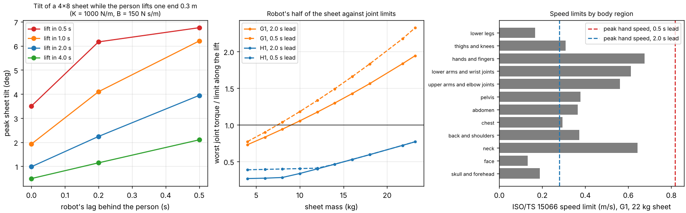

# buildbot-cohold: can a stock Unitree G1 or H1 humanoid hold one end of a sheet while a person leads?

Fifth project of track 20, robots on the residential building site (`PROJECTS.md`, milestone 5). [`buildbot-payload`](../buildbot-payload) found which sheets a standing G1 or H1 can hold with a person; this asks what happens when the person moves. A person lifts their end of a 4x8 sheet 0.3 m, as when raising it to a wall. The robot's hand follows under impedance control. The run scores the sheet's tilt, the load on the person against the NIOSH limit, the robot's joint torques along the lift, and ISO/TS 15066 speed limits for the robot's end of the sheet. Produced with AI assistance (Claude). Simulated and preliminary: a planar rigid-sheet model and static whole-body torque checks, not a closed-loop whole-body simulation.

**Live page:** https://duncan-haywood.github.io/oss-monorepo/research/buildbot-cohold/

**Headline.**
- **The person's load barely changes in a slow lift.** For a 22 kg sheet, the person's pin reaction peaks at 11.1 to 11.5 kg-equivalent when the lift takes 2 to 4 s, against the static half share of 11.0 kg. A 0.5 s snatch raises it to 15.5 to 20.4 kg across the control settings tried, still under the NIOSH constant of 23.1 kg.
- **Lag, not stiffness, tilts the sheet.** The peak tilt follows (hand speed x lag) / sheet length. With the robot 0.2 s behind a 2 s lift it is 2.2 degrees (9 cm of height difference along the sheet); at 0.5 s behind, 3 to 6 degrees (13 to 26 cm). With no following at all (K = 0), the robot end sinks 0.3 m and the sheet ends 7 degrees off level.
- **The robot's own limits bind first.** The **G1** passes its half of the lift only for sheets up to **8 kg** (6 kg in a 0.5 s lead); its waist pitch motor sets the limit, as in `buildbot-payload`. The **H1** passes up to the heaviest sheet tried, **23.2 kg** (a 1/2 in drywall sheet), at 0.77 of its elbow torque limit. A 22 kg sheet is not within the G1's reach, however well it follows.
- **ISO/TS 15066 speed limits sit close to normal lift speeds.** At the robot's end of a 22 kg sheet the standard's body-region formula gives 0.13 m/s for the face, 0.17 for the lower legs and 0.29 for the chest. A 2 s lift moves the robot's hand at up to 0.28 m/s, a 0.5 s lift at 0.82 m/s. These are speeds for an unplanned contact, which a lead-and-follow task does not intend, but they set how fast a robot beside a person should move a heavy sheet, and with the sheet's weight alone the robot's hand force (112 N) is already at the abdomen's 110 N quasi-static limit.



**Not a safety case and not a rated payload.** Nothing here was tested with a robot. A robot holding a sheet beside a person is a falling-object, crush and pinch hazard and needs a risk assessment (ISO 10218, ISO/TS 15066, the site's OSHA duties) before any trial. The body-region numbers were taken from a secondary source and the standard itself was not read.

## Method (`src/buildbot_cohold/model.py`)
- **Sheet.** A rigid rod, 2.44 m long, mass m, pinned to the person's hand at one end and pushed by the robot's hand at the other (planar, x-z). The person's end follows a minimum-jerk path that rises 0.3 m in T seconds. The rod's one degree of freedom is its angle about that pin, integrated at 1 ms. The pin's reaction is what the person carries.
- **Robot hand.** An impedance law: force = half the sheet's weight (feed-forward) + K x (reference - hand position) - B x hand speed. The reference copies the person's end after a lag. Swept: T in {0.5, 1, 2, 4} s, K in {200, 1000, 5000} N/m, B in {50, 150, 400} N s/m, lag in {0, 0.2, 0.5} s (108 runs). The nominal setting is K = 1000, B = 150, lag 0.2 s. These control values are my choices; no robot's controller gains were found, so the conclusion is the sweep's range, not one figure.
- **Robot torques.** Ten samples along the lift plus the instant of peak force. At each, `buildbot_payload` solves the whole-body pose (feet fixed, balance kept, hands at 0.3 m reach and 0.6 m height plus the hand's displacement from the rod) and the static joint torques, extended here to a horizontal hand force. Feasible means every joint inside its limit and both feet pressing down (Menagerie commit `cda5236f`, fetched, not copied; BSD-3-Clause, Unitree Robotics).
- **ISO/TS 15066.** Maximum relative speed v = F / sqrt(mu k) with 1/mu = 1/m_human + 1/m_robot and F, k and m_human per body region from Table 1 of [arXiv:2311.13814](https://arxiv.org/abs/2311.13814) (which reproduces the standard's body model). The robot's mass is the hand's reflected mass (arm and waist, legs and base locked, from MuJoCo's mass matrix: G1 0.7 kg vertical, 1.5 forward; H1 3.7 vertical, 1.0 forward) plus half the sheet.

| Input | Value | Source |
|---|---|---|
| Sheet mass | 22 kg sweep; 21.8 kg OSB (1.5 lb/ft<sup>2</sup>), 23.2 kg drywall (1.6 lb/ft<sup>2</sup>) | `buildbot-payload` (retail listings; USG product tool) |
| Sheet length | 2.44 m | nominal 8 ft |
| Lift | 0.3 m | my choice for raising a sheet to a wall; not sourced |
| Person's lifting limit | 23.1 kg | NIOSH load constant, Waters et al. (1993) |
| Body regions | F_max, k, effective mass | arXiv:2311.13814 Table 1 (the standard's values, secondary source) |
| Joint limits | Menagerie `actuatorfrcrange` / `ctrlrange` | vendor model, not validated |

## Reproduce
```bash
pip install mujoco numpy matplotlib pytest
cd research/buildbot-cohold
python -m pytest -q tests                # 7 tests; two need the Menagerie clone (git + network)
python experiments/run.py > experiments/results.txt   # about 45 s on one CPU, deterministic
python experiments/figure.py
```

## Results (from `experiments/results.txt`)
- **A. Following dynamics, 22 kg sheet.** Robot vertical force peaks at 1.01 to 1.05 times static for 2 to 4 s lifts, up to 1.23 for 1 s and 2.07 for 0.5 s (stiff, lightly damped, no lag). Peak sheet tilt, median over settings: 1.7 degrees (4 s), 3.2 (2 s), 5.0 (1 s), 6.4 (0.5 s). The robot's horizontal force peaks at a median of 0.9 N (4 s), 3.5 N (2 s), 8.5 N (1 s) and 22 N (0.5 s), and at most 25 N for a 2 s lift and 99 N for a 0.5 s one, so it is small beside the 108 N vertical share.
- **B. Torque check.** G1: ratio 0.94 at 8 kg and 1.06 at 10 kg (2 s lead); 1.04 at 8 kg for a 0.5 s lead. Waist pitch is the worst joint in every case. H1: 0.77 at 23.2 kg (right elbow), 0.40 to 0.46 at 12 to 14 kg. These agree with `buildbot-payload` (G1 holds about 4.6 kg at this position, so half of an 8 kg sheet).
- **C. ISO/TS 15066.** Safe speed at the G1's end of a 22 kg sheet runs from 0.13 m/s (face) to 0.68 (hands and fingers); the H1's is within 0.03 m/s of it because the sheet's half dominates the robot mass.
- **Checks.** Tests recover the static half-share split, a released rod's pendulum speed (omega<sup>2</sup> = 3g/L within 1%), the tilt = speed x lag / L relation (within 25%), the standard's formula in its heavy-robot limit, and the torque check against `buildbot-payload`.

## Limitations
- **Planar rigid sheet, one stance.** The robot's feet stay put, its hand moves within reach, and the sheet is rigid and held by a pivoting grip. Walking, turning, a sagging real sheet, a grip with friction and a person's own dynamics are not modelled. The person's hand is a prescribed path, not a body that reacts.
- **Torques are quasi-static** at sampled poses, and use peak, not continuous, motor limits. The robot's own inertia during the motion is left out, as is the whole-body balance's dependence on the horizontal force beyond the foot-force check.
- **The robot model is the community's.** The hand-following law is my idealised impedance controller, not Unitree's.
- **ISO/TS 15066 is used as a speed screen.** The standard's transient and quasi-static limits, pressure limits and its factor-of-two relation between them are not applied; the hand's reflected mass is a locked-base figure; and a lead-and-follow task does not aim the sheet at the person. Read the speeds as how fast a heavy sheet should move near a body, not as a compliance check.
- **No interaction force on the person except the pin reaction.** A person's hands and arms were not scored against the standard's regions.

## Next steps
Close the loop in MuJoCo with the robot's hand as a simulated admittance controller and a simulated person with a body model; apply the standard's pressure limits to the sheet's edge and corner; add walking so the robot can follow a person across a floor (`buildbot-carry`); sweep the follower's lag against a real force-sensing latency once a sourced figure exists.

## Owner steps
None needed. A hardware trial would need a G1 or H1, a risk assessment against ISO 10218 and ISO/TS 15066, and a spotter.

## Outside dependencies (vitamins)
MuJoCo (Apache-2.0), NumPy, Matplotlib and pytest. The Unitree G1 and H1 models come from MuJoCo Menagerie (BSD-3-Clause, © Unitree Robotics) at a pinned commit. The ISO/TS 15066 body-model values were read from arXiv:2311.13814 (the standard is paywalled). Sheet masses and the NIOSH constant follow `buildbot-payload`. No group in `prompt.md` covers construction, and none is claimed.
