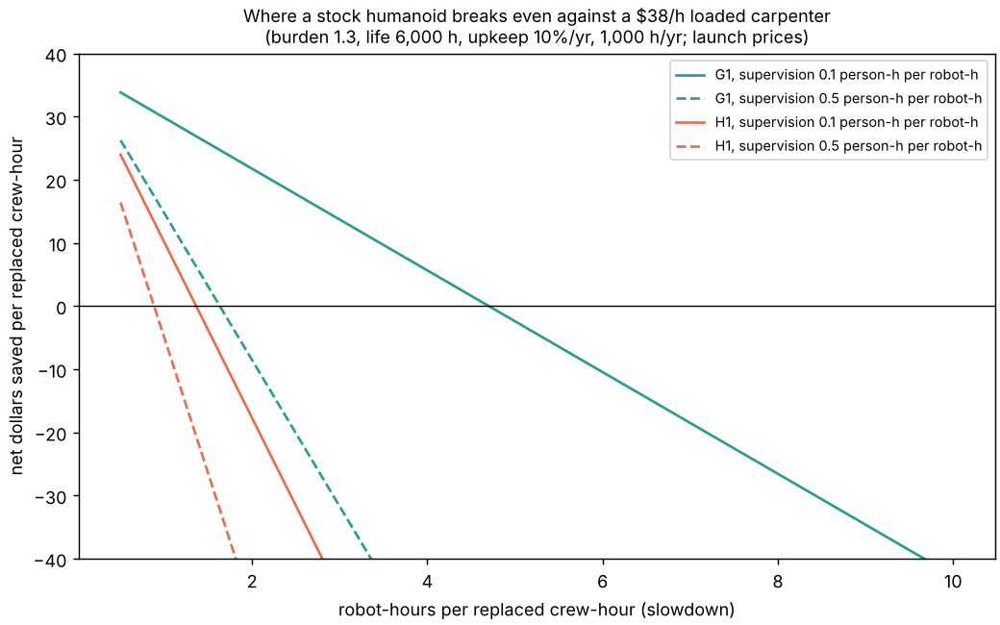

# buildbot-cost: does a stock Unitree humanoid pay for itself on a house site, and how much of a new home's price could it remove?

Third project of track 20, robots on the residential building site (`PROJECTS.md`, milestone 8, taken before 3 to 7 because it needs no robot skill: it prices the hours of [`buildbot-taskbook`](../buildbot-taskbook) against a robot's ownership cost and asks how slow the robot may be before it loses money). Produced with AI assistance (Claude).

**Live page:** https://duncan-haywood.github.io/monorepo-projects/research/buildbot-cost/



**Headline.** For the taskbook's hand tasks, **a robot breaks even only if it is about as fast as the carpenter it replaces**. At a $37.86 loaded hour (BLS median $29.12 times a 1.3 burden) and a person supervising 0.3 hours per robot-hour, the break-even slowdown is **2.4 robot-hours per replaced crew-hour for a G1 ($16,000 launch price) and 1.1 for an H1 ($90,000)**. Over a sweep of wage, burden, slowdown 1 to 10, supervision, success, price, life, upkeep and use, **the G1 saves money in 15% of draws and the H1 in 0.4%**, and the best draw saves $175 (G1) and $226 (H1) on the taskbook's 48-hour scope. The ceiling, a free instant robot taking every payload-passing hour, is **$1,237 (0.19% of NAHB's $665,298 average price) for the H1 and $223 for the G1**. **Both findings rest on slowdown, supervision and success being swept, not measured**: no robot skill is simulated yet. What the sweep does show is what a skill must deliver: be near human speed, with little supervision, on thousands of nailing and screwing cycles.

**Builds on.** [`buildbot-taskbook`](../buildbot-taskbook) (hours per task and the G1 and H1 payload verdicts, read from its `taskbook.json`), [`buildbot-payload`](../buildbot-payload) behind it, and the NAHB anchor of [`house-cost`](../house-cost). No CU Boulder group in `prompt.md` covers construction and none is claimed.

**Not a quote, not a safety case.** Research code. Prices are launch prices from press reports, wages are a national median; nothing here was reviewed by a builder or a robot vendor. A robot handling lumber beside people needs the owner's risk assessment (ISO 10218, ISO/TS 15066, OSHA) first. The report is about hours and dollars, not jobs: what the supervising person still does is the `supervision` term.

## Model (`src/buildbot_cost/model.py`)
- A robot may take a task only if the taskbook's payload test passes for it (hand tasks; force, accuracy and vision untested). H1: 32.1 of 46.4 hours (scenario A) or 67.1 of 93.4 (B); G1: 5.9 or 16.1.
- Per crew-hour replaced the saving is `loaded_wage - slowdown x (rate + supervision x loaded_wage)`, where `rate = price x (1/life_h + upkeep_per_year / used_h_per_year)`. Zero at `s* = loaded_wage / (rate + supervision x loaded_wage)`, which does not depend on the number of hours. Success (share of eligible hours the robot completes; the rest stay with people) scales the hours.
- Scenario **C** is crude and flagged as such: the taskbook covers 23 hours of framing, sheathing and roof, while NAHB's 16.6% framing stage share of $428,215 with `house-cost`'s assumed 45% materials share implies about 1,033 labour hours for an average (2,000 ft<sup>2</sup>, two-storey) house. C scales every task by 44.1 so that the framing-type rows match it. That mixes two different houses and one assumption of `house-cost`; it is an order-of-magnitude upper scope, not a result.

## Inputs
| input | value | source |
|---|---|---|
| Carpenter wage | $29.12/h median (May 2025) | BLS Occupational Outlook Handbook, Carpenters, https://www.bls.gov/ooh/construction-and-extraction/carpenters.htm, read 2026-10-21 |
| G1 price | $16,000 base | launch price, heise, https://heise.de/-9720187 (2024); current price not checked |
| H1 price | $90,000 base | press reports of the 2024 launch (one gives $90,000 to $150,000); current price not checked |
| House price, construction cost | $665,298 and $428,215 | NAHB, *Cost of Constructing a Home in 2024*, Eye on Housing, 2025-01-23 |
| Burden, slowdown, supervision, success, price multiplier, life, upkeep, use | swept (ranges in `results.txt`) | **not sourced**; no measurement exists for these robots on a site |

Prices are vendor and press claims, kept apart from simulated results. The BLS figure is a wage, so burden (taxes, insurance, overhead) is swept 1.0 to 1.6.

## Reproduce
```bash
pip install pytest matplotlib
cd research/buildbot-cost
python -m pytest -q tests                           # 8 tests, stdlib only (reads ../buildbot-taskbook)
python experiments/run.py > experiments/results.txt # under a second, deterministic (4000 draws, seed 1)
python experiments/figure.py                        # experiments/figure.png
```

## Results (from `experiments/results.txt`)
| scenario | robot | eligible crew-h | ceiling (share of price) | P(saves money) | median net | best draw |
|---|---|---|---|---|---|---|
| A, taskbook minutes | G1 | 5.9 | $223 (0.03%) | 0.151 | $-170 | $175 |
| A | H1 | 32.1 | $1,217 (0.18%) | 0.004 | $-3,459 | $222 |
| B, framing at the norm | G1 | 16.1 | $608 (0.09%) | 0.151 | $-465 | $476 |
| B | H1 | 67.1 | $2,539 (0.38%) | 0.004 | $-7,215 | $463 |
| C, cost-scaled (crude) | G1 | 260 | $9,841 (1.5%) | 0.151 | $-7,524 | $7,705 |
| C | H1 | 1,419 | $53,715 (8.1%) | 0.004 | $-152,643 | $9,794 |

- **The H1 is the wrong price for this work.** Its ownership cost is about $24 an hour against a $38 loaded wage, so any slowdown or supervision wipes out the saving (s* 1.6 with no supervision, 0.6 with a person for every robot-hour). The G1 costs $4 an hour, so it has room (s* 8.9 unsupervised), but passes the payload test for few hours.
- **The ceiling is small for this scope** and large only if the scope is scaled to a whole house (scenario C: up to 8.1% of the price for a perfect H1). The gap between the ceiling and the best draw (1.5% in C) is the cost of being slower, supervised and owned.
- **Where a robot could win:** lower ownership cost per hour (longer life, more hours of use), near-human speed and little supervision. The sweep's best draws are all the cheap, fast, lightly supervised corner.

## Limitations
- **No robot skill is measured.** Slowdown, supervision and success are the whole answer and none is observed. `buildbot-carry`, `-fasten` and `-cohold` would replace the sweep with scored simulations (still not a real site).
- **Payload pass is not a skill** (taskbook): nailing force, accuracy and perception are untested, so eligible hours are an upper bound.
- **Taskbook minutes are the taskbook author's assumptions**; scenario B is one cited cross-check and C scales by a `house-cost` assumption on a different house.
- **Launch prices, not quotes**, and ownership ignores charging, transport, setup, insurance and the cost of a robot failing on a site.
- **Labour only.** No effect on schedule (`house-schedule`), quality, rework or risk is priced; speed-ups from overnight work are not credited.
- **Independent draws**: slowdown and supervision are likely correlated in practice; the sweep treats them as free.

## Next steps
Replace the slowdown and supervision ranges with the output of `buildbot-fasten` and `buildbot-carry`, add a fleet-size and schedule term via `house-schedule`, and check the prices against the vendor's current list.

## Owner steps
None needed. A real value needs a robot trial on a mock-up wall with a risk assessment, and a vendor quote.

## Outside dependencies (vitamins)
Python standard library; Matplotlib for the figure; pytest. Reads `research/buildbot-taskbook/experiments/taskbook.json`. Wage, price and house-cost anchors are cited above; the sweep ranges are my assumptions.
