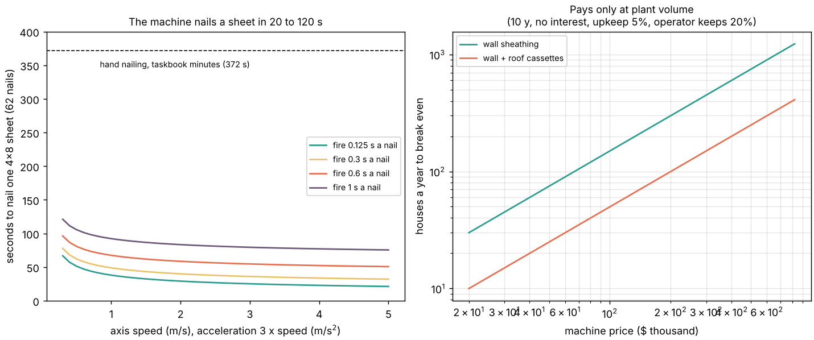

# buildbot-custom: does a purpose-built nailing gantry beat a stock humanoid at fastening sheathing, and at what house volume does it pay?

Fourth project of track 20, robots on the residential building site (`PROJECTS.md`, milestone 7). [`buildbot-taskbook`](../buildbot-taskbook) found fastening the largest verb of the house's hours, [`buildbot-fasten`](../buildbot-fasten) found the stud-face windows tight, and [`buildbot-cost`](../buildbot-cost) found a stock humanoid unlikely to pay. This asks what a machine designed for that one task does instead: a two-axis bridge with a nailer over a panel table, the layout of the nailing bridges used in prefab plants. Produced with AI assistance (Claude).

**Live page:** https://duncan-haywood.github.io/monorepo-projects/research/buildbot-custom/



**Headline.** A gantry with 1 m/s axes, 3 m/s² acceleration and 0.5 s per nail (settling included) nails the 62-nail schedule of a 4x8 sheet in **61 s, 6.1 times faster than hand nailing at the taskbook's minutes (372 s)**; the range over axis speed 0.5 to 5 m/s and 0.125 to 1 s a nail is **20 to 115 s**. Positioning is not the hard part: a sheet needs a **total tip scatter of at most 1.24 mm** (from `buildbot-fasten`'s windows), a belt or screw axis holds 0.1 to 0.5 mm, so what remains is **finding the studs**, with a 0.7 to 1.2 mm budget. The money is the hard part: nailing is **3.3 crew-hours on the walls ($125 a house at a $37.86 loaded hour) and 9.0 hours with roof cassettes ($341)**, so a machine with an unsourced price of $100k breaks even at **150 houses a year on walls only and 50 with the roof** (zero interest, 10 years, upkeep 5%, an operator keeping 20% of the hours). Over a price, life, interest, upkeep and wage sweep the median is **326 houses a year (walls) and 120 (walls and roof)**. On the same wall hours the H1 saves money in 0.4% of draws and the G1 cannot take them. **The machine price and the load, scan and operator times are swept, not sourced**: no quote or time study was read.

**Builds on.** [`buildbot-taskbook`](../buildbot-taskbook) (hours and counts, read from its `taskbook.json`), [`buildbot-fasten`](../buildbot-fasten) (the schedule and the windows, re-derived here without MuJoCo and tested against its 1.24 mm), [`buildbot-cost`](../buildbot-cost) (the humanoid comparison). Nailing bridges: the single-tool bridge patent US 7,954,681 describes firing on the fly along a beam. Kyocera Senco's SmartLoad nailers for bridge systems are listed as driving up to eight nails per second. No CU Boulder group in `prompt.md` covers construction and none is claimed.

**Not a quote, not a safety case.** Research code. Machine prices, scan and load times are my sweeps. A nailing machine is a crush and projectile hazard; it needs guarding and the owner's risk assessment (ISO 10218, OSHA). Nothing here was reviewed by a builder or a machine maker.

## What "purpose-built" means here
The hand-nailing task is a bad fit for a humanoid for three reasons the earlier projects found: the roof deck is out of reach for both stock robots, the G1 cannot press a nailer, and 34 of the 62 nails of a sheet have a ±3.9 mm window. A bridge over a flat panel needs none of the humanoid's legs, arms or balance. The price of that is that the work must come to the machine: wall panels and roof cassettes built flat in a plant or yard, not sheets nailed in place on a standing wall. This is a different business from the track's other robots, and the volume result below is the cost of it.

## Model (`src/buildbot_custom/model.py`, stdlib only)
- **Schedule.** The 62 nails of `buildbot-fasten` (17 pairs on the two vertical joints, 7+7 on the plates, 14 on the two intermediate studs) with the same windows. The test checks 62, 34 joint nails and ±3.9 mm.
- **Cycle.** The carriage visits the nails in a serpentine or greedy order (the faster is reported). Each move is rest-to-rest with a trapezoidal profile (peak speed, acceleration), and the two axes move together, so a leg takes the longer of the two. Each nail costs a fire time that includes settling. This is stop-and-fire; firing on the fly would remove some of it and is not modelled.
- **Positioning budget.** The largest isotropic tip scatter for which 95% of sheets have every nail inside its window (`buildbot-fasten`'s method). Axis repeatability and stud-finding scatter add in quadrature.
- **Economics.** Annual cost is the capital recovery of the price over its life at an interest rate plus upkeep as a share of the price. Saving per house is the booked nailing hours less the share the operator keeps, times the loaded wage. Break-even volume is annual cost over saving per house.

## Inputs
| input | value | source |
|---|---|---|
| Nail schedule and windows | 62 nails, ±3.9 to ±32.5 mm | [`buildbot-fasten`](../buildbot-fasten) (8d common nail, 1.5 in stud face) |
| Hand nailing hours | wall 3.31 h and roof 5.70 h, both at 62 nails a sheet | [`buildbot-taskbook`](../buildbot-taskbook), minutes per nail are the taskbook author's estimate, not a time study; the taskbook was corrected from 72 to 62 nails a sheet on 2026-10-21 |
| Tool ceiling | 8 nails per second | Kyocera Senco SmartLoad listing (vendor claim, tool only, read 2026-10-21) |
| Carpenter wage | $29.12/h, burden 1.3 | BLS Occupational Outlook Handbook; burden from [`buildbot-cost`](../buildbot-cost) |
| Axis speed and acceleration, fire time | swept (0.5 to 5 m/s, 1 to 20 m/s², 0.125 to 1 s) | **not sourced** |
| Machine price, life, interest, upkeep, operator share | swept ($40k to $600k, 7 to 20 y, 4 to 10%, 3 to 12%, 0 to 50%) | **not sourced**; I found no public price for a nailing bridge |
| Scan and load time | 10 to 60 s and 30 to 180 s | **not sourced** |
| Axis repeatability | 0.05 to 1 mm | **not sourced** (a range, not a datasheet) |

## Reproduce
```bash
pip install pytest matplotlib
cd research/buildbot-custom
python -m pytest -q tests                           # 12 tests, stdlib only (reads ../buildbot-taskbook)
python experiments/run.py > experiments/results.txt # under a second, deterministic (4000 draws, seed 1)
python experiments/figure.py                        # experiments/figure.png
```

## Results (from `experiments/results.txt`)
- **Cycle.** Baseline (1 m/s, 3 m/s², 0.5 s a nail): 61.4 s a sheet, travel 30 s and firing 31 s. Doubling the axes saves 9 s; halving the fire time saves 16 s. At the tool's 8 nails per second and 5 m/s the sheet takes 19.5 s. With 20 s of scan and 60 s of loading it is 141 s, 25 sheets an hour and 3.1 machine hours for the 78 sheets of the taskbook house.
- **Positioning.** 1.0 mm total scatter puts 99.7% of sheets in window, 1.5 mm 74%, 2 mm 18%, 3 mm 0.1%. Axis repeatability up to 0.5 mm leaves 1.1 mm for finding the studs; at 1 mm it leaves 0.7.
- **Money.** Walls only: break-even 75, 150, 299 and 599 houses a year at $50k, $100k, $200k and $400k; with roof cassettes 27, 55, 110 and 220. A machine can nail about 650 houses a year at 2,000 machine hours, so volume binds, not capacity. In the sweep, walls: 5% 85, median 326, 95% 1,249 houses; walls and roof: 31, 120 and 459.
- **Against the humanoids.** The H1 passes the payload test for wall nailing (3.3 h): it saves money in 0.4% of draws, median $-356 a house, best $23. The G1 takes none of it. Neither can reach the roof deck.

## Limitations
- **The machine is a model.** No gantry is built, simulated in contact or priced from a quote. Cycle time follows from kinematics and a swept fire time; nail seating, jams, sheet warp and magazine reloads would add to it.
- **The economics rest on an unsourced price** and on the taskbook's hand minutes, which are one author's estimate. The roof case assumes roofs are sheathed as flat cassettes, which the taskbook house does not do. Stud-finding scatter is a budget, not a vision system tested here.
- **Only labour at the nailing step is priced.** Panel handling, the crane or lifter, floor space, financing risk and the cost of idle time are not. A plant also builds panels the taskbook does not cover, which would lower the volume needed. Repeat savings from re-using the machine across the framing (studs, plates, trusses) are not credited.
- **Prefab machines exist.** This is not a new invention: nailing bridges are sold for panel lines. What is new here is the like-for-like comparison with the stock humanoids on one house's hours.
- **Draws are independent**; price, life and upkeep likely correlate.

## Next steps
Read a nailing-bridge quote and a time study to replace the swept price and minutes; simulate the carriage with its drive dynamics and fire on the fly; extend to the other fastening tasks (plates and studs, drywall screws D5), and take the full panel line, not one tool, through `house-offsite`.

## Owner steps
None needed. A real number needs a vendor quote for a nailing bridge and a visit to a plant.

## Outside dependencies (vitamins)
Python standard library; Matplotlib for the figure; pytest. Reads `research/buildbot-taskbook/experiments/taskbook.json` and `research/buildbot-cost/src` (stdlib). Sources: [US 7,954,681, single tool nailing bridge system](https://image-ppubs.uspto.gov/dirsearch-public/print/downloadPdf/7954681) and the [Kyocera Senco SmartLoad listing](https://www.foodmanufacturing.com/home/fastening-assembly/product/22923023/kyocera-senco-industrial-tools-smartload-line-of-tools-fasteners-and-accessories), both found by search and read as result snippets, not in full.
