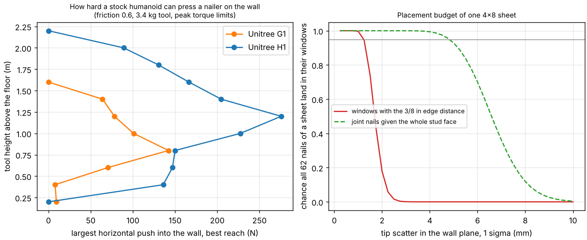

# buildbot-fasten: can a stock Unitree G1 or H1 humanoid nail sheathing to a stud-face tolerance?

Third project of track 20, robots on the residential building site (`PROJECTS.md`, milestone 4). [`buildbot-payload`](../buildbot-payload) showed a stock humanoid can hold a nailer; [`buildbot-taskbook`](../buildbot-taskbook) showed fastening is the biggest verb. This asks the next question: can it press the tool into the wall, and how exactly must it place each nail? It writes the nailing schedule of one 4x8 sheet with a landing window per nail, then computes from the open MuJoCo Menagerie G1 and H1 models how hard each can push and how much joint error the windows allow. Produced with AI assistance (Claude).

**Live page:** https://duncan-haywood.github.io/oss-monorepo/research/buildbot-fasten/

**Headline.** One sheet is **62 nails**, and **34 of them (the two sheet joints) have a window of only ±3.9 mm**: a nail must be 3/8 in from the panel edge yet on the stud half under the sheet. For the whole sheet to land inside its windows with 95% probability, the tool tip needs a scatter of **at most 1.24 mm (1 sigma)**; without the edge-distance band it would be 4.8 mm. Through the robots' own kinematics (feet planted) 1° of independent error on every joint scatters the tip **10 to 24 mm**, so the joints need about **0.05 to 0.11° (1 sigma)**. That is easy for the joints alone (11-bit sensors already give 0.9 mm on the G1 and 0.7 mm on the H1 in the model, with no backlash, deflection or calibration error) and leaves **seeing the stud** (perception and standing position, not modelled) with a total budget near 1 mm. On force, the **G1 pushes at most 8 to 142 N** (its 5 N·m wrist pitch and 50 N·m waist limit it, and it reaches only 0.3 to 0.4 m) and covers tool heights 0.6 to 1.4 m, so **18 of 62 nails from one stance**; the **H1 pushes 82 to 276 N** (elbows limit it) over 0.4 to 2.0 m, **36 of 62**. Nothing here is tested on hardware, and a nailer's recoil and trip force are not modelled.

**Not a rated force or accuracy.** Simulated static limits from community models at their peak torque. No claim about a real robot's repeatability: no figure for Unitree's was found (see Limitations). A robot driving nails near people is a hazard needing a risk assessment (ISO 10218, ISO/TS 15066).

## Method (`src/buildbot_fasten/model.py`; builds on `buildbot_payload`)
- **Schedule** (`schedule`). A 4x8 sheet on end, 6 in on the edges and 12 in in the field, studs at 16 in on centre: 34 joint nails (17 per vertical edge), 7 bottom-plate, 7 top-plate, 14 field (7 on each of the two intermediate studs) = 62. The taskbook had booked 72 a sheet (three interior studs; a 4 ft sheet has two); it was corrected to 62 on 2026-10-21, with `buildbot-cost` and `buildbot-custom` re-run.
- **Windows** (`band`). Each nail has a band to land in, with its centre at the nominal position. Stud face 1.5 in (dressed 2x), nail 8d common, 0.131 in shank, edge distance at least 3/8 in. Vertical sheet edges lie on a stud centre (a joint shared with the next sheet): band 0.375 in to 0.75 in minus the nail radius, ±3.9 mm. Bottom edge flush with a single plate (±13.5 mm in z), top edge with a double plate (±32.5 mm), field nails anywhere on the stud face (±17.4 mm). Sheet success is the product over nails of the Gaussian chance each is inside (`sheet_success`; independent errors, y limiting stud nails, z plate nails).
- **Push** (`push_limit`). The tool (3.4 kg) is held in both hands at (reach x, height z) and the robot presses horizontally with force F into a wall. The pose from `buildbot_payload.pose` leans the centre of mass forward by F·z/W so the ground reaction passes through the middle of the feet. Joint torques come from gravity, the tool and the wall force, with the ground wrench split minimum-norm between the feet. Feasible means all joints within torque limits, both feet loaded, and horizontal ground force at most mu times vertical. F is bisected to 1 N. The torque balance is tested against MuJoCo forward dynamics.
- **Tip scatter** (`tip_jacobian`). The Jacobian of the right hand point with respect to the actuated joints, with the floating base moving by the pseudo-inverse of the foot Jacobian to keep both soles planted. Scatter for independent Gaussian joint errors is the norm of the y or z row times sigma. Tested against a finite perturbation with the feet re-planted by Gauss-Newton.

## Results (`experiments/results.txt`, `results.json`; `python3 experiments/run.py`, about 3 min on one CPU, deterministic)
Models: Menagerie `cda5236f` (BSD-3-Clause, fetched, not copied). Nail windows are from the sources below; the push needed to seat a nailer and the friction coefficient have no sourced value, so they are swept.
- **Budget.** Whole sheet inside its windows: 50% at 1.69 mm, 90% at 1.33, 95% at 1.24, 99% at 1.09 mm (equal y and z). The joint nails bind: with the edge band removed the 95% figure is 4.82 mm.
- **G1 push** (mu 0.6): 8 to 142 N; only 4 cells (reach 0.3 to 0.4 m, tool height 0.8 to 1.0 m) exceed 80 N. Limits: waist pitch (4 cells), wrist pitch (6 cells). It cannot reach the wall at 0.5 m with the tool, and not above 1.4 m. Heights 0.6 to 1.4 m are usable, 18/62 nails of a sheet.
- **H1 push**: 82 to 276 N, mostly 120 to 160 N, elbows limiting (27 of the 28 feasible cells at mu 0.6); with mu 0.3 six cells become friction-limited. Heights 0.4 to 2.0 m at 20 N, 0.4 to 1.8 m at 100 N: 34 to 36 of 62 nails. The top 0.4 m of an 8 ft sheet and the lowest edge need a lift or a person.
- **Joint error.** Tip scatter per degree of independent error on every joint is 13 to 24 mm (G1) and 9 to 19 mm (H1), y or z, so a 95% sheet needs 0.05 to 0.09° (G1) and 0.07 to 0.11° (H1). Sensor quantisation alone (step 360°/2^bits, error step/√12) at the stud-height pose: 10 bits fails (G1 30% of sheets, H1 85%), 11 bits or more passes.

## Limitations
- **Not a policy.** The milestone asked for a policy that drives the schedule. This delivers the schedule, the windows, the push envelope and the error budget (the specification and test scene a policy is scored on). No policy was trained, and no contact, tool recoil or nail-driving dynamics are simulated.
- **No sourced trip force or recoil.** A search found no contact-trip force for a framing nailer; Senco lists a 780 in-lb impact energy at 100 psi in one model's listing, with inconsistent units on the page, so I did not use it. Push needed is swept at 20, 50 and 100 N. Recoil is an impulse, not a static push, and is not modelled.
- **No sourced Unitree repeatability.** A search found only "dual encoders" with no resolution or backlash. The bit table is arithmetic, not a claim about their sensors. Deflection under load, backlash and calibration, which usually dominate, are not modelled; joint errors are assumed independent and Gaussian.
- **The window rules are from secondary sources.** The 3/8 in edge distance and 8d common nails at 6/12 in come from builders' guides and a code summary found by search, not the APA or code document; nail diameter is the common 8d figure. Check them against the governing code before any use.
- **The pose is the nearest feasible one**, not the best, so the push grid is not smooth (for example 276 N at one cell beside 159 N). One stance only: moving the feet along the wall, the lateral reach and the perception that finds the stud are not modelled. The right hand is the tip; the nailer's own length is ignored. Friction mu 0.3 and 0.6 are swept, not sourced.

## Next steps
Model the nailer's recoil as an impulse and its trip force once a source exists; add backlash and compliance to the error budget; add stud-finding perception as the dominant term; then train a policy on this scene, or take the sheet-holding case to `buildbot-cohold`. (`buildbot-taskbook` now books 62 nails a sheet, corrected 2026-10-21.)

## Owner steps
None needed. A hardware check needs a robot, a mock-up wall and a risk assessment.

## Outside dependencies (vitamins)
MuJoCo (Apache-2.0), NumPy, Matplotlib (figure), pytest; reads `../buildbot-payload`, whose Unitree models come from MuJoCo Menagerie (BSD-3-Clause, © Unitree Robotics). Sources, read 2026-10-21 through search results: the Metabo HPT NR90AES1 listing for the 3.4 kg tool (<https://metabo-hpt.com/products/product/plastic-collated-framing-nailer-metabo-hpt-nr90aes1>); the sheathing schedule and edge distance from builders' guides and a code summary, e.g. <https://builderonline.com/building/6-steps-to-sheathing-success_o>. No group in `prompt.md` covers construction, and none is claimed.
