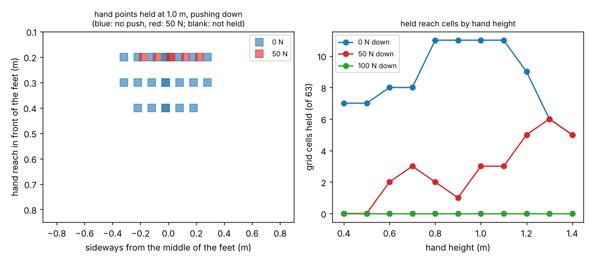

# buildbot-flatsheet: can a G1 humanoid nail a 4x8 sheet lying flat on a table?

Track 20, robots on the residential building site (`PROJECTS.md`, milestone 4). [`buildbot-stance`](../buildbot-stance) found a Unitree G1 needs about 13 stances at 5 platform heights to nail a sheet standing on a wall, and listed "nail sheets flat on a table" as a next step. This asks whether laying the sheet on a panelising table helps: with its feet planted beside the table, which hand points can the G1 hold a 3.4 kg nailer at while pushing straight down, and how many stances does a sheet need? Produced with AI assistance (Claude). Simulated and preliminary. **The push needed to seat a nail, the nailer's length in the hands, the standoff from the table and the re-stance time are not measured**; each is swept.

**Live page:** https://duncan-haywood.github.io/oss-monorepo/research/buildbot-flatsheet/

**Headline (a negative result).**
- **A table does not help this model of the G1.** Pushing down at 50 N, the G1 holds only **30 of 693 grid cells** (reach 0.2 to 0.8 m, sideways 0 to 0.8 m, hand height 0.4 to 1.4 m); with no push, 94. At 100 N it holds **none**. Hand reach is mostly limited by the waist pitch motor and the wrist pitch motors, and beyond 0.5 m forward by the solver's balance rule (the centre of mass stays over the feet).
- **Best case: 48 of the 62 nails, in 16 stances.** On a table 1.0 to 1.1 m high (hands 1.2 to 1.3 m up) and the feet 0.25 m from the edge, greedy cover of the four sides of the table reaches 48 nails and no more; the other 14 are never held. With the feet 0.15 m from the edge almost nothing is reachable. Against the wall (`buildbot-stance`: 62 nails, 13 stances on platforms) the flat sheet is worse, not better.
- **Time.** Those 48 nails take 43 to 54 s of tip moves and firing plus 15 re-stances: 88 to 99 s at 5 s each, and equal to the 372 s hand estimate of [`buildbot-taskbook`](../buildbot-taskbook) (for all 62 nails) at **23 to 24 s per re-stance**. At a mobile base's 2 s re-stance it is 43 to 54 s, but that is the same arms with wheels and the 14 unreachable nails still need a person.



**Not a rated reach or time.** Static whole-body inverse kinematics on a community model, no collisions with the table, no walking, no recoil. The IK keeps the centre of mass over the feet and stays near the home pose, so a deliberate lean or crouch could hold points marked unreachable: the result is an upper bound on difficulty, not a proven limit. Nothing here was tested on hardware. A robot nailing beside people needs a risk assessment (ISO 10218, ISO/TS 15066).

## Builds on
[`buildbot-stance`](../buildbot-stance) (the stance planner and time model), [`buildbot-payload`](../buildbot-payload) (whole-body pose and torque model), [`buildbot-fasten`](../buildbot-fasten) (the ground-wrench check, the nailer and the 62-nail schedule) and [`buildbot-custom`](../buildbot-custom) (nail order and move times). No group in `prompt.md` covers construction, and none is claimed.

## Method
- **Reach grid** (`experiments/reach.py`, MuJoCo, about 10 min). The Menagerie G1 at commit `cda5236f` (BSD-3-Clause, © Unitree Robotics; fetched, not copied) stands with soles fixed. For hand reach x = 0.2 to 0.8 m, sideways dy = 0 to 0.8 m and height z = 0.4 to 1.4 m (0.1 steps), whole-body IK puts both palms there holding the 3.4 kg nailer (Metabo HPT NR90AES1 listing). A downward push of 0, 50 or 100 N plus the tool weight is applied through the hands; a cell is **held** when the IK converges, no body is below the floor, every joint is inside its torque limit, both feet press down and the horizontal foot force stays inside a friction cone of mu 0.3 or 0.6. Left and right agree in **616 of 616** mirror cells.
- **Table geometry** (`src/buildbot_flatsheet/model.py`). The 62 nails of `buildbot-custom` lie on a 1.22 x 2.44 m top (length u = the wall's height, width v = the wall's horizontal position). The hands are `off` above the table top (0.2 or 0.3 m, nailer length in the hands). The robot stands at a standoff s (0.15 or 0.25 m) outside any of four edges; a nail is covered when the four surrounding grid cells of its (reach, sideways) are held (conservative), or the nearest one (generous). Stances are chosen by greedy set cover at 5 cm steps.
- **Time.** Within a stance the tip visits that stance's nails in the serpentine order of `buildbot-custom` (0.5 m/s and 2 m/s², or 4 m/s and 10 m/s², 0.1 s per nail as `buildbot-nailseq`), and each later stance adds a swept re-stance time.

| Input | Value | Source |
|---|---|---|
| Robot | Menagerie G1, 33.3 kg | vendor model, BSD-3-Clause, not validated |
| Nailer mass | 3.4 kg | Metabo HPT NR90AES1 listing, 7.5 lb |
| Push to seat a nail | 0, 50, 100 N | **swept**; no maker figure found |
| Hand height above the sheet | 0.2, 0.3 m | **swept**; nailer length not measured |
| Feet standoff from table edge | 0.15, 0.25 m | **swept**; foot length plus clearance, not measured |
| Foot friction | 0.3, 0.6 | **swept** (vertical push, so rarely binds) |
| Re-stance time | 2 to 40 s | **swept**; no G1 figure found |
| Hand time | 372 s | `buildbot-taskbook` (an estimate, not a time study) |

## Reproduce
```bash
pip install mujoco numpy matplotlib pytest      # MuJoCo and network (Menagerie clone) are needed only for reach.py
cd research/buildbot-flatsheet
python -m pytest -q tests                       # 8 tests, no MuJoCo needed
python experiments/reach.py                     # about 10 min, writes reach.json
python experiments/run.py > experiments/results.txt   # seconds, writes results.json
python experiments/figure.py
```

## Results (`experiments/results.txt`)
- **A.** Left/right mirror: 616/616.
- **B and C.** Held cells by hand height at 50 N are 0 to 6 of 63, against 5 to 11 unpushed; none at 100 N. At 1.0 m only reach 0.2 m and up to 0.2 m sideways is held.
- **D.** Stances by table height (0.2 to 1.1 m), both hand offsets and both standoffs: at standoff 0.15 m no table height covers more than a handful of nails; at 0.25 m and a 0.2 m hand offset only tables 1.0 and 1.1 m cover more than 4 nails under the conservative rule (25 and 16 stances for 48 nails); the generous rule gives 24 and 16, and 44 stances for 48 nails at 0.6 m, an artefact of one isolated held cell.
- **E.** 0 N: 48 nails in 16 stances; 50 N: 48 in 16 (table 1.1 m); 100 N: none.
- **F.** Time for the 48 nails in 16 stances: 54 / 99 / 174 / 324 / 624 s at 2 / 5 / 10 / 20 / 40 s per re-stance (0.5 m/s), 43 to 613 s at 4 m/s.

## Limitations
- **Table height range.** Tables of 0.2 to 1.1 m; hand heights above 1.4 m were not run.
- **No search for the best posture.** A forward lean with a back-held stance, a one-knee crouch or a stepping pattern might hold points marked unreachable; so might walking around the table instead of planting the feet. The result is for planted feet only.
- **No collisions.** The robot's legs and torso may hit the table edge; the standoff is a guess, so reach beyond 0.25 m is optimistic.
- **Greedy cover, coarse grid.** 0.1 m steps; the stance count moves between the two grid rules.
- **Time compares unlike things.** The 48-nail time is not the 62-nail hand estimate; the break-even is indicative.

## Next steps
Search the posture (torque-optimal crouch, lean) and allow a step between nails with the whole-body controller of `buildbot-carry`; try a sheet on a raised, narrower table so both hands can reach the far edge; compare a tracked base carrying the G1's upper body.

## Owner steps
None needed. A hardware check needs a G1, a nailer and a table, and a risk assessment.

## Outside dependencies (vitamins)
MuJoCo (Apache-2.0), NumPy, Matplotlib, pytest. Unitree G1 model from MuJoCo Menagerie (BSD-3-Clause, © Unitree Robotics), fetched and not copied by `buildbot-payload`.
