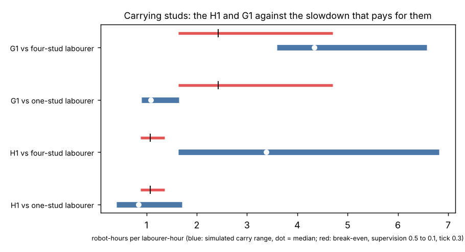

# buildbot-grounded: with the simulated carry and nailing results in place of a swept slowdown, does a stock humanoid pay on a house site?

Track 20, robots on the residential building site (`PROJECTS.md`, "Next steps" of [`buildbot-cost`](../buildbot-cost)). `buildbot-cost` swept the robot's slowdown over 1 to 10 because no skill was simulated. [`buildbot-carry`](../buildbot-carry) and [`buildbot-fasten`](../buildbot-fasten) have now landed, so this reads their `results.json` and replaces the swept inputs with simulated ones where they exist. Produced with AI assistance (Claude).

**Live page:** https://duncan-haywood.github.io/monorepo-projects/research/buildbot-grounded/

**Headline.** At a $37.86 loaded hour and 0.3 supervision, an H1 breaks even at **1.07 robot-hours per replaced crew-hour** and a G1 at **2.42**. The simulated carry slowdown of the **H1 against a labourer who carries one stud a trip is 0.41 to 1.70 (median 0.85)**: it pays in 72% of the 36 cells of the grid. **Against a labourer who carries a bundle of four it is 1.63 to 6.82 (median 3.38) and never pays.** The G1 (one stud only, 3.8 kg) is 0.90 to 1.64 against the one-stud labourer (always below its 2.42) and 3.59 to 6.57 against the bundle (never below 2.42 at 0.3 supervision). So **whether a stock humanoid pays for carrying depends on how the crew carries**, not on the robot: the simulation cannot settle it, and the taskbook's own carry rate (3.3 pieces a minute) sits between the two labourers. Whatever the answer, the dollars are small: the H1's whole framing-carry task is 1.05 crew-hours, a **$40 ceiling (0.006% of an average price)**, and nailing a sheet's reachable 58% (H1) or 29% (G1) of its 62 nails caps at $31 to $73 (H1) and $15 to $36 (G1) per house. Nothing is tested on hardware.

**Not a quote, not a safety case.** A robot handling lumber near people needs a risk assessment (ISO 10218, ISO/TS 15066, OSHA). The inputs are model outputs of other projects, each with its own limits; this one adds no new physics.

## Method (`src/buildbot_grounded/model.py`)
- **Carry slowdown.** From `buildbot-carry/experiments/results.json` ("rates"), each cell of the grid (step time 0.4 to 0.8 s, haul 5, 15 or 30 m each way, handling 10, 20 or 40 s) gives the robot's pieces a minute and the labourer's (1.1 m/s walking, one stud or a bundle of four). Slowdown = labourer pieces a minute over robot pieces a minute, robot-hours per labourer-hour for the same pieces. The robot chooses its pieces per trip.
- **Break-even.** `buildbot-cost`'s `breakeven_slowdown`, imported from that project, at its central inputs: carpenter median $29.12/h (BLS, May 2025) times 1.3, robot life 6,000 h, upkeep 10%/yr, 1,000 h/yr, launch prices $16,000 (G1) and $90,000 (H1).
- **Nails.** The share of a sheet's 62 nails whose tool height the robot can press at (20 or 100 N, mu 0.6), from `buildbot-fasten`'s "coverage". The rest stay with a person.
- **Per house.** Taskbook hours (scenario A) times the reachable share times `net_per_replaced_hour`.

## Results (`experiments/results.txt`, `results.json`; `python3 experiments/run.py`, under a second, deterministic)
| robot | s* at supervision 0.1 / 0.3 / 0.5 | slowdown vs one-stud labourer (min / median / max) | share of cells below s* | slowdown vs four-stud labourer | share below s* |
|---|---|---|---|---|---|
| H1 | 1.36 / 1.07 / 0.88 | 0.41 / 0.85 / 1.70 | 92 / 72 / 58% | 1.63 / 3.38 / 6.82 | 0 / 0 / 0% |
| G1 | 4.70 / 2.42 / 1.63 | 0.90 / 1.08 / 1.64 | 100 / 100 / 97% | 3.59 / 4.34 / 6.57 | 64 / 0 / 0% |

Per house, taskbook scenario A, supervision 0.3 (dollars; ceiling is a free instant robot on the reachable hours):

| task | robot | hours | reachable | ceiling | at slowdown 1 | at slowdown 3 |
|---|---|---|---|---|---|---|
| F2 carry | H1 | 1.05 | 100% | $40 | $3 | &minus;$72 |
| F5 fasten (framing) | H1 | 1.40 | 58% | $31 | $2 | &minus;$55 |
| F5 fasten (framing) | G1 | 1.40 | 29% | $15 | $9 | &minus;$4 |
| S4 fasten (sheathing) | H1 | 3.31 | 58% | $73 | $5 | &minus;$131 |
| S4 fasten (sheathing) | G1 | 3.31 | 29% | $36 | $21 | &minus;$9 |

What this adds to `buildbot-cost`: its sweep put the G1 in the money in 15% of draws and the H1 in 0.4%, on guessed slowdowns. The simulated carry slowdowns land near the break-even for the H1 (about 1) rather than far above it, so the H1's carry task is a coin-flip on labourer behaviour and not a lost cause; the dollars it moves are tens per house.

## Limitations
- **Mass mismatch.** `buildbot-carry` uses 3.8 kg 2x4 studs; the taskbook's house is 2x6 framing with a 5.81 kg mean piece (10.1 kg heaviest). The H1's carry numbers are optimistic for that house, and its G1 limit (3.8 kg) is below the mean piece, so the taskbook (rightly) rejects the G1 for F2; the G1 carry rows describe 2x4 studs, not this house.
- **Fasten is coverage, not speed.** `buildbot-fasten` gives where a robot can press and how exactly it must place, not nails a minute, so the nailing rows show only a ceiling and two slowdown points. The taskbook marks the G1 `no` for F5 and S4 (static payload with a 3.4 kg tool); `buildbot-fasten` finds the G1 can press at 20 N at 0.6 to 1.4 m. The G1 rows take the fasten verdict and are an upper bound.
- **Only two skills.** Carry (envelope, not a walking policy: see that README) and nailing reach; cutting, placing, holding and finishing hours are not grounded. The carry slowdown is an upper-bound gait, so a better gait could do better.
- **The labourer side is `buildbot-carry`'s assumption** (speed 1.1 m/s, bundle of four, handling 10 to 40 s); nothing here is a time study. Supervision, life, upkeep, use and the launch prices are those of `buildbot-cost` (central values, not re-swept; its sweep covers them).

## Next steps
A walking policy that scores falls and drops, which would replace the carry model's gait; a nails-a-minute figure for fastening (needs a contact model); a time study of how crews actually carry studs, which decides the one-stud/bundle question above.

## Owner steps
None needed. A real value needs a robot trial on a mock-up wall with a risk assessment, and a vendor quote.

## Outside dependencies (vitamins)
Python standard library; Matplotlib for the figure; pytest. Reads `results.json` of `buildbot-carry` and `buildbot-fasten`, `taskbook.json` of `buildbot-taskbook`, and imports `buildbot_cost`. Wage and price anchors are cited in `buildbot-cost`.
