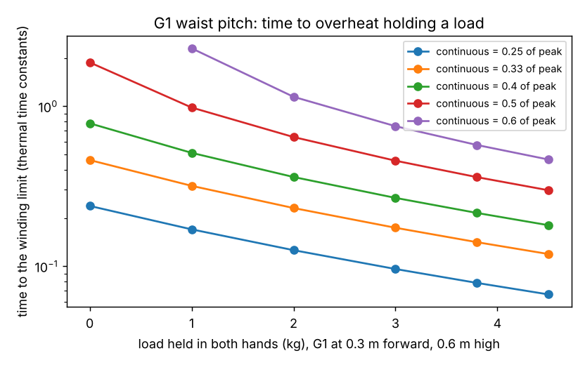

# buildbot-holdheat: how long can a Unitree G1 hold a building load before its motors overheat?

Track 20, robots on the residential building site (`PROJECTS.md`; the "Limitations" of [`buildbot-payload`](../buildbot-payload) and the draw question left by [`buildbot-shift`](../buildbot-shift)). `buildbot-payload` accepts a load if every joint stays under its **peak** torque. A motor can only hold a fraction of peak indefinitely, so this re-reads the same MuJoCo static torques against a continuous rating and a first-order thermal model. Produced with AI assistance (Claude). Simulated and preliminary; no robot was tested; builds on no group in `prompt.md`.

**Live page:** https://duncan-haywood.github.io/oss-monorepo/research/buildbot-holdheat/

**Headline.** At the stud-carry pose (hands 0.3 m ahead of the feet, 0.6 m high, centre of mass kept over the feet), the G1's **waist pitch motor is at 0.54 of its 50 N·m peak with empty hands**, 0.91 with a 3.8 kg 2x4 and 0.98 with 4.5 kg. If a motor's continuous rating is a fraction ρ of peak, **nothing is sustainable at this pose for ρ ≤ 0.5**; at ρ = 0.6 only 0.62 kg is. With copper loss ∝ torque², the 2x4 reaches the winding limit in **0.14 thermal time constants at ρ = 1/3** (0.36 at 0.5, 0.58 at 0.6). A 3.4 kg framing nailer at stud height (1.0 m, 0.4 m ahead) sits at 0.76 of peak with the same waist limit (0.97 time constants at ρ = 0.6, 0.32 at 0.4). One end of a sheet with a person, or a lightweight block, needs 1.5 to 2.5 times the peak and was already a "no" in `buildbot-payload`. So the peak-torque "yes" for a stud is a short-hold "yes": the verdicts that matter for a shift are the continuous ones.



**Pose search (added 2026-10-23).** The 0.54 and 0.91 above are for one chosen posture, not the best one. A 150-pose grid over hand reach (0.15 to 0.35 m), hand height (0.4 to 0.9 m) and balanced-CoM offset (−0.02 to +0.06 m) holding the 3.8 kg stud finds **0.33 of peak at hands 0.15 m ahead and 0.7 m high** (binding joint: wrist pitch, not the waist), against 0.91 at the original pose; at ρ = 0.4, 0.5 and 0.6 that pose is sustainable (hold time infinite) where the original reaches the limit in 0.21, 0.36 and 0.57 time constants. The verdict "a stud is a short-hold task" depends on posture: carried close in, with the arms nearly hanging, it is not, at the cost of the stud riding in front of the thighs (not checked). `experiments/posesearch.py`, output in `experiments/posesearch.txt`.

**Not a rated runtime or payload.** ρ and the thermal time constant are not known for this robot; only dimensionless hold times are reported, and they are model outputs. Carrying lumber near people needs a risk assessment (ISO 10218, ISO/TS 15066).

## Method
- **Torques.** `experiments/run.py` imports `buildbot-payload`'s `pose` and `torques` (MuJoCo Menagerie G1 at commit `cda5236f`, fetched not copied; BSD-3-Clause © Unitree Robotics) and takes u = |τ|/τ_peak per joint from the same static solution (feet fixed, CoM over the feet, load split between the hands).
- **Thermal model** (`buildbot_holdheat.hold_time`). Winding temperature rise follows dT/dt = (u/ρ)² − T in units where the limit is 1 and time is in thermal time constants. Holding at u > ρ reaches the limit at t = −ln(1 − (ρ/u)²); u ≤ ρ never does. Tested against closed form and Euler integration. Only the winding limit is modelled: no gearbox, no cooling that changes with pose, no iron loss, no resistance rise with temperature (which would make it worse).
- **Loss ratio.** Σu² loaded over unloaded, assuming every joint has equal loss at peak torque (a simplification, reported as a rough guide).

| Input | Value | Source |
|---|---|---|
| Joint peak torques | G1 `actuatorfrcrange`, 5 to 139 N·m | MuJoCo Menagerie G1 model (community approximation, not vendor-validated) |
| Task masses and poses | as `buildbot-payload` | see its table (NDS, USG, retail listings, TMS) |
| Continuous / peak ratio ρ | **swept 0.25 to 0.6** | not found for the G1 or its motors; the range is a plausible spread, not a source |
| Thermal time constant | **not needed**: times are in units of it | not found; small frameless motors are typically minutes, which is unverified here |

## Reproduce
```bash
pip install mujoco numpy matplotlib pytest
cd research/buildbot-holdheat
python -m pytest -q tests          # 5 tests, no network
python experiments/run.py > experiments/results.txt   # about 1 min, needs the Menagerie clone of buildbot-payload
python experiments/figure.py
python experiments/posesearch.py > experiments/posesearch.txt   # about 1 min
```

## Results (from `experiments/results.txt`)
- **B. Load sweep at the stud pose.** u_max for 0, 1, 2, 3, 3.8, 4.5 kg: 0.54, 0.63, 0.73, 0.83, 0.91, 0.98 (waist pitch each time). Hold time in time constants at ρ = 1/3 (0.33 in the table): 0.46, 0.32, 0.23, 0.17, 0.14, 0.12; at ρ = 0.6: infinite, 2.30, 1.14, 0.75, 0.57, 0.46.
- **C. Sustainable load** (u_max = ρ): none for ρ = 0.25, 0.33, 0.4, 0.5; 0.62 kg for 0.6.
- **A. Tasks.** Stud 0.91 (loss 3.7x the unloaded pose), 2x6 1.15, nailer 0.76, OSB end 1.89, lightweight block 2.48, drywall end 1.49, whole OSB sheet 4.0. The normal block, the 60 lb bag and the ceiling drywall do not have a reachable pose.

## Limitations
- **Pose-search caveats (2026-10-23).** A coarse grid with a local IK solver: u_max is not monotonic in hand height (0.60 at 0.5 m, 0.44 at 0.6 m, 0.33 at 0.7 m), so the grid minimum is an upper bound on the true minimum, not the optimum. Self-collision was checked on the robot's own collision geoms only (0 of 150 poses flagged; a control with hands 0.06 m apart flags 8 body pairs); the stud itself is not modelled, so it may hit the thighs at 0.15 m reach, and a 2.4 m stud held at the sides of the body is a different grip from "both palms under it". Wrist pitch becomes the binding joint, a small motor whose continuous rating is as unknown as the waist's. Still static.
- The pose is `buildbot-payload`'s balanced, not torque-optimal, posture: leaning back against a forward load costs the waist even when empty. A pose search (arms close in, knees bent, or elbow-on-hip) could move the unloaded 0.54, and that is the first thing to try. The carry is not static either; walking adds dynamic torque.
- Waist pitch binds in every row, so the result is about one motor; a robot with a waist brace or a belt-supported load is a different robot.
- ρ is swept because no continuous rating was found. A datasheet figure for the G1's 50 N·m waist actuator, or a measured current while holding, replaces the sweep.

## Next steps
Model the stud's own geometry and the thigh clearance in the pose search, and refine the grid with a local optimiser; add dynamic torque from the `buildbot-carry` gait; replace the ρ sweep with a datasheet or metered value (owner step: a G1 with current logging on a mock-up wall); feed hold time into `buildbot-shift`'s draw.

## Owner steps
None needed. A real value needs a G1 with motor temperature or current logging, a mock-up wall and a risk assessment (ISO 10218, ISO/TS 15066).

## Outside dependencies (vitamins)
NumPy, Matplotlib, pytest; MuJoCo (Apache-2.0) and the Menagerie G1 model through `buildbot-payload`. No CU Boulder group in `prompt.md` covers construction and none is claimed.
