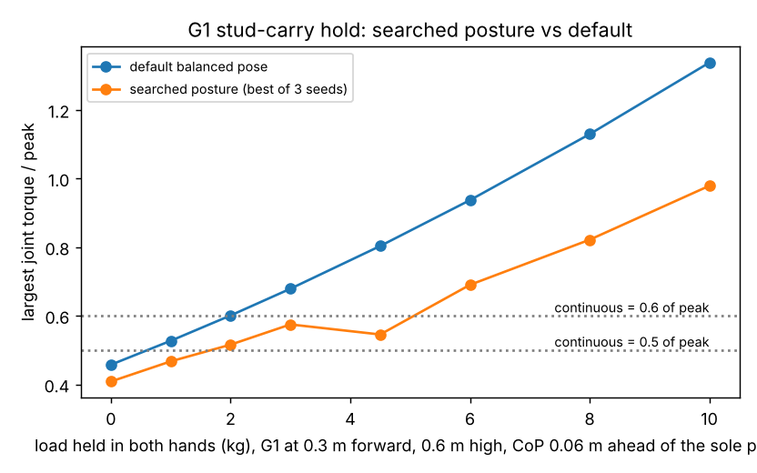

# buildbot-holdpose: does a searched posture let a Unitree G1 hold a stud longer than the default pose?

Track 20, robots on the residential building site (`PROJECTS.md`). The first "next step" of [`buildbot-holdheat`](../buildbot-holdheat) said the waist already sits at 0.54 of peak with empty hands at the stud-carry pose, and that "a pose search could move it". This runs that search. Produced with AI assistance (Claude). Simulated and preliminary; no robot was tested; builds on no group in `prompt.md`.

**Live page:** https://duncan-haywood.github.io/oss-monorepo/research/buildbot-holdpose/

**Headline.** For a 3.8 kg 2x4 held 0.3 m ahead and 0.6 m high, the G1's largest joint torque is **0.91 of peak in the default balanced pose** (`buildbot-holdheat`). Two levers lower it. (1) **Where the centre of pressure sits on the foot**: moving it from the sole point to 0.03 m inside the toe edge gives 0.744 with the default arm posture. (2) **A searched arm and waist posture** (the arms are redundant for a fixed hand position): at that centre of pressure the best of three seeds is **0.487** (binding joint: shoulder pitch), but the other two seeds stop at 0.63 and 0.68, so the search is noisy and 0.487 is an upper bound on the true minimum, not the minimum. At 0.487, a continuous rating of 0.5 of peak makes the stud **sustainable** (it was a 0.14 time-constant hold at ρ = 1/3 before; it is 0.61 now), and the search's empty-handed best is 0.41, so for ρ ≤ 0.4 nothing is sustainable at this pose, as before. With the centre of pressure on the sole point the gain is smaller (0.910 to 0.756) and with it at the toe edge the margin is gone (0.586).



**Not a rated runtime or payload.** ρ and the thermal time constant are still unknown for this robot (see `buildbot-holdheat`). A centre of pressure 3 cm from the toe edge is a thin stability margin that a walking or disturbed robot would not keep.

## Method
- **Fixed by the task.** Hands at (x, z) and both feet flat where they stood, as in [`buildbot-payload`](../buildbot-payload) (MuJoCo Menagerie G1 at commit `cda5236f`, BSD-3-Clause © Unitree Robotics, fetched not copied). The centre of mass of robot plus load is placed `com_dx` ahead of the sole point; in static equilibrium the centre of pressure of each foot is then exactly `com_dx` (tested).
- **Centre-of-pressure bound.** The foot's contact spheres reach 0.125 m ahead of the ankle; the sole point is 0.035 m ahead of it, so the toe edge is **0.09 m** ahead of the sole point (read from the model, tested). Heel side not searched.
- **Posture search** (`buildbot_holdpose.search`). The inverse-kinematics solver of `buildbot-payload` is pulled towards an anchor posture. 60 random anchors (waist pitch and roll, shoulders, elbows and wrists perturbed by N(0, 0.4 rad), legs untouched), then 160 steps of a (1+1) evolution strategy with a 1/5-rule-style step size on the best anchor. The score is the largest |τ|/peak over joints; a posture is rejected if the hands are missed, if any geom pair is in contact (self-collision; the model has no floor), or if a foot unloads. The default pose is always a candidate, so the search is never worse than it. Three seeds each, the best kept; the per-seed values are in `results.txt`.
- **Hold time** is `buildbot-holdheat`'s `hold_time` (first-order winding model, ρ swept 0.25 to 0.6, times in thermal time constants).

| Input | Value | Source |
|---|---|---|
| Joint peak torques, masses, hand poses | as `buildbot-payload` | its table (NDS, USG, retail listings, TMS) |
| Toe edge | 0.09 m ahead of the sole point | the Menagerie G1 foot geometry (a model, not a measured foot) |
| Continuous / peak ratio ρ | **swept 0.25 to 0.6** | not found for the G1, as in `buildbot-holdheat` |
| Safety margin from the toe edge | **swept 0 to 0.09 m** | no standard found for a static hold; the sweep shows the cost of each centimetre |

## Reproduce
```bash
pip install mujoco numpy matplotlib pytest
cd research/buildbot-holdpose
python -m pytest -q tests                      # 5 tests, a few seconds (fetch the Menagerie model on first use)
python experiments/run.py > experiments/results.txt   # about 15 min on 4 cores
python experiments/figure.py
```

## Results (from `experiments/results.txt`)
- **A. Centre of pressure, stud (3.8 kg).** Default → searched u_max: 0.910 → 0.756 at the sole point (0.09 m from the toe edge), 0.828 → 0.697 at 0.03 m, 0.744 → 0.487 at 0.06 m (3 cm from the toe edge), 0.657 → 0.586 at the toe edge. The 0.487 is one seed of three (others 0.680 and 0.629); at the other three positions the seeds agree within 0.05.
- **B. Other tasks at 3 cm from the toe edge** (default → searched): 2x6 (5.9 kg) 0.93 → 0.68; one end of an OSB sheet with a person 1.52 → 1.08; lightweight block 2.08 → 1.57; one end of drywall at mid-height 1.22 → 0.95; a whole OSB sheet 3.11 → 2.33. The sheet, block and drywall cases stay above peak, so they remain "no" for a G1. The nailer row is not in this run.
- **C. Load sweep** (searched, best of 3 seeds): 0, 1, 2, 3, 4.5, 6, 8, 10 kg → 0.41, 0.47, 0.52, 0.57, 0.55, 0.69, 0.82, 0.98. The dip at 4.5 kg is the search: its shoulder-bound posture family was found at 4.5 kg and not at 2 to 3 kg, so the 2 and 3 kg values are conservative.
- **D. Sustainable load:** none for ρ ≤ 0.4; 1 kg at ρ = 0.5 and 4.5 kg at ρ = 0.6 (the heaviest swept load under ρ). `buildbot-holdheat` found 0 and 0.6 kg for the default pose.

## Limitations
- **The search is weak.** 220 evaluations per seed in a 20-joint redundancy, with seed-to-seed spreads of up to 0.2 at the stud. The numbers are upper bounds on the minimum; a gradient-based null-space optimiser or CMA-ES would likely do better.
- **Static, flat-footed.** No dynamics, no walking, no hand friction or grip limit, no self-collision margin (any contact is rejected, a pose 1 mm clear is accepted), no joint-speed or balance-control limit. A posture with a shoulder at 0.5 of peak may need the elbows out in a way that does not clear a person beside the robot.
- **Only the winding model** and the ρ sweep of `buildbot-holdheat`; no gearbox, cooling or resistance rise.
- The posture is searched per load and per task, then judged at that load.

## Next steps
Replace the random search with a null-space or CMA-ES optimiser and rerun with 10 seeds; add a heel/lateral CoP bound and the nailer task; add the torque from `buildbot-carry`'s gait; replace the ρ sweep with a metered holding current (owner step: a G1 with current logging on a mock-up wall).

## Owner steps
None needed. A real value needs a G1 with motor temperature or current logging, a mock-up wall and a risk assessment (ISO 10218, ISO/TS 15066).

## Outside dependencies (vitamins)
NumPy, Matplotlib, pytest; MuJoCo (Apache-2.0) and the Menagerie G1 model through `buildbot-payload`; `buildbot-holdheat` for the thermal model. No CU Boulder group in `prompt.md` covers construction and none is claimed.
