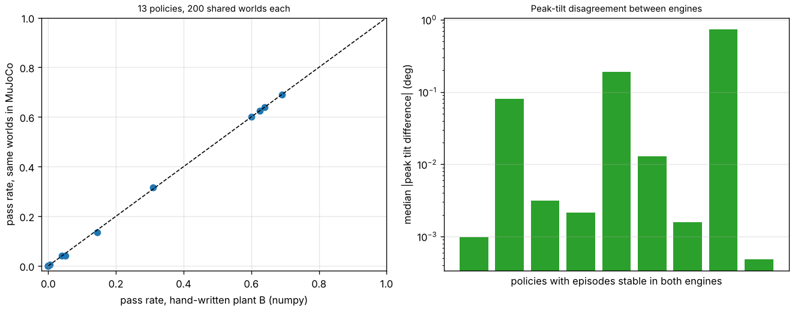

# buildbot-mjsheet: does a hand-written flexing-sheet plant agree with MuJoCo, and do its transfer failures hold there?

Seventh project of track 20, robots on the residential building site (`PROJECTS.md`, milestone 6, the sim-to-sim check, the "MuJoCo as plant B" item in [`buildbot-skills`](../buildbot-skills)'s next steps). `buildbot-skills` found that sheet-following skills tuned on a rigid-sheet model pass 0 to 11% of episodes on a held-out plant with a flexing board, sensing delay and actuator lag. That held-out plant was my own numpy Lagrangian, so a derivation slip could have produced the failure. This rebuilds it in MuJoCo and runs the same policies. Produced with AI assistance (Claude). Simulated and preliminary. It builds on no group in `prompt.md`; none is claimed.

**Live page:** https://duncan-haywood.github.io/oss-monorepo/research/buildbot-mjsheet/

**Headline.** 13 policies from `buildbot-skills` x 200 shared random worlds = 2600 episodes, each run in the numpy plant B and in MuJoCo with the same controller code.
- **The pass/fail label agrees on 99.8% of episodes** (99% to 100% per policy). No policy's pass rate differs between engines by more than 1 point (for example 0.600 vs 0.600, 0.145 vs 0.135, 0.310 vs 0.315).
- **Unstable (tilt over 30 degrees) shares agree for 12 of 13 policies**; the other differs by one episode in 200.
- **Peak tilt agrees to a few thousandths of a degree for the gains that work** (median difference 0.0005 to 0.003 degrees for the four B-trained policies, 0.001 for `buildbot-cohold`'s nominal). It is looser for marginally stable gains: 0.01 to 0.19 degrees, and 0.74 degrees for one policy (`A_nominal`, seed 4) where 96% of episodes are unstable and the survivors are near the edge.
- **The person's peak load differs by about 0.2 to 0.3 kg-equivalent** for stable policies (of about 11 to 12). I think this is my estimator, a finite difference of the sheet's centre-of-mass velocity, not the dynamics; I did not isolate it.
- So the sim-to-sim gap reported in `buildbot-skills` (81 to 82% where tuned, 0 to 11% on the held-out plant) is not a derivation artefact. What this does **not** test: both plants share the same delay, actuator lag, stiffness ranges and planar two-force-point abstraction, which are mine and unmeasured.



**Not a safety case and not a rated skill.** Nothing was run on a robot. A robot holding a sheet beside a person is a falling-object and crush hazard and needs a risk assessment (ISO 10218, ISO/TS 15066, the site's OSHA duties).

## Method (`src/buildbot_mjsheet/mjplant.py`)
- **Model.** Two boxes (mass m/2, length 1.22 m) on y-axis hinges at the person's pin and at the midline; the midline has a spring (stiffness `kflex`) and damper (`0.05 sqrt(kflex m L^2/12)`, as in `buildbot-skills`); RK4, 1 ms. The person's pin is fixed in the simulation and the frame's lift acceleration is added to gravity, which is exact for a pin moving straight up. The robot's force is applied at the far end with `mj_applyFT`.
- **Same controller.** Impedance law, integral term, reference lag, feedback delay ring buffer and first-order force actuator are `buildbot_skills.model._controller` and the same update rules, in Python; only the rigid-body dynamics change.
- **Person's load.** m (a_cm + aP + g) - Fz, with a_cm a finite difference of MuJoCo's subtree COM velocity.
- **Checks (`tests/test_mjplant.py`).** Matches numpy plant B at the nominal case (tilt within 1%, load within 5%); with a very stiff board and instant actuator it reproduces `buildbot-cohold`'s published 2.2422 degrees and 11.4222 kg (to 0.03 degrees, 4%); a static hold has the person carrying half the weight; unstable gains are flagged.
- **Policies and worlds.** The 13 policies in `../buildbot-skills/experiments/results.json`. 200 worlds from `buildbot_skills.model.draw_world(kind="B")`, seed 777 (different from `buildbot-skills`' test set). Every input range is `buildbot-skills`' (see its table); none is sourced to a robot or a board.

## Reproduce
```bash
pip install numpy matplotlib pytest mujoco     # tested with mujoco 3.16.0
cd research/buildbot-mjsheet
python -m pytest -q tests                      # about 1 minute
python experiments/run.py > experiments/results.txt   # about 20 minutes on 4 CPUs, writes results.json
python experiments/figure.py
```
The code imports `buildbot_skills` from the sibling `research/buildbot-skills/src`.

## Results
`experiments/results.txt`: per policy, pass rate in each engine, label agreement, unstable shares and tilt differences.

## Limitations
- **Two correct implementations of the same abstraction can still share a wrong abstraction.** A planar two-point sheet with a lumped midline spring is not a real OSB sheet, a gripper or a humanoid; MuJoCo here is a second integrator and a second set of equations, not a validation of the physics.
- **Shared, unsourced inputs** (delay, actuator lag, stiffness, tilt thresholds) decide the conclusion. The `buildbot-skills` limitation stands: how much delay a real G1 has in a force loop is what decides whether the stiff skills are usable.
- **Marginal policies agree less**; label agreement for them depends on a few near-threshold episodes (200 per policy).
- **Load estimator** differs by 2 to 3% from the analytic expression; the NIOSH check was not the binding one in any diagnostic of `buildbot-skills`.
- 200 worlds per policy, one seed.

## Next steps
Put the MuJoCo Menagerie G1 arm with its actuator model in place of the lumped force, then measure its force-loop delay; add a skill library file for the carry, fasten and cohold skills (the unfinished part of milestone 6).

## Owner steps
None needed.

## Outside dependencies (vitamins)
NumPy, Matplotlib, pytest and MuJoCo (Apache-2.0, `pip install mujoco`). The controller and ranges come from `buildbot-skills`.
