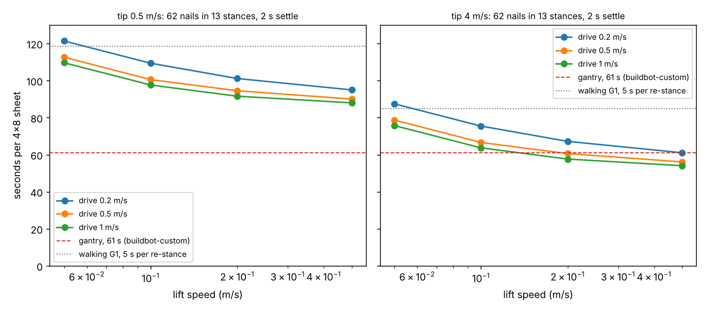

# buildbot-mobilebase: does a G1 on a drive-and-lift base nail a 4x8 sheet faster than a walking G1?

Track 20, robots on the residential building site (`PROJECTS.md`). [`buildbot-stance`](../buildbot-stance) found a standing Unitree G1 needs about 13 stances (at 5 platform heights) to nail one sheet, and left the cost of the 12 moves as a swept 5 to 40 s; its next steps asked for a comparison with a mobile base that re-stances in 2 s. This replaces the assumed re-stance time with one computed from a drive speed and a lift speed, and orders the stances to shorten the trip. Produced with AI assistance (Claude). Simulated and preliminary. **The drive and lift speeds are swept, not sourced from a chosen machine**, and the G1's reach is `buildbot-stance`'s static result (feet fixed on the platform, no base motion, no vibration).

**Live page:** https://duncan-haywood.github.io/oss-monorepo/research/buildbot-mobilebase/

**Headline.**
- **On a base the 13 stances cost 5 to 63 s of re-stancing, so a sheet takes 54 to 121 s** (nailing and tip moves 25 s at a 4 m/s tip, 59 s at 0.5 m/s, plus the moves), against **85 to 119 s for a walking G1 at 5 s a step** and 265 s at 20 s a step. The base averages 2.4 to 5.2 s per move, so it beats a 5 s walker in 22 of the 24 settings (with a 2 s settle) and loses to it only at the slowest setting (0.2 m/s drive, 0.05 m/s lift).
- **A base beats the hand estimate (372 s) by 3 to 7 times** at every speed tried; the break-even is 26 to 29 s per re-stance.
- **Matching the 61 s gantry of [`buildbot-custom`](../buildbot-custom) needs the fast tip and the fast lift.** With the tip at 4 m/s and 10 m/s², a drive of 0.5 m/s and a lift of 0.2 m/s gives 60.6 s. With the tip at 0.5 m/s no setting tried gets under 88 s.
- **Lift speed matters more than drive speed.** Raising the lift from 0.05 to 0.5 m/s saves 22 to 26 s of the sheet; raising the drive from 0.2 to 1.0 m/s saves 7 to 12 s. The wall span between stances is only 1.05 m but the heights run to 1.2 m.
- **Settling dominates once the base is quick.** At 2 s per move the 12 settles are 24 s of the 29 s (1.0 m/s drive, 0.5 m/s lift); the settle is not measured.



**Not a rated time.** A G1 riding a base with a nailer is a design idea; no such machine was built or tested. A powered platform near people needs a risk assessment (ISO 10218, ISO/TS 15066, and the scissor-lift standard that applies where it is used).

## Builds on
[`buildbot-stance`](../buildbot-stance) (the reach grid and the 13-stance cover, used unchanged), [`buildbot-custom`](../buildbot-custom) (nail order and tip move model, the gantry time) and [`buildbot-nailseq`](../buildbot-nailseq) (the 0.1 s per nail and two tip-speed settings). No group in `prompt.md` covers construction, and none is claimed.

## Method
- **Stances.** `buildbot_stance.plan` at reach 0.3 m, 50 N push, mu 0.6, standing heights 0 to 1.4 m: 62 nails in 13 stances at heights 0 to 1.2 m, spanning 0.10 to 1.15 m along the wall (`experiments/results.txt`, A).
- **Move time.** Between stances (y, h): drive |dy|/v_drive and lift |dh|/v_lift, run together (the longer counts) or one after the other, plus a settle after each move.
- **Order.** The visiting order of the 13 stances is the exact shortest path (Held-Karp), so the base does not zig-zag along the wall. `buildbot-stance` timed the stances in greedy order; the nail order inside a stance is `buildbot-custom`'s.
- **Time.** nailing and tip moves of `buildbot-stance` (unchanged) plus the 12 moves.

| Input | Value | Source |
|---|---|---|
| Reach, stances, nail order, nailing time | as `buildbot-stance` | that project |
| Drive speed along the wall | 0.2, 0.5, 1.0 m/s | **swept**; a search listing for a JLG ES1330L scissor lift gave 0.8 km/h (0.22 m/s) raised and 3.9 km/h (1.07 m/s) lowered, which these bracket (the manufacturer page could not be re-fetched here, so those two figures are unverified) |
| Lift speed | 0.05 to 0.5 m/s | **swept**; the same listing gave about 20 s to raise 3.96 m (about 0.2 m/s), also unverified, and a heavy lift moves slower |
| Settle after each move | 0 and 2 s | **swept**; the 2 s is the figure the `buildbot-stance` next steps asked about, not measured |
| Hand and gantry times | 372 s, 61 s | [`buildbot-taskbook`](../buildbot-taskbook) (an estimate), [`buildbot-custom`](../buildbot-custom) |

## Reproduce
```bash
pip install numpy matplotlib pytest
cd research/buildbot-mobilebase
python -m pytest -q tests                  # 6 tests
python experiments/run.py > experiments/results.txt     # a few seconds; reads ../buildbot-stance/experiments/reach.json
python experiments/figure.py
```

## Results (`experiments/results.txt`)
- **A.** 13 stances: (0.20 m, 1.2 m, 11 nails), (1.05, 1.2, 11), (0.25, 0, 9), (1.00, 0, 9), then nine stances of 1 to 5 nails.
- **B.** Re-stance time of the best order, drive and lift in parallel: 5.3 s (1.0 m/s, 0.5 m/s, no settle) to 62.8 s (0.2 m/s, 0.05 m/s, 2 s settle); one after the other adds 1 to 8 s.
- **C.** Whole sheet with a 2 s settle: 88 to 121 s at a 0.5 m/s tip, 54 to 88 s at a 4 m/s tip.
- **D.** Break-even per re-stance: 0.2 s (gantry) and 26.1 s (hand) at a 0.5 m/s tip; 3.0 s and 28.9 s at 4 m/s. A walking G1: 84.7 s at 5 s per step, 264.7 s at 20 s.

## Limitations
- **Speeds are a sweep.** No machine was chosen or priced; a base that carries a 33 kg robot, a 3.4 kg nailer and a person-safe guard rail, and lifts 1.2 m, is not a catalogue part this project priced.
- **The G1's reach is carried over unchanged.** The reach grid has the feet fixed on the floor. A platform adds sway, a base adds vibration, the wall pushes back on the lift, and none of that is modelled.
- **The stance cover is `buildbot-stance`'s greedy one.** It minimises stance count, not time: some stances hold one or two nails (A). A cover that minimises the trip would be at least as fast; the times here are an upper bound for the same reach.
- **Heights are in 0.1 m steps** (a lift is continuous); the cover could use fewer stances with a finer step.
- **No tool mass or battery on the base** and the base's footprint against the wall and the sheet frame is not checked.

## Next steps
Choose the stance cover for time instead of count (a small mixed-integer program over the same options); price a real low-height lift base with a datasheet and add its mass to the G1 reach model; measure a settle time with a phone accelerometer on a mock platform (owner step); try the sheet laid flat on a table, where the base may not need to lift at all.

## Owner steps
None needed. A hardware check needs a G1, a lift base, a nailer and a mock-up wall, and a risk assessment.

## Outside dependencies (vitamins)
NumPy, Matplotlib, pytest. The reach grid is `buildbot-stance`'s, from the Unitree G1 model in MuJoCo Menagerie (BSD-3-Clause, © Unitree Robotics). No part of a base or lift is included.
