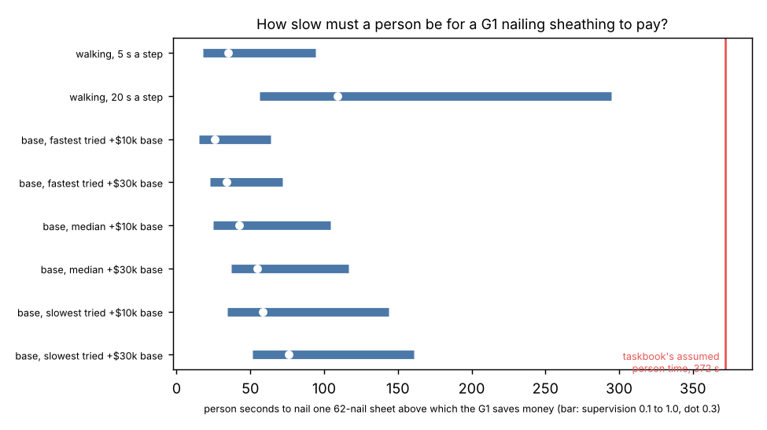

# buildbot-nailpay: how slow must a person be at nailing a sheet of sheathing for a Unitree G1 nailing it to pay?

Track 20, robots on the residential building site (`PROJECTS.md`, "Next steps" of [`buildbot-grounded`](../buildbot-grounded)). `buildbot-grounded` could only show nailing as a ceiling because no simulation gave a robot's *time* per sheet. [`buildbot-mobilebase`](../buildbot-mobilebase) now does (54 to 121 s on a drive-and-lift base, 85 s walking at 5 s a step). The person's time per sheet is the side with no sourced figure, so this turns the question around and solves for it. Produced with AI assistance (Claude). Simulated and preliminary.

**Live page:** https://duncan-haywood.github.io/oss-monorepo/research/buildbot-nailpay/

**Headline.** At a $37.86 loaded hour (BLS median $29.12 times 1.3), a G1 ($16,000 launch price, 6,000 h life, 10% a year upkeep, 1,000 h a year) that nails a 62-nail sheet in 85 s walking **saves money only if a person needs more than 35 s per sheet with 0.3 supervision hours per robot-hour (18 s at 0.1, 52 s at 0.5, 94 s with one person per robot)**. On a base the thresholds are higher because of the base's own cost: **26 to 76 s at 0.3** (fastest 54 s sheet on a $10k base to slowest 121 s on a $30k base). The taskbook's assumed 372 s per sheet is far above all of them, so **if a person really took 6 minutes of hands-on nailing a sheet the robot would pay by a wide margin; if a pro nails a sheet in about a minute it would not** (a base at the median 88 s needs 43 s at 0.3 supervision, 104 s at 1.0). Slow walking changes the answer: at 20 s a step (265 s a sheet) the threshold is 109 s at 0.3. **Whatever the answer, the money is small: about $110 a house on the taskbook's 32 wall-sheathing sheets** at a 372 s person time ($29 if a person needs 120 s). **The person's time per sheet is the unknown that decides this, and no source for it was found** (see Limitations).



**Not a quote, not a safety case.** A G1 nailing beside a person, or riding a powered base, needs a risk assessment (ISO 10218, ISO/TS 15066, OSHA) first. Prices are launch prices from press reports; the base price is swept, no machine exists.

## Method (`src/buildbot_nailpay/model.py`)
- **Robot time per sheet** is read from `buildbot-mobilebase/experiments/results.json`: walking at 5 and 20 s a step, and the base's fastest, median and slowest of 24 tried settings (drive 0.2 to 1 m/s, lift 0.05 to 0.5 m/s, tip 0.5 or 4 m/s). Nothing is re-simulated here.
- **Cost** is `buildbot-cost`'s: `rate = price x (1/life + upkeep/use)`; per sheet the saving is `(person_s - robot_s x (rate/wage + supervision)) x wage / 3600`. Supervision is person-hours per robot-hour; it must cover placing and holding the sheet, which the robot is not modelled to do (here 1.0 means a person is tied up the whole time).
- **Break-even person time** `robot_s x (rate + supervision x wage) / wage`: the same break-even slowdown as `buildbot-cost`, expressed in seconds per sheet.
- **Draws** (section C of the results): person time uniform 60 to 720 s, supervision 0.1 to 1.0, base price $0 or $5k to $40k, life 3,000 to 10,000 h, use 500 to 1,800 h a year. These ranges are my choices, not sourced; the share is conditional on them and mostly reflects that the range starts at 60 s.

| Input | Value | Source |
|---|---|---|
| Robot seconds per sheet | 54.1 to 121.4 (base), 84.7 and 264.7 (walking) | `buildbot-mobilebase` simulation, G1 reach from `buildbot-stance` |
| Wage | $29.12/h median, burden 1.3 | BLS Occupational Outlook Handbook, Carpenters (May 2025), via `buildbot-cost`; burden is an assumption |
| G1 price | $16,000 | launch price, heise (2024), via `buildbot-cost`; not re-checked |
| Base price | $10k, $20k, $30k; draws $5k to $40k | **unsourced** |
| Person time per sheet | 372 s in the taskbook; 60 to 720 s swept | taskbook minutes are its author's assumption; **no source found** |
| Sheets in scope | 32 (1,984 nails / 62) | `buildbot-taskbook` task S4 |

## Reproduce
```bash
pip install pytest matplotlib
cd research/buildbot-nailpay
python -m pytest -q tests                           # 9 tests, stdlib only (reads ../buildbot-mobilebase, ../buildbot-taskbook, ../buildbot-cost)
python experiments/run.py > experiments/results.txt # under a second, deterministic
python experiments/figure.py                        # experiments/figure.png
```

## Results (`experiments/results.txt`)
| robot configuration | robot s/sheet | person s/sheet above which it pays: supervision 0.1 / 0.3 / 0.5 / 1.0 |
|---|---|---|
| walking, 5 s a step | 84.7 | 18 / 35 / 52 / 94 |
| walking, 20 s a step | 264.7 | 56 / 109 / 162 / 295 |
| base, fastest, $10k | 54.1 | 15 / 26 / 37 / 64 |
| base, median, $10k | 88.0 | 25 / 43 / 60 / 104 |
| base, slowest, $30k | 121.4 | 51 / 76 / 100 / 161 |

(Full grid with $30k bases in the results file.) Per house on the 32 wall sheets at 0.3 supervision, walking at 5 s a step: $29 (person 120 s), $69 (240 s), $113 (372 s), $190 (600 s); a $20k base at its median is within $5 of that.

- **A base buys little here.** The walking G1 at 5 s a step is about as fast as a median base (85 s against 88 s) and carries none of the base's cost, so a base only pays if walking between stances is slower than about 5 s a step or the lift is fast and the tip quick.
- **Supervision matters more than hardware.** Moving supervision from 0.1 to 1.0 raises the threshold by 5 times; the base's price moves it by under 2 times.

## Limitations
- **No sourced person time.** A web search for crew productivity on 4x8 sheathing found only low-authority pages (one secondary source gave about 75 sq ft an hour for a skilled installer, which would be 2.3 sheets an hour for the whole job including cutting and placing; I could not open the page to check). The taskbook's 372 s is its author's assumption. A time-and-motion study of a real crew, or a licensed estimating database (RSMeans), is the missing input.
- **Robot times are the upper reach model of `buildbot-stance`**: static reach with feet fixed, a 3.4 kg tool, no base vibration, the settle time swept and unmeasured. `buildbot-taskbook` marks the G1 `no` for this task's payload; `buildbot-fasten` finds it can press at 20 N, so these rows are an upper bound.
- **The robot does not place or hold the sheet, cut it, or reposition ladders.** That is what supervision 1.0 stands for; lower values assume a person does that for several robots.
- **Independent draws**: faster robots probably need more supervision, not less.

## Next steps
- Replace the person-time sweep with a measured or licensed figure (a stopwatch study on a real wall is an owner step).
- Add a supervision model: the person places a sheet (taskbook S1/S2 hours) while the robot nails the previous one.

## Outside dependencies
A sourced person time per sheet; a drive-and-lift base (none exists or is priced); the G1 itself.
