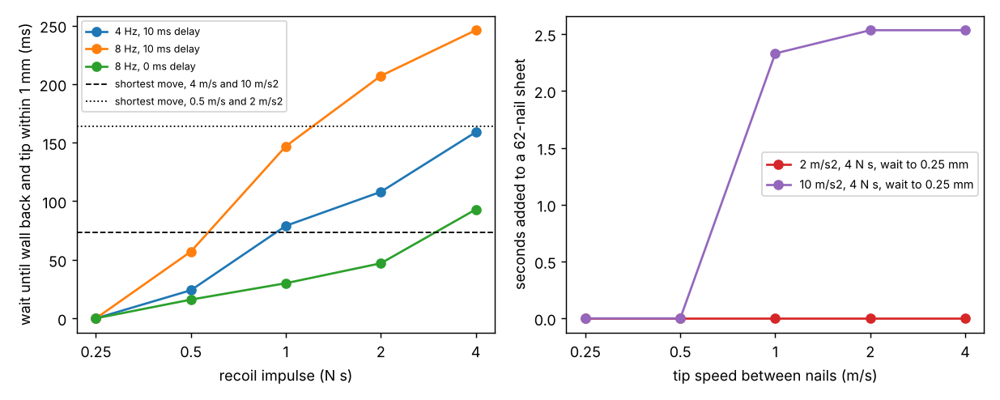

# buildbot-nailseq: does a nailer's recoil slow a G1 down when it fires a whole 62-nail sheet in sequence?

Track 20, robots on the residential building site (`PROJECTS.md`, milestones 4 and 6). [`buildbot-recoil`](../buildbot-recoil) followed one shot until the arm settled and left "fire the 62-nail schedule in sequence and report time per sheet including settling" and "couple this with `buildbot-studfind`" as next steps. This does both: the 62 nails of [`buildbot-custom`](../buildbot-custom) are fired in its serpentine order, each shot's recoil transient (45 MuJoCo traces of the Menagerie G1 hold model) decays while the tip moves to the next nail, and whatever error is left joins the robot's scatter and the stud-finding error of [`buildbot-studfind`](../buildbot-studfind) in one clean-sheet probability. Produced with AI assistance (Claude). Simulated and preliminary. **The recoil of a real nailer is still unmeasured** (impulse swept 0.25 to 4 N s), as are the G1's loop delay, its tip speed between nails and the wall's stiffness.

**Live page:** https://duncan-haywood.github.io/oss-monorepo/research/buildbot-nailseq/

**Headline.**
- **Recoil does not set the time per sheet; the moves do.** After a shot the nosepiece must be back on the wall and the tip close to its place before the next nail. That takes **0 s at 0.25 N s, up to 57 ms at 0.5 N s, 0.03 to 0.15 s at 1 N s and up to 0.25 to 0.31 s at 4 N s**, depending on loop and hold height (3 hold heights x 3 loops). The shortest move between two nails on a sheet is 6 in (0.152 m), which takes **0.16 s even at 0.5 m/s and 2 m/s², and 0.07 s at 4 m/s and 10 m/s²**. At the slower setting the transient is over before the arm arrives for every impulse tried: **0 s added** to a sheet that takes 70 to 120 s.
- **Only a fast arm feels it, and then only a little.** With a tip that reaches 1 to 4 m/s at 10 m/s² (a gantry-like hand, far faster than anything found for the G1) and a 4 N s recoil, waiting to 0.25 mm adds **2.3 to 2.5 s to a 25 to 33 s sheet** (worst of 9 pose and loop combinations); waiting to 4 mm adds 0.02 s. At 1 N s or less nothing is added at any speed.
- **Position is not the problem either; the wall is.** Even firing the moment the move ends, with no wait, the left-over tip error at the next nail is at most **0.02, 0.05, 0.08, 0.14 and 0.37 mm for 0.25, 0.5, 1, 2 and 4 N s**, so the clean-sheet probability is the same to three places as with no recoil: **1.00 with perfect stud reads and 0.93 with a 1 mm single read** (the `buildbot-studfind` figure). What a no-wait policy does do, at 10 m/s² and 4 N s, is fire **2 nails with the nosepiece still off the wall**; waiting for the wall removes them, at no cost in seconds below 1 N s.
- **So the budget stays with the stud finder.** Recoil error is under 0.4 mm against a 0.89 mm allowance for the stud read (`buildbot-studfind`). Nothing here changes that finding; this checks that a sequential-fire sheet does not have a second, hidden term.



**Not a rated time or accuracy.** The arm is a fixed-pelvis community model; real moves between nails need re-stancing (a 4x8 sheet is 1.2 x 2.4 m, beyond one arm pose), which this leaves out. Nailing near people needs a risk assessment (ISO 10218, ISO/TS 15066).

## Method
- **Shots** (`experiments/simulate.py`, MuJoCo, reusing `buildbot_recoil`): the G1 holds the 3.4 kg nailer 0.35 m forward at 0.8, 1.0 and 1.2 m height, 30 N preload, and takes a 4 ms half-sine recoil of 0.25, 0.5, 1, 2 or 4 N s under three loops (4 Hz with 10 ms delay, 8 Hz with 10 ms, 8 Hz with 0). All 9 no-shot holds are stable. Each trace is the tip's offset from the no-shot run, with the wall force, at 1 ms (`traces.npz`, 23 s to regenerate).
- **Sequence** (`src/buildbot_nailseq/model.py`): the 62 nails in `buildbot-custom`'s serpentine order, with trapezoidal moves (tip speed 0.25 to 4 m/s, acceleration 2 or 10 m/s²). The next nail fires at the later of the end of its move and the moment the tip has stayed within `eps` of its place (0.25 to 4 mm) and the wall force is back, plus 0.1 s to trigger and seat. The shot's transient is carried forward unchanged over the move: the response is taken at the hold pose, not re-simulated along the sheet. A "fire when the move ends" policy is the comparison.
- **Error budget:** each nail's error is the stud's shared error (one draw per stud, none for plates), the robot's own 0.9 mm scatter (`buildbot-fasten`) and the deterministic transient left at the moment of firing along the nail's axis; 62 nails must all land in their windows (10,000 sheets, seed 1).

| Input | Value | Source |
|---|---|---|
| Nail windows, order | 62 nails, serpentine | [`buildbot-fasten`](../buildbot-fasten), [`buildbot-custom`](../buildbot-custom) |
| Recoil impulse, loop bandwidth and delay | 0.25 to 4 N s; 4 to 8 Hz, 0 to 10 ms | **swept**; no source found ([`buildbot-recoil`](../buildbot-recoil)) |
| Tip speed, acceleration between nails | 0.25 to 4 m/s, 2 and 10 m/s² | **swept**; no G1 figure found |
| Trigger and seat time | 0.1 s | my choice (adds 6.2 s a sheet whatever else happens) |
| Robot scatter; stud-read scatter | 0.9 mm; 0 or 1 mm | `buildbot-fasten`; swept (`buildbot-studfind`) |
| Robot model | Menagerie G1 | vendor model, BSD-3-Clause; not validated |

## Reproduce
```bash
pip install mujoco numpy matplotlib pytest      # MuJoCo and network (Menagerie clone) are needed only for simulate.py
cd research/buildbot-nailseq
python -m pytest -q tests                       # 8 tests, no MuJoCo needed
python experiments/simulate.py                  # about 25 s, writes traces.npz and traces.json
python experiments/analyse.py > experiments/results.txt   # about 100 s, writes results.json
python experiments/figure.py
```

## Results (`experiments/results.txt`, one row per pose, loop, impulse, speed, acceleration, `eps` and stud scatter)
- **Dwell with no move** (`results.json`, `dwell`): worst over the 9 pose and loop pairs, 0, 0.057, 0.147, 0.21 and 0.25 to 0.31 s for 0.25, 0.5, 1, 2 and 4 N s. It is set by the wall coming back, not by the tip position: tightening `eps` from 4 to 0.25 mm changes it only at 4 N s (0.246 to 0.313 s). The 8 Hz loop with 10 ms delay is slowest, 8 Hz with no delay fastest.
- **Moves:** shortest 0.164 s (6 in at 0.5 m/s and 2 m/s², also at 4 m/s), 0.073 s at 10 m/s². Whole-sheet travel runs 22 s (4 m/s, 10 m/s²) to 116 s (0.25 m/s, 2 m/s²); sheet time with firing is 28 to 123 s, against 372 s by hand (`buildbot-taskbook`'s estimate) and 61 s for the gantry of `buildbot-custom`.
- **Time added** by waiting to 0.25 mm over firing at the move end: 0 s in every case at 2 m/s², and at 10 m/s² 0 s up to 2 N s and 2.3 to 2.5 s at 4 N s.
- **Accuracy:** left-over error and clean-sheet probability in the headline; the probability does not move with `eps` in any of the 5,400 rows (largest change 0.000).

## Limitations
- **The recoil is not measured**, so every number is conditional on J. A nailer that really delivers more than 4 N s, or a robot loop slower than 4 Hz, would change the dwell.
- **One response per hold height.** The transient is taken at three hold poses and carried across moves of up to 2.4 m; in a real sequence the arm's configuration, the carriage or the legs change at every nail. Moves are a kinematic model of the tip, not a simulated arm path, and the sheet is wider and taller than one standing pose reaches (re-stancing time is not counted).
- **Fixed pelvis, one spring wall, no nail.** As in `buildbot-recoil`: no balance, no nail entering wood, no nosepiece trip.
- **Contact-trip behaviour is only counted.** Nails fired off the wall are tallied for the no-wait policy, not simulated as double fires or misses.
- **The schedule is one sheet's first pass.** Reloads, jams and the stud-finding scan are outside it.

## Next steps
Replace the swept recoil with a measured trace (owner step, a phone accelerometer on a nailer); simulate the arm's moves between nails with the whole-body controller instead of a kinematic profile and add re-stancing, to get the G1's real time per sheet; price the 0.1 s trigger-and-seat against a tool that fires in a burst at one stud; fold in the stud scan time of `buildbot-studfind`'s next steps.

## Owner steps
None needed. A hardware check needs a G1 or similar arm, a nailer with an accelerometer, a framed mock-up wall, and a risk assessment.

## Outside dependencies (vitamins)
MuJoCo (Apache-2.0), NumPy, Matplotlib, pytest. Unitree G1 model from MuJoCo Menagerie (BSD-3-Clause, © Unitree Robotics), fetched and not copied by `buildbot-payload`; reads `buildbot-recoil`, `buildbot-custom`, `buildbot-studfind`, `buildbot-fasten` and `buildbot-payload` sources. No group in `prompt.md` covers construction, and none is claimed.
