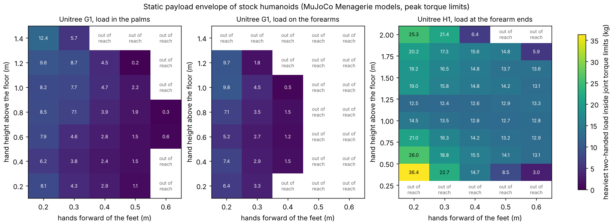

# buildbot-payload: what can a Unitree G1 or H1 humanoid lift on a house-building site?

First project of track 20, robots on the residential building site (`PROJECTS.md`). Before training any construction skill on an off-the-shelf humanoid, one question decides which skills are worth training: can the robot hold the materials at all? This finds the heaviest load a standing Unitree G1 and H1 can hold in both hands at each hand height and reach, from their open MuJoCo Menagerie models. It then checks nine residential handling tasks, from carrying a stud to holding one end of a drywall sheet with a person, against those limits. Produced with AI assistance (Claude).

**Live page:** https://duncan-haywood.github.io/oss-monorepo/research/buildbot-payload/

**Headline.** The **G1** (33 kg) can hold a median **4.5 kg** in its palms over its reachable grid. That is 1.5 to 4.7 kg at 0.4 to 0.5 m in front of its feet and up to 12 kg tucked close to the body. This agrees with Unitree's own posture-dependent arm rating of 2 kg (3 kg for the EDU). Its **waist pitch motor (50 N·m)** is the limit in 16 of 28 cells and its 5 N·m wrists in 5 more. The **H1** (51 kg) holds a median **14.2 kg** (12 to 15 kg over most of a 0.4 to 2.0 m by 0.2 to 0.6 m grid), and its **18 N·m elbows** set the limit. On the tasks, the G1 can carry an 8 ft 2x4 (3.8 kg) and hold a framing nailer, but not a 2x6 (5.9 kg against 4.6) or its half of an OSB sheet. The H1 can carry studs and 2x6s, take one end of a 4x8 OSB or drywall sheet with a person, and set a lightweight concrete block (11.8 kg). It cannot carry a whole OSB sheet alone (20.3 to 23.2 kg against 18.8), set a normal-weight block (16.8 against 15.5) or lift a 60 lb bag. Neither robot reaches an 8 ft ceiling. So with today's stock arms, a humanoid on a house site is a helper for light handling and "the other end" of a sheet, while people and lifts keep the heavy pieces. The motors a purpose-built robot would upgrade first are the waist and the elbows.



**Not a rated payload.** These are simulated static limits from community-built models at the models' peak torque limits. Continuous torque is lower, so a real robot holding a load for minutes will manage less. Nothing here was tested on hardware. A robot carrying material near people is a falling-object and crush hazard, and needs a risk assessment (ISO 10218, ISO/TS 15066) before any trial.

## Method (`src/buildbot_payload/model.py`)
- **Models.** `unitree_g1/g1.xml` (29 joints, with wrists and rubber hands) and `unitree_h1/h1.xml` (19 joints, no hands) from MuJoCo Menagerie at commit `cda5236f`. They are fetched by `fetch.py` and not copied, because they are BSD-3-Clause © Unitree Robotics. Torque limits come from each joint's `actuatorfrcrange` (G1) or its motor's `ctrlrange` (H1). G1: 88 to 139 N·m legs, 50 N·m waist roll and pitch, 25 N·m shoulders, elbows and wrist roll, 5 N·m wrist pitch and yaw. H1: 200 to 300 N·m legs, 40 N·m ankles and shoulder pitch and roll, 18 N·m shoulder yaw and elbows.
- **Pose** (`pose`). Whole-body inverse kinematics of the floating-base robot. Both soles stay flat where they stood, both hands sit at (x, ±w, z) from the middle of the feet (w = 0.18 m on the G1, 0.22 m on the H1), and the **combined centre of mass of robot and load stays over the middle of the feet**, so the robot leans back against the load. The solver is Levenberg-Marquardt with an active set for joint stops and a posture term that is annealed away. It keeps the solution near the home pose and does not search for the torque-optimal posture.
- **Torques** (`torques`). The static generalised forces are gravity on every link plus half the load at each hand point. Ground wrenches at the two sole points balance the six floating-base equations (the minimum-norm split between the feet), and the joint torques are what remains. The tests check this against MuJoCo's forward dynamics: with these torques, wrenches and loads applied, every joint's acceleration is below 10<sup>−6</sup>.
- **Payload** (`max_payload`). The load is bisected to 0.1 kg (re-solving the pose at each mass) up to the heaviest one where the pose converges, every joint is inside its limit and both feet still press down. "Reach" means the pose could not be solved: out of the arms' range, or the robot cannot lean far enough to balance.
- **Grips.** On the G1, "palm" puts the load 8 cm out from the wrist yaw joint, in the rubber hand. "Cradle" hangs it on the forearm end before the wrist joints, which spares the wrists but shortens the reach. The H1 carries at the end of its forearm.
- **Tasks.** Every mass is computed or sourced in `experiments/run.py`:

| Input | Value | Source |
|---|---|---|
| SPF lumber | 28.5 lb/ft<sup>3</sup> | NDS specific gravity 0.42 at 15% moisture, Wood Handbook (FPL-GTR-282) moisture relation |
| 7/16 in OSB, 4x8 | 1.4 to 1.6 lb/ft<sup>2</sup> (45 to 51 lb), swept | retail listings; no mill data found, so the verdict must hold at both ends |
| 1/2 in regular drywall | 1.6 lb/ft<sup>2</sup> (51 lb a sheet) | USG product comparison tool |
| 8x8x16 in CMU | 26 lb lightweight, 37 lb normal weight | averages in a survey in *The Masonry Society Journal* |
| Framing nailer | 7.5 lb | Metabo HPT NR90AES1 listing |
| Bag of concrete mix | 60 lb | labelled mass |
| Person's limit | 51 lb (23.1 kg) | NIOSH lifting equation load constant (Waters et al. 1993) |

  A task passes only if the robot holds the top of its mass range.

## Reproduce
```bash
pip install mujoco numpy matplotlib pytest
cd research/buildbot-payload
python -m pytest -q tests                       # 7 tests; first run clones the two models from Menagerie (git + network)
python experiments/run.py > experiments/results.txt   # about 3 min on one CPU, deterministic
python experiments/figure.py
```
Set `BUILDBOT_MENAGERIE` to an existing Menagerie checkout to skip the clone. The tests skip if the models cannot be fetched.

## Results (from `experiments/results.txt`)
- **A. G1, palm.** 28 of 35 cells reachable, from 0.2 to 1.4 m high and 0.2 to 0.6 m forward. Median 4.5 kg, range 0.2 to 12.4 kg. At 0.2 m forward it holds 6 to 12 kg; at 0.4 m, 2.4 to 4.7 kg; at 0.5 m, 0.2 to 2.2 kg. The binding joints are waist pitch in 16 cells, wrist pitch in 5, shoulder pitch in 2, and 5 cells fail on reach or balance first.
- **A. G1, cradle.** 16 of 35 reachable, median 3.5 kg (0.5 to 9.8). The wrists drop out as a limit, but reach shrinks by the hand's length and the waist still binds (13 cells). Cradling is not a net gain at these distances.
- **A. H1.** 43 of 50 reachable (0.4 to 2.0 m high; 0.2 m high is below its reach). Median 14.2 kg, range 3.0 to 36.4 kg. The 36 kg figure is near the floor with the arms almost straight and the elbows barely loaded. The binding joints are the elbows in 22 cells and shoulder pitch in 11.
- **B. Tasks.** Each verdict compares a task's mass with the capacity at its hand position:

| Task (hand height, reach) | Mass | G1 palm | H1 |
|---|---|---|---|
| Carry an 8 ft 2x4 (0.6, 0.3 m) | 3.8 kg | yes (4.6) | yes (18.8) |
| Carry an 8 ft 2x6 (0.6, 0.3) | 5.9 kg | no (4.6) | yes (18.8) |
| Hold a framing nailer (1.0, 0.4) | 3.4 kg | yes (4.7) | yes (12.8) |
| Carry a 4x8 OSB sheet alone (0.6, 0.3) | 20.3&ndash;23.2 kg | no | no (18.8) |
| One end of a 4x8 OSB sheet, with a person | 10.2&ndash;11.6 kg | no | yes |
| Set a lightweight concrete block (0.6, 0.4) | 11.8 kg | no (2.8) | yes (15.5) |
| Set a normal-weight concrete block (0.6, 0.4) | 16.8 kg | no (2.8) | no (15.5) |
| Lift a 60 lb bag (0.4, 0.3) | 27.2 kg | no (3.8) | no (22.7, balance) |
| One end of a drywall sheet at 1.2 m, with a person | 11.6 kg | no (8.7) | yes (12.4) |
| Drywall up to an 8 ft ceiling, with a person (2.3 m) | 11.6 kg | out of reach | out of reach |

The person's half of a shared OSB or drywall sheet (10 to 12 kg) is under half the NIOSH constant, so the shared lifts the H1 can do are also comfortable for the person.

## Limitations
- **Peak, not continuous, torque.** The models list peak limits, and motors overheat at peak, so a held load will be smaller than these figures. Unitree's 2 to 3 kg rating sits below the G1 envelope at most reaches, which is consistent with that.
- **Static only.** Walking, turning, accelerating a load, gusts on a sheet (`house-panellift` finds a 20 ft panel swings 10° at about 12 mph) and stumbling are all left out. A walking carry will be lower.
- **Posture.** The IK picks the pose nearest the home pose, not the strongest one. A torque-aware posture, such as bending the knees instead of the waist, could raise the G1's waist-limited cells.
- **Grip.** Grip friction, hand strength and the bulk of the item are not modelled. The G1's rubber hands have no fingers, and the H1 has no hands at all, so it would need a fixture or an end effector. The hand spacing is fixed, so a 4 ft sheet is treated as a point load between the hands.
- **Models.** The Menagerie models are the community's approximations of Unitree's robots. Masses, inertias and limits may differ from a particular unit or firmware. The G1 model is the 29-joint version, which is closer to the EDU than to the base G1.

## Next steps
Make the posture torque-aware (optimise for the payload, not for distance from home). Add a continuous-torque limit from motor data once a sourced figure exists. Then take the light tasks the robots passed into `buildbot-carry` (a walking carry) and the shared-sheet case into `buildbot-cohold` (`PROJECTS.md`, track 20). Run the same envelope for a purpose-built design with stronger waist and elbow motors, to price what the upgrade buys.

## Owner steps
None needed for this project. A hardware check would mean measuring a G1's or H1's held load at a few of these poses under supervision. That needs a robot (a purchase or a rental) and a risk assessment.

## Outside dependencies (vitamins)
MuJoCo (Apache-2.0), NumPy, Matplotlib (figure) and pytest. The Unitree G1 and H1 models come from MuJoCo Menagerie (BSD-3-Clause, © Unitree Robotics), fetched at a pinned commit. Unitree's arm rating is from its G1 product page (<https://www.unitree.com/en/mobile/g1>, read 2026-10-21) and is the vendor's claim. Task-mass sources, read 2026-10-21: USG's product comparison tool (<https://assemblies-tools.usg.com/content/usgcom/en/resource-center/tools/product-comparison-tool/product-comparison-page.141134.1400.CertainTeed.html>), the CMU survey in *The Masonry Society Journal* (<https://journal.masonrysociety.org/article/140517.pdf>), and Metabo HPT's NR90AES1 page (<https://metabo-hpt.com/products/product/plastic-collated-framing-nailer-metabo-hpt-nr90aes1>). No group in `prompt.md` covers construction, and none is claimed.
