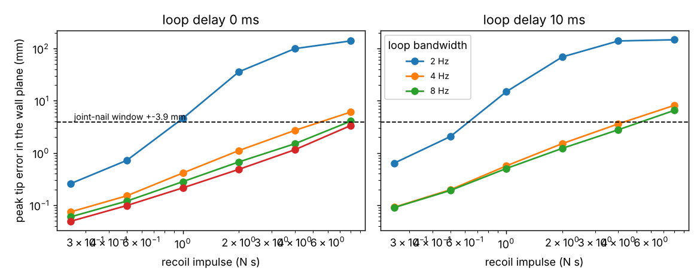

# buildbot-recoil: does a framing nailer's recoil knock a stock Unitree G1 arm off the stud window?

Track 20, robots on the residential building site (`PROJECTS.md`, milestones 4 and 6). [`buildbot-fasten`](../buildbot-fasten) asked how hard a G1 can press a nailer into a wall and how exactly a nail must land, both as static limits, and left "model the nailer's recoil" as its first next step. This is the first time-domain check on that chain: the G1's waist-and-arm joints hold a 3.4 kg nailer against a wall under a closed-loop controller, a recoil impulse hits the tip, and the tip is followed until it settles. Produced with AI assistance (Claude). Simulated and preliminary. **The recoil impulse of a real nailer is not measured here and no source for it was found, so it is swept, not assumed**; the controller gains and delay are swept too, and the legs and balance are not modelled.

**Live page:** https://duncan-haywood.github.io/oss-monorepo/research/buildbot-recoil/

**Headline.**
- **Sideways error is not the problem; losing the wall is.** With a 30 N preload against a 1e5 N/m wall, a recoil of up to **4 N s** moves the tip at most **1 to 4 mm** in the wall plane for loops of 4 to 12 Hz (window of a joint nail: ±3.9 mm), and the tip is back within 1 mm in about 0.1 s or less. But a recoil of **1 N s or more lifts the nosepiece off the wall for 25 to 140 ms** (the tip moves back 0.6 to 18 mm against a 30 N preload), and 0.5 N s does in all but the stiffest loops (8 and 12 Hz, no delay). Only 0.25 N s keeps contact in most loops. On a contact-trip tool that matters (it can fire again when it touches down); on a sequential-trip tool the robot must re-seat anyway.
- **Stiffer is not safer once the loop has delay.** A loop of 8 Hz bandwidth holds a stable hold with 0 or 10 ms of delay and goes unstable at 20 ms; 12 Hz is unstable at 10 ms. 4 Hz keeps the tip in the window up to 4 N s with 10 ms of delay and up to 1 N s with 20 ms (`results.txt`, bottom table). No latency of the G1's arm loop was found, so the delay is swept.
- **Preload trades sideways error for contact.** At 8 Hz and 10 ms, a 10 N preload loses the wall for 75 ms even at 0.25 N s, and a 60 N preload for 17 ms, but 60 N turns the 2 N s sideways error from 1.4 mm to 2.5 mm and 4 N s from 2.9 mm to 8.4 mm (over the window).
- **A floor on the recoil, not the recoil.** An 8d common nail (0.131 in shank, 2.5 in; about 4.3 g of steel, my calculation) leaving at 30 to 100 m/s (my range, unsourced) carries 0.13 to 0.43 N s. That is only the nail's momentum; the driver and the tool's own mass add to what the hand feels. So real recoil may be inside the range where the tip stays in its window and the wall is lost.



**Not a rated force or accuracy.** A community model at its peak torque, a fixed pelvis, no legs, no measured recoil. A robot driving nails near people needs a risk assessment (ISO 10218, ISO/TS 15066).

## Method (`src/buildbot_recoil/model.py`)
- **Hold pose.** `buildbot_fasten.check_push` at hand (0.35 m forward, 1.0 m up), 3.4 kg tool ([`buildbot-fasten`](../buildbot-fasten) sources), 30 N push, mu 0.6. The tool's mass is added to the two wrist links.
- **Plant.** MuJoCo (Menagerie G1 at the `buildbot-payload` pin). The pelvis is fixed in space by a 1e6 kg m² armature on its six dofs, so legs, balance and foot slip are not modelled; the Menagerie joint friction (0.3 N m, a soft constraint that distorts a hold) and its built-in actuators are switched off and joint torques are applied directly, clipped to the model's torque limits.
- **Controller.** Feed-forward torque for gravity, tool and wall force at the hold pose, plus the hold-pose inertia matrix times a second-order law (natural frequency f, damping ratio 0.7), so every mode has bandwidth f. A first version scaled the gains by each joint's diagonal inertia; it went unstable at 5 ms of delay because coupled joints have much less modal inertia than their diagonals (dropped). A transport delay is applied to the torque command, plus one 0.5 ms step.
- **Wall.** One-sided spring (1e5 N/m, swept 2e4 to 1e6) and damper (damping ratio about 0.3 on the tool's mass), preloaded to the push force. Stiffness and damping are assumptions.
- **Shot.** A half-sine force pulse of 4 ms along -x on the two hands, total impulse J. The pulse length is my choice, not swept.
- **Scoring.** Everything relative to the same run without a shot, so the controller's own sag does not count: peak sideways error `sqrt(dy²+dz²)`, peak backward travel, time off the wall, and time until the tip is within 1 mm. `stable` means the no-shot hold stays within 2 mm in the last 0.3 s.

| Input | Value | Source |
|---|---|---|
| Tool mass, nail windows | 3.4 kg; ±3.9 mm (joint nails) | `buildbot-fasten` (Metabo HPT NR90AES1 listing; builders' guides) |
| Robot model, torque limits | Menagerie G1 | vendor model, BSD-3-Clause; not validated |
| Recoil impulse | 0.25 to 8 N s | **swept**; no source found (searched 2026-10-23: only qualitative notes in trade tests) |
| Pulse length | 4 ms | my choice |
| Loop bandwidth, delay | 2 to 12 Hz, 0 to 20 ms | **swept**; no G1 figure found |
| Wall stiffness, damping, preload | 2e4 to 1e6 N/m, ζ about 0.3, 10 to 60 N | stiffness and damping assumed; preload swept |

## Reproduce
```bash
pip install mujoco numpy matplotlib pytest
cd research/buildbot-recoil
python -m pytest -q tests          # 5 tests (four need the Menagerie clone: git + network)
python experiments/run.py          # 108 shots, about 70 s, deterministic; writes results.json/results.txt
python experiments/figure.py
```

## Results (`experiments/results.txt`)
- **A.** 4 bandwidths x 3 delays x 6 impulses. At 0 delay: 8 Hz keeps the tip in the window up to 4 N s (peak 1.5 mm), 12 Hz to 4 N s (1.2 mm; 3.3 mm at 8 N s), 2 Hz only to 0.5 N s. At 10 ms: 4 Hz to 4 N s (3.6 mm) and 8 Hz to 4 N s; unstable at 12 Hz; at 20 ms only 4 Hz (to 1 N s) and 2 Hz (slow, never settles in 1.4 s) remain.
- **B.** Wall stiffness: 2e4 N/m keeps contact at up to 0.5 N s; at 1e6 N/m with 10 ms delay the hold is unstable (contact flutters for 1.2 s), so a stiffer wall needs a slower loop.
- **C.** Preload: see Headline.
- **Checks.** Tests: the no-shot hold stays within 1.5 mm and keeps its preload; the first 20 ms follow momentum (tip travel equals J/m_eff of the operational-space mass along x, within 10%); small shots scale linearly; a stiffer loop moves the tip less; the scoring function flags a 5 mm blip. Not checked against hardware.

## Limitations
- **The recoil is not measured.** Everything is conditional on J; a second, stronger result needs an accelerometer trace of a real nailer.
- **Fixed pelvis.** A standing robot's legs and trunk add compliance and mass; the real response includes balance.
- **Linear-ish controller.** The law uses the hold-pose inertia matrix; real joint controllers (position loops on 8 to 12 bit encoders, motor lag, backlash) are not this.
- **Wall and contact are one spring.** A nail entering wood, a nosepiece trip and a stud that flexes are not modelled. The first nail of the sheet is the only case.
- **Only the G1, one pose, one preload at a time.** The H1's elbows are the limit there (`buildbot-fasten`).

## Next steps
Measure a nailer's recoil with a phone accelerometer or find a published trace and replace the sweep; add the legs (a MuJoCo whole-body controller) to see whether balance, not the arm, binds; fire the 62-nail schedule in sequence and report time per sheet including settling; couple this with `buildbot-studfind` so perception error and recoil error share one budget.

## Owner steps
None needed. A hardware check needs a robot, a nailer with an accelerometer, and a risk assessment.

## Outside dependencies (vitamins)
MuJoCo (Apache-2.0), NumPy, Matplotlib, pytest. Unitree G1 model from MuJoCo Menagerie (BSD-3-Clause, © Unitree Robotics) at the pin in `buildbot-payload`, fetched not copied; reads `../buildbot-payload` and `../buildbot-fasten`. No group in `prompt.md` covers construction, and none is claimed.
