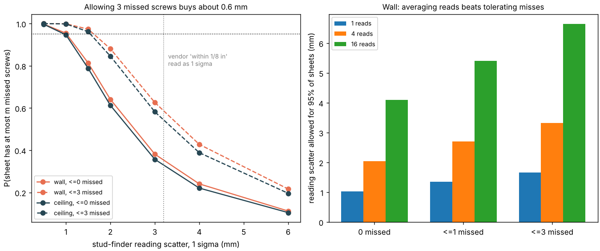

# buildbot-screwline: how well must a drywall-screwing robot find the framing, and do misses matter?

Sixth project of track 20, robots on the residential building site (`PROJECTS.md`; the "take the same stud-finding budget to drywall screws" step of [`buildbot-studfind`](../buildbot-studfind)). Nails into sheathing and screws into drywall differ in count, pitch and what a miss costs, so the budget is re-run with a drywall schedule. It is a **Monte Carlo error budget, not a perception system**: no camera, sensor, board or wall was simulated. Produced with AI assistance (Claude).

**Live page:** https://duncan-haywood.github.io/monorepo-projects/research/buildbot-screwline/

**Headline.** A 4×8 drywall sheet on 16 in framing takes 28 screws on a wall (16 in pitch) or 36 on a ceiling (12 in pitch). With the robot adding 0.9 mm per screw, **a single read of each framing member must be good to 1.02 mm (1 sigma) on a wall and 0.98 mm on a ceiling for 95% of sheets to have every screw on its member**; that is almost the nailing figure (0.89 mm for 62 nails), because the two sheet-edge members, with a ±3.9 mm window each, set the budget and not the screw count. Tolerating misses buys little: allowing 1 missed screw per sheet raises the wall figure to 1.35 mm and 3 misses to 1.66 mm; averaging **4 reads** gives 2.05 mm and **16 reads** 4.10 mm (assuming independent reads). Re-measuring at every screw (1.00 mm) is no better than one shared read here, unlike nailing's worst case, because only 14 edge screws bind. A consumer stud finder's vendor claim "within 1/8 in" read as a 1 sigma of 3.2 mm gives 35% clean wall sheets from one read, 78% from four; read as a 95% bound (1.6 mm), 78% from one read and 98% from four.



**Not a rated accuracy.** Simulated statistics on assumed Gaussian errors. Screwing near people is a hazard needing a risk assessment (ISO 10218, ISO/TS 15066).

## Method (`src/buildbot_screwline/model.py`)
- **Schedule.** Screws on framing at the pitch in USG's FAQ 1595 for non-fire-rated gypsum panels in wood framing: 12 in on ceilings, 16 in on walls. A 48 in sheet over 16 in framing touches 4 members; 96 in at that pitch gives 7 (wall) or 9 (ceiling) screws a member.
- **Windows.** As in `buildbot-fasten`, on a 1.5 in face with a #6 screw (0.138 in nominal major diameter, ASME B18.6.4 size 6) and 3/8 in minimum from a board edge: ±3.9 mm under a sheet edge, ±17 mm on an intermediate member.
- **Errors.** Each member has one reading error shared by its screws (mean of n reads); each screw adds the robot's own 0.9 mm (the `buildbot-fasten` model result). A sheet passes with at most m screws outside their windows. "Servo" gives every screw a fresh reading error.
- **Checks.** With no robot noise the Monte Carlo matches the closed form (two edge members, two intermediate) within 0.01; counts and window widths are asserted; allowing more misses never lowers success; averaging 4 reads allows twice the scatter; 6 tests.

| Input | Value | Source |
|---|---|---|
| Screw pitch | 16 in wall, 12 in ceiling | [USG FAQ 1595](https://assemblies-tools.usg.com/content/usgcom/en/resource-center/faqs/1595.html), non-fire-rated; fire-rated assemblies set their own |
| Edge distance | 3/8 in | USG Fiberock application guide (a gypsum-fibre panel; not confirmed for standard gypsum board; ASTM C840 itself was not opened) |
| Screw diameter | 0.138 in | nominal #6 (ASME B18.6.4), from memory of the standard, not opened |
| Robot scatter per screw | 0.9 mm | `buildbot-fasten` model result (G1, 11-bit joint sensors, no backlash); a screwdriver's reaction and a board's flex are not in it |
| Reading scatter | swept 0.5 to 6 mm | **not measured**; vendor claim "within 1/8 in" has an unstated statistic (see `buildbot-studfind`) |
| Reads, tolerated misses | 1/4/16, 0/1/3 | my choices; the number of misses a sheet may have is not a code figure |

## Reproduce
```bash
pip install numpy matplotlib pytest
cd research/buildbot-screwline
python -m pytest -q tests
python experiments/run.py > experiments/results.txt   # about 8 s, seed 1
python experiments/figure.py
```

## Results (`experiments/results.txt`)
- **A.** Wall, no misses allowed: success 1.00, 0.95, 0.81, 0.64, 0.38, 0.24, 0.11 at reading scatter 0.5, 1, 1.5, 2, 3, 4, 6 mm; with up to 3 missed 1.00, 1.00, 0.97, 0.88, 0.63, 0.43, 0.22. The ceiling is a few points lower (more screws).
- **B.** Allowed scatter for 95%, wall (1 / 4 / 16 reads): 1.02 / 2.05 / 4.10 (no misses), 1.35 / 2.70 / 5.41 (≤1), 1.66 / 3.32 / 6.64 (≤3). Ceiling: 0.98 / 1.97 / 3.94, 1.29 / 2.57 / 5.15, 1.56 / 3.12 / 6.24.
- **C.** Vendor-claim finder in the headline; with 4 reads and sigma 3.2 mm, ≤3 missed screws gives 96% of wall sheets.

## Limitations
- Gaussian, zero-mean, independent reads; repeated reads at one spot share a bias that averaging cannot remove, so the √n gain is a best case.
- A "miss" is a screw whose centre is outside the window; a screw in the board only or a pulled-through head is not distinguished, and how many misses a sheet may carry is a judgement, not a standard.
- Studs are points: no twist, crown, joist-to-sheet offset, board placement error or screw depth control. Pooling over a 16 in grid (studfind) is not repeated here.
- The 3/8 in edge distance and the #6 diameter are not read from the governing standards; steel framing, 5/8 in board, adhesive and fire-rated schedules are not covered.
- Reading time is not priced; no sourced figure was found.

## Next steps
Measure a real finder on a framed mock-up (owner step); model a vision or tip-contact estimator with correlated error; open ASTM C840 and GA-216 to confirm spacing and edge distance; price reads against `buildbot-custom`'s cycle.

## Owner steps
None needed. A hardware check needs a stud finder or camera, a framed mock-up with a measured grid, and a risk assessment.

## Outside dependencies (vitamins)
NumPy, Matplotlib, pytest. Reads nothing at run time; the robot scatter is copied from `buildbot-fasten`. No group in `prompt.md` covers construction, and none is claimed.
