# buildbot-sheathing: can a robot nail wall sheathing to code tolerance, and what decides it?

**Live page:** https://marisstella.app/research/buildbot-sheathing/

A research programme (proposal: [`PROPOSAL.md`](PROPOSAL.md); log: [`LOG.md`](LOG.md)) on
**robotic sheathing of a wood-frame wall**: whether a stock humanoid, a mobile manipulator with a
lift or a purpose-built gantry can hang a 4x8 sheet and land all 62 nails where the panel maker
and the code want them, which error source decides it, and what a clean sheet costs. It pulls
together track 20's 26 `buildbot-*` projects, which priced reach, push, recoil, stud sensing and
cost one at a time, into one question aimed at *Automation in Construction*. Produced with AI
assistance (Claude); simulation and analysis only, nothing tested on hardware.

**Milestone 1 headline: the panel gap and the sheet's own pose set the budget.** Earlier
projects put each sheet edge exactly on its joint stud. Panels are actually hung with a 1/8 in
gap (APA's recommendation), so each edge sits 1/16 in past the stud centre, and the nail must
still be 3/8 in in from that edge and on the stud. That shrinks the 34 joint nails' window from
±3.93 to **±3.14 mm**, and the stud reading a robot needs for 95% clean sheets from 0.90 mm to
**0.41 mm** (1σ, single read, 0.9 mm tool scatter). A sheet must also hang **plumb to about
0.03° (1σ)** and in place to about 0.4–0.6 mm, even when the robot measures the sheet edge and
aims from it; aiming at the design window instead leaves no tolerance at all at a 0.5 mm stud
reading. Along a wall, sheets butted against each other with a 1/8 in gap **leave their studs by
the third sheet** with full 48 in panels and by the fifth with panels trimmed 1/16 in; setting
each sheet from its own studs keeps every sheet at 98% clean.


**Milestone 2 headline: a bowed stud closes the joint, and wider joint framing fixes it where
sensing cannot.** Real studs are not straight. A Stud-grade 8 ft 2x4 may bow 3/4 in and twist
3/8 in, and published kiln-dried studs average 0.11 to 0.21 in of bow and 0.08 to 0.16 in of
twist. Bow moves the 1.5 in nailing face sideways under a sheet edge that is straight, so the
joint window shrinks by the bow whatever the robot knows: a joint stud on a single 2x closes for
any bow over **0.53 in** (8 ft equivalent; 12.5 mm on the stud). At the lower published warp a
robot that reads each stud once gets **55% clean sheets**; reading it at three heights and
fitting the curve gets **80%**, and even perfect stud and edge reads only 87%. To reach 95% on single 2x joints a framer
would have to reject about **two thirds of the studs** for bow (over 1/16 in). Framing the
joints with a **3x or two 2x fastened together**, which the shear-wall standard (SDPWS 4.3.7.1)
already calls for at adjoining panel edges in some shear walls, makes the window 1/2 in wider on each side, and three
reads per stud then give **100% clean sheets** at both published warp levels (20,000 sheets a
cell). Twist costs 1–2 points; plate layout lean of 1.6 mm costs 8.


**Milestone 4 headline: how coarsely may a robot hang the sheet? On doubled joints, about 18
times coarser.** A robot can tack the sheet with two nails in the field studs, measure where its
edge actually landed, and aim the joint nails from that, or re-hang the sheet if the window looks
too tight. On **single-2x** joints this does not rescue a coarse hang: the sheet must still hang
to about **0.03° and 0.4 mm (1σ)** for 95% clean sheets, re-hanging a 1 mm / 0.1° hang tops out at
**87%** (2.1 hangs a sheet), and a held sheet may sway only 0.19 mm under the nail. On **two 2x
fastened at the joint**, tack-then-measure allows **0.54° and 10 mm** (11 mm at the top nail) at
the lower published stud warp, and a held sheet may sway 4.1 mm. That is the placement target
for the humanoid and lift experiments of milestone 3.


**Milestone 3 (first part) headline: does a ledger board square the sheet? Yes, if the robot
lets go and presses lightly; then the panel's own squareness is what is left.** In MuJoCo, a
21.8 kg 4x8 sheet lowered from 0.25–2° off plumb onto a level ledger and released ends parallel
to the ledger within **0.0001°** for any press up to 100 N and wall friction 0.2–0.7. Press harder
and wall friction holds the error: the sheet keeps its full tilt above **115–380 N** (μ 0.7 to
0.2; 189 N at μ 0.4), 0.87–0.99 of the closed form μF_n r̄ = m g W/2. A wrist that keeps its
rotational stiffness also keeps part of its own error once stiffer than about **7,500 N·m/rad**
at 1° (gravity moment 130 N·m over the error). With the ledger seated, what is left is the panel
and the ledger: PS 2 lets a panel be out of square by 0.083° and its bottom edge bow 1/16 in
(a rock of up to 0.149°), and a laser line rated 1/8 in at 30 ft adds 0.020°. A ledger hang then
gives **100% clean sheets on doubled joints** across every ledger and panel setting tried, but at
most **95% on single 2x** joints even with perfect panels and ledger, and **84–86%** with panels
drawn uniformly up to the PS 2 limits; 95% there needs panels within about a quarter of the limits
(0.02° out of square).


**Milestone 3 (second part) headline: can a stock Unitree G1 or H1 be the holder a ledger
needs? It can press and let the ledger seat the sheet, but it cannot carry the sheet there.** In
the static whole-body model (MuJoCo Menagerie models, torque limits, both soles loaded, no foot
slip), the heaviest load a **G1** holds in both hands at 0.6–1.3 m is **2.8–8.7 kg** and an
**H1** **12.4–18.8 kg**, against 21.8 kg for a 4x8 sheet of 7/16 in OSB: neither can hang it
alone, so a lift or a person must stand it on the ledger. Once it sits there, a G1 presses
**66–110 N** into the wall and an H1 **128–281 N**, both over part one's light press. Sliding
the seated sheet sideways to its stud line takes μ_l m g + μ_w F_n (84 N at a ledger friction of
0.3 and a 50 N press); a G1 manages that at μ_l 0.3 but not at 0.5, and it cannot do it through
palm friction (that would need 107 N to 1.5 kN of press), so it must push the sheet's edge. Push
below **h\* = W / (2 μ_l)** (2.03 m at 0.3, 0.87 m at 0.7) or the trailing corner lifts: MuJoCo
agrees within 1.6% in 14 cases. At Unitree's own joint gains (arms kp 60 N·m/rad) a G1 holding
the sheet is **3 to 31 times softer** about the landing corner than the stiffness at which part
one's held wrist keeps its error, so the ledger seats the sheet; the same softness would let the
sheet's own weight turn the hold 10–14° if nothing carried it. An H1 is soft enough through palm
contacts (2–6 times under) but **not with a rigid clamp**: its 4-joint arms keep 0.46–0.99° of a
1° error. Releasing a G1's wrist roll barely matters.


**Milestone 5 headline: what does a clean sheet cost in seconds once every stage is charged?
On doubled joint studs, 76–216 s with one read a stud; on single 2x, 18–65 s more, all of it
rework.** One steady-state cycle along a row: a lift stands the sheet on a laser-set ledger, the
robot slides and presses it so it seats, tacks it, reads the three new studs and both edges, and
nails the 62 nails with edge aim (timed by [`buildbot-mobilebase`](../buildbot-mobilebase));
every missed nail is found and re-driven. With **two 2x at the joint**, a **single read** a stud
gives **0.9997** first-pass clean sheets at the lower published stud warp (three reads 1.0000),
and it is the fastest choice in all 108 swept time cells. On **single 2x** joints no sensing
policy passes 0.59 (single read 0.42, three 0.56, dense 0.58; 0.7–2.2 nails missed a sheet),
three reads are fastest everywhere, and the best single-2x sheet is **17.8–65.2 s slower**
before the extra stud is charged: at 30 s of rework a nail, framing the extra joint stud may
take **30–42 s a sheet** and still win. Firing the next nail without waiting out a 4 N s recoil
costs **up to 7.6 points** of clean sheets on single 2x (a conservative model) and nothing on
doubled joints. On doubled joints even a lift that hangs and tacks the sheet to 0.25° and 5 mm
without a ledger gives 0.978. Every stage time except the nailing is swept, not measured.

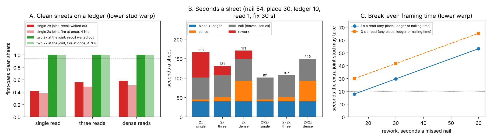

**Milestone 7 headline: what does a clean sheet cost in dollars, by robot class? A G1 on a
drive-and-lift base is the cheapest robot below about 500 houses a year, it beats the hand crew
in only 37% of draws at 100 houses a year (74% at 300), and doubled joint studs never pay in
dollars.** Milestone 5's seconds, priced: ownership (price, life, interest and upkeep spread over
the wall sheets of V houses a year, capped at 2,000 machine hours), people (supervision, an
operator, and the person who still carries the sheet) at a loaded carpenter wage, and the extra
joint stud ($3.41–5.56 for a 92 5/8 in precut, retail listings, plus a framer's minute or two).
Over 4,000 draws with common random numbers, the **hand crew** costs **$5.21 a sheet** (median;
$1.93–14.46 over the taskbook's own sweep of its minutes). The **base** costs $54, $19, $7.03,
$3.48 and $2.20 at 10, 30, 100, 300 and 1,000 houses a year; the **walking H1** about 2.5 times
that, and it beats the base in **no draw** at any volume or sensing policy. The **gantry**
($40k–600k, unsourced) is cheaper than the base in the median draw only from **about 500 houses
a year**. Every robot picks **single 2x joints with three reads**: the extra stud costs
**$5.42 a sheet**, and the rework it saves (0.79 missed nails) is worth well under a dollar of
robot time, so doubling pays only if a missed nail costs **about $6.50 more than its re-drive**
(about ten loaded person-minutes: an inspection callback would; a robot re-driving its own miss
would not). Where a shear wall already requires 3x or doubled joints the stud is sunk and the
milestone 5 result stands. The base's cost is moved most by its life and its base price (rank
correlation ±0.58), both unsourced.

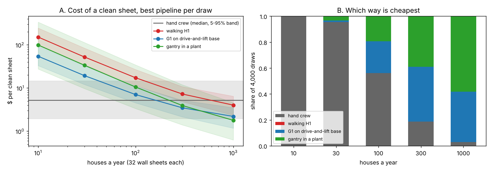

**Milestone 6 headline: do the MuJoCo results survive a second physics engine? Yes for clean
sheets: Drake moves no ledger pipeline by more than 0.06 points.** Every simulated number above
came from one contact model, MuJoCo's soft contact. Milestone 6 rebuilt the ledger seat and the
ledger slide in **Drake** (Toyota Research Institute's `MultibodyPlant`, point contact, the SAP
solver of Castro et al. 2022) with the same sheet, contacts and holder law. A sheet released
under a light press seats in both: Drake leaves **0.0014° (1σ, 0.0047° at most)** over 2,000
random seats, a hundred times MuJoCo's 0.00001° but twenty times under the 0.03° a sheet may hang
on single 2x joints, so all 24 of milestone 5's ledger pipelines keep their clean-sheet rates
within **0.06 points** (the bar was 10). The press at which wall friction stops the ledger working
is **97–100%** of the closed form m g W / (2 μ r̄) in Drake and **87–99%** in MuJoCo: in MuJoCo wall
friction starts holding the sheet at up to 13% less press, the cautious side for a press limit. The
push height that tips a sliding sheet matches W / (2 μ_l) within 0.7% in Drake (1.6% in MuJoCo). Two things do depend on
the contact model: a soft held wrist (300–3,000 N·m/rad) keeps up to **0.016°** in Drake where
MuJoCo and the closed form give zero, and a bottom edge bowed 1/16 in rocks the sheet **0.107–0.123°**
in Drake and **0.139–0.145°** in MuJoCo, both under the 0.149° milestone 3 charged. A sheet on its
bowed middle is balanced, so how far it rocks is set by friction and approach, not by statics:
milestone 3's full rock is the conservative side.

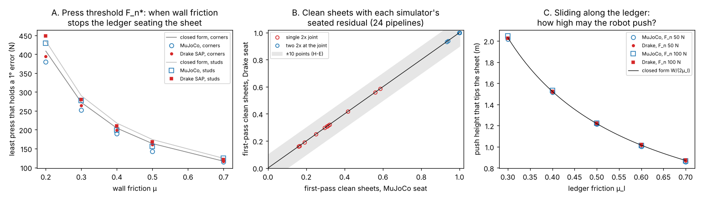

**Milestone 6b: does a bowed sheet edge rock the sheet off plumb? Not if the bow is a curve.**
Milestones 3 to 6 modelled PS 2's 1/16 in bottom-edge bow as three feet, so the sheet balanced on
its middle foot and fell onto a corner: a rock of 2 s / W = 0.149°, on which MuJoCo and Drake
disagreed by 0.02–0.03°. A real bow is a curve. A parabolic 1/16 in bow over 48 in has a radius of
**117 m**, against a centre of mass 1.22 m above it, so the sheet is a stable rocker: gravity rolls
it back to level and only wall friction keeps a tilt, at most θ_s = μ F_n r̄ / (m g (R − h0)).
Modelled as 25 to 401 feet on the curve, both engines seat inside that band in all 48 cells
(0.007° at most at a 5 N press, 0.058° at 50 N), and over 2,000 random seats the 99th percentile
is **0.06°** in both. Charged to milestone 5's pipelines, the best single-2x pipeline goes from
**0.560 to 0.625** clean sheets (doubled joints move by 0.45 points at most) and the engines now
agree within 0.11 points. A kink, a chipped edge or **1 mm of grit on the ledger** keeps a rock
(0.05–0.09° for grit, up to 0.15° for a kink at a light press), set by how the sheet lands rather
than by statics, which is why the engines disagreed before. Placement rules: back the press off
once the sheet is down, and keep the ledger clean.

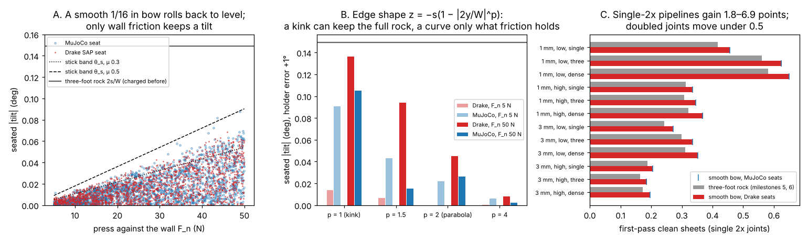

**Milestone 8: the paper draft.** [`paper/draft.md`](paper/draft.md) writes milestones 1 to 7
up as one article for *Automation in Construction* (highlights, abstract, methods, results by
hypothesis, discussion, limitations, references in [`paper/references.bib`](paper/references.bib)).
[`paper/check_numbers.py`](paper/check_numbers.py) ties its 70 quoted figures to the results
files they came from. Scored against the proposal's five hypotheses: H-B (a humanoid needs a
guide), H-C (rows need stud referencing) and H-E (two contact models agree) held; H-D held in its
first half (base beats walker) and was refuted as registered in its second (the gantry crosses
at about 500 houses a year, not 30–300); H-A (aim from the edge) held only at a 0.5 mm stud read
and is not what decides an as-built wall: the joint framing is.

**Milestone 9: straighten the bowed joint stud instead of doubling it? It removes the bow, not
the cap.** Carpenters push a bowed stud onto the line and nail it there; once the first sheet's
joint nails hold it, it stays straight for the next sheet. Treating the stud as a Stud-grade 2x4
bending flatwise between pinned plates (E from the NDS Stud-grade values, 1.2–1.4 million psi,
COV 0.25), one push at mid-height takes **48 E I b / L³**: a median of **28 N** and a 99th
percentile of **126 N** at the lower published warp (53 and 232 N at the higher), 376 N for a
grade-limit stud, and it leaves at most 7.4% of the bow (0.296 b if the plates held the ends
fixed). A G1 can push about **81–88 N** sideways at stud mid-height (ankle roll), enough for 93% of
low-warp studs and 69% of high-warp ones; an H1 about 120 N (99%, 86%). Order matters: pushing
each point onto the line just before its nail, after the nails below it are in, needs up to
1,258 N at the 99th percentile on high-warp studs, so push first and then nail. Straightened,
single-2x joints score within three points of straight studs: the best single-2x pipeline goes
from **0.56 to 0.71** clean sheets at the lower warp and from **0.31 to 0.68** at the higher
(0.63→0.78 and 0.34→0.75 with milestone 6b's smooth-bow rock). It does not reach 95%: even on
straight studs single 2x stops at **0.74–0.81**, because the sheet's own pose on the ledger is
then what closes the window. Doubled joints stay the only route to 95% first-pass clean sheets.
In dollars (G1 on a lift base, 100 houses a year) straightening costs about what it saves at the
lower warp (cheaper than not pushing in 10% of draws) and pays at the higher (92%), and it is
always cheaper than the doubled stud.

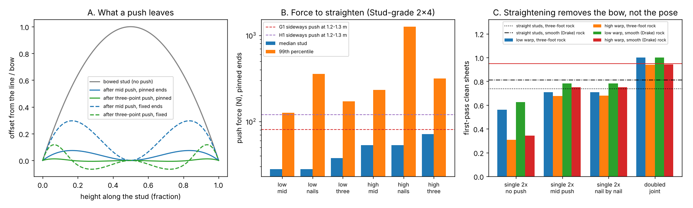

**Milestone 10: what caps single-2x joints once the studs are straight? The nail gun as much as
the sheet, and the two only hurt together.** Milestone 9 left single-2x joints at **0.74–0.81**
clean sheets on straight studs and read the gap as the sheet's pose. Switching each of the six
remaining error sources on and off (all 64 subsets, 20,000 sheets each) says otherwise: by
Shapley share of −ln(clean), the tool's 0.9 mm scatter carries **45–47%**, the stud and edge reads
**12–15%**, and the pose (slide, ledger slope, panel geometry) **39–44%**. Neither group misses on
its own: a perfect tool on the real pose gives 0.995–1.000, a perfect pose with the real tool and
reads 0.957. The joint window is ±3.14 mm and every millimetre the sheet sits off shrinks one
side's half by half a millimetre, so the tool's tail and the pose's offset fail *together*. Two
placement fixes before tacking, sliding the sheet along the ledger to centre its gap on the read
studs and shimming the low corner until the edge reads plumb, lift straight studs from 0.74–0.81
to **0.92** (0.5 mm residuals) and **0.94** (0.25 mm), and pushed low-warp studs to **0.89–0.92**.
That is still short of 95%. Reaching it needs both fixes *and* a tool held to **0.79–0.84 mm**
(1σ) instead of `buildbot-fasten`'s 0.9 mm; without them the tool would need 0.41–0.66 mm.
Doubled joints remain the simple route; for single 2x the order of work is slide, shim, push,
then a tighter tool.

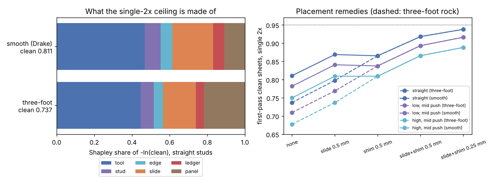

**Milestone 11: what do real installed studs look like, and does the parabola every milestone
assumed hold up? Bow sizes match the books; the shape does not, and it costs single 2x 11–15
points.** The first measured studs in the programme come from a public laser scan (Adel et al.
2024 data set, CC BY 4.0; 1.8 million points, 0.019 mm depth resolution) of a full-scale 2x4
wall two industrial robots built: six vertical studs, five inclined members, scanned on the face
sheathing is nailed to. Sliced every 10 mm, the six studs bow a median **0.106 in** scaled to
8 ft (largest 0.283 in), right on the published kiln-dried mean of 0.11 in. Their shape is not a
parabola: after the best-fit parabola each stud keeps **0.6–0.9 mm RMS** of waviness (a
synthetic face on the scan's 2 mm profile grid leaves 0.27 mm), and on the three most bowed the
parabola explains only 64–79% of the shape. About half of that waviness is common to every
member at the same height, which points to the scan's stitched passes rather than the wood, so
the post hoc check removes it and keeps the rest (0.3–0.6 mm). Put back into milestone 9's best
single-2x pipeline, the measured studs give **0.43–0.47** clean sheets against **0.58** for
parabolas at the same studs' own bows and 0.625 for the model's low-warp draw: the parabola
flattered single 2x by 11–15 points, and a nail window of ±3 mm cannot absorb a millimetre of
waviness a three-read fit does not see. Doubled joints give **1.000** on the measured studs in
every variant, so the programme's recommendation gets stronger. One wall and six studs: enough
to refute the shape assumption, not to estimate a population.

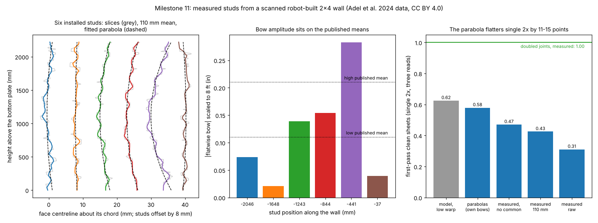

**Milestone 14: what does a missed nail that nobody finds do to a shear wall? About 2% of its
sheet's racking capacity each, more where misses cluster, and 4 in joint nailing covers them.** A
rigid-plastic model of a fully anchored sheathed wall (Källsner and Girhammar 2009), which tracks
SDPWS's spacing table to within 6%, scores the miss patterns of milestone 12's robot. One joint-edge
nail missed costs **2.0–2.2%** of the sheet. With three stud reads on the measured studs, every miss
left in, the mean sheet keeps **97.7%**, but the 99th-percentile sheet only **88.5%**: a stud the
robot misjudges is misjudged for a run of heights, so 13% of sheets miss three or more nails. Nailing
the two joint edges at **4 in instead of 6 in** keeps **99.98%** of sheets at or above the intact 6 in
sheet with every miss left in, and costs less than re-driving the misses ($6.98 against $7.10 a sheet,
against $12.17 for a doubled joint stud). The model is optimistic about clustered misses: with the
bottom foot unnailed it loses 20% where tested walls lost about half (Weiss 2017), so its losses are
lower bounds; at 2.45 times the loss, 97.6% of 4 in sheets still clear the bar.

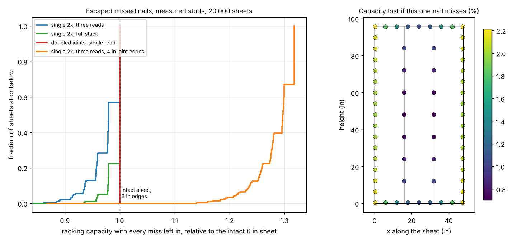

**Milestone 15: do weak stud-to-plate joints explain why the shear-wall model was too optimistic? No,
not at code strength.** Milestone 14's model pinned the studs to the plates with joints of unlimited
strength. Rebuilt as a limit analysis of the whole framed sheet (a linear programme over the top plate,
four studs and the sheet), with each stud held by two 16d end nails at the NDS yield-limit strength
(**2.55** sheathing nails' worth), the bottom foot unnailed still costs only **20–21%** of the sheet,
not the "close to or more than half" Weiss (2017) measured. Reaching 40–50% takes joints at
**0.46–0.56** of the NDS ratio, or a sheet **without hold-downs** (64–100%), so the gap lies in
anchorage or in ultimate strengths the design equations do not give. One thing the rigid model hid: a
lone sheet whose top plate can tilt loses **7%** intact and **16.7%** at the 99th-percentile
escaped-miss sheet (11.5% before); a top plate that only slides, as a continuous wall line holds it,
restores milestone 14's figures, and **4 in joint edges** carry the misses under every joint model
(99.89–99.98% of sheets at or above the intact 6 in sheet).

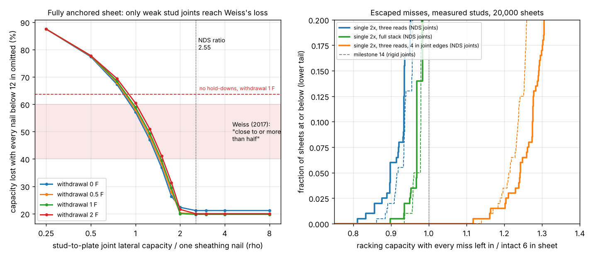

**Milestone 16: do softening nails explain the gap instead? No: in a racking sheet the perimeter nails
all slip about the same.** With every nail a spring on the tested backbone of an 8d common nail through
7/16 in OSB (Shameli Derakshan et al. 2019: 0.97 kN peak, 0.5 kN/mm, 0.8 Fp at 29 mm) and the sheet
pushed over, the intact sheet peaks at **9.8 kN (551 plf) at 2.3% drift**, and omitting every nail below
12 in still costs **20.1–20.4%** at every slip-at-peak from 6 to 15 mm, monotonic or cyclic, and 20.4% for a
nail that drops to 0.8 Fp a millimetre past its peak; rigid-plastic gave 20.4%. At the sheet's peak the
perimeter nails slip 11–12 mm and only the field nails near the centre of rotation lag (3–4 mm), so no
nail is far past its peak while others are short of theirs. The escaped-miss figures stand (mean loss
2.39%, 99th percentile 11.8%, against 2.34% and 11.5%), and 4 in joint edges still carry the misses in
99.98% of sheets. Of milestone 15's three candidates for Weiss's 50% loss, softening nails are now ruled
out alongside code-strength framing joints; the anchorage is what is left.

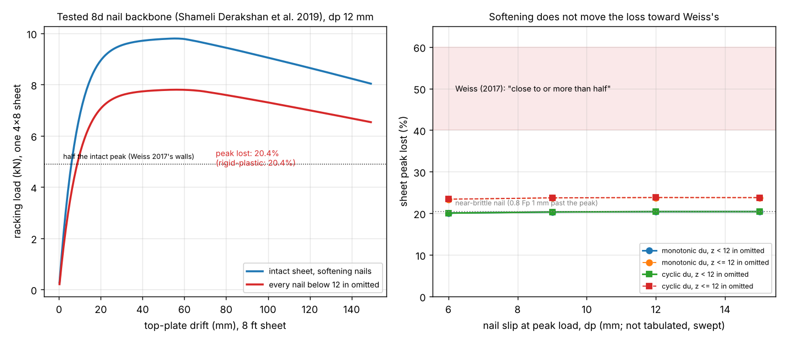

**Not a rated accuracy or a safety case.** Gaussian errors, mostly swept rather than measured;
a single nail outside its window counts as a failed sheet, though a person could pull and
re-drive it. Nailing near people needs a risk assessment (ISO 10218, ISO/TS 15066).

## Milestone 1 method (`src/buildbot_sheathing/budget.py`)
- **Windows.** The 62-nail schedule of [`buildbot-fasten`](../buildbot-fasten): 17 joint nails
  on each vertical edge (6 in), 7 field nails on each intermediate stud (12 in), 14 plate nails.
  A joint nail must land at least 3/8 in from the sheet's actual edge and with its shank on the
  stud face. Field and plate nails keep [`buildbot-studfind`](../buildbot-studfind)'s windows.
- **Sheet.** Its left edge sits at gap/2 + offset + x + θ (z − H/2) from the joint stud's
  centre, its right edge one sheet width further. x and θ are the hanging error, the width is
  48 in minus a trim plus a manufacturing error.
- **Aim.** *Nominal*: the centre of the design window from the robot's estimate of the stud.
  *Edge*: the centre of the window between the measured edge (+3/8 in) and the estimated far
  stud face.
- **Rows.** *Butt*: each sheet set against the last with a gauge gap (offsets accumulate).
  *Stud*: each sheet set from its own studs (the gap absorbs the width error).
- **Checks** (`tests/`, 6 tests): with no gap the model reproduces `buildbot-studfind`'s
  quadrature within 0.01 at three error settings; translation-only and rotation-only results
  match closed forms (|x| ≤ h, |θ| ≤ h/(H/2 − 3/8 in)) within 0.01; edge aim with perfect
  sensing passes exactly while the shifted window is non-empty; a row of exactly trimmed panels
  does not drift.

| Input | Value | Source |
|---|---|---|
| Nail, stud face, edge distance, schedule | 8d common (0.131 in), 1.5 in, 3/8 in, 6/12 in | [`buildbot-fasten`](../buildbot-fasten); edge distance also APA builder tips and West Fraser's install guide, via search |
| Panel gap | 1/8 in at edges, centred on the stud; swept 0 to 3/16 in | APA builder tips (a recommendation, not a requirement), via search, not opened |
| Panel trim ("sized for spacing") | 0, 1/16, 1/8 in | APA TT-055 (up to 1/8 in at the maker's option); "typically 1/16 in" from a JLC Q&A answer; via search |
| Tool-tip scatter | 0.9 mm per nail | `buildbot-fasten` model result (G1, 11-bit joint sensors) |
| Stud estimate scatter | 0.5 mm (0.3 mm sensitivity); swept in table A | **not measured**; inside `buildbot-studfind`'s budget |
| Edge-line error | 0.25, 0.5, 1 mm | **not sourced**: swept |
| Gauge-gap scatter, panel width scatter | 0.5 mm; 0.5 and 1 mm | **not sourced**: one product sheet lists ±1/16 in on width (seen in search); swept |

## Milestone 2 method (`src/buildbot_sheathing/asbuilt.py`)
- **Studs.** Each stud's face line is a parabola of bow b (zero at the plates, sign random) plus
  a straight lean from independent plate-layout errors at its ends; its section twists linearly,
  φ(z) = φ<sub>T</sub>(z/H − 1/2), with φ<sub>T</sub> = (twist rise)/3.5 in. 8 ft warp figures
  are scaled to the 92 5/8 in precut stud (bow by length², twist by length). Magnitudes are
  half-normal or exponential with a published mean, truncated at the grade limit. Crook moves the
  face out of the wall plane and is not modelled.
- **Twist.** A nail must keep its whole shank in wood for at least 10 nail diameters (1.31 in;
  6D swept) within the 2 1/16 in an 8d nail has past 7/16 in sheathing, through the rotated
  section with the sheathing bearing on its high corner. The band of good positions is computed
  by clipping the nail line against the rotated rectangle (`_band_one`, `Band`).
- **Sheets** are straight and plumb; on each joint stud the gap is centred on the middle of the
  robot's estimate of the stud's range (minimax), and panels are cut to fit (milestone 1's width
  drift is left aside).
- **Sensing.** *single*: one read at mid-height (studfind). *ends*: two reads, a line. *three*:
  bottom, middle, top, a parabola. *dense*: a read at each of the 17 joint heights, a fitted
  parabola. Reads 0.5 mm (1σ, independent), measured edge 0.5 mm, tool 0.9 mm.
- **Checks** (`tests/test_asbuilt.py`, 8 tests): the untwisted band is the stud face less the
  shank; the band is mirror-symmetric in twist and shrinks with it, by no more than the
  small-angle bound; straight studs and perfect sensing reduce to the closed-form erf product of
  the 62 half-windows (within 0.01); three or dense reads recover a noiseless parabolic bow
  exactly while a single read passes exactly a quarter of sheets; the bow feasibility edge
  matches the arithmetic (4h on the stud's range, 2h on the plate line) within 3%; truncated
  draws keep their mean and limit; a 3x joint widens the window by 1/2 in a side.

| Milestone 2 input | Value | Source |
|---|---|---|
| Stud-grade warp limits, 8 ft 2x4 | crook 1/4 in, bow 3/4 in, twist 3/8 in | USDA Forest Service reports quoting the 1978 NHPMA grading rules, and Shelly, Arganbright and Birnbach (1979), *Wood and Fiber* 11(1):50–56 (0.64, 1.90, 0.95 cm); seen in search results, not opened. One USDA report gives bow 1/2 in |
| Published mean warp, kiln-dried 2x4 studs | bow 0.11, twist 0.08 in ("low"); bow 0.21, twist 0.16 in ("high") | Koch, *Forest Products Journal* technical note (crook, bow, twist 0.06, 0.11, 0.08 in; drying treatment unclear from the snippet); Koch (1974), southern pine studs between serrated kiln sticks (0.13, 0.21, 0.16 in); both southern pine, seen in search results, not opened |
| Shape of the warp distribution | half-normal and exponential, truncated at the limit | **not sourced**: only means were visible; both shapes are reported |
| Required penetration | 10 D = 1.31 in (6 D swept) | NDS full-design-value penetration, **from memory**, not checked this session |
| Nail length, sheathing | 2.5 in 8d common; 7/16 in OSB | standard sizes |
| Joint framing alternatives | 3x (2.5 in face), two 2x fastened (3.0 in) | SDPWS 4.3.7.1 (3 in nominal or two 2x at adjoining panel edges, for some shear walls), via AWC errata and code-table snippets in search results |
| Plate layout error at each stud end | 0, 0.8, 1.6, 3.2 mm | **not sourced**: swept |
| Stud read, edge line, tool | 0.5, 0.5, 0.9 mm | as milestone 1 (read and edge swept there; read swept in table E here) |

## Milestone 3 method, first part (`src/buildbot_sheathing/ledger.py`)
- **Scene (MuJoCo 3).** A rigid sheet, 1.219 x 2.438 x 0.011 m and 21.8 kg (7/16 in OSB,
  `buildbot-payload`), pressed against a wall box through explicit contact points on its back
  face (the four corners, or 20 points on four stud lines at 16 in) and lowered onto a level
  ledger box through two corner feet. Elliptic friction cone, impratio 10, 20 no-slip
  iterations, stiff contacts (solref 0.002), 0.5 ms step.
- **Holder.** An in-plane impedance on (y, z, θ) at the sheet's centre, aimed at a pose off plumb
  by θ0, plus a press F_n into the wall and a weak torque keeping the sheet flat. At first ledger
  contact the vertical support and translation gains ramp to zero over 0.5 s. *Released*: the
  rotational stiffness ramps out too. *Held*: it ramps to k (swept 300 to 30,000 N·m/rad) and
  stays. The tilt is read 2 s after release.
- **Closed forms** checked against it: the press at which wall friction holds the gravity moment
  about the landing corner, μ F_n r̄ = m g W/2 with r̄ the mean distance from that corner to the
  wall contacts (1.596 m for the corners), and a held wrist's residual
  max(0, θ0 − (m g W/2 − μ F_n r̄)/k).
- **Panel and ledger** (Monte Carlo through milestone 4's model, 20,000 sheets a cell, seed 5).
  The tilt of the vertical edges is the ledger's slope (a laser line uniform within 1/8 in at
  30 ft, plus a Gaussian height error at each of the sheet's bottom corners, swept 0–2 mm) plus the
  panel's corner angle (uniform within ± a fraction of PS 2's limit) plus the rock of an
  outward-bowed bottom edge (bow uniform within ± the same fraction of 1/16 in; bowed out, the
  sheet rests on its middle and a random corner, tilt 2s/W). Translation σx = 3 mm on doubled
  joints, 0 on single 2x; three reads, edge aim, tacked.

| Input | Value | Source |
|---|---|---|
| Sheet | 1.219 x 2.438 x 0.011 m, 21.8 kg | 4x8 7/16 in OSB; mass from `buildbot-payload` (1.5 lb/ft², retail listings) |
| Squareness | diagonals within 1/64 in per ft of the longest edge (1/8 in, 0.083°) | PS 2-18 §5.2.1.3, opened 2026-11-12 |
| Edge straightness | within 1/16 in of the corner-to-corner line | PS 2-18 §5.2.1.3 |
| Laser line | 1/8 in at 30 ft (0.020°) | maker listings (Fluke PLS 180, Stabila LAX 320, DeWalt, Makita), seen in search |
| Wall friction μ | 0.2–0.7 swept | wood on wood 0.25–0.5 in a secondary table (Engineering Toolbox); Wood Handbook figure not found |
| Ledger height error | 0–2 mm a corner, swept | not sourced |
| Press, wrist stiffness, θ0 | swept | robot-dependent; no figure found |

## Milestone 3 method, second part (`src/buildbot_sheathing/humanoid.py`)
- **Robots.** Unitree G1 (29 joints) and H1 (19) from MuJoCo Menagerie at the commit pinned in
  `buildbot-payload`, standing square to the wall, centred on the sheet, hands 0.36 m (G1) or
  0.44 m (H1) apart at reach x and height z. `buildbot-payload`'s static model solves the pose
  (feet fixed, combined CoM over the feet, leaning by F_n z / weight for a press as in
  `buildbot-fasten`) and the joint torques with the ground wrench split between the soles. A
  pose passes if every joint is inside its torque limit, both soles carry load and the ground
  force stays inside a friction cone (rubber on concrete, μ 0.3 and 0.6 swept, as in
  `buildbot-fasten`).
- **Jobs.** *Carry*: heaviest load in both hands with no press (`max_payload`). *Press*: largest
  F_n into the seated sheet. *Slide*: largest F_n while also pushing the sheet sideways with
  P = μ_l m g + μ_w F_n, μ_l 0.3 and 0.5, μ_w 0.4. Forces are split equally between the hands.
- **Tipping while sliding** (MuJoCo, part one's sheet, wall and ledger with separate friction on
  the wall and ledger contacts). A hand at height h above the bottom edge pushes through a spring
  (20 kN/m) moving at 5 cm/s while the press is applied at h_press; the threshold is the least h
  whose slide tilts the sheet past 0.5° (bisection to 1 cm). Closed form, moments about the
  leading bottom corner: h* = (m g W/2 + μ_w F_n h_press) / (μ_l m g + μ_w F_n), which is W/(2μ_l)
  when the press is at the push height, because the wall friction then acts at that height too.
- **Stiffness.** Joint PD gains as published by Unitree: G1 arms and waist kp 60 N·m/rad
  (`unitree_sdk2`, `g1_arm7_sdk_dds_example.cpp`), G1 legs 100/150/40 (hips/knee/ankles,
  `unitree_rl_gym` G1 deploy config); H1 150/200/40 legs, 300 torso, 150 shoulder, 100 elbow
  (`unitree_rl_gym` `h1_config.py`); read 2026-11-12. With the feet planted (the base follows by
  least squares through the foot Jacobian), the hands' compliance is C = J K⁻¹ Jᵀ and the sheet's
  stiffness for a rotation about the wall normal through the landing corner is tᵀ C⁻¹ t, t the
  hands' motion per radian: point velocity and, for a rigid clamp, rotation; for palm (point)
  contacts, point velocity only. The lower bound lets the sheet translate freely in the wall
  plane (a Schur complement). Compared with part one's limit (m g W/2 − μ F_n r̄)/θ0.

| Input | Value | Source |
|---|---|---|
| Robots | G1 29-dof, H1 | MuJoCo Menagerie, commit in `buildbot-payload/src/buildbot_payload/fetch.py` (BSD-3-Clause, Unitree) |
| G1 arm and waist gains | kp 60 N·m/rad, kd 1.5 | `unitreerobotics/unitree_sdk2`, `example/g1/high_level/g1_arm7_sdk_dds_example.cpp`, main, read 2026-11-12 |
| G1 leg gains | hips 100, knee 150, ankles 40 | `unitreerobotics/unitree_rl_gym`, `deploy/deploy_mujoco/configs/g1.yaml` |
| H1 gains | hips 150, knee 200, ankle 40, torso 300, shoulder 150, elbow 100 | `unitree_rl_gym`, `legged_gym/envs/h1/h1_config.py` |
| Foot friction | 0.3, 0.6 swept | `buildbot-fasten` (rubber on concrete spans about this range) |
| Ledger friction μ_l | 0.3–0.7 swept | wood on wood 0.25–0.5 (secondary table, part one); not measured |
| Palm friction μ_h | 0.5–1.0 swept | not sourced |

## Milestone 4 method (`src/buildbot_sheathing/tack.py`)
- **Hang.** On milestone 2's as-built studs (three reads at 0.5 mm, edge line 0.5 mm, tool
  0.9 mm, gap centred on each joint stud's estimated range), the sheet hangs off by a translation
  x and a rotation θ about its centre, both Gaussian and swept.
- **Aim.** *Edge*: each joint nail at the middle of the window between the measured edge line
  (+3/8 in) and the estimated far side of the stud. *Nominal*: as if the sheet hung where intended.
- **Hold or tack.** *Tacked*: the pose is frozen before the edge is measured (a shift while
  tacking folds into the hang). *Held*: each nail also sees an independent sway of the sheet
  along the wall, after the edge was measured.
- **Re-hang.** After measuring, the robot predicts each joint nail's half-window from its measured
  edge and stud estimate; below a threshold (swept 1–2.5 mm) it re-hangs, at most five hangs a
  sheet, the last nailed whatever it predicts. A re-hang is a fresh, independent hang.
- **Checks** (`tests/test_tack.py`, 6 tests): with no hang error it reproduces milestone 2 within
  0.012; translation-only and rotation-only results match closed forms for edge aim (|x| ≤ 2h,
  |θ| ≤ 2h/(H/2 − 3/8 in)) and nominal aim (|x| ≤ h); re-hanging matches the geometric hang count
  and the 1 − (1 − p)<sup>5</sup> clean rate; sway on straight studs matches a numerical
  integral (it moves only the edge side of the window); wider joints allow a coarser hang.

## Milestone 5 method (`src/buildbot_sheathing/cycle.py`)
- **Cycle** (steady state along a row): *place* (a lift stands the sheet on the ledger, the robot
  slides and presses it; milestone 3's tilt draw with the laser rating, 0.5 mm a corner and PS 2
  panels uniform within the limits; 1 or 3 mm left along the wall after the slide), two tacks,
  *sense* (three new studs a sheet, the left joint stud is shared, plus both edges: 5, 11 or 53
  reads for single, three and dense), *nail* (edge aim, `tack.simulate`), *rework* (each missed
  nail found and re-driven). *Lift-tack*: no ledger, the lift hangs to 0.25° and 5 mm (1σ).
- **Recoil.** *Wait*: `buildbot-nailseq`'s 2.4 s a sheet at 4 N s on a fast arm, 0 on a slow one.
  *Fire at once*: its largest left-over tip error at the next nail, 0.37 mm, added to the 0.9 mm
  tool scatter in quadrature as a Gaussian (conservative: the real residual is a bounded
  transient).
- **Seconds** (all swept, 108 cells): nailing with moves and settles 54 or 121 s
  (`buildbot-mobilebase`, fast and slow, 2 s settle); place 15/30/60 s; ledger 0/10/20 s a
  sheet; 1 or 3 s a read; rework 15/30/60 s a missed nail. The extra joint stud is reported as a
  break-even time, not charged.
- **Checks** (`tests/test_cycle.py`, 6 tests): read counts and stage sums; with straight studs
  and a perfect hang only the tool scatter is left (> 0.97 clean); the two-2x three-read ledger
  cell reproduces milestone 3's 1.0000.

## Milestone 6 method (`src/buildbot_sheathing/drake_seat.py`)
- **Second contact model.** Drake 1.51.1 `MultibodyPlant`, discrete at 1 ms, point contact
  (stiffness 10^6 N/m, Hunt-Crossley dissipation 5 s/m) solved by SAP (Castro et al. 2022,
  arXiv:2110.10107), a convex formulation whose stiction is near-rigid. MuJoCo
  (milestone 3) solves soft contact with an elliptic cone, `impratio` 10 and no-slip iterations.
- **Same scene, line for line.** The sheet's only collision geometry is 2 mm spheres at the wall
  contacts and feet, filtered as in the MuJoCo model (wall contacts touch only the wall, feet only
  the ledger); the holder impedance, its release over 0.5 s, the press and the slide's pushing
  spring are copied from `ledger.seat` and `humanoid.slide_sim` and applied as one external wrench
  a step.
- **Checks.** Milestone 3's grids (200 released seats, ten press thresholds by bisection, 30
  held-wrist cells, the bowed edge, creep under a stuck press) and milestone 3b's ten tip heights,
  against the closed forms and the stored MuJoCo results. **H-E:** 2,000 seats on the same random
  draws in both simulators (holder error U(−1°, 1°), wall friction U(0.3, 0.5), press U(5, 50 N),
  seed 13); each simulator's seated residuals are resampled into milestone 5's ledger tilt draw
  (`cycle.clean_cell(residual=...)`) and the 24 ledger pipelines rerun (20,000 sheets, seed 7).
- **Drake's own settings.** Contact stiffness 10^5 and 10^7 N/m, dissipation 0.5 and 50 s/m,
  time step 0.5 and 2 ms, and Drake's TAMSI (Castro et al. 2020, arXiv:1909.05700; deprecated in
  Drake) and lagged solvers, on one seat and the μ 0.4 threshold.

## Milestone 7 method (`src/buildbot_sheathing/cost.py`)
- **Classes.** *Hand crew*: `buildbot-taskbook` S1 carry 0.8, S2 hold and square 1.5 and S4 nail
  62 x 0.1 person-minutes a sheet, times its one-third-to-three-times sweep (log-uniform); its own
  missed nails are not modelled. *Walking H1*: nailing 84.7–264.7 s (the walking-G1 range of
  `buildbot-mobilebase`, 5–20 s a step), a ledger, a person carries the sheet (milestone 3b).
  *G1 on a drive-and-lift base*: nailing 54–121 s (`buildbot-mobilebase`), ledger or lift-tack, a
  person carries the sheet. *Gantry* in a plant: nailing 20–115 s, scan 10–60 s, load 30–180 s
  (`buildbot-custom`), the table fence as the ledger. Where in its range each robot nails is one
  shared draw.
- **Pipelines.** Per draw, each class takes its cheapest of single or two 2x joints by single or
  three reads (and ledger or lift-tack on the base), with missed nails from milestone 5
  (`experiments/m5_cycle/results.json`, lower warp, recoil waited out). Every missed nail is
  re-driven, so the cost of a sheet is the cost of a clean sheet.
- **Dollars.** Ownership = price x (capital recovery factor + upkeep) / sheets a year, sheets =
  min(32 V, 2,000 h / seconds a sheet). People = loaded wage x (supervision x machine seconds +
  carry seconds). Doubled joints add the stud and 60–120 s of a framer.

| input | range | source |
|---|---|---|
| Carpenter wage, burden | $29.12/h, x1.0–1.6 | BLS, via [`buildbot-cost`](../buildbot-cost) |
| Hand minutes a sheet | 8.5 at mid, x1/3–3 | [`buildbot-taskbook`](../buildbot-taskbook) (its author's estimate) |
| 2x4 92 5/8 in stud | $3.41–5.56 | retail listings (McCoy's, Saber Sales, Foxgal) seen through search, 2026-11-12, not opened |
| G1 | $13,500–21,600 | Unitree's page ("from $13.5K") and 2026 retailer listings, seen through search |
| H1 | $90,000–150,000 | press reports of the launch ([`buildbot-cost`](../buildbot-cost)) |
| Drive-and-lift base | $10,000–40,000 | **not sourced** |
| Gantry | $40,000–600,000, log-uniform | **not sourced** ([`buildbot-custom`](../buildbot-custom)'s sweep) |
| Life, interest, upkeep | site 2–7 y, gantry 7–20 y; 4–10%; site 5–20%, gantry 3–12% a year | **not sourced** |
| Supervision, operator | 0.1–1.0 and 0–0.5 person-h a machine-h | [`buildbot-cost`](../buildbot-cost), [`buildbot-custom`](../buildbot-custom) sweeps |
| Stage times | place 15–60 s, ledger 0–20 s, read 1–3 s, re-drive 15–60 s; framer 60–120 s a stud | **not sourced**, milestone 5's sweep |

## Milestone 9 method (`src/buildbot_sheathing/straighten.py`)
- **Beam.** The stud bends flatwise about its weak axis (I = 3.5 x 1.5³ / 12 = 0.984 in⁴) over
  the 92 5/8 in clear span, its stress-free shape milestone 2's parabolic bow, its ends held by
  the plates either pinned (end-nailed; the realistic case) or fixed (the bound). A push is a
  displacement imposed at a point; the force follows from a cubic-Hermite finite-element beam
  (192 elements) and, for a mid push, the closed form c E I b / L³ with c = 48 or 192 and a
  shape left of b u (1 − 2u)² or 4 b u (1 − 2u)².
- **Policies.** *mid*: one push at mid-height onto the line through the stud's estimated ends;
  *nails* (registered): mid first, then bottom up, each joint nail's point pushed to within 0.5 mm
  of the line and held by its nail; *three* (post hoc): a simultaneous push at u = 1/6, 1/2 and
  5/6, a straightedge held at three points. The push is set from a read, so the stud is
  straightened as if its bow were b + N(0, 0.5 mm); the robot believes the shape the policy leaves
  for its own three-read estimate of the bow. Field studs are not pushed.
- **Clean sheets** are milestone 5's ledger pipeline (`tack.simulate` through `cycle.clean_cell`,
  s_x 1 mm, recoil none, 20,000 sheets, seed 7) with both joint studs replaced by their
  straightened shape, under milestone 3's three-foot bow rock and milestone 6b's smooth-bow seats.
- **Capacity.** `humanoid.max_side_push`: milestone 3b's static whole-body check (torque limits,
  both soles loaded, no foot slip) for a push along the wall with both hands at 1.0–1.3 m.
- **Dollars** are milestone 7's model for the G1 on a lift base, with 10–40 s a sheet added for
  the push (unsourced) and missed nails from the clean-sheet run.

| input | value | source |
|---|---|---|
| Stud-grade E (reference) | DF-L 1.4, Hem-Fir 1.2, S-P-F 1.2 million psi | NDS Supplement Table 4A (WCLIB/WWPA, NLGA rules) as tabulated by [Engineers Edge](https://engineersedge.com/civil_engineering/engineering_properties_structural_lumber__15400.htm), read 2026-11-13 (the AWC PDF was not reachable) |
| Southern Pine 2x4 "No.3 and Stud" E | 1.3 million psi (E_min 470,000) | [SFPA/SPIB design values, Table 1](https://www.southernpine.com/wp-content/uploads/2023/09/TABLE01_L1.pdf), read 2026-11-13 |
| COV of E | 0.25, lognormal | NDS Appendix F for visually graded lumber; consistent with the table: 1.3e6 (1 − 1.645 x 0.25) x 1.03 / 1.66 = 475,000 ≈ E_min 470,000 |
| Bow, twist | low and high published warp, grade limit 3/4 in | milestone 2 |
| Push tolerance | 0.5 mm (0.25 and 1 mm reported) | **not sourced**: about one read's scatter |
| Push time | 10–40 s a sheet | **not sourced** |

## Milestone 10 method (`src/buildbot_sheathing/ceiling.py`)
- **Sources.** Milestone 5's ledger pipeline (single 2x, three stud reads, edge aim, recoil none,
  20,000 sheets, seed 7) on straight studs, with six switches: *tool* (0.9 mm a nail,
  `buildbot-fasten`), *stud* (0.5 mm a read), *edge* (0.5 mm), *slide* (1 mm translation left
  after the slide), *ledger* (laser rating and 0.5 mm at each corner) and *panel* (PS 2 squareness
  and the bottom-edge rock, three-foot or milestone 6b's smooth-bow seats). All sources on
  reproduces milestone 9's 0.7370 exactly.
- **Shapley shares** of −ln(clean) over all 64 subsets (exact, not sampled). −ln(clean) is close to
  the expected number of misses when misses are rare, so the shares split the misses, with each
  interaction shared equally between the sources in it.
- **Slide** (after seating, before tacking): the robot reads both edges against its stud estimates
  and slides the sheet to centre the gap; translation left = √((0.5 mm)²/2 + s_slide²).
  **Shim**: it reads the left edge at the end joint-nail heights (2.39 m apart) and lifts the low
  corner until plumb; tilt left = √2 × 0.5 mm / 2.39 m plus s_shim / 1.22 m. s_slide and s_shim
  are swept 0.25–1 mm (not sourced: no shim or slide accuracy was found).
- **Tool scatter needed** for 95%: bisection on s_robot (12 steps, fixed seed).

## Milestone 11 method (`src/buildbot_sheathing/measured.py`)
- **Data.** Adel, Ruan, McGee and Mozaffari (2024, *Automation in Construction* 164, 105444,
  doi:10.1016/j.autcon.2024.105444), wall module experiment: a 2.05 m by 2.32 m
  2x4 frame (two plates, six vertical studs at about 402 mm, five members inclined 6°), butt
  jointed by two industrial robots with a topology-based feedback loop, scanned from one side by a
  laser profiler on the robot (0.150 mm profile resolution, 0.019 mm depth resolution, a profile
  every 2 mm, passes stitched on the robot's calibration). Data set doi:10.34770/0w80-p436, CC BY
  4.0; `experiments/m11_measured/extract.py` downloads it, checks its SHA-256 and writes
  `profiles.json` (the extracted profiles; the raw scan is not committed).
- **Extraction.** A plane fitted to the front surface (inlier sd 1.41 mm) gives u along the wall,
  v up, w out. Each member is sliced every 10 mm of height; per slice the face's two edges (0.5
  and 99.5 percentiles of the points within 1.5 mm of its top), its centre, mean w and slope dw/du
  (the section's rotation, i.e. twist). Bow is the parabola coefficient of the centreline about a
  least-squares chord; lean and layout come from the chords' ends against a uniform grid.
- **Calibration.** Synthetic faces (38.1 mm, 3.2 mm eased corners) on a 2 mm profile grid at 8
  phases: bows of 0–6 mm come back to 0.25 mm RMS, and a perfect parabola leaves 0.27 mm RMS of
  quantisation, the floor any measured residual is read against.
- **Pipeline.** Milestone 9's best single-2x ledger pipeline (`tack.simulate`, three or dense
  reads, s_x 1 mm, edge aim, 0.9 mm tool, Drake smooth-rock seats, 20,000 sheets, seed 7) with a
  new `profiles` argument: each of a sheet's four studs is one of the six measured shapes, with
  random left-right and top-bottom flips, its deviation scaled to the 92 5/8 in stud by length
  squared and its measured twist in place of the linear one. Variants: raw slices, a 110 mm
  running mean, the 110 mm mean less the part common to all eleven members (post hoc, see
  results), twist off, and each stud's own fitted parabola with a linear twist.

## Milestone 12 method (`tack.simulate`, `local` policy and the push on any shape)
- **Question.** Do milestones 9 and 10's single-2x remedies (a mid push, a slide and a shim) still
  work on milestone 11's measured studs, and is their loss the robot's estimate (a fitted
  parabola) or the geometry (a straight edge on a wavy face)?
- **Per-nail reads (`policy="local"`).** The robot reads each stud at every nail height (17 on a
  joint stud, 7 on a field stud, 0.5 mm each) and aims each nail at its own read, with no fitted
  shape.
- **Mid push on any shape.** By superposition on the scanned shape: the stud's mid-height point
  moves by its offset from the chord through its ends plus N(0, 0.5 mm), times the pinned
  point-load shape; the robot believes its estimate moved by its own estimated offset times the
  same shape. On a parabola this is milestone 9's push.
- **Grid.** Single 2x, Drake smooth-rock seats, 0.9 mm tool, 20,000 sheets, seed 7; studs
  measured (110 mm mean), measured less the common part, each stud's own parabola, and straight;
  three, dense or per-nail reads; push or not; milestone 9's ledger or milestone 10's slide and
  shim (0.5 mm). Doubled joints on measured studs; the tool scatter that gives 95% (bisection).

## Milestone 13 method (`src/buildbot_sheathing/price.py`)
- **Question.** Which single-2x pipeline is cheapest per clean sheet on milestone 11's measured
  studs once each remedy's seconds are charged, and does the doubled joint stud now pay?
- **Model.** Milestone 7's G1 on a drive-and-lift base and its 4,000 draws (seed 11), at 100, 300
  and 1,000 houses a year; every missed nail is found and re-driven. Clean sheets and missed nails
  from milestone 12's 12 single-2x cells on measured studs (and the common-removed bracket); a new
  20,000-sheet cell for doubled joints with a single read.
- **Seconds charged.** Point reads at t_read U(1, 3) s each: three reads 9 a sheet, dense 51, per-nail
  31 (17 on the new joint stud, 7 on each new field stud), plus 2 edge reads. Or, for dense and
  per-nail reads, a line laser swept along the three new studs, 3 × 2.353 m / v, v log-uniform
  0.05–0.5 m/s (unsourced; ISO 10218-1's 250 mm/s reduced speed sits inside it). Mid push U(10, 40) s
  (milestone 9); slide and shim U(5, 30) s plus 2 edge reads (unsourced). Seed 29.
- **Break-even.** The extra dollars a missed nail must carry, beyond its re-drive, for doubled joints
  to tie the per-draw cheapest single-2x pipeline: (cost doubled − cost single) / (missed single −
  missed doubled).

## Milestone 14 method (`src/buildbot_sheathing/racking.py`)
- **Question.** If a missed nail is never found, how much racking capacity does the sheet lose, given
  where a robot's misses actually fall?
- **Model.** Källsner and Girhammar's plastic model of a fully anchored wall (2009, *Engineering
  Structures* 31(9), 2171–2181, [doi:10.1016/j.engstruct.2009.03.023](https://doi.org/10.1016/j.engstruct.2009.03.023);
  the full text was not opened, so this is the model as we understand it from its abstract-level descriptions):
  framing pinned at its joints (a stud nail at height z moves γz, a top-plate nail γH, the bottom plate
  none), a rigid sheet, every fastener rigid-plastic with one capacity F along its slip. Capacity is the
  least plastic work over the sheet's rigid motions, H·γ·H_wall = F·min Σ|slip_i|, a convex problem
  solved by reweighted least squares (checked against Nelder–Mead). Only ratios are reported, so F is
  not needed. A missed nail carries nothing. Sheets in a wall share γ, so a wall is the sum of its sheets.
- **Checks.** SDPWS Table 4.3A's ratios across edge spacing (H60), read from secondary copies (the
  Massachusetts reprint of IBC Table 2306.3, [780 CMR 2306.3](https://regulations.justia.com/states/massachusetts/780-cmr/chapter-23/section-2306/subsection-2306-3),
  and a [Huber tech tip](https://www.huberwood.com/uploads/documents/technical/Shear-Capacity-and-Wood-Structural-Panels-Tech-Tip-Wall-ZIP-System.pdf)
  quoting SDPWS 2021); Weiss's walls tested with the bottom 12 in unnailed (H61; B. D. Weiss, *Structural
  performance of light-frame shear walls with simulated decay and a repair design*, MS thesis,
  Washington State University, 2017, [record](https://rex.libraries.wsu.edu/esploro/outputs/graduate/Structural-performance-of-light-frame-shear-walls/99900525291401842);
  only its abstract was read).
- **Misses.** `tack.simulate(return_hits=True)` on milestone 12's measured-stud cells (20,000 sheets,
  seed 7); a 4 in joint-edge schedule via `u_joint` (25 heights a side). Wall lines: 100,000 random
  draws of four sheets. Cost: milestone 7's model with 16 more nails at t_nail / 62 seconds each.

## Milestone 15 method (`src/buildbot_sheathing/frame_lp.py`)
- **Question.** Does finite strength in the stud-to-plate joints explain why milestone 14's model lost
  20% with the bottom foot unnailed where Weiss's walls lost about half, and does it change an escaped
  miss's cost?
- **Model.** Upper-bound (kinematic) limit analysis over small rigid motions of the top plate, each of
  four studs (centrelines at 0, 16, 32 and 48 in) and the sheet, the bottom plate fixed and the top
  plate's mid-point moved one unit along the wall; the least total dissipation is the capacity, solved
  as a linear programme (SciPy's HiGHS). Sheathing nails: rigid-plastic, F along the slip (a 64-sided
  polygon, at most 0.12% low), on the member milestone 14 assigns them. Stud-to-plate joints: lateral
  ρF, bearing in compression, opening against ωF; hold-downs fix the end studs' bottoms vertically.
- **ρ from the NDS yield-limit equations** (single shear, R_d = 2.2; dowel bearing 16,600 G^1.84 psi;
  F_yb 100 ksi for 0.131 in and 90 ksi for 0.162 in nails): an 8d common through 15/32 in OSB (G 0.50)
  into G 0.50 framing, against two 16d common end nails through a 1.5 in plate (IRC Table R602.3(1))
  with the end-grain factor 0.67. ω = 0 (NDS allows no end-grain withdrawal), swept to 2.
- **Checks.** Rigid joints against milestone 14 over 200 three-read miss patterns (H65); the NDS 16d
  value against Table 12N's 141 lb (`tests/test_frame_lp.py`).

## Milestone 16 method (`src/buildbot_sheathing/softnail.py`)
- **Question.** Milestones 14 and 15 gave every nail a rigid-plastic capacity. Real nails peak at some
  millimetres of slip and then soften, so the nails that slip most may be past their peak before the
  rest reach theirs. Does that explain the gap to Weiss's walls, and does it change an escaped miss's cost?
- **Model.** Milestone 14's kinematics (pinned framing, rigid sheet, full anchorage) with each nail a
  nonlinear spring along its slip (the oriented-spring idealisation behind CASHEW; Folz and Filiatrault
  2001, [doi:10.1061/(ASCE)0733-9445(2001)127:4(433)](https://doi.org/10.1061/(ASCE)0733-9445(2001)127:4(433))):
  P = Fp(1 − (1 − δ/δp)^n) up to the slip at peak δp, then a straight fall through 0.8 Fp at Δu to zero at
  δp + 5(Δu − δp). The top plate is pushed to 150 mm in 0.25 mm steps; at each step the sheet's (u, v, θ)
  minimises the springs' energy (damped Newton from the last step; residual under 1e-9 Fp), and the load
  is dE/dΔ. Loading is taken as path-independent; no nail's slip fell before the sheet's peak in any case.
- **Backbone, sourced.** 8d common nails through 7/16 in OSB into SPF, Table 2 of Shameli Derakshan, Zhou
  and Ni (2019, [MOC Summit](https://journalofindustrializedconstruction.com/index.php/mocs/article/download/127/125/125);
  six replicates a group): Fp the mean of the monotonic groups (0.972 kN); the secant stiffness at 0.4 Fp
  the mean of the cyclic groups (0.496 kN/mm; the authors call the monotonic values unreliable), which sets
  n; Δu 28.7 mm (monotonic) or 20.6 mm (cyclic). δp is not tabulated: swept 6–15 mm.
- **Checks.** An elastic-perfectly-plastic backbone yielding at 0.01 mm against milestone 14's capacity
  on 202 patterns (H70); SDPWS's spacing ratios (H71); energy derivative, symmetry and backbone points in
  `tests/test_softnail.py`.

## Reproduce
```bash
pip install numpy matplotlib pytest
cd research/buildbot-sheathing
python -m pytest -q tests                                    # 103 test functions; one uses ../buildbot-studfind, seven need mujoco, two the Menagerie models, four drake, five scipy
python experiments/m1_gap_placement/run.py > experiments/m1_gap_placement/results.txt   # ~12 s, writes results.json
python experiments/m1_gap_placement/figure.py
python experiments/m2_asbuilt_studs/run.py > experiments/m2_asbuilt_studs/results.txt   # ~40 s, seed 3
python experiments/m2_asbuilt_studs/figure.py
python experiments/m4_tack_measure/run.py > experiments/m4_tack_measure/results.txt     # ~100 s, seed 4
python experiments/m4_tack_measure/figure.py
python experiments/m5_cycle/run.py > experiments/m5_cycle/results.txt                   # under a minute, seed 7
python experiments/m5_cycle/figure.py
python experiments/m7_cost/run.py > experiments/m7_cost/results.txt                     # under a second, seed 11; reads m5's results.json
python experiments/m7_cost/figure.py
pip install mujoco                                           # milestone 3; results made with mujoco 4.0.1
python experiments/m3_ledger/run.py > experiments/m3_ledger/results.txt                 # ~95 s, seed 5
python experiments/m3_ledger/figure.py
python experiments/m3b_humanoid/run.py > experiments/m3b_humanoid/results.txt          # ~6 min; clones Menagerie G1/H1 once
python experiments/m3b_humanoid/figure.py
pip install drake                                            # milestone 6; results made with drake 1.51.1 (Python 3.11)
python experiments/m6_drake/run.py > experiments/m6_drake/results.txt                   # ~7 min on 4 CPUs; seeds 13 and 7
python experiments/m6_drake/figure.py
python experiments/m6b_bowed_edge/run.py > experiments/m6b_bowed_edge/results.txt       # ~5 min on 4 CPUs (MuJoCo 4.0.1, Drake 1.51.1); seeds 5, 13, 7
python experiments/m6b_bowed_edge/envelope.py > experiments/m6b_bowed_edge/envelope.txt # ~3 min, post hoc, seed 21
python experiments/m6b_bowed_edge/figure.py
python experiments/m9_straighten/run.py > experiments/m9_straighten/results.txt       # ~1 min (MuJoCo for section C); seeds 5, 7, 11, 23
python experiments/m9_straighten/figure.py
python experiments/m10_ceiling/run.py > experiments/m10_ceiling/results.txt           # ~1 min, seed 7; reads m6b's results.json
python experiments/m10_ceiling/figure.py
python experiments/m11_measured/extract.py                   # downloads the 54 MB data set once (CC BY 4.0), writes profiles.json
python experiments/m11_measured/run.py > experiments/m11_measured/results.txt         # ~15 s, seed 7; reads profiles.json and m6b's results.json
python experiments/m11_measured/figure.py
python experiments/m12_remedies/run.py > experiments/m12_remedies/results.txt         # ~40 s, seed 7; reads m11 profiles.json and m6b's results.json
python experiments/m12_remedies/figure.py
python experiments/m13_price/run.py > experiments/m13_price/results.txt               # ~5 s; reads m12's results.json, m11 profiles.json, m6b's results.json
python experiments/m13_price/figure.py
python experiments/m14_escaped/run.py > experiments/m14_escaped/results.txt         # ~10 s, seed 7
python experiments/m14_escaped/figure.py
pip install scipy                                            # milestone 15; results made with scipy's HiGHS
python experiments/m15_frame_joints/run.py > experiments/m15_frame_joints/results.txt # ~11 min (about 4,000 LPs), seed 7
python experiments/m15_frame_joints/figure.py
python experiments/m16_soft_nails/run.py > experiments/m16_soft_nails/results.txt   # ~25 min (about 7,000 pushovers), seed 7
python experiments/m16_soft_nails/figure.py
python paper/check_numbers.py                                # every number the paper quotes, against its results file
```

## Milestone 1 results (`experiments/m1_gap_placement/results.txt`)
- **A. Gap.** Joint half-window 3.93, 3.73, 3.53, 3.34, 3.14, 2.74 mm at gaps 0, 1/32, 1/16, 3/32,
  1/8, 3/16 in; stud scatter allowed for 95%: 0.90, 0.79, 0.68, 0.56, 0.41, 0 mm; tip scatter
  allowed with perfect studs: 1.23, 1.17, 1.11, 1.05, 0.98, 0.86 mm. At `buildbot-studfind`'s
  0.89 mm: 0.95 clean without the gap, 0.75 with it planned for, 0.56 (1.1 nails missed) if the
  robot aims for no gap.
- **B. Pose** (gap 1/8 in, tip 0.9 mm). At stud 0.5 mm, nominal aim is at 0.93 clean with a
  perfect sheet, so no pose error is allowed; edge aim allows 0.62 / 0.44 / 0 mm of translation
  and 0.044° / 0.031° / 0° of rotation with the edge measured to 0.25 / 0.5 / 1 mm. At stud
  0.3 mm: nominal 0.38 mm and 0.028°, edge (0.5 mm) 0.61 mm and 0.042°. Edge aim also halves the
  stud error's weight (the aim point sits midway between edge and stud face): 0.93 to 0.96 clean
  with a perfect sheet.
- **C. Rows of 10 sheets** (gauge and width scatter 0.5 mm, edge aim). Butted full panels: clean
  0.98, 0.22, then 0; butted 1/16 in trimmed panels: 0.98, 0.73, 0.25, 0.05, 0.01, then 0;
  butted 1/8 in trimmed panels: 0.95 falling to 0.66 by sheet 10 (the gauge error accumulates);
  set from the studs: 0.98 at every sheet. With 1 mm of width scatter, stud-referenced 1/16 in
  panels would need a negative gap at 5.6% of joints.
- **Pre-registered hypotheses** ([`LOG.md`](LOG.md)): H1 held; H2 held trivially; H3 held at
  the planned setting and fell short (ratio 1.6) at a tighter one; H4 partly refuted (the third
  butted sheet's window exists in 46% of trials, but none is clean); H5 refuted.

## Milestone 2 results (`experiments/m2_asbuilt_studs/results.txt`)
- **A. Geometry.** Half-window 3.14 mm. The largest wall bow that leaves a window on both sides
  of a single-2x joint is 12.5 mm with the gap centred on the stud's range (0.53 in over 8 ft) and
  6.3 mm centred on the plate line (0.27 in). Stud-grade's limit is 17.7 mm on the stud. Studs
  whose bow closes a joint: 0.01% and 0.7% (low warp, half-normal and exponential), 4.0% and 5.4%
  (high warp) with minimax centring; 5–31% with the plate line. Twist shrinks the side of the band
  the nail runs toward: the half-band falls from 17.38 to 16.94, 16.03 and 14.64 mm at 1°, 3° and
  6° (10D); the grade limit is 5.9° end to end.
- **B. H6.** Every stud at the bow limit: no feasible sheet under three or dense reads (minimax);
  single and ends pass 25%, the sheets whose own sides of both joints happen to open, which
  closes the neighbouring sheet's side.
- **C. Main table** (clean sheets; single / ends / three / dense). Straight studs 0.94 / 0.96 /
  0.96 / 0.97. Low warp, half-normal 0.55 / 0.55 / 0.80 / 0.83 (1.7, 2.2, 0.26, 0.21 nails missed
  a sheet); exponential 0.58 / 0.59 / 0.77 / 0.79. High warp, half-normal 0.39 / 0.35 / 0.47 /
  0.50; exponential 0.45 / 0.40 / 0.52 / 0.55.
- **D. Ablation (low warp).** Twist alone costs 1 point (three: 0.959 to 0.949); bow alone 14
  (0.818); 6D instead of 10D penetration gains 2 points; perfect reads lift three to 0.85 and
  perfect reads and edge to 0.87: the ceiling is the window the bow leaves against 0.9 mm of tool
  scatter, not sensing.
- **E.** Read scatter allowed for 95% on straight studs: 0.44 / 0.55 / 0.60 / 1.19 mm; with the
  low published warp no policy reaches 95% at any read scatter.
- **F. Culling (low warp).** Rejecting studs bowed over 1/4, 1/8 and 1/16 in (7%, 36%, 65% of
  studs) gives three-read 0.85, 0.92, 0.94 and dense 0.88, 0.94, 0.96.
- **G. Lean.** Plate layout error of 0.8 / 1.6 / 3.2 mm at each end takes three-read from 0.80 to
  0.78 / 0.72 / 0.55.
- **H. Joint framing** (added after C–F). A 3x joint (2.5 in face) or two 2x fastened (3.0 in):
  largest bow 37.9 and 50.6 mm, above the grade limit. Three or dense reads: **1.0000** at both
  warp levels and both shapes. Single read: 0.99 and 0.85 (3x, low and high warp), 1.00 and 0.95
  (two 2x).
- **Pre-registered hypotheses** ([`LOG.md`](LOG.md)): H6 held; H7 held (0.55 < 0.80); **H8
  refuted** (three reads give 0.80, not ≥ 0.95, on single-2x joints); H9 held (twist costs 1.4
  points, under 3).

## Milestone 3 results, first part (`experiments/m3_ledger/results.txt`)
- **A. Released seat** (corners, 200 runs). At F_n ≤ 100 N every cell (μ 0.2–0.7, θ0 0.25–2°)
  ends within 0.0001° of the ledger; above the threshold the sheet keeps 99.6–100% of θ0, with
  one partial cell (μ 0.3, 250 N: 0.97 of 1°).
- **B. Press threshold** (least press leaving over half of a 1° error). Corners: 380, 253, 189,
  143, 115 N at μ 0.2, 0.3, 0.4, 0.5, 0.7, against 408, 272, 204, 163, 117 N predicted (ratio
  0.87–0.99). Stud-line contacts: 430, 278, 199, 156, 125 N (ratio 0.90–1.00).
- **C. Held wrist** (μ 0.4). The closed form matches 29 of 30 cells within 0.005° or 10%; the
  outlier is 0.089° simulated against 0.119° predicted (100 N, 0.5°, 10,000 N·m/rad), where the
  wrist and friction share the moment and friction is not fully mobilised.
- **D. Sensitivity.** Descent speed 0.01–0.2 m/s, release over 0.1–2 s, half the time step, stud
  contacts and the sign of θ0 change the seated tilt by under 0.0001°; a contact five times
  softer leaves 0.00035°.
- **E. Bowed bottom edge** (1/16 in out). The sheet rocks onto its middle and the corner on the
  side it was tilted to: 0.139–0.145°, against 0.149° for a rigid edge (contact compliance
  under the loaded middle foot). Friction creep with the sheet stuck at 400 N: 4×10⁻⁸ °/s.
- **F. Clean sheets.** Ledger-hang tilt σ: 0.012° (laser only) to 0.154° (2 mm a corner, full PS 2
  panels); 0.085° at 0.5 mm with full PS 2 panels. Two 2x, low warp, σx 3 mm: **1.0000** in every
  cell. Single 2x, straight, σx 0: 0.953 perfect panel and ledger, 0.934 / 0.857 at half / full
  PS 2 limits; 0.844 at a 0.5 mm ledger with full limits, 0.636 at 2 mm. 95% needs panels within
  0.244 of the PS 2 limits with a perfect ledger.
- **Pre-registered hypotheses** ([`LOG.md`](LOG.md)): H13 held (0.00003°); H14 held (ratios
  0.87–0.99); **H15 refuted** narrowly (29 of 30 cells); H16 held (1.0000 against 0.844); H17
  held (0.857 < 0.90).

## Milestone 3 results, second part (`experiments/m3b_humanoid/results.txt`)
- **A. Tipping while sliding.** MuJoCo threshold over closed form 0.984–1.007 in 14 cases (μ_l
  0.3–0.7, F_n 50 and 100 N, press at the push height or fixed at 0.6 or 1.2 m); h* = 2.03, 1.52,
  1.22, 1.02, 0.87 m at μ_l 0.3 to 0.7. Pushed at 0.8 h*, the sheet slides 9 cm in 2 s with a peak
  tilt of 0.004–0.011° and a mean push within 1% of μ_l m g + μ_w F_n.
- **A2. Palm friction.** Sliding by friction at the palms needs F_n ≥ μ_l m g / (μ_h − μ_w): 107 N
  at μ_l 0.3 and μ_h 1.0, 535 N at 0.5 and 0.6, impossible for μ_h ≤ μ_w.
- **B. Whole body** (reach 0.3 and 0.4 m, hands 0.6–1.3 m). G1: carry 2.8–8.7 kg (waist pitch
  or wrist pitch); press 66–110 N at foot friction 0.6, 66–98 N at 0.3 (slip at 98 N); press while
  sliding at μ_l 0.3, 42–96 N (0.6) and 42–50 N (0.3, slip); at μ_l 0.5, at most 41 N, nothing above
  1.0 m (ankle roll). H1: carry 12.4–18.8 kg (elbow); press 128–281 N (0.6), 128–151 N (0.3);
  sliding at μ_l 0.3, 105–206 N; at 0.5, 34–141 N.
- **C. Stiffness about the landing corner at stock gains** (F_n 50 N, x 0.35 m; limit 11,281 /
  5,641 / 2,820 N·m/rad at θ0 0.5 / 1 / 2°). G1 rigid clamp 778–1,946, palm contacts 182–1,101
  (gains could rise 2.9–31 times before the limit at 1°); releasing the wrist roll changes it by
  0.1–19%, all three wrist joints by up to 99%. H1 palm contacts 876–2,740 (2.1–6.4 times under);
  H1 rigid clamp 10,423–613,376, which keeps 0.46–0.99° of a 1° error. With free translation the
  stiffness drops to 0–305 N·m/rad: the pivot, not the joints, sets most of it.
- **C2.** At 1.0 m the sheet's gravity moment (130 N·m) on a stock-gain hold with no weight
  feedforward turns a G1's grip 9.6° (clamp) or 14.2° (palms), an H1's palms 4.8°.
- **Pre-registered hypotheses** ([`LOG.md`](LOG.md)): **H18 refuted in part** (the G1 cannot carry
  and can press, as predicted; the H1 cannot carry either, 18.8 kg at best); H19 held (within
  1.6%); H20 held (G1 slides with ≥ 50 N press at μ_l 0.3 at foot friction 0.6, never at 0.5; the
  H1 at both); **H21 refuted** (stock gains are soft enough except an H1 clamp).

## Milestone 4 results (`experiments/m4_tack_measure/results.txt`)
- **A. Hang allowed for 95% clean sheets** (tacked, 1σ; translation alone, rotation alone).
  Single 2x, straight studs: nominal aim 0.44 mm / 0.032°, edge aim 0.37 mm / 0.029°; at the
  lower published warp nothing (0.83 and 0.81 clean with a perfect hang). 3x, low warp: nominal
  3.8 mm / 0.21°, edge 7.2 mm / 0.38°. Two 2x, low warp: nominal 5.4 mm / 0.29°, edge
  **10.4 mm / 0.54°**; straight studs 10.8 mm / 0.56°. With three reads per stud, aiming from the
  edge loses a little on single 2x joints (its 0.5 mm reading adds noise a near-perfect hang does
  not) and nearly doubles the hang allowed on wide ones.
- **B. Grid** (low warp, edge aim). Single 2x: 0.81 clean with a perfect hang, 0.52 at
  1 mm / 0.1°, 0.23 at 2 mm / 0.2°. Two 2x: ≥ 0.9999 up to 4 mm / 0.2°, 0.983 at 6 mm / 0.3°.
- **C. Sway of a held sheet** allowed for 95%: 0.19 mm (single 2x, straight), none (single 2x,
  low warp), 3.1 / 3.0 mm (3x), 4.2 / 4.1 mm (two 2x).
- **D. Re-hang** (max 5). Single 2x, straight, hang 1 mm / 0.1°: 0.70 without, 0.77 / 0.82 /
  **0.87** / 0.81 at thresholds 1.0 / 1.5 / 2.0 / 2.5 mm, with 1.2 / 1.4 / 2.1 / 3.6 hangs a
  sheet; low warp best 0.66 (1.5 mm, 2.2 hangs). Coarser hangs do worse (best 0.66 at 2 mm /
  0.2°, 0.47 at 3 mm / 0.3°). 3x at 3 mm / 0.3°: 0.967 without, 0.9996 at 2.5 mm with 1.1 hangs.
- **Pre-registered hypotheses** ([`LOG.md`](LOG.md)): **H10 refuted** (re-hanging peaks at 0.87,
  not ≥ 0.95, on single 2x); H11 held (0.54°, 10.4 mm against ≥ 0.2°, ≥ 4 mm); H12 held (sway
  0.19 mm against 4.1 mm).

## Milestone 5 results (`experiments/m5_cycle/results.txt`)
- **A. First-pass clean sheets** (lower warp, ledger, 1 mm after the slide; single / three /
  dense reads). Single 2x: 0.417 / 0.560 / 0.583 (2.16 / 0.79 / 0.70 nails missed); 3 mm after
  the slide 0.250 / 0.295 / 0.309; higher warp 0.314 / 0.308 / 0.323. Two 2x: 0.9997 / 1.0000 /
  1.0000; higher warp 0.938 / 1.0000 / 1.0000. Lift-tack (0.25°, 5 mm): single 2x 0.079–0.092,
  two 2x 0.978 / 0.996 / 0.997. Wilson intervals are in the file.
- **B. Fastest policy** by seconds a sheet including rework: single read on two 2x and three
  reads on single 2x in all 108 cells. At nailing 54 s, place 30 s, ledger 10 s, 1 s reads and
  30 s rework: two 2x single 101 s, single 2x three 131 s (of which 24 s rework), single 2x
  single 166 s (65 s rework).
- **C. Break-even framing time** for the extra joint stud: 17.8–29.8 s at 15 s rework,
  29.6–41.6 s at 30 s, 53.2–65.2 s at 60 s (the lower figure at 1 s reads, the higher at 3 s);
  higher warp 33.8–129.2 s.
- **D. Stages** (two 2x, single read): place 10–57%, sensing 2–17%, nailing 37–86% of the sheet;
  76–216 s a sheet (median 146) against 94–281 s (median 183) for the best single-2x pipeline.
- **Pre-registered hypotheses** ([`LOG.md`](LOG.md)): H22, H23, H24, H25 held; **H26 refuted**
  (fire-at-once recoil costs up to 7.6 points on single 2x, at most 0.12 on two 2x); **H27
  refuted** (placing the sheet outweighs fast nailing in 18 of 108 cells).

## Milestone 6 results (`experiments/m6_drake/results.txt`)
- **A. Released seats** (200 cells): Drake seats every cell MuJoCo seats except where the press is
  within a few percent of the threshold (6 of 200 cells differ, all at the boundary, all in the
  direction of Drake's higher threshold). Below the threshold Drake leaves up to 0.016° (at
  100–300 N; 0.0056° at 50 N or less), MuJoCo 0.0001°.
- **B. Press threshold** (N, Drake / MuJoCo / closed form): corners μ 0.2 394 / 380 / 408, μ 0.4
  199 / 189 / 204, μ 0.7 117 / 115 / 117; Drake/closed 0.965–0.998 on corners, 0.964–1.030 on stud
  contacts; Drake/MuJoCo 1.011–1.127.
- **C. Held wrist:** where the closed form keeps an error (k ≥ 10,000 N·m/rad, or 3,000 at
  100 N and 2°) Drake and MuJoCo agree within 0.07°; where it predicts none, Drake keeps
  0.001–0.016°.
- **D. Drake settings:** the μ 0.4 threshold stays at 187.5–199.7 N across stiffness, dissipation,
  time step and solver; the released seat stays within 0.003° except at the softest contact
  (10^5 N/m, 0.023°).
- **E. Bowed edge** (1/16 in): Drake 0.107–0.123°, MuJoCo 0.139–0.145°, bound 0.149°. **Tilted
  ledger** (1–3 mm over the sheet): the sheet follows it within 0.004° (Drake) and 0.0000°
  (MuJoCo). **Creep** under a stuck 400 N press: 4×10⁻⁵ °/s in Drake, 4×10⁻⁸ in MuJoCo.
- **F. H-E:** seated residual sd 0.00142° (Drake) against 0.00001° (MuJoCo); the 24 ledger
  pipelines' first-pass clean sheets differ by at most **0.06 points**. Cost: 0.11 s a Drake
  seat, 0.025 s a MuJoCo seat (four processes).
- **G. Tip height:** Drake/closed form 0.995–1.007, MuJoCo 0.984–1.007.
- **Pre-registered hypotheses** ([`LOG.md`](LOG.md)): H32 held (worst Drake/MuJoCo 12.7% at
  μ 0.5); H33 held (0.0025° at most, bar 0.005°); **H34 refuted** (70% of held-wrist cells within
  max(0.005°, 10%), bar 90%: the misses are Drake's 0.005–0.016° where the closed form says
  zero); H35 held (0.06 points, bar 10); H36 held.

## Milestone 7 results (`experiments/m7_cost/results.txt`)
- **A. Dollars per clean sheet** (median [5%, 95%]) at 10 / 30 / 100 / 300 / 1,000 houses a year.
  Walking H1: 151.73 / 52.07 / 17.23 / 7.26 / 4.02. Base: 54.43 / 19.28 / 7.03 [4.52, 11.03] /
  3.48 / 2.20. Gantry: 99.24 / 33.49 / 10.51 [3.33, 34.17] / 3.93 / 1.78. Hand crew 5.21
  [1.93, 14.46] at every volume.
- **Cheapest way** (share of draws): hand 1.00 at 10 houses, 0.96 at 30, 0.56 at 100, 0.19 at 300,
  0.03 at 1,000; the base 0.25 at 100 and 0.42 at 300; the gantry 0.58 at 1,000; the H1 never.
- **Pipeline.** All three robots choose single 2x with three reads (ledger on the base) in every
  draw at 100 houses a year.
- **B. Where the dollars go** (two 2x, single read, 100 houses a year): ownership 44% of the base's
  sheet, 62% of the gantry's, 67% of the H1's; the stud 24–44%; people 3–11%.
- **C. Sensitivity** of the base at 100 houses a year: life −0.58, base price +0.58, upkeep
  +0.29, supervision +0.26, hand minutes +0.19 (Spearman).
- **D. Higher warp** raises the medians by $0.14–0.53 a sheet (100 and 1,000 houses a year).
- **E. Break-even** for doubled joints on the base: a missed nail must cost $6.51 [5.21, 7.88]
  more than its re-drive.
- **Pre-registered hypotheses** ([`LOG.md`](LOG.md)): H28 held (the base beats the H1 in every
  draw); **H29 refuted** (the median crossing is at about 500 houses a year, outside 30–300;
  62% of draws cross inside 10–1,000, at a median of 54 houses); **H30 refuted** for every class
  (doubled joints win in 0% of draws, median $5.1–5.3 a sheet dearer); H31 held.

## Milestone 9 results (`experiments/m9_straighten/results.txt`)
- **A. Closed form.** The FE beam gives c = 48.000 (pinned) and 192.000 (fixed) and leaves
  0.07407 b and 0.29630 b at u = 1/6, matching the closed forms. A three-point push needs 64.8,
  14.4 and 64.8 E I b / L³ (pinned) and leaves 0.0117 b.
- **B. Force** (N; median / 95th / 99th percentile over 200,000 studs, pinned). Low warp: mid
  28 / 89 / 126, nail by nail 28 / 95 / 355, three-point 38 / 121 / 170. High warp: mid 53 / 168 /
  232, nail by nail 53 / 780 / 1,258, three-point 71 / 227 / 314. Fixed ends: four times the mid
  push and far more for nail by nail (p99 7,182 N low). Grade-limit stud (17.7 mm at the wall) at
  DF-L's 95th-percentile E (2.04 million psi): mid 376 N, three-point 508 N, nail by nail 2,821 N.
  Nail by nail at a 1 mm tolerance: p99 126 N (low); at 0.25 mm, 791 N.
- **C. Sideways capacity** at 1.2–1.3 m: G1 81–88 N (right ankle roll), H1 120–123 N (shoulder
  yaw), at foot friction 0.3 or 0.6 and reach 0.3 or 0.4 m. Share of studs whose mid push fits:
  G1 0.928 (low warp) and 0.688 (high); H1 0.987 and 0.858.
- **D. Clean sheets** (single 2x, three reads; no push → mid push, pinned). Three-foot rock:
  low 0.560 → 0.710, high 0.307 → 0.677; straight studs 0.737. Smooth-bow rock: low 0.625 → 0.782,
  high 0.344 → 0.750; straight studs 0.811. Nail by nail and three-point push within 0.4 points of
  the mid push; fixed ends lose up to 5 points at high warp. Doubled joints, single read: 0.9994
  and 0.940; three reads 1.000.
- **E. Dollars** (base, median $/clean sheet at 100 houses a year, low / high warp): doubled
  12.17 / 12.20, single 2x no push 7.03 / 7.29, single 2x straightened 7.10 / 7.12. Straightening
  is cheaper than doubling in every draw (at 100 and 300 houses, both rocks) until about 925 s of
  pushing a sheet, and cheaper than not pushing in 7.5–10% of draws at low warp and 92% at high.
- **Pre-registered hypotheses** ([`LOG.md`](LOG.md)): H41 held; H42 held (126 N, bar 200; 376 N,
  bar 400; nail by nail equals the mid push for the median stud); **H43 refuted** (0.71 and 0.68,
  bar 0.95: straightening stops at the straight-stud ceiling); H44 held (100% of draws, bar 90%),
  though milestone 7 had already found doubled joints never pay in dollars, so the bar was low.

## Milestone 10 results (`experiments/m10_ceiling/results.txt`)
- **A. Closed form.** Tool scatter alone, perfect pose and reads: 0.9838 in Monte Carlo against
  0.9833 for the product of the 62 nails' normal probabilities.
- **B. Shapley shares** of −ln(clean) on straight studs (three-foot rock, clean 0.737 / smooth
  rock, 0.811): tool 44.6% / 46.9%, stud read 7.0 / 8.4, edge read 5.0 / 6.1, slide 17.5 / 21.7,
  ledger 4.1 / 5.9, panel 21.9 / 11.0; pose together 43.5% / 38.6%. Alone, every source but the
  tool gives 1.000 clean and the tool 0.984; pose alone 0.995 / 1.000; tool and reads alone 0.957;
  tool and pose 0.805 / 0.874.
- **C. Remedies** (clean, three-foot / smooth rock). Straight studs: none 0.737 / 0.811; slide
  0.5 mm 0.798 / 0.869; shim 0.5 mm 0.865 (both); slide and shim 0.5 mm 0.918, 0.25 mm 0.938, 1 mm
  0.822; slide and shim 0.5 mm with dense reads 0.937. Pushed studs (mid, pinned), slide and shim
  0.5 mm: low warp 0.893, high 0.866 (0.25 mm: 0.916, 0.888; dense reads: 0.922, 0.901). A slide
  that leaves 1 mm is no better than none. With the shim the rock model no longer matters.
- **D. Tool scatter for 95%** (1σ): straight studs 0.48 mm (three-foot) and 0.66 mm (smooth)
  without remedies, 0.84 mm with slide and shim 0.5 mm; low-warp pushed studs 0.41 / 0.60 mm
  without, 0.79 mm with.
- **Pre-registered hypotheses** ([`LOG.md`](LOG.md)): H45 held (|diff| 0.0005, bar 0.003);
  **H46 refuted** (pose 43.5% and 38.6%, bar 50%: milestone 9's reading was half right); H47 held
  (+6.1 and +5.8 points, bar 5); **H48 refuted** (0.893, bar 0.95).

## Milestone 11 results (`experiments/m11_measured/results.txt`)
- **A. Calibration.** True bows 0 / 1 / 3 / 6 mm read back as −0.08 / 0.89 / 2.88 / 5.95 mm (sd
  0.12–0.34); parabola R² 0.06 / 0.60 / 0.90 / 0.97 and 0.23–0.30 mm RMS residual from the 2 mm
  grid alone; a 38.1 mm face reads 36.0 mm wide.
- **B. Resolution.** The six faces read 35.6–36.0 mm wide (all front points), as the synthetic
  38.1 mm face does; centrelines jump 1.2–2.6 mm between some neighbouring slices, the size of
  the profile pitch.
- **C. Six vertical studs.** Bow −1.55, −0.44, −2.92, −3.25, −5.95, +0.83 mm over 2,220 mm
  (0.074, 0.021, 0.139, 0.154, 0.283, 0.039 in at 8 ft; median 0.106 in); parabola R² 0.21, 0.03,
  0.64, 0.74, 0.79, 0.11; RMS residual 0.59–0.94 mm (0.39–0.76 mm after a 110 mm mean). Twist
  end to end −0.3 to 3.5°. Out of plane, the two left studs run 20.5 and 10.9 mm across their
  height (the frame is not flat), the others 2–3.5 mm. Layout about a 402 mm grid: sd 2.0 mm at
  the bottom plate, 5.1 mm at the top; the end studs lean 14.6 and 6.5 mm, the inner four within
  1.7 mm (the paper reports the top plate sagging toward one end).
- **Post hoc: wood or scan?** Residuals after each member's parabola correlate across the
  eleven members (median pairwise r 0.47); their mean carries 48% of the residual variance, against
  9% if independent. Removing it leaves 0.31–0.60 mm RMS on the studs.
- **D. Inclined members.** Bows −1.38, −1.99, +0.54, −5.07, −0.59 mm (0.025–0.238 in at 8 ft);
  all eleven members: median 0.074 in, mean 0.105 in.
- **E. Clean sheets, single 2x, three reads:** measured raw 0.311, 110 mm mean 0.425, common part
  removed 0.471, twist off 0.461, each stud's parabola 0.579; model low warp 0.625, straight 0.811.
  Dense reads: 0.388, 0.474, 0.503, 0.529, 0.600 (model 0.650). Doubled joints: 1.0000 in every
  variant.
- **F. Robot placement in the same data set.** The nail-laminated panel's benchmark poses
  reproduce the paper's Table 1 exactly (mean 1.282 mm in plane; per robot y sd 0.25 and 0.44 mm);
  the adaptive file does not (mean 1.956 mm against 0.401 in Table 1), so it was not used.
- **Pre-registered hypotheses** ([`LOG.md`](LOG.md)): **H49 refuted** (35.6–36.0 mm wide against
  38.1 ± 2, and jumps of 1.2–2.6 mm: the 2 mm profile pitch, which the synthetic face shows as
  well); H50 held (median 0.106 in, largest 0.283 in); **H51 refuted** (R² 0.21–0.79, residual
  0.59–0.94 mm); **H52 refuted** (measured 0.425 against parabola 0.579, 15 points; doubled
  joints 1.000).

## Milestone 12 results (`experiments/m12_remedies/results.txt`)

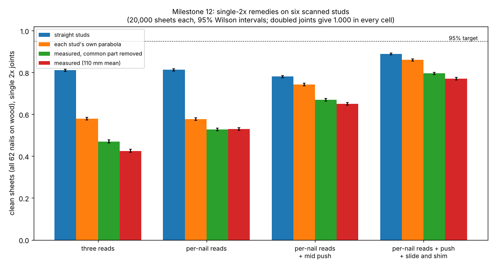

- **Per-nail reads close most of the waviness gap.** Measured studs, ledger, no push: three reads
  0.425, dense parabola 0.474, per-nail reads 0.530 (each stud's own parabola 0.579). The waviness
  cost falls from 15.4 points to 4.7. On parabolic and straight studs per-nail reads gain nothing.
- **The push still pays.** Three reads: 0.425 to 0.552 with a mid push (+12.6 points; +16.3 on
  parabolas). Per-nail reads and the push: 0.650. Forces 10–72 N; four of six studs straighten,
  the most leaning end stud does not (its shape is not a bow).
- **Stacked.** Per-nail reads, push, and slide plus shim: **0.771** (0.796 with the common part
  removed), against 0.860 on parabolas and 0.889–0.937 on straight studs. 95% then needs a tool
  held to 0.61 mm (1σ), against 0.84 mm on straight studs.
- **Doubled joints:** 1.0000 in every cell.
- **Pre-registered hypotheses** ([`LOG.md`](LOG.md)): H53 held (0.530 against a 0.502 bar);
  H54 held (+12.6 points against +10); **H55 refuted** (0.771 against 0.90); H56 held.
- **A bug caught before use.** The first run measured the push from each profile's
  least-squares line instead of its end chord; fixed and tested, and only the fixed run is reported
  ([`LOG.md`](LOG.md)).

## Milestone 13 results (`experiments/m13_price/results.txt`)

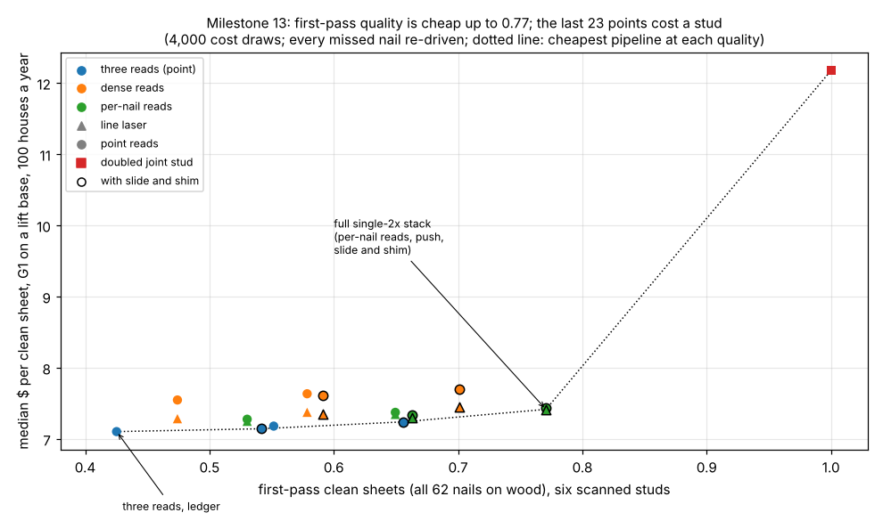

- **First-pass quality is cheap up to 0.77.** At 100 houses a year, three reads on the ledger cost
  a median **$7.10** per clean sheet (0.425 first-pass clean, 198 s); the full stack (per-nail reads
  by line laser, mid push, slide and shim) **$7.42** (0.771, 248 s). Below the machine's capacity,
  extra seconds cost only supervision, so 35 points of first-pass quality cost 32 cents.
- **The doubled joint stud still does not pay.** Doubled joints give 1.000 in 145 s but cost
  **$12.17**: the stud and a framer's time are 44% of it. The per-draw cheapest single-2x pipeline is
  cheaper in **every** draw at 100, 300 and 1,000 houses a year (median saving $5.13).
- **Break-even.** Doubling pays only if a missed nail costs a median **$5.51** more than its re-drive
  [5–95%: $3.91, $8.55], 8.8 loaded person-minutes ($5.83 with the common part removed). Measured
  studs lower milestone 7's $6.51 (the three-read pipeline now misses 1.095 nails a sheet, not
  0.79), but less than that rise suggests: in about half the draws the cheapest pipeline is one that
  misses fewer nails.
- **Line laser or point reads.** Per-nail reads by point (31 + 2 a sheet) cost 15 cents more than
  three reads; by line laser they tie three reads at about **0.23 m/s** sweep speed and win above it.
- **Pre-registered hypotheses** ([`LOG.md`](LOG.md)): H57 held (1.000 of draws against a 0.90 bar);
  H58 held (the full stack is never the cheapest pipeline); **H59 refuted** ($5.51 against a $5.00 bar).
- **Reading it.** The dollar case for doubling rests entirely on what an escaped or late-found missed
  nail costs, which this model does not price: every miss is assumed found. A shear-wall nailing
  defect found at inspection, or not found, is the number a builder would supply.

## Milestone 14 results (`experiments/m14_escaped/results.txt`)

- **The model against the code table.** 4, 3 and 2 in edge spacing give 1.442, 1.884 and 2.769 times
  the 6 in sheet against SDPWS's 1.536, 1.964 and 2.607 (H60 held).
- **The model against a test: unconservative.** The bottom 12 in unnailed loses 20.4% (11 of 62 nails)
  against "close to or more than half" in Weiss's (2017) tests (**H61 refuted**). Every loss here is a
  lower bound.
- **One nail.** A joint-edge nail is worth 2.00–2.21% of the sheet, a plate nail 1.05–1.83%, a field
  nail 0.70–1.02% (H62 held).
- **Misses left in, three reads.** Mean sheet 0.977, 1st percentile 0.885, 13.4% of sheets below 0.95,
  a 16 ft wall's 1st percentile 0.934 (**H63 refuted** on the tail). Full stack: mean 0.994, 1st
  percentile 0.937. Doubled joints: 1.000.
- **4 in joint edges.** Intact 1.318; with 1.572 misses a sheet left in, mean 1.286, 1st percentile
  1.160, 99.98% of sheets at or above the intact 6 in sheet (H64 held); 97.6% at 2.45 times the loss.
  Median $6.98 a sheet at 100 houses a year, against $7.10 for 6 in with re-drives and $12.17 for doubled
  joints.

## Milestone 15 results (`experiments/m15_frame_joints/results.txt`)

- **The joint.** Z = 74.0 lb for the sheathing nail (mode IIIs), 140.7 lb for a 16d end nail (mode IV),
  ρ = 2.55 (2.34 in SPF).
- **Reproduces milestone 14 with rigid joints** (H65 held): ratios within 0.09%; the absolute capacity is
  1.2% higher because the joint-edge nails sit 3/8 in off the stud centreline.
- **Intact sheet at NDS joints** (H66 refuted): −7.2% at 6 in, the spacing check fails at 2 in (2.87 against
  2.61). The cause is a lone sheet's top plate tilting while an interior stud lifts (zero withdrawal); a
  withdrawal of 2 F, or a top plate that only slides (post hoc), removes it.
- **Weiss's pattern** (H67 refuted): 21.1% lost at NDS joints, 19.7–21.1% for any withdrawal; 40% needs
  ρ ≤ 1.42, 50% needs ρ ≤ 1.18; without hold-downs 64% (withdrawal 1 F) to 100% (none).
- **Escaped misses, three reads** (H68 refuted as registered): mean loss 2.73%, 99th percentile 16.7%
  (milestone 14: 2.34%, 11.5%); with a sliding top plate 2.34% and 11.51%. Full stack: 0.73% and 6.5%.
- **4 in joint edges** (H69 held): 99.89% of sheets at or above the intact 6 in sheet (99.98% with a
  sliding top plate).

## Milestone 16 results (`experiments/m16_soft_nails/results.txt`)

- **Reduces to milestone 14** (H70 held): an elastic-perfectly-plastic nail yielding at 0.01 mm gives
  milestone 14's capacity to 0.000% on the intact sheet, the Weiss pattern and 200 miss patterns.
- **Spacing table** (H71 held): 4, 3 and 2 in edge spacing at 1.444, 1.888 and 2.775 of 6 in, against
  SDPWS's 1.536, 1.964 and 2.607 (−6%, −4%, +6%; milestone 14: 1.442, 1.884, 2.769). Peak drift
  55–56 mm (2.3%) at every spacing. Absolute: 9.80 kN a sheet, 8.04 kN/m (551 plf) at the tested Fp,
  beside 560 plf nominal for the heavier 15/32 in Structural I panel (not like for like).
- **Weiss's pattern** (H72 refuted): 20.1–20.4% lost over δp 6–15 mm and both Δu (23.4–23.8% with
  z ≤ 12 in); a near-brittle nail (0.8 Fp 1 mm past its peak) 20.4%. At the peak the perimeter nails slip
  11–12 mm (median 11.0, max 12.3) and only field nails near the centre of rotation lag (min 3.7 mm);
  0–61% of nails are past δp at the sheet's peak, and no nail unloads before it. Omitting the bottom foot
  moves the centre of rotation from 11.8 to 24.9 in below the sheet's bottom edge.
- **One nail alone:** joint edge 2.12% (milestone 14: 2.08%), field 0.85%, plates 1.43%; sum 1.040.
- **Escaped misses, three reads** (H73 held): mean loss 2.39%, 99th percentile 11.80%, 4-sheet wall 1st
  percentile 0.932 (milestone 14: 2.34%, 11.49%, 0.934); the cyclic Δu gives 2.40% and 11.81%.
- **4 in joint edges** (H74 held): intact 1.320 of the 6 in sheet; with 1.572 misses a sheet left in, 99.98%
  at or above the intact 6 in sheet (minimum 0.854).

## Limitations
- **Softening nails (milestone 16).** Monotonic loading only (no cyclic strength degradation, pinching
  or unloading branch; most shear-wall tests are cyclic); one nail-joint study, SPF framing; the slip at
  peak is swept, not measured; milestone 14's kinematics (pinned framing, rigid sheet, full anchorage).
- **Framed-sheet model (milestone 15).** Joint strengths are NDS design-level (yield-limit) ratios, not
  tested ultimates; joints and nails are rigid-plastic, with no softening; bearing friction and hold-down
  shear are ignored. One sheet with its own four studs; Weiss's set-up was not read.
- **Racking model (milestone 14).** Rigid-plastic, equal fasteners, full anchorage, a rigid sheet and
  sheets acting independently; no stiffness, edge-distance, tear-out or cyclic effects. It understates
  clustered missing nails against one test series (about 2.5 times there). Whether a code official
  accepts a schedule that knowingly includes shiners is outside it.
- **Measured studs (milestone 11).** One wall of six studs, of unstated grade and species, built
  by robots that shorten members to fit, scanned from one side with a profile every 2 mm along
  the wall, so a face edge is known to about ±1 mm per slice and passes are stitched on the
  robot's calibration; the part of the waviness common to every member is treated as scan
  artefact, which may also remove some real shape. Length-squared scaling to the 92 5/8 in stud
  assumes constant curvature, which the measured shapes do not have.
- **Gaussian, independent, swept.** Stud, edge, gauge and width errors are swept, not measured;
  real errors have bias and heavy tails. The stud estimate includes the layout scatter
  (studfind's single-read policy).
- **Studs (milestone 2).** Warp means come from two southern pine studies seen as search
  snippets; the distribution shapes are guesses (two are reported); bow is a parabola fixed at
  the plates and twist is linear, both as the free piece warped, though nailing, blocking and
  the sheathing itself pull a stud partly straight (which would help) and studs keep moving as
  they dry in place (which would not). Crook, sheet bow and wall racking are not modelled.
- **Hang and sway (milestone 4).** Gaussian and swept, not measured on any robot; sway is an
  independent translation per nail, with no rotation and no recoil coupling; a re-hang is a
  fresh draw, which understates a robot that corrects from its measurement; the measured edge
  line is taken to have the true slope.
- **Ledger (milestone 3).** A rigid sheet on point contacts; a real OSB sheet flexes, its back
  face touches studs and plates unevenly, and the ledger board itself bows between fasteners. The
  holder is a lumped impedance at the sheet's centre, not a humanoid's arm; the press,
  wrist stiffness and wall friction are swept, not measured. PS 2 gives limits, not distributions:
  the uniform shapes are assumptions, and real panels are probably far inside the limits, which
  is what decides the single-2x case. The bowed edge is modelled at the bottom only; a bowed
  vertical edge would also bend the measured edge line.
- **Second model (milestone 6).** Drake and MuJoCo are both compliant, regularised contact
  models run on the same rigid point-contact sheet; agreeing with each other does not make
  either a real sheet on real framing. A real check needs a framed mock-up.
- **Humanoid (milestone 3, second part).** Static only: no walking, no balance controller, no
  dynamics of the press or slide, and a 50/50 force split between the hands, where pushing the
  sheet's edge would load one hand. The PD stiffness takes the joint gains at face value (no
  motor or gearbox compliance, no grip compliance), with the feet rigidly planted; the published
  gains are examples and training defaults, not a holding controller. The sheet bottom is at
  floor level and the robot centred on it; rigid clamp and palm point contacts bracket a real
  hand. Ledger and palm friction are swept, not measured.
- **Cycle (milestone 5).** Every stage time but the nailing is swept, not measured; each missed
  nail is assumed found and re-driven at one cost, though a joint a bowed stud has closed may need
  a block or a sister stud; stages run in series, with no overlap between the lift and the robot.
- **Cost (milestone 7).** Every machine price but the humanoids', every life and upkeep, and
  every stage time are swept, not sourced. The hand crew's minutes are the taskbook author's,
  and its own missed nails are not charged (which favours it). A site robot is dedicated to wall
  sheathing; moving it between sites, setting it up, insurance and idle days are not priced, and
  neither are a plant's floor space, the walls a plant must ship, or a missed nail found late.
- **Straightening (milestone 9).** A linear Euler-Bernoulli beam with ideal pinned or fixed
  ends; real end nails sit between and can slip, the stud's own bow may relax as it dries or
  creep back before the second sheet, and a stud with a knot near the push point may crack.
  The sheet is taken as rigid in its plane, so a driven nail holds its point; nail slip under
  the stud's spring-back is not modelled. E is a design reference value with an assumed
  lognormal spread, not measured studs. The humanoid capacity is milestone 3b's static check
  with both hands on the stud; a one-hand push while the other hand nails would have less.
- **Ceiling split (milestone 10).** Shapley shares depend on the scale (−ln clean) and share
  interactions equally; "alone" and "all but" values are reported beside them. The slide and shim
  are modelled by their residuals, not as mechanisms: whether a robot can shim a 22 kg sheet on a
  ledger, and to what, is not known; the shim residual's effect on the ledger seat is not
  simulated. The tool scatter is one Gaussian, so the 0.79–0.84 mm target is a 1σ figure.
- **Plate nails** see only the tool scatter: the sheet's vertical placement is not modelled.
- **Strict pass/fail.** One nail outside its window fails the sheet; the nails missed are
  reported beside it, and real practice may accept a near miss or re-drive it.
- **Windows from secondary sources.** The gap, edge distance and trim were read in search
  results (APA pages, a manufacturer's guide, a trade Q&A), not in APA E30 or the code.

## Next steps
Milestone 2 left two checks: measured stud profiles (the Adel et al. 2024 data set, or a scan of
real studs in a wall) in place of means and assumed shapes, and how far sheathing nails pull a
bowed stud straight. Milestone 3 is done for a static robot; what is left is dynamic: a
G1 or H1 walking a sheet the last metre with a person or a lift, the edge push and its one-hand
load, and a controller that feeds the weight forward and drops it at ledger contact, in MuJoCo
with a balance policy. Milestone 5 timed the cycle with swept stage times; a measured time for
each stage (a lift cycle, a stud read, a re-drive) would pin it, and milestone 7 priced the extra
joint stud against the 18–65 s it saves (it does not pay unless a missed nail costs about $6.50 more
than its re-drive). A time study of a crew's sheathing, a quote for a drive-and-lift base and a
nailing bridge, and the cost of a missed nail found at inspection would replace milestone 7's
widest sweeps. Milestone 6 found the ledger results hold on Drake; how far a bowed bottom edge
rocks the sheet depends on the contact model (0.11–0.15°), so a flexible sheet and a measured rock
on a mock-up would pin it. Milestone 8, the paper draft, is done ([`paper/`](paper/)); before submission it needs the Elsevier LaTeX template, the unconfirmed citations checked and authorship decided. Milestone 9 found that pushing a bowed joint stud onto its line
removes the bow's cost at 28–232 N but leaves single 2x at the straight-stud ceiling of 0.74–0.81,
and milestone 10 split that ceiling: the tool's scatter carries about half of it, the pose the
rest, and a slide and a shim before tacking lift it to 0.92–0.94, still short of 95% without a
tool held to about 0.8 mm. Next for single 2x: a measured scatter for a nailer on an arm (the
0.9 mm is one source), a mock-up of the slide and shim, and a mock-up push on real studs to pin
the end restraint. A measured sample of
real panels' squareness and edge bow would settle the single-2x case. Milestone 11 measured six installed studs from a public
scan and found the parabola flatters single 2x by 11–15 points; the next measured check is a
scan with finer profile pitch (or a scan along the studs) of framer-built walls, to separate
the wood's waviness from the scanner's and to give a population, not one wall. Milestone 12
found that reading each stud at every nail height recovers most of that loss, and that per-nail
reads, a mid push and a slide and shim together reach 0.77 on the measured studs (95% needs a
0.6 mm tool); a line-laser stud read on a real robot, and its time, is the next measured input. Milestone 13
priced those remedies: they cost 32 cents a clean sheet for 35 points of first-pass quality, while
the doubled joint stud costs $5.13 more and pays only if a missed nail costs about $5.51 beyond its
re-drive; the cost and detection rate of a missed nail at inspection is now the input that decides
the framing. Milestone 14 sized an escaped miss in capacity (about 2% of its sheet,
clustered) and found 4 in joint nailing carries them; a racking test of sheets with shiners at the
simulated positions would check the model where it is weakest, clustered misses. Milestone 15 found that
stud-to-plate joints at code strength do not close the gap to Weiss's tests; the next inputs are
Weiss's anchorage and wall size (the thesis full text), and tested ultimate strengths of end-nailed
joints and sheathing nails in place of design ratios, or a softening fastener model. Milestone 16 ran the softening fastener on a tested backbone and found
it changes nothing (20.1–20.4% against 20.4%), because a racking sheet slips its perimeter nails almost
equally; what is left is the anchorage, so the next step is a model with hold-down and sill-plate
stiffness and uplift (or Weiss's full text, to read her set-up). The full plan is in [`PROPOSAL.md`](PROPOSAL.md),
"Milestones".

## Owner steps
None needed. A hardware check needs a framed mock-up wall, a nailer on an arm, a measured stud
grid and a risk assessment.

## Outside dependencies (vitamins)
NumPy, Matplotlib (figure), pytest, MuJoCo (Apache-2.0, milestone 3), Drake (BSD-3-Clause, milestone 6). Reads `../buildbot-studfind` in one test, and `../buildbot-payload` and `../buildbot-fasten` (the whole-body model) in milestone 3's second part, which clones the Unitree G1 and H1 models (BSD-3-Clause) from MuJoCo Menagerie at a pinned commit. No group in
`prompt.md` covers construction, and none is claimed.
