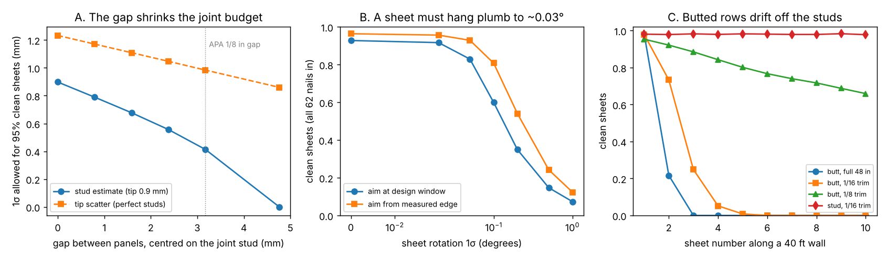
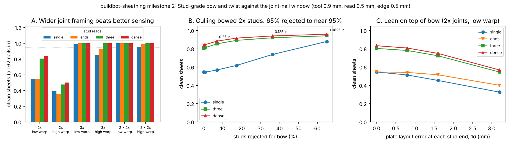
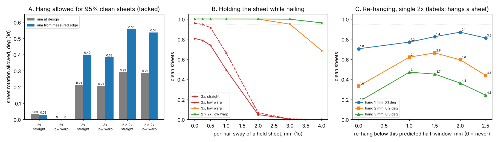
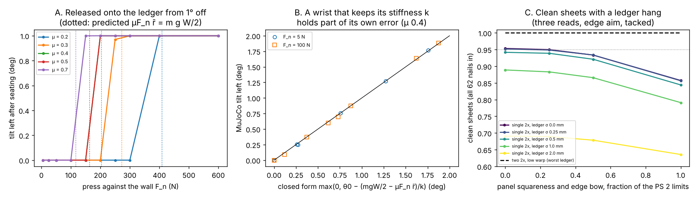
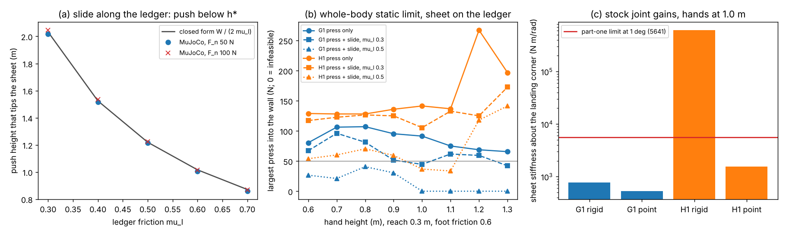

# buildbot-sheathing: can a robot nail wall sheathing to code tolerance, and what decides it?

**Live page:** https://marisstella.app/research/buildbot-sheathing/

A research programme (proposal: [`PROPOSAL.md`](PROPOSAL.md); log: [`LOG.md`](LOG.md)) on
**robotic sheathing of a wood-frame wall**: whether a stock humanoid, a mobile manipulator with a
lift or a purpose-built gantry can hang a 4x8 sheet and land all 62 nails where the panel maker
and the code want them, which error source decides it, and what a clean sheet costs. It pulls
together track 20's 26 `buildbot-*` projects, which priced reach, push, recoil, stud sensing and
cost one at a time, into one question aimed at *Automation in Construction*. Produced with AI
assistance (Claude); simulation and analysis only, nothing tested on hardware.

**Milestone 1 headline: the panel gap and the sheet's own pose set the budget.** Earlier
projects put each sheet edge exactly on its joint stud. Panels are actually hung with a 1/8 in
gap (APA's recommendation), so each edge sits 1/16 in past the stud centre, and the nail must
still be 3/8 in in from that edge and on the stud. That shrinks the 34 joint nails' window from
±3.93 to **±3.14 mm**, and the stud reading a robot needs for 95% clean sheets from 0.90 mm to
**0.41 mm** (1σ, single read, 0.9 mm tool scatter). A sheet must also hang **plumb to about
0.03° (1σ)** and in place to about 0.4–0.6 mm, even when the robot measures the sheet edge and
aims from it; aiming at the design window instead leaves no tolerance at all at a 0.5 mm stud
reading. Along a wall, sheets butted against each other with a 1/8 in gap **leave their studs by
the third sheet** with full 48 in panels and by the fifth with panels trimmed 1/16 in; setting
each sheet from its own studs keeps every sheet at 98% clean.



**Milestone 2 headline: a bowed stud closes the joint, and wider joint framing fixes it where
sensing cannot.** Real studs are not straight. A Stud-grade 8 ft 2x4 may bow 3/4 in and twist
3/8 in, and published kiln-dried studs average 0.11 to 0.21 in of bow and 0.08 to 0.16 in of
twist. Bow moves the 1.5 in nailing face sideways under a sheet edge that is straight, so the
joint window shrinks by the bow whatever the robot knows: a joint stud on a single 2x closes for
any bow over **0.53 in** (8 ft equivalent; 12.5 mm on the stud). At the lower published warp a
robot that reads each stud once gets **55% clean sheets**; reading it at three heights and
fitting the curve gets **80%**, and even perfect stud and edge reads only 87%. To reach 95% on single 2x joints a framer
would have to reject about **two thirds of the studs** for bow (over 1/16 in). Framing the
joints with a **3x or two 2x fastened together**, which the shear-wall standard (SDPWS 4.3.7.1)
already calls for at adjoining panel edges in some shear walls, makes the window 1/2 in wider on each side, and three
reads per stud then give **100% clean sheets** at both published warp levels (20,000 sheets a
cell). Twist costs 1–2 points; plate layout lean of 1.6 mm costs 8.



**Milestone 4 headline: how coarsely may a robot hang the sheet? On doubled joints, about 18
times coarser.** A robot can tack the sheet with two nails in the field studs, measure where its
edge actually landed, and aim the joint nails from that, or re-hang the sheet if the window looks
too tight. On **single-2x** joints this does not rescue a coarse hang: the sheet must still hang
to about **0.03° and 0.4 mm (1σ)** for 95% clean sheets, re-hanging a 1 mm / 0.1° hang tops out at
**87%** (2.1 hangs a sheet), and a held sheet may sway only 0.19 mm under the nail. On **two 2x
fastened at the joint**, tack-then-measure allows **0.54° and 10 mm** (11 mm at the top nail) at
the lower published stud warp, and a held sheet may sway 4.1 mm. That is the placement target
for the humanoid and lift experiments of milestone 3.



**Milestone 3 (first part) headline: does a ledger board square the sheet? Yes, if the robot
lets go and presses lightly; then the panel's own squareness is what is left.** In MuJoCo, a
21.8 kg 4x8 sheet lowered from 0.25–2° off plumb onto a level ledger and released ends parallel
to the ledger within **0.0001°** for any press up to 100 N and wall friction 0.2–0.7. Press harder
and wall friction holds the error: the sheet keeps its full tilt above **115–380 N** (μ 0.7 to
0.2; 189 N at μ 0.4), 0.87–0.99 of the closed form μF_n r̄ = m g W/2. A wrist that keeps its
rotational stiffness also keeps part of its own error once stiffer than about **7,500 N·m/rad**
at 1° (gravity moment 130 N·m over the error). With the ledger seated, what is left is the panel
and the ledger: PS 2 lets a panel be out of square by 0.083° and its bottom edge bow 1/16 in
(a rock of up to 0.149°), and a laser line rated 1/8 in at 30 ft adds 0.020°. A ledger hang then
gives **100% clean sheets on doubled joints** across every ledger and panel setting tried, but at
most **95% on single 2x** joints even with perfect panels and ledger, and **84–86%** with panels
drawn uniformly up to the PS 2 limits; 95% there needs panels within about a quarter of the limits
(0.02° out of square).



**Milestone 3 (second part) headline: can a stock Unitree G1 or H1 be the holder a ledger
needs? It can press and let the ledger seat the sheet, but it cannot carry the sheet there.** In
the static whole-body model (MuJoCo Menagerie models, torque limits, both soles loaded, no foot
slip), the heaviest load a **G1** holds in both hands at 0.6–1.3 m is **2.8–8.7 kg** and an
**H1** **12.4–18.8 kg**, against 21.8 kg for a 4x8 sheet of 7/16 in OSB: neither can hang it
alone, so a lift or a person must stand it on the ledger. Once it sits there, a G1 presses
**66–110 N** into the wall and an H1 **128–281 N**, both over part one's light press. Sliding
the seated sheet sideways to its stud line takes μ_l m g + μ_w F_n (84 N at a ledger friction of
0.3 and a 50 N press); a G1 manages that at μ_l 0.3 but not at 0.5, and it cannot do it through
palm friction (that would need 107 N to 1.5 kN of press), so it must push the sheet's edge. Push
below **h\* = W / (2 μ_l)** (2.03 m at 0.3, 0.87 m at 0.7) or the trailing corner lifts: MuJoCo
agrees within 1.6% in 14 cases. At Unitree's own joint gains (arms kp 60 N·m/rad) a G1 holding
the sheet is **3 to 31 times softer** about the landing corner than the stiffness at which part
one's held wrist keeps its error, so the ledger seats the sheet; the same softness would let the
sheet's own weight turn the hold 10–14° if nothing carried it. An H1 is soft enough through palm
contacts (2–6 times under) but **not with a rigid clamp**: its 4-joint arms keep 0.46–0.99° of a
1° error. Releasing a G1's wrist roll barely matters.



**Milestone 5 headline: what does a clean sheet cost in seconds once every stage is charged?
On doubled joint studs, 76–216 s with one read a stud; on single 2x, 18–65 s more, all of it
rework.** One steady-state cycle along a row: a lift stands the sheet on a laser-set ledger, the
robot slides and presses it so it seats, tacks it, reads the three new studs and both edges, and
nails the 62 nails with edge aim (timed by [`buildbot-mobilebase`](../buildbot-mobilebase));
every missed nail is found and re-driven. With **two 2x at the joint**, a **single read** a stud
gives **0.9997** first-pass clean sheets at the lower published stud warp (three reads 1.0000),
and it is the fastest choice in all 108 swept time cells. On **single 2x** joints no sensing
policy passes 0.59 (single read 0.42, three 0.56, dense 0.58; 0.7–2.2 nails missed a sheet),
three reads are fastest everywhere, and the best single-2x sheet is **17.8–65.2 s slower**
before the extra stud is charged: at 30 s of rework a nail, framing the extra joint stud may
take **30–42 s a sheet** and still win. Firing the next nail without waiting out a 4 N s recoil
costs **up to 7.6 points** of clean sheets on single 2x (a conservative model) and nothing on
doubled joints. On doubled joints even a lift that hangs and tacks the sheet to 0.25° and 5 mm
without a ledger gives 0.978. Every stage time except the nailing is swept, not measured.


**Not a rated accuracy or a safety case.** Gaussian errors, mostly swept rather than measured;
a single nail outside its window counts as a failed sheet, though a person could pull and
re-drive it. Nailing near people needs a risk assessment (ISO 10218, ISO/TS 15066).

## Milestone 1 method (`src/buildbot_sheathing/budget.py`)
- **Windows.** The 62-nail schedule of [`buildbot-fasten`](../buildbot-fasten): 17 joint nails
  on each vertical edge (6 in), 7 field nails on each intermediate stud (12 in), 14 plate nails.
  A joint nail must land at least 3/8 in from the sheet's actual edge and with its shank on the
  stud face. Field and plate nails keep [`buildbot-studfind`](../buildbot-studfind)'s windows.
- **Sheet.** Its left edge sits at gap/2 + offset + x + θ (z − H/2) from the joint stud's
  centre, its right edge one sheet width further. x and θ are the hanging error, the width is
  48 in minus a trim plus a manufacturing error.
- **Aim.** *Nominal*: the centre of the design window from the robot's estimate of the stud.
  *Edge*: the centre of the window between the measured edge (+3/8 in) and the estimated far
  stud face.
- **Rows.** *Butt*: each sheet set against the last with a gauge gap (offsets accumulate).
  *Stud*: each sheet set from its own studs (the gap absorbs the width error).
- **Checks** (`tests/`, 6 tests): with no gap the model reproduces `buildbot-studfind`'s
  quadrature within 0.01 at three error settings; translation-only and rotation-only results
  match closed forms (|x| ≤ h, |θ| ≤ h/(H/2 − 3/8 in)) within 0.01; edge aim with perfect
  sensing passes exactly while the shifted window is non-empty; a row of exactly trimmed panels
  does not drift.

| Input | Value | Source |
|---|---|---|
| Nail, stud face, edge distance, schedule | 8d common (0.131 in), 1.5 in, 3/8 in, 6/12 in | [`buildbot-fasten`](../buildbot-fasten); edge distance also APA builder tips and West Fraser's install guide, via search |
| Panel gap | 1/8 in at edges, centred on the stud; swept 0 to 3/16 in | APA builder tips (a recommendation, not a requirement), via search, not opened |
| Panel trim ("sized for spacing") | 0, 1/16, 1/8 in | APA TT-055 (up to 1/8 in at the maker's option); "typically 1/16 in" from a JLC Q&A answer; via search |
| Tool-tip scatter | 0.9 mm per nail | `buildbot-fasten` model result (G1, 11-bit joint sensors) |
| Stud estimate scatter | 0.5 mm (0.3 mm sensitivity); swept in table A | **not measured**; inside `buildbot-studfind`'s budget |
| Edge-line error | 0.25, 0.5, 1 mm | **not sourced**: swept |
| Gauge-gap scatter, panel width scatter | 0.5 mm; 0.5 and 1 mm | **not sourced**: one product sheet lists ±1/16 in on width (seen in search); swept |

## Milestone 2 method (`src/buildbot_sheathing/asbuilt.py`)
- **Studs.** Each stud's face line is a parabola of bow b (zero at the plates, sign random) plus
  a straight lean from independent plate-layout errors at its ends; its section twists linearly,
  φ(z) = φ<sub>T</sub>(z/H − 1/2), with φ<sub>T</sub> = (twist rise)/3.5 in. 8 ft warp figures
  are scaled to the 92 5/8 in precut stud (bow by length², twist by length). Magnitudes are
  half-normal or exponential with a published mean, truncated at the grade limit. Crook moves the
  face out of the wall plane and is not modelled.
- **Twist.** A nail must keep its whole shank in wood for at least 10 nail diameters (1.31 in;
  6D swept) within the 2 1/16 in an 8d nail has past 7/16 in sheathing, through the rotated
  section with the sheathing bearing on its high corner. The band of good positions is computed
  by clipping the nail line against the rotated rectangle (`_band_one`, `Band`).
- **Sheets** are straight and plumb; on each joint stud the gap is centred on the middle of the
  robot's estimate of the stud's range (minimax), and panels are cut to fit (milestone 1's width
  drift is left aside).
- **Sensing.** *single*: one read at mid-height (studfind). *ends*: two reads, a line. *three*:
  bottom, middle, top, a parabola. *dense*: a read at each of the 17 joint heights, a fitted
  parabola. Reads 0.5 mm (1σ, independent), measured edge 0.5 mm, tool 0.9 mm.
- **Checks** (`tests/test_asbuilt.py`, 8 tests): the untwisted band is the stud face less the
  shank; the band is mirror-symmetric in twist and shrinks with it, by no more than the
  small-angle bound; straight studs and perfect sensing reduce to the closed-form erf product of
  the 62 half-windows (within 0.01); three or dense reads recover a noiseless parabolic bow
  exactly while a single read passes exactly a quarter of sheets; the bow feasibility edge
  matches the arithmetic (4h on the stud's range, 2h on the plate line) within 3%; truncated
  draws keep their mean and limit; a 3x joint widens the window by 1/2 in a side.

| Milestone 2 input | Value | Source |
|---|---|---|
| Stud-grade warp limits, 8 ft 2x4 | crook 1/4 in, bow 3/4 in, twist 3/8 in | USDA Forest Service reports quoting the 1978 NHPMA grading rules, and Shelly, Arganbright and Birnbach (1979), *Wood and Fiber* 11(1):50–56 (0.64, 1.90, 0.95 cm); seen in search results, not opened. One USDA report gives bow 1/2 in |
| Published mean warp, kiln-dried 2x4 studs | bow 0.11, twist 0.08 in ("low"); bow 0.21, twist 0.16 in ("high") | Koch, *Forest Products Journal* technical note (crook, bow, twist 0.06, 0.11, 0.08 in; drying treatment unclear from the snippet); Koch (1974), southern pine studs between serrated kiln sticks (0.13, 0.21, 0.16 in); both southern pine, seen in search results, not opened |
| Shape of the warp distribution | half-normal and exponential, truncated at the limit | **not sourced**: only means were visible; both shapes are reported |
| Required penetration | 10 D = 1.31 in (6 D swept) | NDS full-design-value penetration, **from memory**, not checked this session |
| Nail length, sheathing | 2.5 in 8d common; 7/16 in OSB | standard sizes |
| Joint framing alternatives | 3x (2.5 in face), two 2x fastened (3.0 in) | SDPWS 4.3.7.1 (3 in nominal or two 2x at adjoining panel edges, for some shear walls), via AWC errata and code-table snippets in search results |
| Plate layout error at each stud end | 0, 0.8, 1.6, 3.2 mm | **not sourced**: swept |
| Stud read, edge line, tool | 0.5, 0.5, 0.9 mm | as milestone 1 (read and edge swept there; read swept in table E here) |

## Milestone 3 method, first part (`src/buildbot_sheathing/ledger.py`)
- **Scene (MuJoCo 3).** A rigid sheet, 1.219 x 2.438 x 0.011 m and 21.8 kg (7/16 in OSB,
  `buildbot-payload`), pressed against a wall box through explicit contact points on its back
  face (the four corners, or 20 points on four stud lines at 16 in) and lowered onto a level
  ledger box through two corner feet. Elliptic friction cone, impratio 10, 20 no-slip
  iterations, stiff contacts (solref 0.002), 0.5 ms step.
- **Holder.** An in-plane impedance on (y, z, θ) at the sheet's centre, aimed at a pose off plumb
  by θ0, plus a press F_n into the wall and a weak torque keeping the sheet flat. At first ledger
  contact the vertical support and translation gains ramp to zero over 0.5 s. *Released*: the
  rotational stiffness ramps out too. *Held*: it ramps to k (swept 300 to 30,000 N·m/rad) and
  stays. The tilt is read 2 s after release.
- **Closed forms** checked against it: the press at which wall friction holds the gravity moment
  about the landing corner, μ F_n r̄ = m g W/2 with r̄ the mean distance from that corner to the
  wall contacts (1.596 m for the corners), and a held wrist's residual
  max(0, θ0 − (m g W/2 − μ F_n r̄)/k).
- **Panel and ledger** (Monte Carlo through milestone 4's model, 20,000 sheets a cell, seed 5).
  The tilt of the vertical edges is the ledger's slope (a laser line uniform within 1/8 in at
  30 ft, plus a Gaussian height error at each of the sheet's bottom corners, swept 0–2 mm) plus the
  panel's corner angle (uniform within ± a fraction of PS 2's limit) plus the rock of an
  outward-bowed bottom edge (bow uniform within ± the same fraction of 1/16 in; bowed out, the
  sheet rests on its middle and a random corner, tilt 2s/W). Translation σx = 3 mm on doubled
  joints, 0 on single 2x; three reads, edge aim, tacked.

| Input | Value | Source |
|---|---|---|
| Sheet | 1.219 x 2.438 x 0.011 m, 21.8 kg | 4x8 7/16 in OSB; mass from `buildbot-payload` (1.5 lb/ft², retail listings) |
| Squareness | diagonals within 1/64 in per ft of the longest edge (1/8 in, 0.083°) | PS 2-18 §5.2.1.3, opened 2026-11-12 |
| Edge straightness | within 1/16 in of the corner-to-corner line | PS 2-18 §5.2.1.3 |
| Laser line | 1/8 in at 30 ft (0.020°) | maker listings (Fluke PLS 180, Stabila LAX 320, DeWalt, Makita), seen in search |
| Wall friction μ | 0.2–0.7 swept | wood on wood 0.25–0.5 in a secondary table (Engineering Toolbox); Wood Handbook figure not found |
| Ledger height error | 0–2 mm a corner, swept | not sourced |
| Press, wrist stiffness, θ0 | swept | robot-dependent; no figure found |

## Milestone 3 method, second part (`src/buildbot_sheathing/humanoid.py`)
- **Robots.** Unitree G1 (29 joints) and H1 (19) from MuJoCo Menagerie at the commit pinned in
  `buildbot-payload`, standing square to the wall, centred on the sheet, hands 0.36 m (G1) or
  0.44 m (H1) apart at reach x and height z. `buildbot-payload`'s static model solves the pose
  (feet fixed, combined CoM over the feet, leaning by F_n z / weight for a press as in
  `buildbot-fasten`) and the joint torques with the ground wrench split between the soles. A
  pose passes if every joint is inside its torque limit, both soles carry load and the ground
  force stays inside a friction cone (rubber on concrete, μ 0.3 and 0.6 swept, as in
  `buildbot-fasten`).
- **Jobs.** *Carry*: heaviest load in both hands with no press (`max_payload`). *Press*: largest
  F_n into the seated sheet. *Slide*: largest F_n while also pushing the sheet sideways with
  P = μ_l m g + μ_w F_n, μ_l 0.3 and 0.5, μ_w 0.4. Forces are split equally between the hands.
- **Tipping while sliding** (MuJoCo, part one's sheet, wall and ledger with separate friction on
  the wall and ledger contacts). A hand at height h above the bottom edge pushes through a spring
  (20 kN/m) moving at 5 cm/s while the press is applied at h_press; the threshold is the least h
  whose slide tilts the sheet past 0.5° (bisection to 1 cm). Closed form, moments about the
  leading bottom corner: h* = (m g W/2 + μ_w F_n h_press) / (μ_l m g + μ_w F_n), which is W/(2μ_l)
  when the press is at the push height, because the wall friction then acts at that height too.
- **Stiffness.** Joint PD gains as published by Unitree: G1 arms and waist kp 60 N·m/rad
  (`unitree_sdk2`, `g1_arm7_sdk_dds_example.cpp`), G1 legs 100/150/40 (hips/knee/ankles,
  `unitree_rl_gym` G1 deploy config); H1 150/200/40 legs, 300 torso, 150 shoulder, 100 elbow
  (`unitree_rl_gym` `h1_config.py`); read 2026-11-12. With the feet planted (the base follows by
  least squares through the foot Jacobian), the hands' compliance is C = J K⁻¹ Jᵀ and the sheet's
  stiffness for a rotation about the wall normal through the landing corner is tᵀ C⁻¹ t, t the
  hands' motion per radian: point velocity and, for a rigid clamp, rotation; for palm (point)
  contacts, point velocity only. The lower bound lets the sheet translate freely in the wall
  plane (a Schur complement). Compared with part one's limit (m g W/2 − μ F_n r̄)/θ0.

| Input | Value | Source |
|---|---|---|
| Robots | G1 29-dof, H1 | MuJoCo Menagerie, commit in `buildbot-payload/src/buildbot_payload/fetch.py` (BSD-3-Clause, Unitree) |
| G1 arm and waist gains | kp 60 N·m/rad, kd 1.5 | `unitreerobotics/unitree_sdk2`, `example/g1/high_level/g1_arm7_sdk_dds_example.cpp`, main, read 2026-11-12 |
| G1 leg gains | hips 100, knee 150, ankles 40 | `unitreerobotics/unitree_rl_gym`, `deploy/deploy_mujoco/configs/g1.yaml` |
| H1 gains | hips 150, knee 200, ankle 40, torso 300, shoulder 150, elbow 100 | `unitree_rl_gym`, `legged_gym/envs/h1/h1_config.py` |
| Foot friction | 0.3, 0.6 swept | `buildbot-fasten` (rubber on concrete spans about this range) |
| Ledger friction μ_l | 0.3–0.7 swept | wood on wood 0.25–0.5 (secondary table, part one); not measured |
| Palm friction μ_h | 0.5–1.0 swept | not sourced |

## Milestone 4 method (`src/buildbot_sheathing/tack.py`)
- **Hang.** On milestone 2's as-built studs (three reads at 0.5 mm, edge line 0.5 mm, tool
  0.9 mm, gap centred on each joint stud's estimated range), the sheet hangs off by a translation
  x and a rotation θ about its centre, both Gaussian and swept.
- **Aim.** *Edge*: each joint nail at the middle of the window between the measured edge line
  (+3/8 in) and the estimated far side of the stud. *Nominal*: as if the sheet hung where intended.
- **Hold or tack.** *Tacked*: the pose is frozen before the edge is measured (a shift while
  tacking folds into the hang). *Held*: each nail also sees an independent sway of the sheet
  along the wall, after the edge was measured.
- **Re-hang.** After measuring, the robot predicts each joint nail's half-window from its measured
  edge and stud estimate; below a threshold (swept 1–2.5 mm) it re-hangs, at most five hangs a
  sheet, the last nailed whatever it predicts. A re-hang is a fresh, independent hang.
- **Checks** (`tests/test_tack.py`, 6 tests): with no hang error it reproduces milestone 2 within
  0.012; translation-only and rotation-only results match closed forms for edge aim (|x| ≤ 2h,
  |θ| ≤ 2h/(H/2 − 3/8 in)) and nominal aim (|x| ≤ h); re-hanging matches the geometric hang count
  and the 1 − (1 − p)<sup>5</sup> clean rate; sway on straight studs matches a numerical
  integral (it moves only the edge side of the window); wider joints allow a coarser hang.

## Milestone 5 method (`src/buildbot_sheathing/cycle.py`)
- **Cycle** (steady state along a row): *place* (a lift stands the sheet on the ledger, the robot
  slides and presses it; milestone 3's tilt draw with the laser rating, 0.5 mm a corner and PS 2
  panels uniform within the limits; 1 or 3 mm left along the wall after the slide), two tacks,
  *sense* (three new studs a sheet, the left joint stud is shared, plus both edges: 5, 11 or 53
  reads for single, three and dense), *nail* (edge aim, `tack.simulate`), *rework* (each missed
  nail found and re-driven). *Lift-tack*: no ledger, the lift hangs to 0.25° and 5 mm (1σ).
- **Recoil.** *Wait*: `buildbot-nailseq`'s 2.4 s a sheet at 4 N s on a fast arm, 0 on a slow one.
  *Fire at once*: its largest left-over tip error at the next nail, 0.37 mm, added to the 0.9 mm
  tool scatter in quadrature as a Gaussian (conservative: the real residual is a bounded
  transient).
- **Seconds** (all swept, 108 cells): nailing with moves and settles 54 or 121 s
  (`buildbot-mobilebase`, fast and slow, 2 s settle); place 15/30/60 s; ledger 0/10/20 s a
  sheet; 1 or 3 s a read; rework 15/30/60 s a missed nail. The extra joint stud is reported as a
  break-even time, not charged.
- **Checks** (`tests/test_cycle.py`, 6 tests): read counts and stage sums; with straight studs
  and a perfect hang only the tool scatter is left (> 0.97 clean); the two-2x three-read ledger
  cell reproduces milestone 3's 1.0000.

## Reproduce
```bash
pip install numpy matplotlib pytest
cd research/buildbot-sheathing
python -m pytest -q tests                                    # 40 tests; one uses ../buildbot-studfind, seven need mujoco, two the Menagerie models
python experiments/m1_gap_placement/run.py > experiments/m1_gap_placement/results.txt   # ~12 s, writes results.json
python experiments/m1_gap_placement/figure.py
python experiments/m2_asbuilt_studs/run.py > experiments/m2_asbuilt_studs/results.txt   # ~40 s, seed 3
python experiments/m2_asbuilt_studs/figure.py
python experiments/m4_tack_measure/run.py > experiments/m4_tack_measure/results.txt     # ~100 s, seed 4
python experiments/m4_tack_measure/figure.py
python experiments/m5_cycle/run.py > experiments/m5_cycle/results.txt                   # under a minute, seed 7
python experiments/m5_cycle/figure.py
pip install mujoco                                           # milestone 3; tested with mujoco 3
python experiments/m3_ledger/run.py > experiments/m3_ledger/results.txt                 # ~95 s, seed 5
python experiments/m3_ledger/figure.py
python experiments/m3b_humanoid/run.py > experiments/m3b_humanoid/results.txt          # ~6 min; clones Menagerie G1/H1 once
python experiments/m3b_humanoid/figure.py
```

## Milestone 1 results (`experiments/m1_gap_placement/results.txt`)
- **A. Gap.** Joint half-window 3.93, 3.73, 3.53, 3.34, 3.14, 2.74 mm at gaps 0, 1/32, 1/16, 3/32,
  1/8, 3/16 in; stud scatter allowed for 95%: 0.90, 0.79, 0.68, 0.56, 0.41, 0 mm; tip scatter
  allowed with perfect studs: 1.23, 1.17, 1.11, 1.05, 0.98, 0.86 mm. At `buildbot-studfind`'s
  0.89 mm: 0.95 clean without the gap, 0.75 with it planned for, 0.56 (1.1 nails missed) if the
  robot aims for no gap.
- **B. Pose** (gap 1/8 in, tip 0.9 mm). At stud 0.5 mm, nominal aim is at 0.93 clean with a
  perfect sheet, so no pose error is allowed; edge aim allows 0.62 / 0.44 / 0 mm of translation
  and 0.044° / 0.031° / 0° of rotation with the edge measured to 0.25 / 0.5 / 1 mm. At stud
  0.3 mm: nominal 0.38 mm and 0.028°, edge (0.5 mm) 0.61 mm and 0.042°. Edge aim also halves the
  stud error's weight (the aim point sits midway between edge and stud face): 0.93 to 0.96 clean
  with a perfect sheet.
- **C. Rows of 10 sheets** (gauge and width scatter 0.5 mm, edge aim). Butted full panels: clean
  0.98, 0.22, then 0; butted 1/16 in trimmed panels: 0.98, 0.73, 0.25, 0.05, 0.01, then 0;
  butted 1/8 in trimmed panels: 0.95 falling to 0.66 by sheet 10 (the gauge error accumulates);
  set from the studs: 0.98 at every sheet. With 1 mm of width scatter, stud-referenced 1/16 in
  panels would need a negative gap at 5.6% of joints.
- **Pre-registered hypotheses** ([`LOG.md`](LOG.md)): H1 held; H2 held trivially; H3 held at
  the planned setting and fell short (ratio 1.6) at a tighter one; H4 partly refuted (the third
  butted sheet's window exists in 46% of trials, but none is clean); H5 refuted.

## Milestone 2 results (`experiments/m2_asbuilt_studs/results.txt`)
- **A. Geometry.** Half-window 3.14 mm. The largest wall bow that leaves a window on both sides
  of a single-2x joint is 12.5 mm with the gap centred on the stud's range (0.53 in over 8 ft) and
  6.3 mm centred on the plate line (0.27 in). Stud-grade's limit is 17.7 mm on the stud. Studs
  whose bow closes a joint: 0.01% and 0.7% (low warp, half-normal and exponential), 4.0% and 5.4%
  (high warp) with minimax centring; 5–31% with the plate line. Twist shrinks the side of the band
  the nail runs toward: the half-band falls from 17.38 to 16.94, 16.03 and 14.64 mm at 1°, 3° and
  6° (10D); the grade limit is 5.9° end to end.
- **B. H6.** Every stud at the bow limit: no feasible sheet under three or dense reads (minimax);
  single and ends pass 25%, the sheets whose own sides of both joints happen to open, which
  closes the neighbouring sheet's side.
- **C. Main table** (clean sheets; single / ends / three / dense). Straight studs 0.94 / 0.96 /
  0.96 / 0.97. Low warp, half-normal 0.55 / 0.55 / 0.80 / 0.83 (1.7, 2.2, 0.26, 0.21 nails missed
  a sheet); exponential 0.58 / 0.59 / 0.77 / 0.79. High warp, half-normal 0.39 / 0.35 / 0.47 /
  0.50; exponential 0.45 / 0.40 / 0.52 / 0.55.
- **D. Ablation (low warp).** Twist alone costs 1 point (three: 0.959 to 0.949); bow alone 14
  (0.818); 6D instead of 10D penetration gains 2 points; perfect reads lift three to 0.85 and
  perfect reads and edge to 0.87: the ceiling is the window the bow leaves against 0.9 mm of tool
  scatter, not sensing.
- **E.** Read scatter allowed for 95% on straight studs: 0.44 / 0.55 / 0.60 / 1.19 mm; with the
  low published warp no policy reaches 95% at any read scatter.
- **F. Culling (low warp).** Rejecting studs bowed over 1/4, 1/8 and 1/16 in (7%, 36%, 65% of
  studs) gives three-read 0.85, 0.92, 0.94 and dense 0.88, 0.94, 0.96.
- **G. Lean.** Plate layout error of 0.8 / 1.6 / 3.2 mm at each end takes three-read from 0.80 to
  0.78 / 0.72 / 0.55.
- **H. Joint framing** (added after C–F). A 3x joint (2.5 in face) or two 2x fastened (3.0 in):
  largest bow 37.9 and 50.6 mm, above the grade limit. Three or dense reads: **1.0000** at both
  warp levels and both shapes. Single read: 0.99 and 0.85 (3x, low and high warp), 1.00 and 0.95
  (two 2x).
- **Pre-registered hypotheses** ([`LOG.md`](LOG.md)): H6 held; H7 held (0.55 < 0.80); **H8
  refuted** (three reads give 0.80, not ≥ 0.95, on single-2x joints); H9 held (twist costs 1.4
  points, under 3).

## Milestone 3 results, first part (`experiments/m3_ledger/results.txt`)
- **A. Released seat** (corners, 200 runs). At F_n ≤ 100 N every cell (μ 0.2–0.7, θ0 0.25–2°)
  ends within 0.0001° of the ledger; above the threshold the sheet keeps 99.6–100% of θ0, with
  one partial cell (μ 0.3, 250 N: 0.97 of 1°).
- **B. Press threshold** (least press leaving over half of a 1° error). Corners: 380, 253, 189,
  143, 115 N at μ 0.2, 0.3, 0.4, 0.5, 0.7, against 408, 272, 204, 163, 117 N predicted (ratio
  0.87–0.99). Stud-line contacts: 430, 278, 199, 156, 125 N (ratio 0.90–1.00).
- **C. Held wrist** (μ 0.4). The closed form matches 29 of 30 cells within 0.005° or 10%; the
  outlier is 0.089° simulated against 0.119° predicted (100 N, 0.5°, 10,000 N·m/rad), where the
  wrist and friction share the moment and friction is not fully mobilised.
- **D. Sensitivity.** Descent speed 0.01–0.2 m/s, release over 0.1–2 s, half the time step, stud
  contacts and the sign of θ0 change the seated tilt by under 0.0001°; a contact five times
  softer leaves 0.00035°.
- **E. Bowed bottom edge** (1/16 in out). The sheet rocks onto its middle and the corner on the
  side it was tilted to: 0.139–0.145°, against 0.149° for a rigid edge (contact compliance
  under the loaded middle foot). Friction creep with the sheet stuck at 400 N: 4×10⁻⁸ °/s.
- **F. Clean sheets.** Ledger-hang tilt σ: 0.012° (laser only) to 0.154° (2 mm a corner, full PS 2
  panels); 0.085° at 0.5 mm with full PS 2 panels. Two 2x, low warp, σx 3 mm: **1.0000** in every
  cell. Single 2x, straight, σx 0: 0.953 perfect panel and ledger, 0.934 / 0.857 at half / full
  PS 2 limits; 0.844 at a 0.5 mm ledger with full limits, 0.636 at 2 mm. 95% needs panels within
  0.244 of the PS 2 limits with a perfect ledger.
- **Pre-registered hypotheses** ([`LOG.md`](LOG.md)): H13 held (0.00003°); H14 held (ratios
  0.87–0.99); **H15 refuted** narrowly (29 of 30 cells); H16 held (1.0000 against 0.844); H17
  held (0.857 < 0.90).

## Milestone 3 results, second part (`experiments/m3b_humanoid/results.txt`)
- **A. Tipping while sliding.** MuJoCo threshold over closed form 0.984–1.007 in 14 cases (μ_l
  0.3–0.7, F_n 50 and 100 N, press at the push height or fixed at 0.6 or 1.2 m); h* = 2.03, 1.52,
  1.22, 1.02, 0.87 m at μ_l 0.3 to 0.7. Pushed at 0.8 h*, the sheet slides 9 cm in 2 s with a peak
  tilt of 0.004–0.011° and a mean push within 1% of μ_l m g + μ_w F_n.
- **A2. Palm friction.** Sliding by friction at the palms needs F_n ≥ μ_l m g / (μ_h − μ_w): 107 N
  at μ_l 0.3 and μ_h 1.0, 535 N at 0.5 and 0.6, impossible for μ_h ≤ μ_w.
- **B. Whole body** (reach 0.3 and 0.4 m, hands 0.6–1.3 m). G1: carry 2.8–8.7 kg (waist pitch
  or wrist pitch); press 66–110 N at foot friction 0.6, 66–98 N at 0.3 (slip at 98 N); press while
  sliding at μ_l 0.3, 42–96 N (0.6) and 42–50 N (0.3, slip); at μ_l 0.5, at most 41 N, nothing above
  1.0 m (ankle roll). H1: carry 12.4–18.8 kg (elbow); press 128–281 N (0.6), 128–151 N (0.3);
  sliding at μ_l 0.3, 105–206 N; at 0.5, 34–141 N.
- **C. Stiffness about the landing corner at stock gains** (F_n 50 N, x 0.35 m; limit 11,281 /
  5,641 / 2,820 N·m/rad at θ0 0.5 / 1 / 2°). G1 rigid clamp 778–1,946, palm contacts 182–1,101
  (gains could rise 2.9–31 times before the limit at 1°); releasing the wrist roll changes it by
  0.1–19%, all three wrist joints by up to 99%. H1 palm contacts 876–2,740 (2.1–6.4 times under);
  H1 rigid clamp 10,423–613,376, which keeps 0.46–0.99° of a 1° error. With free translation the
  stiffness drops to 0–305 N·m/rad: the pivot, not the joints, sets most of it.
- **C2.** At 1.0 m the sheet's gravity moment (130 N·m) on a stock-gain hold with no weight
  feedforward turns a G1's grip 9.6° (clamp) or 14.2° (palms), an H1's palms 4.8°.
- **Pre-registered hypotheses** ([`LOG.md`](LOG.md)): **H18 refuted in part** (the G1 cannot carry
  and can press, as predicted; the H1 cannot carry either, 18.8 kg at best); H19 held (within
  1.6%); H20 held (G1 slides with ≥ 50 N press at μ_l 0.3 at foot friction 0.6, never at 0.5; the
  H1 at both); **H21 refuted** (stock gains are soft enough except an H1 clamp).

## Milestone 4 results (`experiments/m4_tack_measure/results.txt`)
- **A. Hang allowed for 95% clean sheets** (tacked, 1σ; translation alone, rotation alone).
  Single 2x, straight studs: nominal aim 0.44 mm / 0.032°, edge aim 0.37 mm / 0.029°; at the
  lower published warp nothing (0.83 and 0.81 clean with a perfect hang). 3x, low warp: nominal
  3.8 mm / 0.21°, edge 7.2 mm / 0.38°. Two 2x, low warp: nominal 5.4 mm / 0.29°, edge
  **10.4 mm / 0.54°**; straight studs 10.8 mm / 0.56°. With three reads per stud, aiming from the
  edge loses a little on single 2x joints (its 0.5 mm reading adds noise a near-perfect hang does
  not) and nearly doubles the hang allowed on wide ones.
- **B. Grid** (low warp, edge aim). Single 2x: 0.81 clean with a perfect hang, 0.52 at
  1 mm / 0.1°, 0.23 at 2 mm / 0.2°. Two 2x: ≥ 0.9999 up to 4 mm / 0.2°, 0.983 at 6 mm / 0.3°.
- **C. Sway of a held sheet** allowed for 95%: 0.19 mm (single 2x, straight), none (single 2x,
  low warp), 3.1 / 3.0 mm (3x), 4.2 / 4.1 mm (two 2x).
- **D. Re-hang** (max 5). Single 2x, straight, hang 1 mm / 0.1°: 0.70 without, 0.77 / 0.82 /
  **0.87** / 0.81 at thresholds 1.0 / 1.5 / 2.0 / 2.5 mm, with 1.2 / 1.4 / 2.1 / 3.6 hangs a
  sheet; low warp best 0.66 (1.5 mm, 2.2 hangs). Coarser hangs do worse (best 0.66 at 2 mm /
  0.2°, 0.47 at 3 mm / 0.3°). 3x at 3 mm / 0.3°: 0.967 without, 0.9996 at 2.5 mm with 1.1 hangs.
- **Pre-registered hypotheses** ([`LOG.md`](LOG.md)): **H10 refuted** (re-hanging peaks at 0.87,
  not ≥ 0.95, on single 2x); H11 held (0.54°, 10.4 mm against ≥ 0.2°, ≥ 4 mm); H12 held (sway
  0.19 mm against 4.1 mm).

## Milestone 5 results (`experiments/m5_cycle/results.txt`)
- **A. First-pass clean sheets** (lower warp, ledger, 1 mm after the slide; single / three /
  dense reads). Single 2x: 0.417 / 0.560 / 0.583 (2.16 / 0.79 / 0.70 nails missed); 3 mm after
  the slide 0.250 / 0.295 / 0.309; higher warp 0.314 / 0.308 / 0.323. Two 2x: 0.9997 / 1.0000 /
  1.0000; higher warp 0.938 / 1.0000 / 1.0000. Lift-tack (0.25°, 5 mm): single 2x 0.079–0.092,
  two 2x 0.978 / 0.996 / 0.997. Wilson intervals are in the file.
- **B. Fastest policy** by seconds a sheet including rework: single read on two 2x and three
  reads on single 2x in all 108 cells. At nailing 54 s, place 30 s, ledger 10 s, 1 s reads and
  30 s rework: two 2x single 101 s, single 2x three 131 s (of which 24 s rework), single 2x
  single 166 s (65 s rework).
- **C. Break-even framing time** for the extra joint stud: 17.8–29.8 s at 15 s rework,
  29.6–41.6 s at 30 s, 53.2–65.2 s at 60 s (the lower figure at 1 s reads, the higher at 3 s);
  higher warp 33.8–129.2 s.
- **D. Stages** (two 2x, single read): place 10–57%, sensing 2–17%, nailing 37–86% of the sheet;
  76–216 s a sheet (median 146) against 94–281 s (median 183) for the best single-2x pipeline.
- **Pre-registered hypotheses** ([`LOG.md`](LOG.md)): H22, H23, H24, H25 held; **H26 refuted**
  (fire-at-once recoil costs up to 7.6 points on single 2x, at most 0.12 on two 2x); **H27
  refuted** (placing the sheet outweighs fast nailing in 18 of 108 cells).

## Limitations
- **Gaussian, independent, swept.** Stud, edge, gauge and width errors are swept, not measured;
  real errors have bias and heavy tails. The stud estimate includes the layout scatter
  (studfind's single-read policy).
- **Studs (milestone 2).** Warp means come from two southern pine studies seen as search
  snippets; the distribution shapes are guesses (two are reported); bow is a parabola fixed at
  the plates and twist is linear, both as the free piece warped, though nailing, blocking and
  the sheathing itself pull a stud partly straight (which would help) and studs keep moving as
  they dry in place (which would not). Crook, sheet bow and wall racking are not modelled.
- **Hang and sway (milestone 4).** Gaussian and swept, not measured on any robot; sway is an
  independent translation per nail, with no rotation and no recoil coupling; a re-hang is a
  fresh draw, which understates a robot that corrects from its measurement; the measured edge
  line is taken to have the true slope.
- **Ledger (milestone 3).** A rigid sheet on point contacts; a real OSB sheet flexes, its back
  face touches studs and plates unevenly, and the ledger board itself bows between fasteners. The
  holder is a lumped impedance at the sheet's centre, not a humanoid's arm; the press,
  wrist stiffness and wall friction are swept, not measured. PS 2 gives limits, not distributions:
  the uniform shapes are assumptions, and real panels are probably far inside the limits, which
  is what decides the single-2x case. The bowed edge is modelled at the bottom only; a bowed
  vertical edge would also bend the measured edge line.
- **Humanoid (milestone 3, second part).** Static only: no walking, no balance controller, no
  dynamics of the press or slide, and a 50/50 force split between the hands, where pushing the
  sheet's edge would load one hand. The PD stiffness takes the joint gains at face value (no
  motor or gearbox compliance, no grip compliance), with the feet rigidly planted; the published
  gains are examples and training defaults, not a holding controller. The sheet bottom is at
  floor level and the robot centred on it; rigid clamp and palm point contacts bracket a real
  hand. Ledger and palm friction are swept, not measured.
- **Cycle (milestone 5).** Every stage time but the nailing is swept, not measured; each missed
  nail is assumed found and re-driven at one cost, though a joint a bowed stud has closed may need
  a block or a sister stud; stages run in series, with no overlap between the lift and the robot.
- **Plate nails** see only the tool scatter: the sheet's vertical placement is not modelled.
- **Strict pass/fail.** One nail outside its window fails the sheet; the nails missed are
  reported beside it, and real practice may accept a near miss or re-drive it.
- **Windows from secondary sources.** The gap, edge distance and trim were read in search
  results (APA pages, a manufacturer's guide, a trade Q&A), not in APA E30 or the code.

## Next steps
Milestone 2 left two checks: measured stud profiles (the Adel et al. 2024 data set, or a scan of
real studs in a wall) in place of means and assumed shapes, and how far sheathing nails pull a
bowed stud straight. Milestone 3 is done for a static robot; what is left is dynamic: a
G1 or H1 walking a sheet the last metre with a person or a lift, the edge push and its one-hand
load, and a controller that feeds the weight forward and drops it at ledger contact, in MuJoCo
with a balance policy. Milestone 5 timed the cycle with swept stage times; a measured time for
each stage (a lift cycle, a stud read, a re-drive) would pin it, and milestone 7 prices the extra
joint stud against the 18–65 s it saves. A measured sample of real panels' squareness and edge
bow would settle the single-2x case. The full plan is in [`PROPOSAL.md`](PROPOSAL.md),
"Milestones".

## Owner steps
None needed. A hardware check needs a framed mock-up wall, a nailer on an arm, a measured stud
grid and a risk assessment.

## Outside dependencies (vitamins)
NumPy, Matplotlib (figure), pytest, MuJoCo (Apache-2.0, milestone 3). Reads `../buildbot-studfind` in one test, and `../buildbot-payload` and `../buildbot-fasten` (the whole-body model) in milestone 3's second part, which clones the Unitree G1 and H1 models (BSD-3-Clause) from MuJoCo Menagerie at a pinned commit. No group in
`prompt.md` covers construction, and none is claimed.
