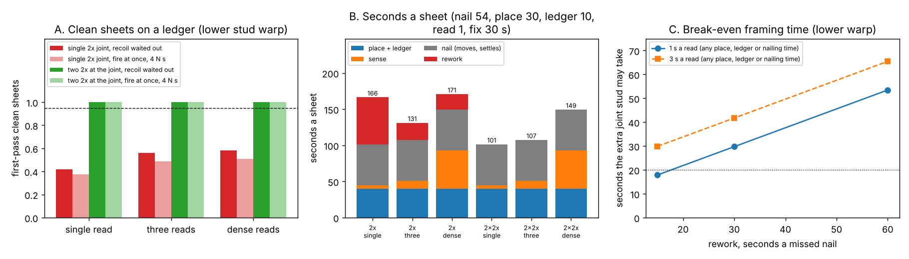
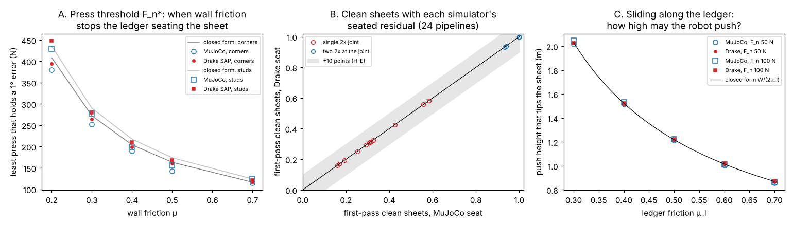
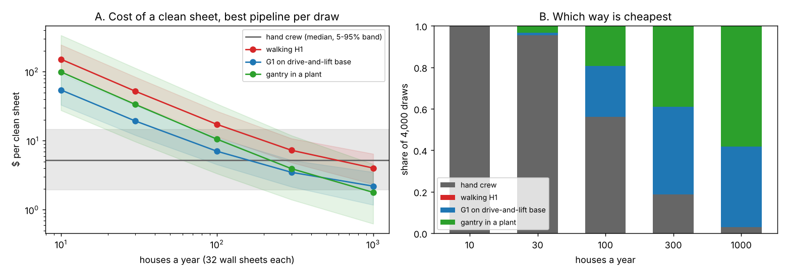

# Can a robot nail wall sheathing to code tolerance? A tolerance, contact and cost analysis of robotic sheathing on wood-frame walls

*Draft for* Automation in Construction *(Elsevier, full research article). Milestones 8, 22 and 24
of the `buildbot-sheathing` programme (22 added sections 4.9–4.10 and 5.13–5.14; 24 cut the abstract to the journal's 150 words). Written with AI assistance (Claude Code); simulation and analysis
only, nothing tested on hardware. Every number below is produced by code in this directory and
checked against its results file by `paper/check_numbers.py`. Authorship, affiliations and the
corresponding author are left for the owner to fill in before any submission.*

## Highlights

- The 1/8 in panel gap shrinks a joint nail's window from ±3.93 to ±3.14 mm.
- Bowed studs cap single-2x joints at 87% clean sheets, even with perfect reads.
- Doubled joint studs give 99.94% clean sheets with one read a stud (94% at high warp).
- A G1 on a lift base beats a hand crew in only 37% of draws at 100 houses a year.
- Decayed-wall tests fit only with end nails at about a quarter of their NDS strength.

## Abstract

Sheathing is the most repetitive nailing in wood framing: 34 of a 4x8 sheet's 62 nails
must land on a 1.5 in stud face. We carry every error source (panel gap, sheet pose, bowed studs,
stud sensing, arm, tool) through a tolerance model, MuJoCo and Drake placement simulations and a
cost model to the share of sheets with every nail inside its window. At the stud bow published for
kiln-dried lumber, single-2x joints cap at 87% clean sheets even with perfect sensing; doubled
joint studs lift a one-read robot to 99.94%. Neither stock humanoid can carry the 21.8 kg sheet,
and a G1 on a lift base beats a two-person crew in only 37% of draws at 100 houses a year. An
escaped miss costs about 2% of its sheet's racking capacity. Five capacity models match
decayed-wall tests only if end-nailed joints carry about a quarter of their code strength.

**Keywords:** construction robotics; wood-frame construction; sheathing; tolerance analysis;
humanoid robots; sim-to-sim; MuJoCo; Drake; cost of automation; shear walls; missing nails

## 1. Introduction

A wood-frame wall is braced by its sheathing, and the sheathing holds only where its nails hit
the framing. In our task model of a framing crew (`buildbot-taskbook`), fastening is 31% of the
crew's hours, and sheathing is the most repetitive part of it: 62 nails a 4x8 sheet, 17 on each
vertical edge at 6 in, 7 on each intermediate stud at 12 in and 14 into the plates
(`buildbot-fasten`). It is an obvious target for a robot, and robot makers and panel-line
integrators face a concrete design question: how good must the robot's stud sensing, sheet
placement and arm be, and which robot (a stock humanoid, a mobile manipulator with a lift, or a
gantry over a framing table in a plant) does the job most cheaply?

The question has been studied in pieces. Mobile fabrication robots have been localised to a few
millimetres across repositioning [Sandy et al. 2016; Giftthaler et al. 2017; Lachmayer et al.
2022], factory and multi-robot timber assembly correct their paths from as-built measurement
[Willmann et al. 2016; Adel et al. 2024], a humanoid has carried and screwed plasterboard to a
wall [Kumagai et al. 2019], and stud pose has been estimated from images for robot-assisted
light-frame assembly [Cote et al. 2024]. None of these carries the error sources of a
real sheathed wall to the outcome a builder inspects. That outcome is strict: a nail that misses
the stud holds nothing, and where the sheathing is a shear wall the nailing schedule is
structural.

This paper makes four contributions.

1. **A tolerance model of sheathing nailing** (Section 3) that includes what earlier robot
   budgets left out: the panel gap, the sheet's own pose, row drift along a wall, and the bow and
   twist of real studs, with the share of sheets whose 62 nails all land as the outcome.
2. **A placement analysis in two physics engines** (Sections 4.3 and 5.4): a ledger board seats a
   released sheet, a stock humanoid cannot carry the sheet but can press it, and the result holds
   on a second contact model.
3. **A cycle and cost model** (Sections 4.5–4.6) that charges every stage, including the rework of
   missed nails, and ranks four ways to do the work per clean sheet over 10 to 1,000 houses a year.
4. **A design recommendation with its conditions**: the joint framing, not the robot's sensing,
   decides the clean-sheet rate; whether paying for it is worth it depends on what a missed nail
   costs.

Every hypothesis was written down before its experiment was run (`LOG.md`), and the paper reports
the refuted ones beside the held ones.

## 2. Related work

**Mobile construction robots.** Sandy et al. [2016] keep a mobile arm's end effector accurate
across repositioning with on-board sensing, and Giftthaler et al. [2017] describe the full In situ
Fabricator and two building-scale demonstrations. Lachmayer et al. [2022] frame the central
difficulty of mobile construction robots as the gap between the precision a task needs and the
accuracy a robot achieves, and refine the base pose with a laser scanner. That framing is ours;
the task differs, and none of these budgets a fastening task against a code window.

**Robotic timber assembly.** Willmann et al. [2016] assemble timber members robotically in a
factory. Adel et al. [2024] adapt a multi-robot timber process from as-built measurement, both by
pose and by topology, and reduce deviations on nail-laminated panels and a two-robot wall frame;
it is the strongest published "measure, then correct" baseline, and its data set
[Adel et al. 2024, data] is the most promising source of measured as-built framing. The
coarse-to-fine stud pose estimator of Cote et al. [2024] is the real-sensor counterpart
of the stud-reading error we sweep.

**Humanoids at the wall.** Kumagai et al. [2019] had the HRP-5P humanoid carry an 11 kg board and
screw it to a wall, localising against a map. We could not see whether screw placement was
measured against the framing. Our sheet is twice that board's mass.

**Tolerance analysis.** Worst-case and statistical stack-up and allocation are standard in
mechanical assembly [Chase and Parkinson 1991]; we apply them to construction fastening with the
error structure of a wall (errors shared by every nail on a stud, on a sheet edge, and drifting
along a row).

**Simulation and contact.** MuJoCo [Todorov et al. 2012] provides the soft, convex contact of our
primary simulation; Drake's SAP solver [Castro et al. 2023] and its TAMSI solver [Castro et al.
2020] give the second contact model. Learned humanoid control in MuJoCo [Zakka et al. 2025] and
domain randomisation [Tobin et al. 2017] are the route to the dynamic hand-off we leave open.

**Gap.** No work we found propagates the full chain to the clean-sheet rate of sheathing
nailing, compares aiming strategies on it, or ranks robot classes by the cost of a clean sheet.
The claim is narrow: a tolerance-allocation analysis of one construction fastening task, checked
in two physics engines, with robot designs priced on the same budget.

## 3. Problem and error model

**Windows.** A joint nail (8d common, 0.131 in shank) must land at least 3/8 in from the sheet's
actual edge and with its whole shank on the 1.5 in stud face [`buildbot-fasten`; APA builder
tips]. Panels are hung with a 1/8 in gap at edges and ends (APA's recommendation, not a code
requirement), centred on the joint stud, so each sheet edge sits 1/16 in past the stud centre.
Field and plate nails keep the wider windows of `buildbot-studfind`.

**Sheet.** Its left edge sits at gap/2 + offset + x + θ(z − H/2) from the joint stud's centre,
where x and θ are the hanging error, and its width is 48 in minus a trim ("sized for spacing",
0 to 1/8 in at the maker's option, APA TT-055) plus a manufacturing error.

**Studs.** Each stud's face is a parabola of bow b, zero at the plates, plus a straight lean from
plate-layout errors at its ends; its section twists linearly along its length. Bow and twist
means are 0.11–0.21 in and 0.08–0.16 in (8 ft equivalent; published kiln-dried southern pine
studs, read as search snippets), truncated at the Stud-grade limits of 3/4 in bow and 3/8 in
twist. Two distribution shapes (half-normal, exponential) are reported, because none is
published. A twisted stud keeps a nail only where at least 10 nail diameters of shank stay in
wood through the rotated section.

**Robot.** A stud is read with 0.5 mm (1σ) scatter per read at one, two, three or 17 heights
(*single*, *ends*, *three*, *dense*) and fitted by a line or parabola; the sheet edge is read to
0.5 mm; the tool tip scatters 0.9 mm per nail (`buildbot-fasten`'s G1 model with 11-bit joint
sensors). The robot aims either at the design window from its stud estimate (*nominal*) or at the
window between the measured edge plus 3/8 in and the estimated far stud face (*edge*).

**Outcome.** A sheet is *clean* when all 62 nails land inside their windows. One nail outside
fails the sheet; nails missed a sheet are reported beside it. Rates come from 20,000 Monte Carlo
sheets a cell (binomial standard error under 0.002 at 95%) with fixed seeds, and Wilson intervals
where they matter.

**Checks.** With no gap the model reproduces `buildbot-studfind`'s quadrature within 0.01 at
three error settings; translation-only and rotation-only results match their closed forms within
0.01; edge aim with perfect sensing passes exactly while the shifted window is non-empty; a row of
exactly trimmed panels does not drift (`tests/`, 69 test functions in all).

## 4. Methods

### 4.1 The joint budget (milestone 1)

We solve for the stud-read and tool scatter that leave 95% clean sheets as the gap grows from 0
to 3/16 in, the translation and rotation scatter a sheet may hang with under each aim, and the
clean-sheet rate along a 10-sheet (40 ft) row when each sheet is butted against the last with a
1/8 in gauge (offsets accumulate) or set from its own studs (the gap absorbs the width error).

### 4.2 As-built studs and joint framing (milestone 2)

Studs bow and twist as in Section 3. Each sensing policy is scored at no warp and the lower and
higher published warp, with an ablation of bow and twist, perfect reads, culling studs over a
bow cut, plate-layout lean, and three joint framings: one 2x (1.5 in face), a 3x (2.5 in) and two
2x fastened together (3.0 in), the last two being what SDPWS 4.3.7.1 names for adjoining panel
edges in some shear walls.

### 4.3 Placement in a physics engine (milestones 3 and 3b)

*Ledger seat.* In MuJoCo 4.0.1 (elliptic cone, `impratio` 10, 20 no-slip iterations, 0.5 ms), a
rigid 1.2192 × 2.4384 × 0.0111 m, 21.8 kg sheet (7/16 in OSB) touches the wall on spheres at its
corners or along four stud lines and stands on a level ledger. A holder lowers it 0.25–2° off
plumb, presses it into the wall with F_n = 5–600 N, and either releases it or keeps a wrist of
rotational stiffness k = 300–30,000 N·m/rad. Friction holds the error when its moment beats
gravity's: the closed-form press threshold is F_n* = m g W / (2 μ r̄), with r̄ the mean contact
lever arm. A held wrist keeps max(0, θ₀ − (m g W/2 − μ F_n r̄)/k). The seated sheet then carries
the panel's squareness and bottom-edge straightness (PS 2: diagonals within 1/8 in, a corner
angle of 0.083°; a 1/16 in edge bow that rocks the sheet up to 0.149°) and a laser line rated
1/8 in at 30 ft (0.020°).

*Stock humanoids.* The Unitree G1 (29 joints) and H1 from MuJoCo Menagerie at a pinned commit are
posed square to the wall by a static whole-body model (feet planted, torque limits, both soles
loaded, foot friction 0.3 and 0.6). We find the heaviest load each holds in both hands at
0.6–1.3 m, the largest press it can make into a seated sheet, and the press it can hold while
also sliding the sheet along the ledger with P = μ_l m g + μ_w F_n. Pushing the sheet's edge at
height h tips its trailing corner unless h < h* = W / (2 μ_l) (moments about the leading corner,
with the press at the push height); MuJoCo checks h* by bisection. With Unitree's published joint
gains (G1 arms kp 60 N·m/rad; H1 legs, torso and arms from `unitree_rl_gym`) the hands'
compliance C = J K⁻¹ Jᵀ gives the sheet's stiffness about the landing corner, which we compare
with the stiffness at which a held wrist keeps its error.

### 4.4 Tack, then measure (milestone 4)

The robot tacks the sheet with two field nails, measures where its edge landed and aims the
joint nails from that, or re-hangs it when the narrowest predicted half-window falls below a
threshold (at most five hangs). We solve for the hang (1σ) and the per-nail sway of a held sheet
that leave 95% clean sheets, for each joint framing.

### 4.5 The whole cycle (milestone 5)

One steady-state cycle along a row: a lift stands the sheet on a laser-set ledger, the robot
slides and presses it so it seats (PS 2 panels, 0.5 mm a corner, 1 or 3 mm left after the slide),
tacks it, reads the three new studs and both edges, nails the 62 nails with edge aim (54 or
121 s, `buildbot-mobilebase`) and re-drives every missed nail. Place and slide (15–60 s), ledger
(0–20 s), a read (1–3 s) and a re-drive (15–60 s a nail) are swept over 108 time cells; recoil is
either waited out or fired through, a 4 N·s impulse modelled as 0.37 mm added in quadrature to
the 0.9 mm tool scatter. A ledger-free alternative hangs and tacks the sheet with a lift to 0.25°
and 5 mm (1σ).

### 4.6 Dollars per clean sheet (milestone 7)

Four classes: a two-person hand crew (8.5 person-minutes a sheet at the task book's midpoint,
swept from one third to three times); a walking H1 (nailing 84.7–264.7 s; a person carries the
sheet); a G1 on a drive-and-lift base (nailing 54–121 s; the base can also hang and tack without
a ledger); and a gantry over a framing table in a plant (nailing 20–115 s plus scan and load,
`buildbot-custom`). Each class picks per draw the cheapest pipeline (framing, sensing, placement)
using milestone 5's missed-nail rates; every missed nail is re-driven, so every sheet ends clean.
Ownership is the capital recovery of the price over its life plus upkeep, spread over the 32 wall
sheets of V houses a year and capped at 2,000 machine hours; people are a loaded wage (BLS $29.12
an hour times a burden of 1.0–1.6) times carry, operator and supervision time. The extra joint
stud is a 92 5/8 in precut 2x4 at $3.41–5.56 (retail listings) plus 60–120 s of a framer's time.
Prices: G1 $13,500–21,600, H1 $90,000–150,000, base and lift $10,000–40,000 and gantry
$40,000–600,000; the last two are **not sourced** and are swept wide. 4,000 draws with common
random numbers across classes.

### 4.7 A second contact model (milestone 6)

The ledger seat and slide are rebuilt in Drake 1.51.1 (`MultibodyPlant`, discrete at 1 ms, point
contact, SAP; TAMSI as a third check) with the same sheet, contact points and holder law, applied
as an external wrench each step. Contact stiffness (10⁵–10⁷ N/m), Hunt–Crossley dissipation
(0.5–50 s/m) and the time step (0.5–2 ms) are swept. To test H-E, 2,000 seats are drawn per
engine (holder error uniform in ±1°, wall friction 0.3–0.5, press 5–50 N), and each engine's
seated residual is added to milestone 5's ledger tilt draw for all 24 ledger pipelines.

### 4.8 Straightening a bowed joint stud (milestone 9)

A carpenter pushes a bowed stud onto the line and nails it there; once the first sheet's joint
nails hold it, it stays straight for the next sheet. We model the stud as a linear
Euler–Bernoulli beam bending flatwise (I = 3.5 × 1.5³/12 = 0.984 in⁴) over the 92 5/8 in clear
span, its stress-free shape the parabolic bow of Section 3, with the plates holding its ends
either pinned (end-nailed; the realistic case) or fixed (the stiff bound). A push is a
displacement imposed at a point, solved on a cubic-Hermite finite-element beam of 192 elements
and checked against the closed form c E I b / L³ for a mid push (c = 48 pinned, 192 fixed, with a
residual shape of b u (1 − 2u)² and 4 b u (1 − 2u)²). The modulus E is drawn lognormal about the
NDS reference values for Stud grade (Douglas Fir-Larch 1.4, Hem-Fir 1.2, Spruce-Pine-Fir 1.2,
Southern Pine 1.3 million psi) with the coefficient of variation 0.25 the NDS uses for visually
graded lumber. Three push policies are scored: one push at mid-height; a push at each joint-nail
height in turn, bottom up, each held by its nail once driven; and a simultaneous three-point push
at u = 1/6, 1/2, 5/6. The push is set from the robot's own three-read estimate of the bow, so the
stud is straightened as if its bow were b + N(0, 0.5 mm) and the robot believes the residual its
policy leaves. Clean sheets then come from the cycle model of Section 4.5 with both joint studs
replaced by their straightened shape. Whether a robot can supply the force is checked in the
static whole-body model of Section 4.3, pushing along the wall with both hands at 1.0–1.3 m.

### 4.9 What an escaped miss costs in capacity (milestones 14 to 16)

Sections 4.5 and 4.6 re-drive every missed nail. A miss that escapes is a structural question: a
missing sheathing nail on a shear wall lowers its racking capacity. We size that loss three ways.
Milestone 14 uses Källsner and Girhammar's (2009) plastic model of a fully anchored sheet: pinned
framing, a rigid 4x8 sheet and equal rigid-plastic nails, the capacity being the least plastic work
over the sheet's rigid motions. Milestone 15 rebuilds it as a rigid-body upper-bound limit analysis
(a linear programme, HiGHS) in which the studs and plates are bodies joined by stud-to-plate joints
of finite strength, set from the NDS yield-limit equations for two 16d common end nails with the
end-grain factor 0.67 (2.549 sheathing-nail capacities a joint in DF-L). Milestone 16 replaces the
rigid-plastic nails with a softening backbone fitted to tested 8d nails through 7/16 in OSB
(Shameli Derakshan et al. 2019: peak 0.972 kN, 0.496 kN/mm at 0.4 of peak) and pushes the sheet
over. Each model is checked against SDPWS Table 4.3A's ratios for 6, 4, 3 and 2 in edge spacing,
and each then scores the 20,000 simulated sheets of the measured-stud pipelines (section 4.5) with
every miss left in.

### 4.10 Checking the capacity model against decayed walls (milestones 17 to 21)

A capacity model that removes nails needs a test that removed nails. Weiss (2017) racked 8 by 8 ft
walls (two vertical sheets of 7/16 in OSB, DF-L studs at 16 in, HTT4 hold-downs on the double end
studs, CUREE cyclic loading) at 6 in and 3 in edge spacing, intact and with every nail below 12 in
omitted to simulate decay. Her decayed walls kept 56.5% (6 in edges) and 33.9% (3 in) of the intact
walls' peak, where every model in section 4.9 removes about a fifth. Five more models of her wall,
each registered with its hypotheses before it was run (`LOG.md`), test the explanations one at a
time:

1. **Her wall and anchorage** (milestone 17): the section 4.9 limit analysis for two sheets, seven
   studs, the double top plate held to slide without rotating and rigid hold-downs, with the
   end-nail joint strength swept as a multiple m of the NDS ratio.
2. **The anchor rods' shear path** (milestone 18): each held-down stud bottom also resists sliding
   on the sill through its 5/8 in anchor rod, rigid-plastic at s sheathing-nail capacities, scaled
   by the NDS dowel equations for a rod bearing in the sill (617–1,137 lb).
3. **Slack and softening** (milestone 19): the same bodies joined by springs (milestone 16's nail
   backbone, end-nail joints of strength m and slip scale λ), anchor rods that bear only after a gap
   of up to 1/4 in, pushed to 150 mm; 960 pushovers.
4. **The cyclic protocol** (milestone 20): Weiss tested under the CUREE basic history (Krawinkler
   et al. 2001), so the wall is driven through it with every sheathing nail an oriented pair of SAWS
   hysteretic springs (Folz and Filiatrault 2001; Judd and Fonseca 2005) fitted to cyclic tests of
   nails through 7/16 in OSB into DF-L (Anderson et al. 2007), and rod holes that crush.
5. **Cumulative damage** (milestone 21): every spring's envelope scaled by s = 1 − E/(γ F_U Δ_u),
   E the energy it dissipates after its first reversal past yield (Rahnama and Krawinkler 1993, as
   in Ibarra et al. 2005), with γ swept from ∞ to 5 since no calibrated value for nails in OSB was
   found.

Each model reduces to its predecessor in a code check (the cyclic springs match OpenSees'
`SAWSMaterial` to under 1e-12 of the nail's peak, for Anderson et al.'s nails and for Folz and
Filiatrault's own 8d set as tabulated by Ghazinader (2024)). Shares kept are compared, not absolute loads, because
the sourced nails are not exactly Weiss's.

## 5. Results

### 5.1 The gap and the sheet's pose set the budget (H-A, H-C)

With the 1/8 in gap the joint half-window falls from 3.931 to 3.137 mm, and the single stud read
that leaves 95% clean sheets with perfect placement falls from 0.898 to 0.413 mm (1σ). At the
0.89 mm `buildbot-studfind` achieves, clean sheets drop from 0.952 to 0.748 when the robot plans
for the gap, and to 0.562 when it does not. Pose is as tight: with a 0.5 mm stud read, a robot
aiming at the design window tolerates no hang error at all, while aiming from an edge read to
0.5 mm allows 0.44 mm of translation and 0.0312° of rotation (1σ). Along a row, sheets butted
with a 1/8 in gauge leave their studs by the third sheet with full 48 in panels (no third sheet
clean) and keep a joint window for four sheets when trimmed 1/16 in; setting each sheet from its
own studs keeps every sheet at 0.98 clean. **H-C held.** **H-A held at a 0.5 mm stud read** (no
pose tolerance without edge aim); at 0.3 mm, aiming at the design window allows 0.38 mm and
0.0276°, so H-A depends on a stud reader whose accuracy no commercial source we found states.
Section 5.2 shows that on an as-built wall neither aim is what decides.

### 5.2 Bowed studs cap single-2x joints; doubled joints remove the cap

Bow moves the stud's face under a sheet edge that stays straight, so a single-2x joint closes for
any bow over 0.531 in (8 ft equivalent) whatever the robot knows. At the lower published warp
(half-normal) one read a stud gives 0.5453 clean sheets, three reads and a fitted parabola
0.8032, and perfect stud and edge reads 0.8685 (Table 1). Twist costs 1–2 points and 1.6 mm of
plate-layout lean costs 8. Reaching 95% by culling would mean rejecting 0.649 of studs (a 1/16 in
bow cut). Framing the joint with two fastened 2x members gives 0.9996 with a single read and
1.0000 with three at the lower warp, and 1.0000 with three reads at the higher warp.

*Table 1. Clean sheets by sensing and joint framing, lower published warp, half-normal (20,000
sheets a cell; `experiments/m2_asbuilt_studs/results.txt`, sections C, D and H).*

| Joint framing | single | ends | three | dense |
|---|---|---|---|---|
| one 2x (1.5 in) | 0.5453 | 0.5462 | 0.8032 | 0.8327 |
| one 2x, perfect reads and edge | 0.5631 | — | 0.8685 | 0.8685 |
| 3x (2.5 in) | 0.9909 | 0.9983 | 1.0000 | 1.0000 |
| two 2x (3.0 in) | 0.9996 | 1.0000 | 1.0000 | 1.0000 |

### 5.3 How coarsely may the sheet hang? (H-B, first part)

With tack-then-measure, single-2x joints on straight studs still need a hang of about 0.03° and
0.4 mm (1σ), and on bowed studs no hang reaches 95%; on straight studs, re-hanging a 1 mm / 0.1°
hang peaks at 0.8690 with 2.10 hangs a sheet. A held sheet may sway 0.187 mm under the nail. On two 2x, the robot may
hang to 0.5365° and 10.414 mm (edge aim, lower warp), 18 times coarser in rotation, and a held
sheet may sway 4.127 mm. This is the target placement has to meet.

### 5.4 A ledger seats the sheet; a stock humanoid can press it but not carry it (H-B)

A sheet released on the ledger under a press of 100 N or less, at wall friction 0.2–0.7, ends
parallel to the ledger within 0.0001°; at a press of 50 N or less and friction 0.3–0.5 the largest
residual is 0.00003°. Above a threshold friction holds the whole error: 189.3 N at μ 0.4 on corner
contacts, 0.872–0.987 of the closed form m g W / (2 μ r̄) over μ 0.2–0.7.
A held wrist matches its closed form within 0.005° or 10% in 29 of 30 cells (largest error
0.0367°). Seated, the panel decides: drawn uniformly within the PS 2 limits with a ledger good to
0.5 mm a corner, doubled joints stay at 1.0000 and single 2x on straight studs falls to 0.8440;
95% there needs panels within 0.244 of the PS 2 limits.

Neither stock humanoid can bring the sheet to the ledger. Holding with both hands at
0.6–1.3 m, a G1 carries at most 2.8–8.7 kg and an H1 12.4–18.8 kg, against 21.8 kg. On the ledger
both can press: a G1 66–110 N and an H1 128–281 N. MuJoCo reproduces the tipping height
h* = W / (2 μ_l) within 1.6% in 14 cases. At Unitree's published gains a G1 is 3 to 31 times
softer about the landing corner than the stiffness at which a hold keeps its error, so the ledger
seats the sheet; an H1 is soft enough through palm contacts but keeps 0.46–0.99° of a 1° error
with a rigid clamp. **H-B is supported**: a stock humanoid cannot hang a sheet within the
single-2x budget unaided and needs a guide. Its refutation test, a learned hang policy, was not
run.

### 5.5 The whole cycle in seconds (milestone 5)

On two 2x with one read a stud the first-pass clean rate is 0.9994 [0.999, 1.000] and a sheet
takes 76 to 216 s (median 146); a single read is the fastest policy in all 108 time cells. On
single 2x no policy passes 0.5814 (dense reads; 0.71 nails missed a sheet), three reads are
fastest in all 108 cells, and the best single-2x sheet takes 94 to 282 s (median 184). Before the
extra stud is charged, two 2x win by 17.9 to 65.5 s a sheet, all of it rework (Fig. 1). Firing
through the recoil costs up to 7.39 points on single 2x (a conservative model) and at most 0.12
on two 2x. On two 2x a lift that hangs and tacks the sheet to 0.25° and 5 mm needs no ledger
(0.9775 with one read, 0.9960 with three). Nailing is the largest stage in 90 of 108 cells
(place is in the other 18), refuting our expectation that it always would be.

### 5.6 The second contact model (H-E)

Drake leaves a seated residual of 0.00142° (1σ; 0.00466° at most) over 2,000 random seats, against
MuJoCo's 0.00001°. Both are far under the 0.03° single-2x joints allow, and the worst difference
in clean-sheet rate between the engines over the 24 ledger pipelines is **0.05 points** (bar 10).
**H-E held.** Drake's press thresholds are 0.965–0.998 of the closed form on corner contacts,
MuJoCo's 0.872–0.987: MuJoCo lets wall friction hold the sheet from a little less press, the
cautious side for a press limit. The tipping height matches W / (2 μ_l) within 0.7% in Drake.
Two terms depend on the engine. A soft held wrist (300–3,000 N·m/rad) keeps up to 0.016° in Drake
where MuJoCo and the closed form keep nothing (H34 refuted: 70% of cells within tolerance, bar
90%), and a 1/16 in bowed bottom edge rocks the sheet 0.107–0.123° in Drake and 0.139–0.145° in
MuJoCo, both under the 0.149° static bound milestone 3 charged. On its bowed middle the sheet is
balanced, so the rock is set by friction and approach, not statics; charging the full bound is
the conservative choice.

That three-foot bow is a modelling choice, and the rock is its artefact. A smooth bow is a
rocker: a parabolic 1/16 in bow over 48 in has radius R = 117.0 m at mid-width, against a centre
of mass h0 = 1.221 m above it, so rolling by θ raises the centre of mass by (R − h0) θ²/2 and
gravity rolls the sheet back to level. Only wall friction can then keep a tilt, at most
θ_s = μ F_n r̄ / (m g (R − h0)), with r̄ = 1.562 m from the mid-width contact. Modelled as 49 feet
on the curve, both engines seat inside θ_s + 0.005° in all 48 cells of a grid over bow, holder
error, wall friction and press (H37). Over the 2,000 random seats of milestone 6 the 99th
percentile |θ| is 0.05876° in Drake and 0.06055° in MuJoCo, and the best single-2x pipeline
rises from 0.5602 to 0.6250 clean sheets (Drake; 0.6244 with MuJoCo seats), while doubled joints
move by at most 0.45 points (H40). A kink keeps the rock: balanced on a point the sheet's
toppling moment is smaller than the wall friction a light press holds, so it stops where the
approach leaves it, which is why the engines disagreed. A 1 mm bump under a straight edge (grit
on the ledger) leaves a median 0.0500° in Drake and 0.0607° in MuJoCo. A light press once the
sheet is seated and a clean ledger are the placement rules that follow.

### 5.7 Dollars per clean sheet (H-D)

*Table 2. Dollars per clean sheet, best pipeline per draw, median [5%, 95%] over 4,000 draws
(`experiments/m7_cost/results.txt`, section A).*

| Class | 10 houses/yr | 100 houses/yr | 1,000 houses/yr |
|---|---|---|---|
| walking H1 | 151.73 [98.03, 245.83] | 17.23 [11.48, 26.77] | 4.02 [2.34, 6.45] |
| G1 on a lift base | 54.43 [33.04, 93.51] | 7.03 [4.52, 11.04] | 2.20 [1.17, 3.50] |
| gantry (plant) | 99.24 [27.59, 337.09] | 10.51 [3.33, 34.17] | 1.78 [0.63, 4.57] |
| hand crew | 5.21 [1.93, 14.46] | 5.21 [1.93, 14.46] | 5.21 [1.93, 14.46] |

The base costs less than the walking H1 in every draw, at every volume and with either sensing
policy forced: **H-D's first half held**. The gantry is dearer than the base in the median draw
at 10 houses a year (+$43.67 a sheet) and cheaper only from about 501 houses a year (at 300 it is
still +$0.51); we had predicted a crossing between 30 and 300, so **H-D's second half is refuted
as registered**, though the ranking does flip inside the swept range. Per draw, 62% of draws cross
inside 10–1,000 houses, at a median of 54: the gantry's unsourced price spreads the crossing over
two decades. Against the crew, the base is cheaper in 37% of draws at 100 houses a year, 74% at
300 and 94% at 1,000 (Fig. 3). Its cost is moved most by its life (Spearman −0.58) and base price
(+0.58), both unsourced.

Every robot picks single 2x joints with three reads. The extra stud costs $5.42 a sheet (median),
while the 0.79 missed nails a sheet it saves are worth well under a dollar of robot and
supervisor time. Doubled joints pay only if a missed nail costs $6.47 [5.17, 7.83] more than its
re-drive, about ten loaded person-minutes.

### 5.8 Straightening the stud removes the bow, not the cap (milestone 9)

The finite-element beam reproduces the closed forms exactly (c = 48.000 and 192.000; residual
0.07407 b and 0.29630 b at u = 1/6). A mid-height push on a pinned-end Stud-grade 2x4 takes a
median of 28 N and a 99th percentile of 126 N at the lower published warp, 53 and 232 N at the
higher, and 376 N for a grade-limit stud (3/4 in over 8 ft) at Douglas Fir-Larch's 95th-percentile
modulus. The static whole-body model gives a stock G1 81–88 N of sideways push at stud mid-height
(ankle roll binding) and an H1 120–123 N, covering 93% and 99% of low-warp studs and 69% and 86%
of high-warp ones. Order matters: pushing each nail's point onto the line after the nails below it
are driven turns the stud into a short beam and needs up to 1,258 N (99th percentile, higher
warp), against 355 N at the lower warp, so a robot should straighten the stud before it starts
nailing rather than nail by nail.

Straightening removes most of what bow costs. On the best single-2x pipeline (ledger, three reads,
lower warp) first-pass clean sheets rise from 0.5602 to 0.7095, and at the higher warp from 0.3071
to 0.6773 — 15 and 37 points. It does not reach 95%, because the same pipeline on perfectly
straight studs gives 0.7370: with bow removed, the tool's scatter and the sheet's pose together
close the window (section 5.9). The three push policies land within 0.4 points of each other, while fixed ends cost up
to 5 points at the higher warp, since they leave four times the residual. In dollars (G1 on a lift
base, 100 houses a year) straightening costs about what it saves at the lower warp — cheaper than
not pushing in 10% of draws — and pays at the higher (92%), and the median draw favours it over the
extra stud until about 925 s of pushing a sheet. Doubled joint studs therefore remain the only
route to 95% first-pass clean sheets; the push is the cheap fallback for a robot that cannot get
one, and it reframes the single-2x question as a placement question rather than a lumber question.

### 5.9 What the straight-stud ceiling is made of (milestone 10)

With every error source switched on, single-2x joints on straight studs reach 0.7370 clean sheets
(three-foot rock) and 0.8107 (smooth rock). Splitting −ln(clean) by exact Shapley values over all 64
subsets of six sources, the tool's 0.9 mm scatter carries 44.6% and 46.9%, the sheet's pose (the
slide, the ledger's slope and the panel's geometry) 43.5% and 38.6%, and the stud and edge reads
the rest. Tool scatter alone gives 0.9838 clean, matching the closed form 0.9833. The sources
interact: the pose alone gives 0.9952 clean and the tool and reads alone 0.9573, yet together
0.7370, because each millimetre the sheet sits off its intended place narrows one side of the
±3.14 mm joint window by half a millimetre. Two placement steps before tacking address the pose:
sliding the sheet along the ledger to centre its gap on the read studs, and shimming the low corner
until the edge reads plumb. With 0.5 mm residuals both lift straight studs to 0.9180, and pushed
low-warp studs (section 5.8) to 0.8932; 95% then needs a tool held to 0.839 mm (straight) or
0.794 mm (pushed) at 1σ. Single 2x can therefore reach 95% only with a pose fix and a tool about
10% tighter than the one assumed; doubled joints reach it with neither.

### 5.10 Measured studs: the bow is the published size, the shape is not a parabola (milestone 11)

The scanned wall of Adel et al. [2024, data] holds six installed vertical 2x4 studs seen on the
face sheathing is nailed to. Sliced every 10 mm, their flatwise bows scaled to 8 ft have a median
of 0.106 in and a largest of 0.283 in, on the published kiln-dried mean of 0.11 in. Their shape
is not the parabola of section 4.2: after it, 0.59–0.94 mm RMS remains, against 0.27 mm that the
scan's 2 mm profile pitch leaves on a synthetic parabolic face, and on the three most bowed studs
the parabola explains 64–79% of the shape. Part of that residual is common to all eleven scanned
members at the same height (48% of its variance, against 9% for independent members), which
points to the stitched scan passes; removing it leaves 0.31–0.60 mm. In the single-2x pipeline
of section 5.8 (three reads), the measured studs give 0.425 clean sheets (0.471 with the common
part removed), against 0.579 for parabolas at the same studs' own bows: the parabola overstated
single 2x by 11–15 points. Doubled joints give 1.000 on the measured studs. One robot-built wall
is a small sample; it refutes the shape assumption without estimating a population.

### 5.11 The single-2x remedies on measured studs (milestone 12)

Most of section 5.10's loss is the robot's estimate, not the geometry. Reading each stud at every
nail height and aiming each nail at its own read, with no fitted shape, lifts the measured studs
from 0.4253 to 0.5303 clean sheets (ledger placement, no push), against 0.5792 for their own
parabolas: the cost of waviness falls from 15.4 points to 4.7. On parabolic or straight studs the
same reads gain nothing. The mid push of section 5.8, measured from the chord through the stud's
ends and applied by superposition to the scanned shape, still lifts three-read single 2x from
0.4253 to 0.5516. With per-nail reads, the push and section 5.9's slide and shim, measured studs
reach 0.7707 (0.7960 with the scan's common part removed), against 0.8600 on their own parabolas;
95% then needs a tool held to 0.606 mm (1σ), against 0.839 mm on straight studs. Doubled joints
give 1.0000 in every cell. The single-2x route therefore needs all of a line read along the stud,
a push, a pose fix and a tighter tool; doubled joints need none of them.

The 0.5 mm slide residual is an assumption, so milestone 27 asks what the slide leaves as a
mechanism. A seated sheet breaks away on static friction and runs on kinetic friction, and a hand
that can only push its edge stops it by letting go. Along the wall the stock G1 hand is a spring of
63 N/m (one hand at the press pose, Unitree's gains), so soft that it acts as a force source; what
sets the run is the time from slip to release. Correcting from either edge until the sheet sits
within half a tap leaves 0.262 mm rms at a 20 ms reaction (μ_s 0.4, μ_k/μ_s 0.8), and the stack
above then gives 0.7912; at 50 ms it leaves 1.035 mm and 0.6948, and at 100 ms 3.855 mm and 0.3167.
The slide's assumption therefore holds only for a controller that releases within about 20 ms of
seeing the sheet move; the friction pair of OSB on lumber, which sets how far the sheet runs, is
swept rather than measured.

The shim's 0.5 mm is the same kind of assumption (milestone 28). A seated sheet is plumbed by
lifting its low bottom corner, a median of 0.946 mm and a 99th percentile of 3.018 mm on the
simulated rock draws. A stack of 1/16 in horseshoe shims leaves the lift rounded to a step,
0.458 mm rms, and with the 20 ms slide above the stack gives 0.7964 against 0.7912 with a
Gaussian 0.5 mm. A tapered composite shim (1:32) driven under the corner could set the height
continuously, but it carries half the sheet's weight plus wall friction, so at μ 0.4 on every face
it needs a push of 118.5 N; the stock G1 gives 65.6 N into the wall at a 0.5 m ledger (both hands,
waist pitch limiting), enough only for faces at μ 0.252 or less, while the H1 gives 132.0 N. A
hand's effective mass along the push is under 1 kg, so the wedge, unlike the 21.8 kg sheet, runs
far on each stick-slip tap (12.70 mm at 20 ms) and the 1:32 slope leaves 0.132 mm rms. The
discrete stack, which the G1 can place, is therefore the shim the paper's numbers can rest on.

The tool's own 0.9 mm is the largest of these assumptions (milestone 29), and the one the stack is
most sensitive to: with the 0.9 mm point model at other scatters the stack gives 0.9595 at 0.6 mm
and 0.3152 at 1.3 mm. The figure is the G1's 11-bit joint quantisation carried to the hand point. A
nailer's nose sits ahead of the grip, so the hand's rotation (0.095° about the vertical, 1σ) moves
it, and the nail must stay inside the stud for ten diameters past the sheathing, 44.4 mm below the
surface, where a leaning nail has moved again. Carried to a nose 0.3 m ahead of the grip and that
depth (the two offsets correlated, as the same joint errors make both), the G1's along-wall scatter
is 1.312 mm at the surface and 1.375 mm at depth, and the best single-2x stack falls from 0.7964 to
0.2637; the H1 gives 0.5706. A 12-bit sensor at the same length gives 0.9344, so the requirement is
a tool-point accuracy, not a hand-point one. An independent lean of the nail (the tool's own aim,
deflection in the wood) of 0.434° (1σ) costs a further 2 points. Doubled joint studs stay at 1.0000
at every length and at a 2° lean.

Gear backlash adds to quantisation only on joints that nothing holds against one side of the gap
(milestone 30). No G1 backlash figure is published, so the total gap is swept from 0 to 25 arcmin;
catalogue precision planetaries are rated 1–7 arcmin. With the 3.4 kg nailer and a press of
25–50 N at the nose, 16–19 of the G1's 22 joints that move the nose keep one sign of static torque
above 0.2 N m at every nail, so their backlash is a fixed bias that calibration removes; the two
ankle rolls carry no torque under the least-norm ground reaction. With 12-bit joints and the
nose 0.3 m ahead, 5 arcmin on every joint takes the best single-2x stack from 0.9344 to 0.7646;
counting the held joints, to 0.9134; with every leg joint loose, to 0.8870; and with the ankle
rolls biased to one side, the stack keeps 0.9344 up to 25 arcmin. Holding 0.90 then needs
backlash below 2.67 arcmin if no joint is held and 6.24 arcmin if gravity and the press hold
theirs. The nailer's 12-11/16 in height puts the grip 0.29–0.32 m behind the nose (11-bit stack
0.2792 to 0.2354), and a handle 0.15 m above the drive axis costs the 11-bit G1 8.02 points
through the hand's roll, while one below it gains 4.08.

That calibration holds at the pose it was taken at (milestone 31). Over the 15 poses a stock G1
reaches from one stance (hand heights 0.4–1.2 m, hands shifted 0.15 m either way along the wall),
13–20 of the 22 joints that move the nose stay held, fewest near the top of the reach, where knees,
shoulder and wrist joints go loose. Calibrated at every pose, 5 arcmin then costs the 12-bit G1
between 0.33 and 9.93 points; the worst is the 1.2 m pose, 0.9131 to 0.8138. Three joints held at
every pose (both hip yaws and the waist roll, −27.83 to +19.97 N m) change the sign of their torque
across the grid, so they rest on the other side of their gaps. A single tool-frame calibration at
the 1.0 m pose therefore leaves a fixed offset of every nail along the wall of up to 3.394 mm (at 0.4 m, shifted
0.15 m), mostly from those sign flips, and the single-2x stack falls to 0.0000 there. Kept within
2 points of each pose's own stack at every pose, 12-bit joints tolerate 2.49 arcmin with per-pose
calibration and 0.44 arcmin with one calibration (13 bits: 4.13 and 0.79). A stock-gearbox
humanoid therefore needs the bias predicted at every pose (from the static torques, which give
the side of each gap) rather than one tool offset.

Both milestones let each foot apply any wrench at one point, split by least squares. A sole
pushes only through its contact patch (milestone 32): with the contact points of the Menagerie
models' own collision geoms and friction cones at mu 0.5, the upright poses balance a press of at
most 79.6 N at a 0.4 m hand height, 39.0 N at 0.8 m, 31.1 N at 1.0 m and 25.9 N at 1.2 m (G1;
the H1 100.9 to 25.2 N over 0.4–1.6 m), so above about 0.8 m the 50 N press would tip the robot
onto its heels. Leaning the centre of mass 0.040–0.124 m towards the wall puts the 25–50 N range
inside the window at all 36 poses. Waist and arm torques are the same under every ground-reaction
model (to 0.00e+00 N m), because no foot is in their subtree. On the leaned poses neither hip yaw
nor the waist roll changes sign under any model, including the least-norm one (H118 refuted);
the only G1 joint held everywhere that flips is the right wrist pitch, −6.04 to +3.00 N m. A
controller that keeps all 12 G1 leg joints on one side by 0.2 N m is infeasible at every pose
(worst margin −45.5 N m; H119 refuted, H120 not testable). Holding only the hip rolls, hip yaws and
ankle rolls, a variant added after the first run, is feasible everywhere (margin 3.31 N m) and cuts
the worst per-pose loss at 5 arcmin from 8.63 points (least-norm) to 3.74, but one calibration at
the 1.0 m pose still leaves 1.401 mm (least-norm 1.950, torque-minimising 2.632), and 1.094 mm at
the best calibration pose. The balance controller therefore makes the press possible above chest
height; the pose-by-pose compensation of milestone 31 stays.

That compensation works only with the right model (milestone 33). Predicting each held joint's
side at every pose and subtracting its bias leaves 0.00e+00 mm when the compensator uses the
robot's own balance controller. A compensator that assumes the least-norm split while the G1
holds its light leg joints leaves 1.156 mm (17 joint-pose cases on the wrong side; assuming the
force- or torque-minimising split, 1.450 and 1.237 mm), against 1.401 mm with no compensation. With
the controller modelled, the mass the compensator does not know matters little: a 64-nail magazine
weighs 0.295 kg (8d common) to 0.410 kg (16d) of steel, and +0.4 kg leaves 0.017 mm, +1.0 kg
0.057 mm. Under the torque-minimising controller, which leaves light joints near zero torque,
+0.2 kg already leaves 0.412 mm and +1.0 kg 0.836 mm. Compensating only joints whose predicted
torque clears a 1 N m guard band leaves 1.374 mm: each joint left out costs half a gap.

The joints also wind up elastically as the press grows between the nose touching the sheet and
the shot (milestone 34). No torsional stiffness k_t is published for either robot, so it is swept
with the same value on every joint, and the press at the shot is uniform over 25–50 N. A nose free
to slide carries the windup into the entry point: 3.193 mm at the worst G1 pose at k_t 1e4 N m/rad
(10.642 mm at 3e3, 0.319 mm at 1e5), and the 12-bit stack with matched backlash compensation loses
5.47 points; within 2 points needs k_t ≥ 1.78e+04 N m/rad on both robots. A nose stuck by friction
in the wall plane (the press direction stays force-controlled) turns the windup into a tilt about
the nose, 0.018 mm at the nail's tip at 1e4, and costs 0.00 points. Because the sticking reaction
does not depend on a common k_t, whether the nose sticks is set by the pose: the G1 needs a
friction coefficient of 0.073 to 0.789, so at mu 0.4 it sticks at 10 of 15 poses (the H1 0.026 to
1.166). Sliding friction-limited at mu 0.4, the G1 loses 1.05 points at 1e4 and the requirement
falls to k_t ≥ 1.00e+04. The mean windup is a pose bias: one calibration leaves 12.436 mm vertically
at 1e4, which a torque model removes up to its error in k_t. The servo is far softer than any
plausible transmission: under Unitree's PD gains, a full magazine left out of the feedforward
droops the G1's nose by 51.30 mm at the worst pose (32.12 mm at the least; H1 22.42 mm), mostly
through the waist and ankle pitches. The joint encoders read that error, so re-targeting on them
removes it.

The air hose is a force rather than a mass (milestone 35). A 3/8 in hose (listed weights 0.152 and
0.274 kg/m) hangs from the grip to the floor as a catenary and, once dragged, pulls horizontally
with whatever tension the floor holds (1.6 to 21.5 N for the rubber hose over a friction
coefficient of 0.3 to 0.8 and 2 to 10 m dragged; swept). Neither the balance controller nor the
compensator knows it. At k_t 1e4 N m/rad a 5 N pull in the worst direction winds the G1's free
nose up by 1.251 mm, worst when it pulls towards the wall (along the wall at most 0.921 mm), and
leaves the matched backlash compensator 1.001 mm along the wall after one calibration; the hanging
hose alone leaves 0.474 mm. With the tension uniform over 0 to 5 N the worst G1 pose loses 2.17
points of the 12-bit stack, over 0 to 10 N 20.66 points. A hose has to come off the tool, be
measured at the wrist, or drag lightly.

Measuring the wrench at the wrist (milestone 36) lets the compensator predict from the measured
load. With a 0.2 N error (twice the Robotiq FT 300's listed 0.1 N noise) and k_t known, the G1's
worst residual along the wall falls from 2.344 mm to 0.293 mm at a 20 N drag, and with the drag
uniform over 0 to 20 N the worst pose loses 1.64 points instead of 91.55. A stiffness misjudged by
25% leaves 0.060 and 0.100 mm at 5 N. The residual has a floor, though: at 5 N the same sensor
leaves 0.824 mm, and an error of 0.01 N already leaves 0.267 mm, because a held joint within
0.0014 to 0.05 N m of the holding threshold is predicted on the wrong side of its gap. That floor
is a property of the sharp threshold model, so it bounds the brittleness of model-based backlash
compensation rather than measuring it; the cure is to keep held joints away from the threshold.
A 2.4 N error (the sensor's pre-2017 noise) leaves 1.326 mm, worse than no sensor.

A preload is that cure for the legs (milestone 37). Here the controller plans once from the
measured force and the robot settles under the true one by the smallest change of contact forces
that balances it, a stricter model than re-solving under the true force. Without a preload it
leaves the G1 1.378 mm at a 5 N drag and loses 56.48 points over 0 to 20 N, because the balance
controller holds its chosen joints exactly at the threshold: 161 of the 175 mispredicted
joint-pose cases are those joints. Commanding every leg joint at least 0.1 N m clear of the
threshold removes all of them and gives back the re-solved figures (0.830 mm at 5 N, 1.64 points
over 0 to 20 N), for 1.66% more leg torque and one of 15 G1 poses. The 0.3 to 0.8 mm that remains
comes from waist and arm joints, which the ground reaction cannot reach.

The arms take a different preload (milestone 38). A squeeze between the two hands along the line
joining the grip points has no net force or moment, so it changes only the arm joints' torques
(at most 1.1e-16 N m per newton elsewhere). Chosen by the controller from its plan within 10 N,
it removes all 14 mispredicted arm joints; with the leg preload and the FT 300 the G1's worst
residual at a 5 N drag falls from 0.830 to 0.485 mm, and over 0 to 20 N the worst pose loses
0.05 points instead of 1.64 (the H1 0.02 instead of 2.19). The floor that remains comes from the
waist, which only the tool's wrench loads. Holding the nailer, the G1's wrist pitch already
exceeds its 5 N m rating in the model at 7 of 14 poses.

That floor is the waist's own backlash (milestone 39). With the squeeze and the leg preload, a
braked waist takes the G1's worst residual at a 5 N drag from 0.485 to 0.012 mm and its 0 to
10 N stack loss from 5.80 to 0.04 points; a waist gearbox with 1 arcmin of backlash gives 0.106 mm
and 0.11 points. Making only the waist roll and pitch rigid, as on the base G1, leaves 0.485 mm:
the joint that flips is the yaw. With the pre-2017 sensor a braked waist still leaves 0.873 mm.

Every nail but the first starts from a lifted nose (milestone 40). No recoil figure for a framing
nailer is published; an 8d nail fired at chronograph speeds of 29.8 to 36.9 m/s [Buchalter et al.
2002] carries 0.129 to 0.160 N s, a floor, and the force-plate unloading of Lowe et al. [2014]
gives at most about 8.70 N s a nail, a bracket that straddles the 0.25 to 1 N s at which a
simulated G1 arm loses the wall. The press then rises from zero. Modelled quasi-statically, that
rise sets none of the 56 nose-moving joints the window leaves loose: 36 change sign inside the 25
to 50 N window, and the 11 that stay below the holding threshold peak at 0.159 N m on the rise.
So the braked spec keeps 0.012 mm at a 5 N drag with either compensator; only at a 20 N drag does
the rise set one wrist joint, which costs 0.203 mm unless the compensator plans the rise. What the
lift-off does change is the stance: at 12 of 35 poses the leaned stance balances only above 3.7 to
11.8 N of press, so it cannot be used with a tool that lifts off.

Leaning less fixes that (milestone 41). Re-leaned to the furthest-forward lean that still stands
at zero press, each of the 12 stances moves its centre of mass back 9.9 to 39.1 mm and then
balances over the whole of 0 to 50 N. The window's width is the rigid-body figure
(m + m_tool) g × sole length / grip height to the printed digit, so a stance that stands at zero
press and still takes 50 N exists only below a grip height of 1.225 m on the G1 and 1.883 m on the
H1; the G1 at its 1.2 m poses keeps 1.6 N above the press window. Rebuilt on the re-leaned poses,
the braked spec leaves the G1 0.011 mm and the H1 0.019 mm at a 5 N drag, but one H1 pose loses
its balance controller and the G1's worst no-hose stack falls from 0.9160 to 0.9030.

That loss is the stance, not the controller (milestone 42). The new pose set flips four of the
G1's six held leg-joint sides (both hip rolls and both ankle rolls), so a two-by-two of leans and
sides separates them: at the G1's worst pose the lean costs 1.30 points, the sides 0.00 and the
interaction 0.00. At every pose where both side choices have a solution they give the same stack,
because a side sets which way a joint is held and the stack counts only the loose ones. The sides
still decide feasibility: with the old ones the re-leaned G1 at (1.2 m, +0.15 m) has no solution.
Compared in one torque convention, the re-lean costs the H1 0.09 to 0.29 points per pose, and the
G1 0.31 to 1.30 points at four poses while gaining 0.60 to 0.79 at two.

Those figures use the controller's 'hold-min' torques; the spec re-plans its leg preload and
squeeze for each stance (milestone 43). In that convention the re-lean does not cost the G1: its
worst no-hose stack rises from 0.9160 to 0.9257 with the braked waist and from 0.9081 to 0.9257
with the stock one, over the same poses plus one the old lean could not plan, and at its worst pose
the two conventions now differ by 2.70 points. The price is paid by the H1 near the top of its
reach. Two of its re-leaned poses keep a balance controller but cannot carry the 0.1 N m leg
preload at a 50 N press (the stance allows 0.033 and 0.095 N m), so only three of its six re-leaned
poses have a plan, and those lose 0.09 to 0.22 points.

A per-pose preload of 0.9 of what each stance allows (0.030 and 0.085 N m) returns a plan at both
poses (milestone 44), and their stacks do not move between no preload and 0.085 N m, so the stack
alone cannot tell the two apart. The residual along the wall can. With a 0.2 N sensor error the
H1's worst becomes 0.172 mm, against 0.019 mm on its other poses, all of it at (1.4 m, −0.15 m),
where a joint in the controller's hold set flips and the leg preload cannot reach it; at (1.6 m, 0)
the residual is 0.003 mm. The zero-press stance therefore keeps a spec-grade plan at four of the
H1's six re-leaned poses.

The joint that flips at (1.4 m, −0.15 m) is the right hip roll, which the controller holds and the
leg preload does reach: it is planned 0.030 N m above its threshold and a 0.2 N sensor error moves
it 0.033 N m. A hold-first preload (milestone 45), which gives the held joints the largest margin
the stance allows before the other legs take theirs, raises that margin only to 0.0339 N m, while
the other legs had 0.19 N m to spare, so the residual stays 0.172 mm at every hose drag. The joint
moves 0.163 N m per newton of sensor error along z, so that pose holds the spec only with a z error
under about 0.19 N: 0.004 mm at 0.15 N, an ATI Mini45-class figure, against 0.172 mm at 0.2 N.

That bound belongs to the hold side, not the pose (milestone 46). The controller held each joint on
one side per robot, and at this pose that side pins the right hip roll at its threshold, while the
torque-minimising plan puts it at −3.79 N m. Held on that side, the stance allows a common leg margin
of 2.29 N m at a 50 N press, the pose takes the full 0.1 N m preload, and its worst residual along
the wall is 0.005 mm at every hose drag with a 0.2 N sensor error. The H1 then meets the tool-point
spec at all 19 poses with an FT 300-class sensor. The per-robot side also disagrees with the
torque-minimising one at both press ends at four other H1 poses, which a per-pose rule would fix.

A per-pose rule helps the H1 and hurts the G1 (milestone 47). Choosing at each pose the hold sides
with the largest common leg margin at zero hose force lifts every pose of both robots above the
preload goal (smallest 0.886 N m), gives the two H1 poses that had no plan one, and lowers the H1's
worst residual along the wall at 20 N of hose drag from 0.032 to 0.010 mm. On the G1 the worst
residual at 20 N rises from 0.011 to 0.037 mm: at three poses a leg joint that the zero-drag score
does not weigh flips under drag. Hold sides should be scored at the loads the controller will meet.

Scored at those loads, they do both (milestone 48). Taking at each pose the sides whose smallest
common leg margin over 17 hose loads and both press ends is largest returns the G1's worst residual
to 0.016 / 0.011 / 0.011 mm at 0 / 5 / 20 N of drag and keeps the H1's 0.010 / 0.014 / 0.010 mm, at
no stack cost. At 8 of 34 poses no side has a plan with 20 N of drag pulling backward at the 50 N
press, and those keep the per-robot sides. The worst residuals are over the cases that have a plan:
the G1 has none in 258 of 1530 swept pose-cases (17%), the H1 in 41 of 1938, a coverage the G1 figures
since milestone 41 also carry.

Those missing plans are a stance limit (milestone 49). At the 50 N press end of all 24 failing cells
no contact force balances the base inside the friction cones (best cone slack −23.77 to −0.10 N),
while the 25 N end balances at every cell; the soles' net horizontal load stays at most 0.189 of the
vertical, so the robot tips back rather than slides. With 20 N of drag pulling straight back, the
largest press the G1 balances at its 1.2 m grips falls from 51.6 to 36.4 N, and the H1's at 1.6 m from
58.7 to 42.8 N, below the 50 N press. A pose's lean must leave headroom above 50 N for the hose.

No lean does that for a hose pulling in every direction (milestone 50). Over forward leans of 0 to
150 mm, the worst friction-cone slack over the 17 hose loads at 25 and 50 N peaks at −0.69 N for the
G1 at 1.0 m grips and −10.12 N at 1.2 m: what the lean gives to a hose pulling back it takes from one
pulling forward. The drag a pose tolerates straight back is its press headroom over 50 N divided by
0.78, to within 9% at all 8 poses; the G1 at its 1.2 m grips tolerates 4.0 N at its current lean and
11.4 N in every direction at its best. A dragged rubber hose reaches 4.0 N with about 3 m on the
floor (μ_f 0.5, unsourced), so at high grips the hose has to be fed or carried, not dragged.

Those limits are the right hose rule as far as balance goes, but not all of it (milestone 51). In the
sweep of section 5.11, every case whose drag passes the limit at its pose or at the calibration pose has
no plan (162 of 162 on the G1, 36 of 36 on the H1), and inside the limits the G1 plans 1272 of 1368
cases (93.0%) and the H1 1897 of 1902, with worst residuals unchanged (G1 0.016 mm, H1 0.014 mm). Of the
101 cases inside with no plan, 75 are on the G1 and come from its one calibration pose: 45 under 20 N
pulling sideways, at 35% of the drag that pose balances, with no plan even for an exact sensor. Because
one calibration serves every pose, the calibration should be taken with the hose slack.

Taking it slack works (milestone 52). With the calibration move made under the hanging hose's weight
alone, it plans at every sensor-error axis on both robots, and the G1 plans 1342 of the
1368 cases inside the limits (98.1%, from 93.0%); the H1 is unchanged at 1897 of 1902. The slack
calibration changes no residual: the compensator subtracts the load the wrist sensor measures, so the
error left at the calibration pose is the sensor's bias alone, the same under any hose load. What remains
are 21 plan limits at the G1's 1.0 and 1.2 m grips, 5 at the H1's 1.6 m grip, and 5 G1 sensor-error cases.

Those last cases are a leg-preload limit, and choosing the hold sides per load clears them (milestone 53).
At 20 of the 26 plan limits the hold QP solves on the pose's sides but leaves a common leg margin of only
0.004 to 0.092 N m on the G1 (0.019 to 0.062 N m on the H1), below the 0.1 N m preload, bound at an ankle
roll or hip joint; at 6 the hold QP itself fails. Re-choosing the hold sides at each press from the measured
load, among the 2n combinations whose full plan solves, recovers 31 of the 33 drops with 1.8 to 5.2 N m
of margin. Inside the drag limits both robots then plan every case (G1 1368 of 1368, H1 1902 of 1902), and the
largest recovered residual is 0.0106 mm, so no worst residual moves. The two cases left lie outside the
limits at the calibration pose, and no side combination has a hold solution there. One side set per pose
(milestones 46 to 48) cannot hold under every hose load; one per measured load can.

Off the grid the coverage holds but the spec does not, quite (milestone 54). At 48 Latin-hypercube hose
loads (0 to 20 N, any direction), with the drag limit bisected at each sampled direction, both robots plan
every case inside the limits (G1 4002 of 4002, H1 5436 of 5436). But 4 of those 9438 cases leave the
0.03 mm spec, the worst 0.284 mm on the G1. Each is one joint whose torque sits at the 0.2 N m friction
threshold, so the plan from the measured load and the robot under the true load disagree on whether it is
held; the excess lives in direction spans 2.75 to 4.75 degrees wide, which a 45 degree grid steps over.
Per-load sides clear the 3 H1 cases but not the G1's, an arm joint. The grid's drag limits are also up to
2.17 N optimistic between directions on the G1's low grips, though only at limits above 23 N.

A held-or-free margin sized from the sensor bound closes those misses, at a coverage cost (milestone 55).
Planned-to-settled torque is linear in the load error, so a 0.2 N bound moves each joint by at most
rj = 0.2 N &times; ||Gj||, up to 0.27 N m. Planning only when every joint sits further than
that from the friction torque at both press ends, with the squeeze and the hold sides re-chosen, every planned
in-envelope case on the same 48 loads is in spec (worst 0.0107 mm on the G1) with no held or side flip between
plan and robot, but coverage falls to 96.4% (G1) and 96.6% (H1), and to 95.9% and 96.8% on 48 fresh loads with
off-axis sensor errors. Most drops bind on the G1 waist or the H1 torso, which no preload in the model reaches,
and the dropped cases were inside spec under the old rule, so the margin should be weighted by a flip's cost.

Weighting the margin by each flip's cost at the nose recovers the coverage and keeps the spec (milestone 56). The
residual along the wall is linear in the joint error, so the largest change of each joint's backlash term over
the held states its torque band can reach, times its entry in the wall row of the nose Jacobian, bounds what its
flip can do, and the sum Y bounds them all. Planning when Y is at most half the spec, every planned in-envelope
case stays inside 0.03 mm in three load sets (worst 0.0178 mm), coverage is 100% on the G1 and 99.6% to 99.9% on
the H1, 637 of the 667 cases milestone 55 dropped are won back, and in 28 158 planned cases the flip shift never
beats Y. The waist and torso cost nothing at this budget; the H1's left knee and right elbow are what still bind.

The half-spec budget replicates on a held-out load set but buys little (milestone 57). On 48 new loads with new
sensor errors, the rule with &beta; = 0.5 keeps every planned case inside 0.03 mm (worst 0.0178 mm) and plans
99.93% of in-envelope cases on the G1 and 99.54% on the H1. Sweeping &beta; over 0, 0.25, 0.5, 0.75 and 1, coverage
does not move between 0 and 0.5; 0.75 recovers the H1's 25 left-knee cases, and at 1 one H1 case leaves 0.0315 mm,
because the bound then spends the whole spec and the windup term adds to it. The flips the budget admits are on knee
and ankle pitch joints, which move the nose little along the wall and 0.27 to 0.29 mm across it, a direction the
bound leaves out; with no budget the worst residual across the wall is 0.026 mm. The bound should carry both rows.

Carrying both rows closes the gap at no cost (milestone 58). Pricing each flip through the across-wall row as well,
with half of a 0.03 mm spec for each direction, on a second held-out set of 48 loads, the y-only rule again leaves
presses 0.2713 mm (G1) and 0.2865 mm (H1) across the wall, while the two-row rule keeps every planned case inside
0.03 mm in both directions (worst 0.0220 mm across) and plans the same share, 100% on the G1 and 99.63% on the H1.
The second row changes which hold sides and squeeze are chosen, not whether a plan exists.
The nail's angle needs no rows of its own here (milestone 59). Carrying the same flip cost through the rows of the
depth point, 44.4 mm along the nail, on a third held-out set of 48 loads, the two-row rule already leaves the depth
point at worst 0.0220 mm (G1) and 0.0177 mm (H1), the nail axis tilts at most 0.034 mrad, and the four-row rule plans
the same presses (100% on the G1, 99.65% on the H1).
A raised leg preload plans most of what is left (milestone 60). On a fourth held-out set of 48 loads, the four-row
rule leaves 18 H1 cases unplanned, 17 of them binding on the left knee. Raising that case's leg preload margin from
0.1 N m to 0.12, 0.16 or 0.18 N m plans all 17, inside 0.03 mm at both points (worst 0.0181 mm at the depth point),
with no flip between plan and robot, and lifts H1 coverage from 99.67% to 99.98%. The controller's leg effort rises
by a median 0.1% and at most 13.5%, at the 1.6 m pose. Raising the left knee's margin alone plans the same 17. The
four cases left are an H1 elbow, which no leg preload moves, and three G1 cases with no plan on any side.
On a fifth held-out set (milestone 61) the rule plus the leg raise plans every in-envelope press: 4050 of 4050 on
the G1 and 5436 of 5436 on the H1, inside 0.03 mm at both points with no flip. Neither of the fourth set's leftover
mechanisms recurs. A development probe on them found the elbow case planned by a squeeze of 12.5 N, above the 10 N
chosen in milestone 38, and the G1 cases at or past the planner's own limit on the pose's hold sides, which is up to
44.4 N tighter than the balance test used as the envelope gate; other hold sides recover most of that gap.
Over every hold-side combination (milestone 62, a sixth held-out set) the planner's limit equals the balance limit
to 0.01 N in 712 of 720 G1 and 904 of 912 H1 pose-direction pairs; the only pairs more than 0.5 N short are 7 on the
G1 at 46 to 60 N, above any working hose load. With hold sides chosen per load, the balance test is the planner's
envelope, and the chain plans every case inside it: 3996 of 3996 on the G1 and 5400 of 5400 on the H1.
A sensor bias aimed at the robot's weakest joint does not break the bound (milestone 63, a seventh held-out set).
For each pose and load the 0.2 N bias is set along the settle gradient of the joint the plan leaves nearest its
friction threshold, both signs. No planned press leaves 0.03 mm: the worst is 0.0180 mm on the G1 and 0.0203 mm on the
H1, against 0.0238 and 0.0182 mm under six random directions on the same loads. The chain plans 1359 of 1360 G1 and
1812 of 1812 H1 cases under the aimed bias; the one refusal is a load 0.06 N under its balance limit. The aimed bias is
worse than random on the H1 only, because the rule keeps the targeted joint from flipping and the residual comes from
admitted flips elsewhere.

### 5.12 What the remedies cost (milestone 13)

Section 5.7's cost model, with each remedy's seconds charged (a line-laser or point read at every
nail height, the push U(10, 40) s, the slide and shim U(5, 30) s; swept, not measured), prices
section 5.11's pipelines on the measured studs. At 100 houses a year, three reads on the ledger
cost a median $7.10 per clean sheet at 0.4253 first-pass clean; the full stack, with per-nail reads
by line laser, costs $7.42 at 0.7707. Below the machine's capacity extra seconds cost only
supervision, so first-pass quality up to 0.77 is nearly free. Doubled joints reach 1.0000 in 145 s
but cost $12.17, and the cheapest single-2x pipeline beats them in every one of the 4,000 draws at
100, 300 and 1,000 houses a year (median saving $5.13). Doubling pays only if a missed nail costs a
median $5.51 more than its re-drive (8.8 loaded person-minutes), against $6.47 on the parabolic
studs of section 5.7. A line laser beats three point reads once it sweeps faster than about
0.23 m/s.

### 5.13 An escaped miss costs about 2% of its sheet (milestones 14 to 16)

The plastic model reproduces the code's spacing ratios: 4, 3 and 2 in edges give 0.939, 0.959 and
1.062 of SDPWS Table 4.3A's ratios. One missing joint-edge nail costs a mean 2.08% of the sheet
(2.00–2.21% by height), a field nail 0.85% and a plate nail 1.42%. With every miss of the three-read
pipeline on measured studs left in, sheets lose a mean 2.34% and 11.49% at the 99th percentile, and
a four-sheet wall keeps 0.9340 of its capacity in 99% of walls. The registered bar (mean loss
under 3%, 99th percentile under 10%, the wall at 95% or more in 99% of walls) fails on its last two
terms (H63 refuted), so misses should not escape on 6 in joint edges. Nailing the joint
edges at 4 in instead (16 more nails a sheet) carries the misses: the sheet beats an intact 6 in
sheet in 0.9998 of draws, and at 100 houses a year it costs a median $6.98 a sheet with misses left
in, against $7.10 for 6 in edges with every miss re-driven and $5.21 less than doubled joints. The
other two models leave this standing. Joints of NDS strength raise the mean loss to 2.73% (99th
percentile 16.66%) and 4 in joint edges still beat an intact 6 in sheet in 0.9989 of draws;
softening nails give 2.39% and 11.80%.

### 5.14 The capacity model against Weiss's decayed walls (milestones 17 to 21)

Every model of a lone sheet removes about a fifth of its capacity with the bottom 12 in unnailed
(20.4% plastic, 20.1% to 20.4% across the softening backbones), against "close to or more than
half" in Weiss's tests. Her own wall, modelled as built, reproduces her intact walls: 0.89 and 0.92
of the tested peaks at the backbone's nail strength, and a 3 in over 6 in ratio of 1.931 against
1.872 tested. Its decayed walls do not follow. Table 3 lists what each added mechanism leaves.

*Table 3. Share of the intact wall kept by the decayed walls (6 in | 3 in edges): with end-nail
joints at their NDS strength (m = 1; rods at their design value, no gap in milestone 19 and a
1/16 in gap in 20 and 21), and the best fit over each model's swept inputs (for milestone 21, the
best at γ 10).*

| Model (milestone) | At NDS joints | Best fit | Best fit's end nails |
|---|---|---|---|
| Weiss (2017), tested | 56.5% \| 33.9% | | |
| Limit analysis, her wall (17) | 79.5% \| 63.4% | 58.2% \| 30.2% | 0.47 × NDS |
| + rods' shear path, rigid (18) | 79.5% \| 73.5% | 68.9% \| 63.6% | 0.17 × NDS |
| Springs, rod slack, pushover (19) | 79.5% \| 72.8% | 57.8% \| 32.5% | 0.25 × NDS |
| CUREE history, SAWS nails (20) | 77.8% \| 70.6% | 57.6% \| 31.4% | 0.25 × NDS |
| + energy damage, γ 10 (21) | 79.3% \| 73.2% | 65.5% \| 34.8% | 0.25 × NDS |

At code-strength joints the decayed 3 in wall keeps 63–74% in every model. In the limit analysis it
fails by every stud sliding on the sill, carried by its 18 end nails alone. The anchor rods stop
that slide well below their NDS design value (at the 0.47 fit, once a rod carries 1.75 F = 423 lb
against 617 lb), and with the slide stopped no joint strength fits both walls (rms 22.8%). Once the wall is a set of
springs, slack at the rods changes the decayed shares by 0.1 point at a 1/16 in gap (end nails at
0.47 of NDS), and joints that peak at a quarter of the nails' slip leave the 3 in wall at 71.3%. Under the CUREE history its envelope peak is its monotonic peak (70.5%
monotonic, 70.6% cyclic), as for the intact walls (−0.1% and −0.0%); the cycles act on the rods,
whose holes crush to 27.94 mm on one side, but only after the peak. Energy-based damage lowers
intact and decayed walls together: at code strength the intact 6 in walls fall to 96.8%, 93.9%, 85.7%,
75.1% and 63.2% of their monotonic peaks at γ 100, 50, 20, 10 and 5, while the decayed shares rise
by up to 2.9 points: the decayed 3 in wall keeps 70.6, 70.9, 71.1, 72.4, 73.2 and 73.5%
from γ ∞ down to γ 5.

Two things survive every model with springs (milestones 19 to 21). No grid point with end nails at
0.75 of NDS or stronger comes within 10 points of both tested shares, and every fit within 5 points
rms of both has end nails at a quarter of NDS (all 30 such points of the 960 pushovers have m 0.25,
and so do the best cyclic and damaged fits; the rigid-plastic models fit at 0.47 and 0.17). Either the 16d end-nailed joints in these
walls carry about a quarter of their NDS ratio at ultimate, or the decayed walls fail by a local
mode none of these models has: tear-out of the few nails left near the unnailed bottom edge, or
the middle stud splitting, both of which Weiss reports. A tested ultimate of a 16d end-nailed
stud-to-plate joint decides between them; none was found in the sources this programme could reach.

For the robot, nothing in section 5.13 moves. In Weiss's two-sheet wall the escaped misses of the
three-read pipeline cost a mean 2.73% and 10.41% at the 99th percentile at NDS joints, and 2.67%
and 10.19% at the fitted 0.47 × NDS. The decayed-wall gap is a gap in what the model knows about
a wall that has lost its bottom row, not about one that has lost a scattered nail or two.

## 6. Discussion

**What decides a clean sheet.** The robot's sensing matters only where the framing leaves room
for it. On single-2x joints an as-built wall closes the window under a straight sheet edge in
enough places that perfect sensing reaches 87% clean sheets; on doubled joints a single read a
stud suffices. For a robot maker, this means the specification to chase is not a sub-millimetre
stud reader but a frame the robot can nail into, and a placement system that delivers a sheet
seated on a ledger. Section 5.8 separates the two caps: pushing the bowed stud onto its line
(28–126 N, within a stock G1's reach) recovers 15–37 points but stops at 0.7370, the straight-stud
ceiling of the same pipeline, so bow and sheet pose each cap single-2x joints on their own.

**What it means for robot choice.** A stock humanoid is the wrong carrier for a 21.8 kg sheet but
a usable presser: the work splits between a lift (or a person) that carries and a robot that
seats, tacks and nails. Putting the arm on a drive-and-lift base wins over legs in every draw. A
plant gantry wins only at panel-line volumes, and its price is the least known input.

**Seconds against dollars.** The two cost views disagree, and both are reported. In seconds,
doubled joints save 18–65 s of rework a sheet; in dollars, that rework is cheap robot time and the
stud is not. The decision turns on the cost of a missed nail found late: a miss the robot finds
and re-drives at once is cheap, a miss found at inspection or in a shear wall where it is a
structural defect is not. Where a shear-wall design already calls for 3x or doubled joints, the
stud is sunk and the robot gets its 99.94% for free. On measured studs
(section 5.12) the threshold is about $5.50 a missed nail, and the single-2x remedies cost about
30 cents a sheet, so the framing choice reduces to that one number.

**Against a crew.** A site robot beats the hand crew in the median draw only when it sheathes
over about 100 houses a year, more than a robot moving between single-house sites would. That is
the honest headline for the economics: the technical problem is solvable with a ledger and the
right framing; the business case needs volume.

**What an escaped miss means.** A robot that misses a joint nail and lets it pass costs about 2%
of a sheet's racking capacity per miss, which a designer can carry by nailing the joint edges at
4 in: that wins on dollars against both re-driving every miss and doubling the joint stud. The
check against Weiss's decayed walls (section 5.14) bounds how far to trust that figure. The model
reproduces intact walls and their spacing ratios, and it reproduces the decayed walls only if the
end-nailed joints are about a quarter of their NDS strength. That uncertainty sits in walls that
have lost a whole bottom row of nails, the regime a scattered miss never reaches, and in both
readings a robot's escaped misses cost about the same (2.73% and 2.67% mean in her wall).

## 7. Limitations and threats to validity

- **Swept, not measured.** Stud, edge, gauge and width errors, every hang and sway, every stage
  time but the nailing, and every machine price but the humanoids' are swept. Real errors have
  bias and heavy tails.
- **Studs.** Warp means come from two studies read as search snippets; distribution shapes are
  assumed (two are shown); bow is a parabola and twist linear, as in a free stud, though nailing
  pulls a stud partly straight. Crook, sheet bow and wall racking are not modelled.
- **Rigid sheet, two compliant engines.** Both engines run a rigid point-contact sheet with
  regularised contact; agreeing with each other does not make either a real sheet on real
  framing. Real edge profiles are not measured: a smooth bow seats inside the friction band, a
  kink or grit does not, and how often real edges and ledgers have one is unknown.
- **The slide's friction.** Static and kinetic coefficients of OSB on the ledger and the wall are
  swept (μ_s 0.3–0.7, μ_k/μ_s 0.5–0.9); the hand's release is instantaneous after the latency, and
  the residual enters the tolerance model as a Gaussian at its rms.
- **The shim.** Shim sizes are from supplier listings; the wedge's face frictions are swept
  (0.2–0.6), the shim stack is placed exactly at its rounded height, the wedge's stroke and the
  pulled-off foot when backing it out are checked but not simulated, and the ledger height (0.5 m)
  that sets the G1's push is the model's, not a measured site value.
- **The tool point.** Joint quantisation, gear backlash and joint windup under the press (milestone
  34, transmission stiffness and nose friction swept, the same stiffness on every joint) are carried
  to the nailer's nose; link and tool-mount deflection are not, and calibration is modelled as exact, either at
  every pose or once at one pose (milestone 31). The backlash is swept (no
  G1 figure is published), which joints are held depends on the ground-reaction split (least-norm,
  and from milestone 32 friction-cone QPs over the model's sole contact points, statics only, mu
  swept 0.3–0.8), and the handle's offset from the drive axis is swept; the grip's 0.29–0.32 m behind the nose follows the nailer's published height, and the
  10-diameter penetration that sets the 44.4 mm depth is milestone 2's band, not a code clause.
- **Static humanoid.** No walking, balance controller or hand-off dynamics; joint gains are taken
  at face value.
- **Strict pass/fail.** One nail outside its window fails a sheet, though a crew may accept a near
  miss or re-drive it; the crew's own misses are not charged, which favours it.
- **Windows from secondary sources.** The gap, edge distance and trim were read in APA pages and a
  manufacturer's guide seen in search results, not in APA E30 or the building code.
- **Capacity models.** Every capacity is a model of rigid framing and sheets; the end-nail
  joint's load-slip shape is borrowed from the sheathing nail, its strength swept; the damage rate
  γ is swept, not calibrated; the sourced nails (0.113 in and 8d in SPF) are not exactly Weiss's 8d
  common in DF-L, so only shares are compared. Decayed walls are explained only with end nails at
  about a quarter of NDS, which no test available to us confirms.
- **No hardware.** Nothing here is a rated accuracy or a safety case; nailing near people needs a
  risk assessment under ISO 10218 and ISO/TS 15066.

## 8. Conclusion

A robot can nail wall sheathing to the code's windows, but not on any wall. With the panel gap in
the budget and studs bowed as real lumber is, single-2x joints cap a perfectly sensing robot at
87% clean sheets, while doubled joint studs let a robot that reads each stud once reach 99.94% and
hang the sheet 18 times more coarsely. A ledger board seats a released sheet in two physics
engines, so the placement problem reduces to carrying the sheet there, which no stock humanoid
can do. On cost, a G1 on a drive-and-lift base is the best robot below panel-plant volumes, but it
beats a two-person crew only above about 100 houses a year. Pushing the bowed joint stud straight, which a stock G1 can just
manage, buys back 15–37 points but leaves single-2x joints at the straight-stud ceiling of 74%.
An escaped miss costs about 2% of its sheet, and with 4 in joint edges 99.98% of sheets still beat an intact
6 in sheet. The capacity
model matches intact shear walls but explains walls that have lost their bottom row only if
end-nailed stud-to-plate joints carry a quarter of their code strength. The open terms are
measured: stud profiles, panel squareness, stage times, the cost of a missed nail, a tested
ultimate for a 16d end-nailed joint, and a mock-up to check the whole chain. The tool error that reaches
the nail is a tool-point quantity: a stock G1's 11-bit joints leave 1.3 mm at a nailer's nose, 12-bit
joints restore 93% clean single-2x sheets, and gear backlash costs nothing more if the balance
controller keeps the ankle-roll joints loaded one way, provided the held joints' bias is compensated
pose by pose: one calibration leaves up to 3.4 mm at the edge of the reach. Pushing through real
soles, the robot must also lean into the wall to take the press above chest height, and no
ground-reaction split removes that compensation (1.1–2.6 mm after one calibration). The
compensation must be computed from the robot's own balance controller: then a full nail
magazine left out of the model costs 0.017 mm, while a wrong ground-reaction model leaves 1.2 mm.
Under the press the joints must be stiffer than about 1.8e4 N m/rad if the nose can slide on the
sheet; a nose that grips it, as it does at most poses at mu 0.4, needs about 1e4, and the servo's
own droop must be closed on the joint encoders.

## Data and code availability

All code, results files and figures are MIT licensed in this directory: `src/buildbot_sheathing/`
(models), `experiments/m*/run.py` (each milestone, with seeds), `tests/` (182 test functions), and
`README.md`, "Reproduce". MuJoCo 4.0.1 and Drake 1.51.1 produced the simulated results. `reproduce.py --check`
re-runs an experiment in a scratch copy and compares its results file with the committed one; it
lists 30 experiments, and the 22 checked at milestone 25 reproduce, wall-clock timings aside. Drake releases from 1.58 no longer provide the TAMSI
solver that one comparison in section 5.6 uses.

## Declaration of generative AI use

Per Elsevier's policy on generative AI in writing, the authors declare that the analysis code,
experiments and this text were produced with Claude Code (Anthropic). Every number was produced by
the code in this repository and checked by `paper/check_numbers.py`; the authors must review and
take responsibility for the content before submission.

## References

BibTeX entries are in `paper/references.bib`. Identifiers were checked by
`research/_shared/cite_check.py` on 2026-11-12 (`cite_check.json`) except where noted there.

- Adel, A., Ruan, D., McGee, W., Mozaffari, S. (2024). Feedback-driven adaptive multi-robot timber construction. *Automation in Construction* 164, 105444. doi:10.1016/j.autcon.2024.105444.
- Ruan, D. (2024). Adaptive Multi-Robot Timber Construction Dataset. Princeton University. doi:10.34770/0w80-p436. CC BY 4.0. (Cited in the text as Adel et al. [2024, data].)
- Castro, A.M., Qu, A., Kuppuswamy, N., Alspach, A., Sherman, M. (2020). A transition-aware method for the simulation of compliant contact with regularized friction. *IEEE Robotics and Automation Letters*. arXiv:1909.05700.
- Castro, A.M., Permenter, F.N., Han, X. (2023). An unconstrained convex formulation of compliant contact. *IEEE Transactions on Robotics*. arXiv:2110.10107.
- Chase, K.W., Parkinson, A.R. (1991). A survey of research in the application of tolerance analysis to the design of mechanical assemblies. *Research in Engineering Design* 3, 23–37. doi:10.1007/BF01580066.
- Cote, N., Tish, D., Koehle, M., Koga, Y., Chitta, S. (2024). Adaptive robotic construction of wood frames. *Construction Robotics* 8, 8. doi:10.1007/s41693-024-00122-0.
- Giftthaler, M., et al. (2017). Mobile robotic fabrication at 1:1 scale: the In situ Fabricator. *Construction Robotics*. doi:10.1007/s41693-017-0003-5.
- Buchalter, G.M., Johnson, L.P., Reichman, M.V., Jacobs, J.B. (2002). Penetrating trauma to the head and neck from a nail gun: a unique mechanism of injury. *Ear, Nose & Throat Journal* 81(11), 779–783. (Nail velocities seen as quoted by NIOSH's 2013 Science Blog post on nail-gun speed; the article itself not read.)
- Kumagai, I., et al. (2019). Toward industrialization of humanoid robots: autonomous plasterboard installation to improve safety and efficiency. *IEEE Robotics & Automation Magazine* 26(4), 20–29.
- Lachmayer, L., Recker, T., Dielemans, G., Dörfler, K., Raatz, A. (2022). Autonomous sensing and localization of a mobile robot for multi-step additive manufacturing in construction. *ISPRS Archives* XLIII-B1-2022, 453–458. doi:10.5194/isprs-archives-XLIII-B1-2022-453-2022.
- Lowe, B.D., Albers, J., Hudock, S.D. (2014). A biomechanical assessment of hand/arm force with pneumatic nail gun actuation systems. *International Journal of Industrial Ergonomics* 44(5), 715–722. doi:10.1016/j.ergon.2014.06.007.
- Sandy, T., Giftthaler, M., Dörfler, K., Kohler, M., Buchli, J. (2016). Autonomous repositioning and localization of an in situ fabricator. ICRA 2016, 2852–2858.
- Tobin, J., et al. (2017). Domain randomization for transferring deep neural networks from simulation to the real world. arXiv:1703.06907.
- Todorov, E., Erez, T., Tassa, Y. (2012). MuJoCo: a physics engine for model-based control. IROS. doi:10.1109/IROS.2012.6386109.
- Willmann, J., Knauss, M., Bonwetsch, T., Apolinarska, A.A., Gramazio, F., Kohler, M. (2016). Robotic timber construction — expanding additive fabrication to new dimensions. *Automation in Construction* 61, 16–23. doi:10.1016/j.autcon.2015.09.011.
- Zakka, K., et al. (2025). MuJoCo Playground. arXiv:2502.08844.
- Anderson, E.N., Leichti, R.J., Sutt, E.G., Rosowsky, D.V. (2007). Sheathing nail bending-yield stress: effect on cyclic performance of wood shear walls. *Wood and Fiber Science* 39(4), 536–547.
- Folz, B., Filiatrault, A. (2001). Cyclic analysis of wood shear walls. *Journal of Structural Engineering* 127(4), 433–441. doi:10.1061/(ASCE)0733-9445(2001)127:4(433).
- Ibarra, L.F., Medina, R.A., Krawinkler, H. (2005). Hysteretic models that incorporate strength and stiffness deterioration. *Earthquake Engineering & Structural Dynamics* 34(12), 1489–1511. doi:10.1002/eqe.495.
- Judd, J.P., Fonseca, F.S. (2005). Analytical model for sheathing-to-framing connections in wood shear walls and diaphragms. *Journal of Structural Engineering* 131(2), 345–352. doi:10.1061/(ASCE)0733-9445(2005)131:2(345).
- Källsner, B., Girhammar, U.A. (2009). Plastic models for analysis of fully anchored light-frame timber shear walls. *Engineering Structures* 31(9), 2171–2181. doi:10.1016/j.engstruct.2009.03.023.
- Krawinkler, H., Parisi, F., Ibarra, L., Ayoub, A., Medina, R. (2001). Development of a testing protocol for woodframe structures. CUREE Publication W-02.
- Rahnama, M., Krawinkler, H. (1993). Effects of soft soil and hysteresis model on seismic demands. Blume Earthquake Engineering Center report 108, Stanford University. (Catalogue record only.)
- Shameli Derakshan, S., Zhou, L., Ni, C. (2019). Effect of loading speed on the mechanical properties of nail joints. Modular and Offsite Construction Summit, 462–470.
- Weiss, B.D. (2017). Structural performance of light-frame shear walls with simulated decay and a repair design. MS thesis, Washington State University.
- American Forest & Paper Association / American Wood Council. *National Design Specification for Wood Construction* (NDS), yield-limit equations for dowel-type fasteners (edition not confirmed).
- APA – The Engineered Wood Association. Builder tips (panel spacing, fastener edge distance) and Technical Topic TT-055 (sized for spacing). Web pages seen as search records.
- American Wood Council. *Special Design Provisions for Wind and Seismic* (SDPWS), section 4.3.7.1 (edition not confirmed).
- DOC PS 2: Performance Standard for Wood Structural Panels.
