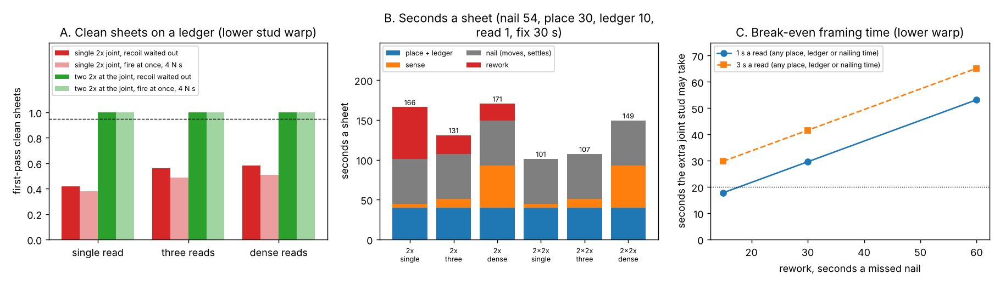
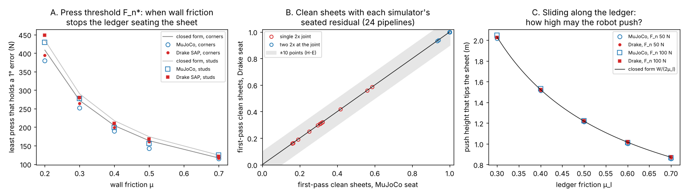
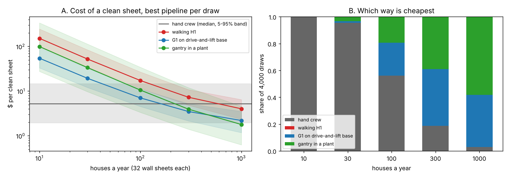

# Can a robot nail wall sheathing to code tolerance? A tolerance, contact and cost analysis of robotic sheathing on wood-frame walls

*Draft for* Automation in Construction *(Elsevier, full research article). Milestone 8 of the
`buildbot-sheathing` programme. Written with AI assistance (Claude Code); simulation and analysis
only, nothing tested on hardware. Every number below is produced by code in this directory and
checked against its results file by `paper/check_numbers.py`. Authorship, affiliations and the
corresponding author are left for the owner to fill in before any submission.*

## Highlights

- The 1/8 in panel gap shrinks the window of a sheathing joint nail from ±3.93 to ±3.14 mm.
- Bowed studs, not sensing, cap single-2x joints: 87% clean sheets with perfect reads.
- Doubled joint studs give 99.97% clean sheets with one read a stud, in 76–216 s a sheet.
- A ledger seats a released sheet in MuJoCo and Drake; clean sheets agree within 0.06 points.
- A G1 on a lift base beats a walking H1 in every draw, but a hand crew in only 37% at 100 houses.

## Abstract

Fastening sheathing is the most repetitive part of framing a wood-frame wall: a 4x8 sheet takes 62
nails, and the 34 on its two vertical edges must land on a 1.5 in stud face while staying 3/8 in
from a panel edge that is itself hung with a 1/8 in gap. Construction robots have been localised
to millimetres and timber assembly has been corrected from measurement, but no work we found
carries every error source of a real wall (the panel gap, sheet pose, row drift, bowed and
twisted studs, stud sensing, the arm and the tool's recoil) through to the outcome a builder
inspects: the share of sheets with every nail inside its window. We build that chain as a
statistical tolerance model checked against closed forms and Monte Carlo, simulate the placement
step (a ledger board, a stock Unitree G1 or H1 holding the sheet) in MuJoCo and again in Drake,
and price the result per clean sheet for four ways to do the work. With the gap in the budget, a
robot must read each stud to 0.41 mm (1σ) and hang the sheet plumb to about 0.03° for 95% clean
sheets on single-2x joints, and at the stud bow published for kiln-dried lumber no sensing
reaches it: one read a stud gives 55%, three 80% and perfect sensing 87%. Framing each joint with
two fastened 2x members, which the shear-wall standard already names for adjoining panel edges,
lifts a one-read robot to 99.97% and lets it hang the sheet 18 times more coarsely. A ledger seats
a released sheet to 0.0001° under a light press in MuJoCo, Drake moves no pipeline's clean-sheet
rate by more than 0.06 points, and neither stock humanoid can carry the 21.8 kg sheet, though both
can press it on the ledger. Priced, a G1 on a drive-and-lift base is the cheapest robot below
about 500 houses a year and beats a walking H1 in every draw, yet beats a two-person crew's $5.21
a sheet in only 37% of draws at 100 houses a year; the extra joint stud that wins in seconds does
not pay in dollars unless a missed nail costs about $6.50 more than its re-drive.

**Keywords:** construction robotics; wood-frame construction; sheathing; tolerance analysis;
humanoid robots; sim-to-sim; MuJoCo; Drake; cost of automation

## 1. Introduction

A wood-frame wall is braced by its sheathing, and the sheathing holds only where its nails hit
the framing. In our task model of a framing crew (`buildbot-taskbook`), fastening is 31% of the
crew's hours, and sheathing is the most repetitive part of it: 62 nails a 4x8 sheet, 17 on each
vertical edge at 6 in, 7 on each intermediate stud at 12 in and 14 into the plates
(`buildbot-fasten`). It is an obvious target for a robot, and robot makers and panel-line
integrators face a concrete design question: how good must the robot's stud sensing, sheet
placement and arm be, and which robot (a stock humanoid, a mobile manipulator with a lift, or a
gantry over a framing table in a plant) does the job most cheaply?

The question has been studied in pieces. Mobile fabrication robots have been localised to a few
millimetres across repositioning [Sandy et al. 2016; Giftthaler et al. 2017; Lachmayer et al.
2022], factory and multi-robot timber assembly correct their paths from as-built measurement
[Willmann et al. 2016; Adel et al. 2024], a humanoid has carried and screwed plasterboard to a
wall [Kumagai et al. 2019], and stud pose has been estimated from images for robot-assisted
light-frame assembly [Construction Robotics 2024]. None of these carries the error sources of a
real sheathed wall to the outcome a builder inspects. That outcome is strict: a nail that misses
the stud holds nothing, and where the sheathing is a shear wall the nailing schedule is
structural.

This paper makes four contributions.

1. **A tolerance model of sheathing nailing** (Section 3) that includes what earlier robot
   budgets left out: the panel gap, the sheet's own pose, row drift along a wall, and the bow and
   twist of real studs, with the share of sheets whose 62 nails all land as the outcome.
2. **A placement analysis in two physics engines** (Sections 4.3 and 5.4): a ledger board seats a
   released sheet, a stock humanoid cannot carry the sheet but can press it, and the result holds
   on a second contact model.
3. **A cycle and cost model** (Sections 4.5–4.6) that charges every stage, including the rework of
   missed nails, and ranks four ways to do the work per clean sheet over 10 to 1,000 houses a year.
4. **A design recommendation with its conditions**: the joint framing, not the robot's sensing,
   decides the clean-sheet rate; whether paying for it is worth it depends on what a missed nail
   costs.

Every hypothesis was written down before its experiment was run (`LOG.md`), and the paper reports
the refuted ones beside the held ones.

## 2. Related work

**Mobile construction robots.** Sandy et al. [2016] keep a mobile arm's end effector accurate
across repositioning with on-board sensing, and Giftthaler et al. [2017] describe the full In situ
Fabricator and two building-scale demonstrations. Lachmayer et al. [2022] frame the central
difficulty of mobile construction robots as the gap between the precision a task needs and the
accuracy a robot achieves, and refine the base pose with a laser scanner. That framing is ours;
the task differs, and none of these budgets a fastening task against a code window.

**Robotic timber assembly.** Willmann et al. [2016] assemble timber members robotically in a
factory. Adel et al. [2024] adapt a multi-robot timber process from as-built measurement, both by
pose and by topology, and reduce deviations on nail-laminated panels and a two-robot wall frame;
it is the strongest published "measure, then correct" baseline, and its data set
[Adel et al. 2024, data] is the most promising source of measured as-built framing. The
coarse-to-fine stud pose estimator of Construction Robotics [2024] is the real-sensor counterpart
of the stud-reading error we sweep.

**Humanoids at the wall.** Kumagai et al. [2019] had the HRP-5P humanoid carry an 11 kg board and
screw it to a wall, localising against a map. We could not see whether screw placement was
measured against the framing. Our sheet is twice that board's mass.

**Tolerance analysis.** Worst-case and statistical stack-up and allocation are standard in
mechanical assembly [Chase and Parkinson 1991]; we apply them to construction fastening with the
error structure of a wall (errors shared by every nail on a stud, on a sheet edge, and drifting
along a row).

**Simulation and contact.** MuJoCo [Todorov et al. 2012] provides the soft, convex contact of our
primary simulation; Drake's SAP solver [Castro et al. 2023] and its TAMSI solver [Castro et al.
2020] give the second contact model. Learned humanoid control in MuJoCo [Zakka et al. 2025] and
domain randomisation [Tobin et al. 2017] are the route to the dynamic hand-off we leave open.

**Gap.** No work we found propagates the full chain to the clean-sheet rate of sheathing
nailing, compares aiming strategies on it, or ranks robot classes by the cost of a clean sheet.
The claim is narrow: a tolerance-allocation analysis of one construction fastening task, checked
in two physics engines, with robot designs priced on the same budget.

## 3. Problem and error model

**Windows.** A joint nail (8d common, 0.131 in shank) must land at least 3/8 in from the sheet's
actual edge and with its whole shank on the 1.5 in stud face [`buildbot-fasten`; APA builder
tips]. Panels are hung with a 1/8 in gap at edges and ends (APA's recommendation, not a code
requirement), centred on the joint stud, so each sheet edge sits 1/16 in past the stud centre.
Field and plate nails keep the wider windows of `buildbot-studfind`.

**Sheet.** Its left edge sits at gap/2 + offset + x + θ(z − H/2) from the joint stud's centre,
where x and θ are the hanging error, and its width is 48 in minus a trim ("sized for spacing",
0 to 1/8 in at the maker's option, APA TT-055) plus a manufacturing error.

**Studs.** Each stud's face is a parabola of bow b, zero at the plates, plus a straight lean from
plate-layout errors at its ends; its section twists linearly along its length. Bow and twist
means are 0.11–0.21 in and 0.08–0.16 in (8 ft equivalent; published kiln-dried southern pine
studs, read as search snippets), truncated at the Stud-grade limits of 3/4 in bow and 3/8 in
twist. Two distribution shapes (half-normal, exponential) are reported, because none is
published. A twisted stud keeps a nail only where at least 10 nail diameters of shank stay in
wood through the rotated section.

**Robot.** A stud is read with 0.5 mm (1σ) scatter per read at one, two, three or 17 heights
(*single*, *ends*, *three*, *dense*) and fitted by a line or parabola; the sheet edge is read to
0.5 mm; the tool tip scatters 0.9 mm per nail (`buildbot-fasten`'s G1 model with 11-bit joint
sensors). The robot aims either at the design window from its stud estimate (*nominal*) or at the
window between the measured edge plus 3/8 in and the estimated far stud face (*edge*).

**Outcome.** A sheet is *clean* when all 62 nails land inside their windows. One nail outside
fails the sheet; nails missed a sheet are reported beside it. Rates come from 20,000 Monte Carlo
sheets a cell (binomial standard error under 0.002 at 95%) with fixed seeds, and Wilson intervals
where they matter.

**Checks.** With no gap the model reproduces `buildbot-studfind`'s quadrature within 0.01 at
three error settings; translation-only and rotation-only results match their closed forms within
0.01; edge aim with perfect sensing passes exactly while the shifted window is non-empty; a row of
exactly trimmed panels does not drift (`tests/`, 55 tests in all).

## 4. Methods

### 4.1 The joint budget (milestone 1)

We solve for the stud-read and tool scatter that leave 95% clean sheets as the gap grows from 0
to 3/16 in, the translation and rotation scatter a sheet may hang with under each aim, and the
clean-sheet rate along a 10-sheet (40 ft) row when each sheet is butted against the last with a
1/8 in gauge (offsets accumulate) or set from its own studs (the gap absorbs the width error).

### 4.2 As-built studs and joint framing (milestone 2)

Studs bow and twist as in Section 3. Each sensing policy is scored at no warp and the lower and
higher published warp, with an ablation of bow and twist, perfect reads, culling studs over a
bow cut, plate-layout lean, and three joint framings: one 2x (1.5 in face), a 3x (2.5 in) and two
2x fastened together (3.0 in), the last two being what SDPWS 4.3.7.1 names for adjoining panel
edges in some shear walls.

### 4.3 Placement in a physics engine (milestones 3 and 3b)

*Ledger seat.* In MuJoCo 4.0.1 (elliptic cone, `impratio` 10, 20 no-slip iterations, 0.5 ms), a
rigid 1.2192 × 2.4384 × 0.0111 m, 21.8 kg sheet (7/16 in OSB) touches the wall on spheres at its
corners or along four stud lines and stands on a level ledger. A holder lowers it 0.25–2° off
plumb, presses it into the wall with F_n = 5–600 N, and either releases it or keeps a wrist of
rotational stiffness k = 300–30,000 N·m/rad. Friction holds the error when its moment beats
gravity's: the closed-form press threshold is F_n* = m g W / (2 μ r̄), with r̄ the mean contact
lever arm. A held wrist keeps max(0, θ₀ − (m g W/2 − μ F_n r̄)/k). The seated sheet then carries
the panel's squareness and bottom-edge straightness (PS 2: diagonals within 1/8 in, a corner
angle of 0.083°; a 1/16 in edge bow that rocks the sheet up to 0.149°) and a laser line rated
1/8 in at 30 ft (0.020°).

*Stock humanoids.* The Unitree G1 (29 joints) and H1 from MuJoCo Menagerie at a pinned commit are
posed square to the wall by a static whole-body model (feet planted, torque limits, both soles
loaded, foot friction 0.3 and 0.6). We find the heaviest load each holds in both hands at
0.6–1.3 m, the largest press it can make into a seated sheet, and the press it can hold while
also sliding the sheet along the ledger with P = μ_l m g + μ_w F_n. Pushing the sheet's edge at
height h tips its trailing corner unless h < h* = W / (2 μ_l) (moments about the leading corner,
with the press at the push height); MuJoCo checks h* by bisection. With Unitree's published joint
gains (G1 arms kp 60 N·m/rad; H1 legs, torso and arms from `unitree_rl_gym`) the hands'
compliance C = J K⁻¹ Jᵀ gives the sheet's stiffness about the landing corner, which we compare
with the stiffness at which a held wrist keeps its error.

### 4.4 Tack, then measure (milestone 4)

The robot tacks the sheet with two field nails, measures where its edge landed and aims the
joint nails from that, or re-hangs it when the narrowest predicted half-window falls below a
threshold (at most five hangs). We solve for the hang (1σ) and the per-nail sway of a held sheet
that leave 95% clean sheets, for each joint framing.

### 4.5 The whole cycle (milestone 5)

One steady-state cycle along a row: a lift stands the sheet on a laser-set ledger, the robot
slides and presses it so it seats (PS 2 panels, 0.5 mm a corner, 1 or 3 mm left after the slide),
tacks it, reads the three new studs and both edges, nails the 62 nails with edge aim (54 or
121 s, `buildbot-mobilebase`) and re-drives every missed nail. Place and slide (15–60 s), ledger
(0–20 s), a read (1–3 s) and a re-drive (15–60 s a nail) are swept over 108 time cells; recoil is
either waited out or fired through, a 4 N·s impulse modelled as 0.37 mm added in quadrature to
the 0.9 mm tool scatter. A ledger-free alternative hangs and tacks the sheet with a lift to 0.25°
and 5 mm (1σ).

### 4.6 Dollars per clean sheet (milestone 7)

Four classes: a two-person hand crew (8.5 person-minutes a sheet at the task book's midpoint,
swept from one third to three times); a walking H1 (nailing 84.7–264.7 s; a person carries the
sheet); a G1 on a drive-and-lift base (nailing 54–121 s; the base can also hang and tack without
a ledger); and a gantry over a framing table in a plant (nailing 20–115 s plus scan and load,
`buildbot-custom`). Each class picks per draw the cheapest pipeline (framing, sensing, placement)
using milestone 5's missed-nail rates; every missed nail is re-driven, so every sheet ends clean.
Ownership is the capital recovery of the price over its life plus upkeep, spread over the 32 wall
sheets of V houses a year and capped at 2,000 machine hours; people are a loaded wage (BLS $29.12
an hour times a burden of 1.0–1.6) times carry, operator and supervision time. The extra joint
stud is a 92 5/8 in precut 2x4 at $3.41–5.56 (retail listings) plus 60–120 s of a framer's time.
Prices: G1 $13,500–21,600, H1 $90,000–150,000, base and lift $10,000–40,000 and gantry
$40,000–600,000; the last two are **not sourced** and are swept wide. 4,000 draws with common
random numbers across classes.

### 4.7 A second contact model (milestone 6)

The ledger seat and slide are rebuilt in Drake 1.51.1 (`MultibodyPlant`, discrete at 1 ms, point
contact, SAP; TAMSI as a third check) with the same sheet, contact points and holder law, applied
as an external wrench each step. Contact stiffness (10⁵–10⁷ N/m), Hunt–Crossley dissipation
(0.5–50 s/m) and the time step (0.5–2 ms) are swept. To test H-E, 2,000 seats are drawn per
engine (holder error uniform in ±1°, wall friction 0.3–0.5, press 5–50 N), and each engine's
seated residual is added to milestone 5's ledger tilt draw for all 24 ledger pipelines.

## 5. Results

### 5.1 The gap and the sheet's pose set the budget (H-A, H-C)

With the 1/8 in gap the joint half-window falls from 3.931 to 3.137 mm, and the single stud read
that leaves 95% clean sheets with perfect placement falls from 0.898 to 0.413 mm (1σ). At the
0.89 mm `buildbot-studfind` achieves, clean sheets drop from 0.952 to 0.748 when the robot plans
for the gap, and to 0.562 when it does not. Pose is as tight: with a 0.5 mm stud read, a robot
aiming at the design window tolerates no hang error at all, while aiming from an edge read to
0.5 mm allows 0.44 mm of translation and 0.0312° of rotation (1σ). Along a row, sheets butted
with a 1/8 in gauge leave their studs by the third sheet with full 48 in panels (no third sheet
clean) and keep a joint window for four sheets when trimmed 1/16 in; setting each sheet from its
own studs keeps every sheet at 0.98 clean. **H-C held.** **H-A held at a 0.5 mm stud read** (no
pose tolerance without edge aim); at 0.3 mm, aiming at the design window allows 0.38 mm and
0.0276°, so H-A depends on a stud reader whose accuracy no commercial source we found states.
Section 5.2 shows that on an as-built wall neither aim is what decides.

### 5.2 Bowed studs cap single-2x joints; doubled joints remove the cap

Bow moves the stud's face under a sheet edge that stays straight, so a single-2x joint closes for
any bow over 0.531 in (8 ft equivalent) whatever the robot knows. At the lower published warp
(half-normal) one read a stud gives 0.5453 clean sheets, three reads and a fitted parabola
0.8032, and perfect stud and edge reads 0.8685 (Table 1). Twist costs 1–2 points and 1.6 mm of
plate-layout lean costs 8. Reaching 95% by culling would mean rejecting 0.649 of studs (a 1/16 in
bow cut). Framing the joint with two fastened 2x members gives 0.9996 with a single read and
1.0000 with three at the lower warp, and 1.0000 with three reads at the higher warp.

*Table 1. Clean sheets by sensing and joint framing, lower published warp, half-normal (20,000
sheets a cell; `experiments/m2_asbuilt_studs/results.txt`, sections C, D and H).*

| Joint framing | single | ends | three | dense |
|---|---|---|---|---|
| one 2x (1.5 in) | 0.5453 | 0.5462 | 0.8032 | 0.8327 |
| one 2x, perfect reads and edge | 0.5631 | — | 0.8685 | 0.8685 |
| 3x (2.5 in) | 0.9909 | 0.9983 | 1.0000 | 1.0000 |
| two 2x (3.0 in) | 0.9996 | 1.0000 | 1.0000 | 1.0000 |

### 5.3 How coarsely may the sheet hang? (H-B, first part)

With tack-then-measure, single-2x joints on straight studs still need a hang of about 0.03° and
0.4 mm (1σ), and on bowed studs no hang reaches 95%; on straight studs, re-hanging a 1 mm / 0.1°
hang peaks at 0.8690 with 2.10 hangs a sheet. A held sheet may sway 0.187 mm under the nail. On two 2x, the robot may
hang to 0.5365° and 10.414 mm (edge aim, lower warp), 18 times coarser in rotation, and a held
sheet may sway 4.127 mm. This is the target placement has to meet.

### 5.4 A ledger seats the sheet; a stock humanoid can press it but not carry it (H-B)

A sheet released on the ledger under a press of 100 N or less, at wall friction 0.2–0.7, ends
parallel to the ledger within 0.0001°; at a press of 50 N or less and friction 0.3–0.5 the largest
residual is 0.00003°. Above a threshold friction holds the whole error: 189.3 N at μ 0.4 on corner
contacts, 0.872–0.987 of the closed form m g W / (2 μ r̄) over μ 0.2–0.7.
A held wrist matches its closed form within 0.005° or 10% in 29 of 30 cells (largest error
0.0367°). Seated, the panel decides: drawn uniformly within the PS 2 limits with a ledger good to
0.5 mm a corner, doubled joints stay at 1.0000 and single 2x on straight studs falls to 0.8440;
95% there needs panels within 0.244 of the PS 2 limits.

Neither stock humanoid can bring the sheet to the ledger. Holding with both hands at
0.6–1.3 m, a G1 carries at most 2.8–8.7 kg and an H1 12.4–18.8 kg, against 21.8 kg. On the ledger
both can press: a G1 66–110 N and an H1 128–281 N. MuJoCo reproduces the tipping height
h* = W / (2 μ_l) within 1.6% in 14 cases. At Unitree's published gains a G1 is 3 to 31 times
softer about the landing corner than the stiffness at which a hold keeps its error, so the ledger
seats the sheet; an H1 is soft enough through palm contacts but keeps 0.46–0.99° of a 1° error
with a rigid clamp. **H-B is supported**: a stock humanoid cannot hang a sheet within the
single-2x budget unaided and needs a guide. Its refutation test, a learned hang policy, was not
run.

### 5.5 The whole cycle in seconds (milestone 5)

On two 2x with one read a stud the first-pass clean rate is 0.9997 [0.999, 1.000] and a sheet
takes 76 to 216 s (median 146); a single read is the fastest policy in all 108 time cells. On
single 2x no policy passes 0.5833 (dense reads; 0.70 nails missed a sheet), three reads are
fastest in all 108 cells, and the best single-2x sheet takes 94 to 281 s (median 183). Before the
extra stud is charged, two 2x win by 17.8 to 65.2 s a sheet, all of it rework (Fig. 1). Firing
through the recoil costs up to 7.64 points on single 2x (a conservative model) and at most 0.12
on two 2x. On two 2x a lift that hangs and tacks the sheet to 0.25° and 5 mm needs no ledger
(0.9775 with one read, 0.9960 with three). Nailing is the largest stage in 90 of 108 cells
(place is in the other 18), refuting our expectation that it always would be.

### 5.6 The second contact model (H-E)

Drake leaves a seated residual of 0.00142° (1σ; 0.00466° at most) over 2,000 random seats, against
MuJoCo's 0.00001°. Both are far under the 0.03° single-2x joints allow, and the worst difference
in clean-sheet rate between the engines over the 24 ledger pipelines is **0.06 points** (bar 10).
**H-E held.** Drake's press thresholds are 0.965–0.998 of the closed form on corner contacts,
MuJoCo's 0.872–0.987: MuJoCo lets wall friction hold the sheet from a little less press, the
cautious side for a press limit. The tipping height matches W / (2 μ_l) within 0.7% in Drake.
Two terms depend on the engine. A soft held wrist (300–3,000 N·m/rad) keeps up to 0.016° in Drake
where MuJoCo and the closed form keep nothing (H34 refuted: 70% of cells within tolerance, bar
90%), and a 1/16 in bowed bottom edge rocks the sheet 0.107–0.123° in Drake and 0.139–0.145° in
MuJoCo, both under the 0.149° static bound milestone 3 charged. On its bowed middle the sheet is
balanced, so the rock is set by friction and approach, not statics; charging the full bound is
the conservative choice.

That three-foot bow is a modelling choice, and the rock is its artefact. A smooth bow is a
rocker: a parabolic 1/16 in bow over 48 in has radius R = 117.0 m at mid-width, against a centre
of mass h0 = 1.221 m above it, so rolling by θ raises the centre of mass by (R − h0) θ²/2 and
gravity rolls the sheet back to level. Only wall friction can then keep a tilt, at most
θ_s = μ F_n r̄ / (m g (R − h0)), with r̄ = 1.562 m from the mid-width contact. Modelled as 49 feet
on the curve, both engines seat inside θ_s + 0.005° in all 48 cells of a grid over bow, holder
error, wall friction and press (H37). Over the 2,000 random seats of milestone 6 the 99th
percentile |θ| is 0.05876° in Drake and 0.06055° in MuJoCo, and the best single-2x pipeline
rises from 0.5602 to 0.6250 clean sheets (Drake; 0.6244 with MuJoCo seats), while doubled joints
move by at most 0.45 points (H40). A kink keeps the rock: balanced on a point the sheet's
toppling moment is smaller than the wall friction a light press holds, so it stops where the
approach leaves it, which is why the engines disagreed. A 1 mm bump under a straight edge (grit
on the ledger) leaves a median 0.0500° in Drake and 0.0607° in MuJoCo. A light press once the
sheet is seated and a clean ledger are the placement rules that follow.

### 5.7 Dollars per clean sheet (H-D)

*Table 2. Dollars per clean sheet, best pipeline per draw, median [5%, 95%] over 4,000 draws
(`experiments/m7_cost/results.txt`, section A).*

| Class | 10 houses/yr | 100 houses/yr | 1,000 houses/yr |
|---|---|---|---|
| walking H1 | 151.73 [98.02, 245.83] | 17.23 [11.48, 26.77] | 4.02 [2.34, 6.45] |
| G1 on a lift base | 54.43 [33.04, 93.51] | 7.03 [4.52, 11.03] | 2.20 [1.17, 3.50] |
| gantry (plant) | 99.24 [27.59, 337.09] | 10.51 [3.33, 34.17] | 1.78 [0.63, 4.57] |
| hand crew | 5.21 [1.93, 14.46] | 5.21 [1.93, 14.46] | 5.21 [1.93, 14.46] |

The base costs less than the walking H1 in every draw, at every volume and with either sensing
policy forced: **H-D's first half held**. The gantry is dearer than the base in the median draw
at 10 houses a year (+$43.67 a sheet) and cheaper only from about 501 houses a year (at 300 it is
still +$0.51); we had predicted a crossing between 30 and 300, so **H-D's second half is refuted
as registered**, though the ranking does flip inside the swept range. Per draw, 62% of draws cross
inside 10–1,000 houses, at a median of 54: the gantry's unsourced price spreads the crossing over
two decades. Against the crew, the base is cheaper in 37% of draws at 100 houses a year, 74% at
300 and 94% at 1,000 (Fig. 3). Its cost is moved most by its life (Spearman −0.58) and base price
(+0.58), both unsourced.

Every robot picks single 2x joints with three reads. The extra stud costs $5.42 a sheet (median),
while the 0.79 missed nails a sheet it saves are worth well under a dollar of robot and
supervisor time. Doubled joints pay only if a missed nail costs $6.51 [5.21, 7.88] more than its
re-drive, about ten loaded person-minutes.

## 6. Discussion

**What decides a clean sheet.** The robot's sensing matters only where the framing leaves room
for it. On single-2x joints an as-built wall closes the window under a straight sheet edge in
enough places that perfect sensing reaches 87% clean sheets; on doubled joints a single read a
stud suffices. For a robot maker, this means the specification to chase is not a sub-millimetre
stud reader but a frame the robot can nail into, and a placement system that delivers a sheet
seated on a ledger.

**What it means for robot choice.** A stock humanoid is the wrong carrier for a 21.8 kg sheet but
a usable presser: the work splits between a lift (or a person) that carries and a robot that
seats, tacks and nails. Putting the arm on a drive-and-lift base wins over legs in every draw. A
plant gantry wins only at panel-line volumes, and its price is the least known input.

**Seconds against dollars.** The two cost views disagree, and both are reported. In seconds,
doubled joints save 18–65 s of rework a sheet; in dollars, that rework is cheap robot time and the
stud is not. The decision turns on the cost of a missed nail found late: a miss the robot finds
and re-drives at once is cheap, a miss found at inspection or in a shear wall where it is a
structural defect is not. Where a shear-wall design already calls for 3x or doubled joints, the
stud is sunk and the robot gets its 99.97% for free.

**Against a crew.** A site robot beats the hand crew in the median draw only when it sheathes
over about 100 houses a year, more than a robot moving between single-house sites would. That is
the honest headline for the economics: the technical problem is solvable with a ledger and the
right framing; the business case needs volume.

## 7. Limitations and threats to validity

- **Swept, not measured.** Stud, edge, gauge and width errors, every hang and sway, every stage
  time but the nailing, and every machine price but the humanoids' are swept. Real errors have
  bias and heavy tails.
- **Studs.** Warp means come from two studies read as search snippets; distribution shapes are
  assumed (two are shown); bow is a parabola and twist linear, as in a free stud, though nailing
  pulls a stud partly straight. Crook, sheet bow and wall racking are not modelled.
- **Rigid sheet, two compliant engines.** Both engines run a rigid point-contact sheet with
  regularised contact; agreeing with each other does not make either a real sheet on real
  framing. Real edge profiles are not measured: a smooth bow seats inside the friction band, a
  kink or grit does not, and how often real edges and ledgers have one is unknown.
- **Static humanoid.** No walking, balance controller or hand-off dynamics; joint gains are taken
  at face value.
- **Strict pass/fail.** One nail outside its window fails a sheet, though a crew may accept a near
  miss or re-drive it; the crew's own misses are not charged, which favours it.
- **Windows from secondary sources.** The gap, edge distance and trim were read in APA pages and a
  manufacturer's guide seen in search results, not in APA E30 or the building code.
- **No hardware.** Nothing here is a rated accuracy or a safety case; nailing near people needs a
  risk assessment under ISO 10218 and ISO/TS 15066.

## 8. Conclusion

A robot can nail wall sheathing to the code's windows, but not on any wall. With the panel gap in
the budget and studs bowed as real lumber is, single-2x joints cap a perfectly sensing robot at
87% clean sheets, while doubled joint studs let a robot that reads each stud once reach 99.97% and
hang the sheet 18 times more coarsely. A ledger board seats a released sheet in two physics
engines, so the placement problem reduces to carrying the sheet there, which no stock humanoid
can do. On cost, a G1 on a drive-and-lift base is the best robot below panel-plant volumes, but it
beats a two-person crew only above about 100 houses a year. The open terms are measured: stud
profiles, panel squareness, stage times, the cost of a missed nail, and a mock-up to check the
whole chain.

## Data and code availability

All code, results files and figures are MIT licensed in this directory: `src/buildbot_sheathing/`
(models), `experiments/m*/run.py` (each milestone, with seeds), `tests/` (55 tests), and
`README.md`, "Reproduce". MuJoCo 4.0.1 and Drake 1.51.1 produced the simulated results.

## Declaration of generative AI use

Per Elsevier's policy on generative AI in writing, the authors declare that the analysis code,
experiments and this text were produced with Claude Code (Anthropic). Every number was produced by
the code in this repository and checked by `paper/check_numbers.py`; the authors must review and
take responsibility for the content before submission.

## References

BibTeX entries are in `paper/references.bib`. Identifiers were checked by
`research/_shared/cite_check.py` on 2026-11-12 (`cite_check.json`) except where noted there.

- Adel, A., Ruan, D., McGee, W., Mozaffari, S. (2024). Feedback-driven adaptive multi-robot timber construction. *Automation in Construction* 164, 105444.
- Adel, A., et al. (2024, data). Adaptive multi-robot timber construction dataset. doi:10.34770/0w80-p436.
- Castro, A.M., Qu, A., Kuppuswamy, N., Alspach, A., Sherman, M. (2020). A transition-aware method for the simulation of compliant contact with regularized friction. *IEEE Robotics and Automation Letters*. arXiv:1909.05700.
- Castro, A.M., Permenter, F.N., Han, X. (2023). An unconstrained convex formulation of compliant contact. *IEEE Transactions on Robotics*. arXiv:2110.10107.
- Chase, K.W., Parkinson, A.R. (1991). A survey of research in the application of tolerance analysis to the design of mechanical assemblies. *Research in Engineering Design* 3, 23–37. doi:10.1007/BF01580066.
- Construction Robotics (2024). Adaptive robotic construction of wood frames. doi:10.1007/s41693-024-00122-0. (Title from Crossref; authors not confirmed in this session.)
- Giftthaler, M., et al. (2017). Mobile robotic fabrication at 1:1 scale: the In situ Fabricator. *Construction Robotics*. doi:10.1007/s41693-017-0003-5.
- Kumagai, I., et al. (2019). Toward industrialization of humanoid robots: autonomous plasterboard installation to improve safety and efficiency. *IEEE Robotics & Automation Magazine* 26(4), 20–29.
- Lachmayer, L., et al. (2022). *ISPRS Archives* XLIII-B1-2022, 453. (Title not confirmed beyond the record.)
- Sandy, T., Giftthaler, M., Dörfler, K., Kohler, M., Buchli, J. (2016). Autonomous repositioning and localization of an in situ fabricator. ICRA 2016, 2852–2858.
- Tobin, J., et al. (2017). Domain randomization for transferring deep neural networks from simulation to the real world. arXiv:1703.06907.
- Todorov, E., Erez, T., Tassa, Y. (2012). MuJoCo: a physics engine for model-based control. IROS. doi:10.1109/IROS.2012.6386109.
- Willmann, J., Knauss, M., Bonwetsch, T., Apolinarska, A.A., Gramazio, F., Kohler, M. (2016). Robotic timber construction — expanding additive fabrication to new dimensions. *Automation in Construction* 61, 16–23. doi:10.1016/j.autcon.2015.09.011.
- Zakka, K., et al. (2025). MuJoCo Playground. arXiv:2502.08844.
- APA – The Engineered Wood Association. Builder tips (panel spacing, fastener edge distance) and Technical Topic TT-055 (sized for spacing). Web pages seen as search records.
- American Wood Council. *Special Design Provisions for Wind and Seismic* (SDPWS), section 4.3.7.1 (edition not confirmed).
- DOC PS 2: Performance Standard for Wood Structural Panels.
