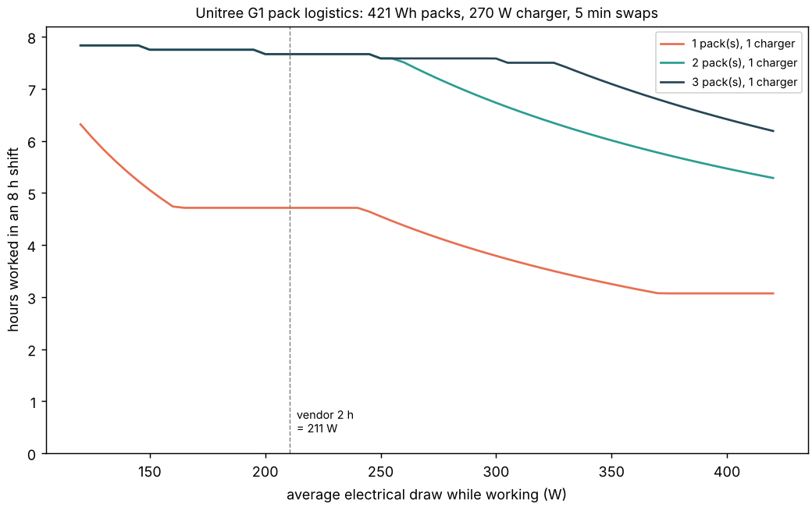

# buildbot-shift: how many hours of an 8-hour shift can a battery-powered Unitree G1 actually work?

A project of track 20, robots on the residential building site (`PROJECTS.md`). It does not extend the `buildbot-carry*` chain (which had gone to micro-variants of one speed ceiling) but asks a question [`buildbot-cost`](../buildbot-cost) left as a swept number: its "use" input (500 to 2,000 h/yr) hides the battery. Produced with AI assistance (Claude). Simulated and preliminary; no robot was tested.

**Live page:** https://duncan-haywood.github.io/monorepo-projects/research/buildbot-shift/

**Headline.** At the vendor's own "about 2 hours" (421.2 Wh pack, so about 211 W average), **one pack gets a G1 only 4.7 h of work out of an 8 h shift; two packs and one 270 W charger get 7.7 h**, and a third pack or a second charger adds nothing. The charger is the bottleneck once the robot draws about 300 W or more (a pack then runs 1.3 h and takes 1.6 h to refill): 3 packs for 7 h of work at 300 W, 4 at 400 W. Pack logistics change the `buildbot-cost` G1 break-even slowdown only from 2.42 to between 2.27 and 2.46, so **the battery is a scheduling detail, not what decides whether a humanoid pays**; it does put a G1 at about 1,200 to 1,900 h/yr, inside the cost sweep's range.



**Not a rated runtime.** The 2 h figure is the vendor's, with no stated activity. Carrying lumber draws more than standing.

## Method (`src/buildbot_shift/model.py`)
An event model. The robot works from a charged pack at constant draw until the usable energy is gone, swaps (5 min), and the spent pack goes on the earliest free charger (constant power, first come first served). It waits if no pack is ready. Every pack starts full.

| Input | Value | Source |
|---|---|---|
| Pack | 9000 mAh, 46.8 V nominal = 421.2 Wh | retailer listing of the official spec (see references) |
| Vendor runtime | about 2 h, activity unstated | [Unitree G1 page](https://www.unitree.com/g1) |
| Charger | 54 V x 5 A = 270 W | Unitree G1 page (a 54 V 5.5 A charger is also listed) |
| Average draw | 211 W (= 421.2 Wh / 2 h); swept 150 to 400 W | implied by the vendor claim; sweep because no source gives a task draw |
| Usable fraction, charger efficiency | 90%, 90% | assumed |
| Swap time | 5 min; swept 2 to 10 | assumed |
| Pack price | $699.99 | one US retailer ([Maverick Drone](https://www.maverickdrone.com/collections/all/products/g1-battery)), not a quote |
| Pack life | 300 and 1,000 cycles | assumed: no source gives a rated cycle count |
| Working days | 250 a year | assumed |

Link to cost: hours per year = hours worked x 250 replaces `used_h`, and pack wear (price over cycles x 1.8 h) plus the extra packs' purchase over 6,000 h is added to `buildbot-cost`'s ownership rate (G1 $16,000, life 6,000 h, upkeep 10%/yr, loaded wage $37.86, supervision 0.3).

## Results (`experiments/results.txt`)
- **A.** Hours worked in 8 h, 1 / 2 / 3 / 4 packs: 4.71 / 7.67 / 7.67 / 7.67 (the same with 2 chargers at 211 W).
- **B.** With 2 packs and 1 charger the hours worked fall from 7.75 (150 W) to 7.67 (211 W), 6.73 (300 W) and 5.47 (400 W) at 5 min swaps. Packs needed for 7 h: 2, 2, 3 and 4 at 150, 211, 300 and 400 W with one charger; 2, 2, 2, 3 with two.
- **C.** Break-even slowdown (robot-hours per replaced crew-hour): 2.42 in `buildbot-cost`; 2.27 / 2.40 with 1 pack, 2.33 / 2.46 with 2 and 2.31 / 2.45 with 3 (pack life 300 / 1,000 cycles).

## Reproduce
```bash
cd research/buildbot-shift
PYTHONPATH=src python -m unittest discover -s tests   # 7 tests, including the one-pack cycle worked by hand
python experiments/run.py > experiments/results.txt   # stdlib, instant, deterministic; writes results.json
python experiments/figure.py                           # needs matplotlib
```

## Limitations
- **Draw is not measured.** 211 W is back-calculated from a vendor claim; a carrying or nailing G1 may draw more. `buildbot-carry`-style simulations with a motor model would give a task draw; MuJoCo joint torques here would need motor constants nobody in this track has sourced.
- Constant draw, no battery ageing, no cold-weather loss, no charging-time curve (constant power), no time for the robot to go to the charger or for a person to swap it (5 min is assumed).
- Pack price and cycle life are single retailer and assumed figures; the extra-pack capital term is crude.
- Hot-swapping a pack is listed by one retailer as a feature; whether a G1 can swap without a restart, and who may do it safely near the robot, is not established here.
- It says nothing about whether the robot does useful work in those hours.

## Next steps
Measure the draw of the `buildbot-carry` and `-fasten` motions with a sourced motor model, or on a real G1 (owner step), then replace the swept 150 to 400 W.

## Owner steps
None needed. A real value needs a metered G1 on a mock-up wall with a risk assessment (ISO 10218, ISO/TS 15066) and a vendor quote for packs.

## Outside dependencies (vitamins)
Python standard library; Matplotlib for the figure. Reads `research/buildbot-cost` (for its rate and break-even functions). Pack energy comes from a retailer listing quoting the official spec ([Camera Warehouse](https://www.camera-warehouse.com.au/unitree-g1-battery-9000-mah), [RobotShop](https://www.robotshop.com/products/unitree-g1-humanoid-robot-us)); the other sources are linked in the table. No CU Boulder group in `prompt.md` covers construction and none is claimed.
