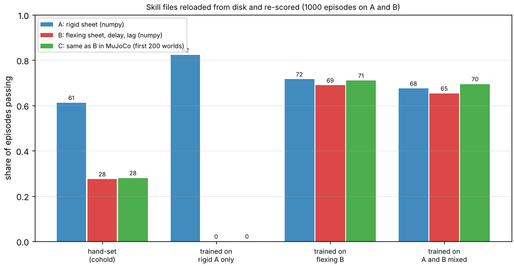

# buildbot-skillpack: a loadable skill library for building-site robots, and does training on two plants at once cover a third?

Seventh project of track 20, robots on the residential building site (`PROJECTS.md`, milestone 6, the part `buildbot-skills` left open: "a library of the skills in a form a robot owner could load"). [`buildbot-skills`](../buildbot-skills) and [`buildbot-mjsheet`](../buildbot-mjsheet) showed that a sheet-following skill tuned on a rigid-sheet plant fails on a flexing one, and that the failure also appears in MuJoCo. This packages the skills as versioned JSON files with a loader, a validator and a re-scorer, and asks the one new question that falls out: if the tuning scores the worse of two plants, does the skill hold on a third (MuJoCo)? Produced with AI assistance (Claude). Simulated and preliminary; builds on no group in `prompt.md`.

**Live page:** https://duncan-haywood.github.io/monorepo-projects/research/buildbot-skillpack/

**Headline.**
- **Five skill files in [`skills/`](skills), each reloaded from disk and re-scored to the digit.** Four are the sheet-following skill (`cohold-follow-*`: hand-set, trained on the rigid plant A, trained on the flexing plant B, trained on A and B mixed) and one is the 95%-of-sheets nailing tolerance budget (`sheathing-nail`). Every file carries its parameters, interface, test scene and seed, pass criteria, the success it claimed when published, and caveats. The loader rejects a file without caveats that say it is not a rated capability.
- **Mixing the two plants did not help.** The mixed skill (K 386, B 34, Ki 80) passes **67.5% on A, 65.3% on B and 69.5% on the MuJoCo plant C**. The skill tuned on B alone passes 71.6%, 68.9% and 71.0%, and the hand-set gains 61.2%, 27.5% and 28.0%. So a skill trained on the flexing plant already holds on the rigid one, and training on both gives nothing extra. (The B skill's seed was picked on the B test set in `buildbot-skills`, which favours it by a few points; the mixed seed was picked on a separate validation set. See Limitations.)
- **The one that fails is the skill tuned on the rigid plant only**: 82.3% on A, **0.0% on B and on MuJoCo**. This is the `buildbot-skills` result, now reproduced from a file anyone can load.
- **MuJoCo agrees with the numpy plant** for every skill to within sampling error (n = 200 for C): 0.0 vs 0.0, 71.0 vs 68.9, 69.5 vs 65.3, 28.0 vs 27.5.



**Not a rated skill and not a safety case.** Nothing ran on a robot. A robot holding a sheet beside a person is a falling-object and crush hazard (ISO 10218, ISO/TS 15066, the site's OSHA duties). Simulated pass rates are not payload, accuracy or safety ratings.

## Skill file format (`src/buildbot_skillpack/pack.py`)
`schema` (`buildbot-skillpack/1`), `name`, `kind` (`cohold-follow` or `sheathing-nail`), `version`, `licence`, `interface` (what the skill observes and commands), `params`, `scene` (test seed, episode count, ranges), `criteria`, `claimed` (success rates as published), `caveats`, and a free `note`. `pack.load(path)` validates (known schema and kind, every parameter present and in range, caveats present and saying "not a rated capability") and raises `SkillError` otherwise. `evalpack.rescore_follow` regenerates the scene's episodes from the stored seed, runs the controller on plants A and B (numpy, `buildbot-skills`) and optionally C (MuJoCo, `buildbot-mjsheet`), and `evalpack.compare` lists claims that no longer reproduce.

The follow skill is an impedance law on the robot's end of the sheet: `Fz = 0.5 m g + K (ref - z) - B vz + Ki ∫(ref - z)`, `Fx = K (L - x) - B vx`, with the reference copying the person's end after a lag. The nailing file is a tolerance budget, not a controller: the stud-read scatter (0.89 mm) and tool-tip scatter (0.9 mm) for which `buildbot-studfind` gives 95.1% of 4x8 sheets with all 62 nails inside their windows.

| Input | Value | Source |
|---|---|---|
| Plants A, B, C, their ranges, thresholds | unchanged | [`buildbot-skills`](../buildbot-skills), [`buildbot-mjsheet`](../buildbot-mjsheet); delay, actuator lag and flex stiffness are **not sourced** there |
| Mixed training | 300 log-uniform (K, B, Ki) candidates, 120 randomised episodes on each of A and B, score = the lower pass rate, 4 seeds, seed picked on 400 validation episodes per plant | **mine** |
| Test set | 1000 episodes per plant, `numpy.random.default_rng(2024)` drawn separately for A and for B | **mine**; differs from `buildbot-skills`' (one generator for both), so rates differ by a few points from its table |
| Nail budget | 0.89 mm read, 0.9 mm tool | `buildbot-studfind` |

## Reproduce
```bash
pip install numpy matplotlib pytest mujoco
cd research/buildbot-skillpack
python -m pytest -q tests
python experiments/run.py > experiments/results.txt   # about 4 minutes on 4 CPUs, rewrites skills/*.json and results.json
python experiments/figure.py
```
Load a skill: `from buildbot_skillpack import pack; s = pack.load("skills/cohold-follow-mixed.json"); s["params"]` gives `K`, `B`, `Ki`.

## Results (`experiments/results.txt`)
Mixed training, per seed (train min over A and B; validation on A / B): seed 1 0.650, 0.618 / 0.635; seed 2 0.658, 0.682 / 0.650; seed 3 0.583, 0.685 / 0.680; seed 4 0.650, 0.632 / 0.615. Seed 3 won on validation. Pass-rate table above and in the figure. All five files reload and re-score to their claimed values; the tests check the loader's rejections, determinism, that no-gain control scores below the hand-set one, and that the nail budget matches `buildbot-studfind`.

## Limitations
- **A packaged skill is only as good as its plants.** All three plants share the planar two-force-point abstraction; C changes the integrator and rigid-body code, not the model of delay, actuator lag or stiffness, which are swept ranges nobody measured. Agreement on C is a cross-check of the code, not of the physics.
- **Selection is unequal.** The B skill is the seed `buildbot-skills` picked on its B test set; the mixed skill was picked on a validation set. A B-only skill picked on validation would likely land a point or two lower. The honest reading is "mixing is not better", not "mixing is worse".
- **Pass rates are comparable inside this table only.** The test episodes differ from `buildbot-skills`' (separate generators), and C uses 200 worlds (standard error about 3 points).
- **Only the follow skill is a controller.** Carry and fasten skills (a walking carry policy, a nailing policy) are still not written; `sheathing-nail` records a tolerance budget. The format does not yet hold a learned network.
- **One 0.3 m lift in a plane**; no walking, grip slip or reacting person.

## Next steps
Add the `buildbot-carry` and nailing-placement skills as controllers once they exist; train with an observer for the sheet's mass; measure a G1 hand-force loop's latency to replace the delay sweep; select every skill the same way (validation set) and repeat with more seeds.

## Owner steps
None needed. A hardware trial needs a G1 or H1, a risk assessment (ISO 10218, ISO/TS 15066) and a spotter.

## Outside dependencies (vitamins)
NumPy, Matplotlib, pytest; MuJoCo (Apache-2.0) for plant C via `buildbot-mjsheet`. Reads `buildbot-skills`, `buildbot-mjsheet`, `buildbot-fasten` and `buildbot-studfind`. Delay, actuator lag and sheet stiffness could not be found and are swept.
