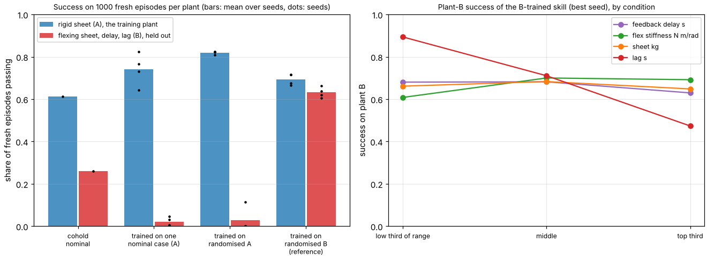

# buildbot-skills: does a sheet-following skill tuned on a rigid-sheet simulator survive a flexing sheet, sensing delay and actuator lag?

Sixth project of track 20, robots on the residential building site (`PROJECTS.md`, milestone 6, the sim-to-sim check). [`buildbot-cohold`](../buildbot-cohold) built a person-leads, robot-follows lift of a 4x8 sheet with hand-set impedance gains. This asks the sim-to-real question in its cheapest form: tune the skill on one simulator with randomised conditions, then test it on a second simulator that has dynamics the first lacks. It is **my own planar model of both plants, not two physics engines**, and no robot, controller or sheet was measured. Produced with AI assistance (Claude). Simulated and preliminary. It builds on no group in `prompt.md`; none is claimed.

**Live page:** https://duncan-haywood.github.io/monorepo-projects/research/buildbot-skills/

**Headline.** 1000 fresh episodes per plant; a pass is peak tilt of 3 degrees or less, final tilt 0.5 degrees or less and the person's peak load under the NIOSH constant (23.1 kg-equivalent).
- **Tuned where it was trained, it passes 81 to 82% of episodes; on the held-out plant it passes 0 to 11%.** Over four seeds, random search on the rigid-sheet plant with randomised sheet mass, lift time, lag and feed-forward error picks stiff, lightly damped gains (K of 891 to 28,900 N/m, B of 20 to 44 N s/m). Without delay those are fine. With 0 to 30 ms of feedback delay and a 5 to 50 ms force actuator lag, 72 to 100% of episodes go unstable (tilt over 30 degrees).
- **Randomising what the simulator has did not help.** Training on a single nominal case gave 0 to 5% on the held-out plant; training on the randomised distribution gave 0 to 11%. `buildbot-cohold`'s hand-set setting (K 1000, B 150) passes 61% on the rigid plant and 26% on the held-out one, with 49% unstable.
- **A skill tuned on the held-out plant passes 61 to 66% there** and 67 to 72% back on the rigid plant, so the two plants are not incompatible: lower gains (K 241 to 548, B 21 to 58) with an integral term sit in both. The cost is lag: success falls from 89% (reference lag under 0.15 s) to 47% (0.3 to 0.5 s), because the peak tilt of a following robot is set by hand speed times lag over sheet length (`buildbot-cohold`).
- **The ceiling is not 100%.** Even on the plant it was tuned on, no gain setting passes more than 82% of the drawn worlds: the rest are fast lifts with a late reference, which no gain fixes.



**Not a safety case and not a rated skill.** Nothing was run on a robot. A robot holding a sheet beside a person is a falling-object and crush hazard and needs a risk assessment (ISO 10218, ISO/TS 15066, the site's OSHA duties).

## Method (`src/buildbot_skills/model.py`, `train.py`)
- **Skill.** An impedance law on the robot's end of the sheet, force = feed-forward (an estimate of half the sheet's weight, wrong by 0.8 to 1.2x in the world) + K x (reference height - hand height) - B x hand speed + Ki x integral of the height error. The reference copies the person's end after a lag. Three numbers (K, B, Ki) are what is trained.
- **Plant A (training).** The rigid rod of `buildbot-cohold`, re-derived here with no MuJoCo dependency. A test checks it against `buildbot-cohold`'s published 22 kg, 2 s, K 1000, B 150, lag 0.2 s figures (2.242 degrees peak tilt, 11.42 kg person peak).
- **Plant B (held out).** Two rigid halves joined at the midline by a torsional spring-damper (a flexing board), a first-order lag on the hand-force command, and feedback that arrives late. Lagrangian two-link equations written out in the source; tests check that with a very stiff hinge and an instant actuator it reproduces plant A, that a static hold splits the weight evenly, and that results do not change when the time step is halved. Each episode first holds still for 1 s under heavy damping so the board starts at its sag equilibrium; only the lift is scored.
- **Training.** Random search: 300 log-uniform (K, B, Ki) candidates, scored on 120 episodes by pass rate (ties by mean peak tilt), four seeds. Test sets are 1000 fresh episodes per plant, the same for every policy.

| Input | Value | Source |
|---|---|---|
| Sheet mass | 6 to 23 kg | `buildbot-cohold`: the G1's limit (8 kg) up to a 23.2 kg drywall sheet |
| Lift | 0.3 m, minimum jerk, 1 to 4 s | `buildbot-cohold` |
| Reference lag, feed-forward error, reference height error | 0 to 0.5 s, 0.8 to 1.2x, N(0, 1 cm) | **mine**; the lag range is `buildbot-cohold`'s |
| Feedback delay, actuator lag (plant B) | 0 to 30 ms, 5 to 50 ms | **not sourced**: no robot's figure was found |
| Sheet flexural stiffness (plant B) | 150 to 6000 N m/rad | **not sourced.** A web search found no published stiffness for 7/16 in OSB. A beam estimate with an OSB modulus of about 5 GPa recalled from memory, not checked, gives about 600 |
| Pass thresholds | 3 degrees peak, 0.5 degrees final, NIOSH 23.1 kg | tilt limits **mine** (swept 1 to 5 degrees in the diagnostics); NIOSH constant from Waters et al. (1993) as in `buildbot-payload` |

## Reproduce
```bash
pip install numpy matplotlib pytest
cd research/buildbot-skills
python -m pytest -q tests
python experiments/run.py > experiments/results.txt   # about 6 minutes on 4 CPUs, writes results.json
python experiments/figure.py
```

## Results (`experiments/results.txt`)
- **Table.** Four seeds each of: trained on one nominal case (A), trained on randomised A, trained on randomised B (a reference, not a fair transfer test). Test pass rates on A and on B, and the share of unstable B episodes, are in `results.txt`.
- **Tilt limit.** For the best-seed B-trained skill, pass rate on B is 14% at a 1 degree limit, 45% at 2, 66% at 3 and 89% at 5.
- **Where it fails (B-trained, best seed).** Peak tilt over the limit in 29% of episodes, final tilt in 8%, NIOSH in 1%, unstable in 1%. Sheet mass, delay and flex stiffness each move the pass rate by 8 points or less; reference lag moves it by 42.

## Limitations
- **Both plants are mine.** They share a planar, two-force-point abstraction of a sheet held at two ends. A second physics engine, or a real robot, may fail in ways neither does. Plant B differs from A in a few named ways; that is a probe of unmodelled dynamics, not a measurement of sim-to-real error.
- **Delay, actuator lag and sheet stiffness ranges are unsourced** and the conclusion depends on them: with no delay and no actuator lag, plant B reduces to plant A (a test). How much delay a real G1 has in a force-feedback loop is the number that decides whether the stiff skills are usable.
- **Random search over three gains** is a deliberately weak "training"; a learned policy might behave differently. It does show that the gap comes from the simulator, not the optimiser: the same search over plant B finds working gains.
- **The skill follows one lift** (a 0.3 m raise). Walking, a person who reacts, grip friction and the robot's whole-body balance are `buildbot-cohold`'s open items and are not added here.
- **Unfinished milestone.** `PROJECTS.md` milestone 6 also asks for a library of the carry, fasten and cohold skills in a loadable form. This covers one skill's transfer check and no policy file.

## Next steps
Measure a robot's hand-force loop latency (or take it from a vendor datasheet) to replace the delay sweep; repeat the check with MuJoCo as plant B; add the fastening skill's placement error as a second skill in the same harness; use the B-trained gains with an observer for the sheet's mass.

## Owner steps
None needed. A hardware trial needs a G1 or H1, a risk assessment (ISO 10218, ISO/TS 15066) and a spotter.

## Outside dependencies (vitamins)
NumPy, Matplotlib and pytest. Plant A's dynamics come from `buildbot-cohold`, re-derived; no Unitree model is used here. The sheet stiffness and the delay and actuator ranges could not be found and are swept.
