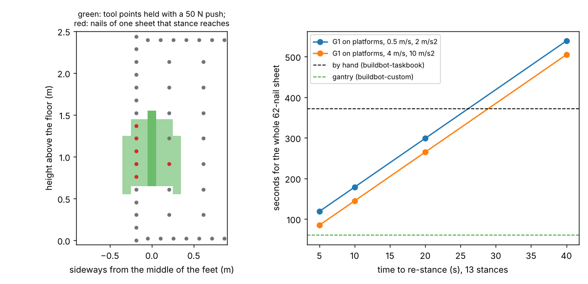

# buildbot-stance: how many times must a G1 humanoid re-stand to nail one 4x8 sheet?

Track 20, robots on the residential building site (`PROJECTS.md`, milestones 4 and 6). [`buildbot-nailseq`](../buildbot-nailseq) timed all 62 nails of a sheet with the arm fixed and left out "re-stancing (a 4x8 sheet is 1.2 x 2.4 m, beyond one arm pose)"; [`buildbot-fasten`](../buildbot-fasten) found only a band of heights works. This measures the missing piece: with the feet planted, which sideways positions and heights can a Unitree G1 hold a 3.4 kg nailer at and push it into the wall, how many nails of a sheet is that, and how many stances (and platforms) does a whole sheet need? Produced with AI assistance (Claude). Simulated and preliminary. **The time to re-stance, the push needed to seat a nail and the nailer's balance when reaching sideways are not measured**; the first two are swept, the third is a static check only.

**Live page:** https://duncan-haywood.github.io/oss-monorepo/research/buildbot-stance/

**Headline.**
- **One G1 stance covers a sixth of a sheet at best.** With a 3.4 kg nailer held 0.4 m in front of the feet and pushed into the wall at 50 N, the G1 can hold **32 of 153 grid points: heights 0.7 to 1.5 m, at most 0.3 m sideways (0.2 m above 1.3 m)**. Placed best, that covers **6 of the 62 nails**; at 0.3 m from the feet, 10. Four stances (0.4 m) reach 14 nails and no floor stance reaches the other **48**: the whole bottom plate and everything above 1.5 m.
- **Below 0.7 m the waist is the limit.** At 0.2 to 0.6 m height the waist pitch motor (50 N·m) is over its limit (ratio 1.06 to 1.48 without a push). A harder seat of **100 N** leaves only 6 grid points; no stance gets even one nail of the sheet.
- **A whole sheet needs platforms and about 13 stances.** Allowing the robot to stand at any height from 0 to 1.4 m, a greedy cover at 0.3 m reach needs **13 stances at 5 platform heights** (a more generous grid rule: 9). At 0.4 m reach the whole sheet cannot be covered (41 of 62).
- **Re-stancing decides whether it beats a carpenter.** The nails and tip moves of 13 stances take **25 s (4 m/s, 10 m/s²) to 59 s (0.5 m/s, 2 m/s²)**, then each of the 12 changes adds its re-stance time. The total equals the 372 s hand estimate of `buildbot-taskbook` at **26 to 29 s per re-stance**, and with a 5 s re-stance (85 to 119 s) is still slower than the 61 s gantry of [`buildbot-custom`](../buildbot-custom). The G1 has to step, climb a platform and settle in well under half a minute, twelve times a sheet, to beat the hand.



**Not a rated reach or time.** Static whole-body inverse kinematics on a community model, no collisions, no walking and no platform. Nothing here was tested on hardware. A robot nailing beside people needs a risk assessment (ISO 10218, ISO/TS 15066).

## Builds on
[`buildbot-payload`](../buildbot-payload) (the whole-body pose and torque model, extended here with a sideways shift `dy` of both hands; default 0, so its results do not change), [`buildbot-fasten`](../buildbot-fasten) (the push model, the nailer and the 62-nail schedule), [`buildbot-custom`](../buildbot-custom) (the nail order and move times) and [`buildbot-nailseq`](../buildbot-nailseq) (the 0.1 s trigger-and-seat and the two tip-speed settings). No group in `prompt.md` covers construction, and none is claimed.

## Method
- **Reach grid** (`experiments/reach.py`, MuJoCo, about 5 min). The Menagerie G1 at commit `cda5236f` (BSD-3-Clause, © Unitree Robotics; fetched, not copied) stands with its soles fixed. For every tool point at reach x = 0.3, 0.4 and 0.5 m, height z = 0 to 1.6 m (0.1 steps) and sideways dy = 0 to 0.8 m (0.1 steps), whole-body IK (`buildbot_payload.pose`) puts both hands there, holds the 3.4 kg nailer (Metabo HPT NR90AES1 listing) between them, and shifts the balanced centre of mass forward by F·z/W for a push F. A point counts as **held** when the IK converges, no body origin is below the floor, every joint stays inside its torque limit, both feet press down, and the horizontal foot force stays inside a friction cone of mu 0.3 or 0.6. Pushes of 0, 50 and 100 N are checked (the force needed to seat a nail is not known: swept, as in `buildbot-fasten`). Sideways reach is computed to the left only; the same cells to the right agree in **135 of 136** cases.
- **Stances** (`src/buildbot_stance/model.py`). The 62 nails of `buildbot-custom` go on the wall with the sheet standing on end, its lower edge at the floor. A stance is a position along the wall and a platform height h. A nail is covered when its tool point (sideways from the feet centre, height minus h) has all four surrounding grid points held (conservative); the generous rule needs only the nearest. Stances are chosen by greedy set cover on a 5 cm grid of positions.
- **Time.** In each stance the tip visits that stance's nails in `buildbot-custom`'s serpentine order (trapezoidal moves at 0.5 m/s and 2 m/s², or 4 m/s and 10 m/s², 0.1 s per nail, as `buildbot-nailseq`), and each later stance adds a re-stance time swept over 5, 10, 20 and 40 s.

| Input | Value | Source |
|---|---|---|
| Robot | Menagerie G1, 33.3 kg | vendor model, BSD-3-Clause, not validated ([`buildbot-payload`](../buildbot-payload)) |
| Nailer mass | 3.4 kg | Metabo HPT NR90AES1 listing, 7.5 lb ([`buildbot-fasten`](../buildbot-fasten)) |
| Push to seat a nail | 0, 50, 100 N | **swept**; no maker figure found |
| Foot friction | 0.3 and 0.6 | **swept**; rubber on concrete (no change between them here) |
| Re-stance time | 5 to 40 s | **swept**; no G1 figure found |
| Tip speed, acceleration, 0.1 s per nail | as `buildbot-nailseq` | swept / that project's choice |
| Hand and gantry times | 372 s, 61 s | [`buildbot-taskbook`](../buildbot-taskbook) (an estimate, not a time study), [`buildbot-custom`](../buildbot-custom) |

## Reproduce
```bash
pip install mujoco numpy matplotlib pytest      # MuJoCo and network (Menagerie clone) are needed only for reach.py
cd research/buildbot-stance
python -m pytest -q tests                       # 10 tests, no MuJoCo needed
python experiments/reach.py                     # about 5 min, writes reach.json
python experiments/run.py > experiments/results.txt   # a few seconds, writes results.json
python experiments/figure.py
```

## Results (`experiments/results.txt`)
- **B, reach map.** At 0.4 m and 50 N the held points are z 0.7 to 1.5 m straight ahead, 0.7 to 1.4 m at 0.1 and 0.2 m sideways, 0.6 to 1.2 m at 0.3 m and nothing beyond; the map is the same with mu 0.3 and 0.6.
- **C, floor only.** Best single stance / stances / nails covered: 10 / 7 / 29 at 0.3 m, 6 / 4 / 14 at 0.4 m, 4 / 6 / 12 at 0.5 m (50 N). With no push (holding the tool in free air) the set is different (0.4 m: 2 / 4 / 6), because a push leans the robot forward and brings the high points into range.
- **D, platforms.** 13 stances for 62 nails at 0.3 m, 11 stances for 41 at 0.4 m and 10 for 39 at 0.5 m (50 N); the nails below 0.7 m high are out of reach at any platform because the waist limit binds in the pose the IK finds.
- **D2, the generous grid rule.** 62 nails in 9 stances at 0.3 m; 45 at 0.4 m. The count is sensitive to the grid, so treat "9 to 13" as the range.
- **E, F, time.** 14 floor-reachable nails in 4 stances: 24 to 129 s with re-stance times of 5 to 40 s. The whole sheet in 13 stances: 25 to 59 s of nailing and moves plus 12 re-stances (85 to 119 s at 5 s each, 505 to 539 s at 40 s).

## Limitations
- **Static and kinematic only.** No walking, no step, no platform climb, no nailer recoil, no collision between the arms, the tool and the legs. Whether a G1 can step sideways 0.3 m, or onto a platform 1 m high, carrying 3.4 kg is not examined.
- **The IK is not a search for the best posture.** It keeps near the home pose and a deep crouch or a leaning torso that the waist could hold might reach points marked unreachable, so the low nails are an upper bound on difficulty, not a proven limit. At z = 0 the solver folded the robot below the floor until a floor check was added.
- **Coarse grid.** 0.1 m steps; the conservative rule needs four corners, the generous rule one, and the count of stances moves between them (13 against 9 at 0.3 m).
- **Greedy cover.** Not the minimum; the true minimum is at most 13.
- **A sheet on the wall is one geometry.** A sheet laid flat on a panelising table puts the nails below the robot's hands and may change everything.

## Next steps
Simulate the step and the platform climb (a whole-body controller from `buildbot-carry`) to get a re-stance time instead of a sweep; search the posture for the torque-optimal crouch to see whether the bottom plate is reachable; nail sheets flat on a table; compare with a mobile base (a tracked or wheeled platform with the G1's arms) that re-stances in 2 s.

## Owner steps
None needed. A hardware check needs a G1, a nailer and a mock-up wall, and a risk assessment.

## Outside dependencies (vitamins)
MuJoCo (Apache-2.0), NumPy, Matplotlib, pytest. Unitree G1 model from MuJoCo Menagerie (BSD-3-Clause, © Unitree Robotics), fetched and not copied by `buildbot-payload`.
