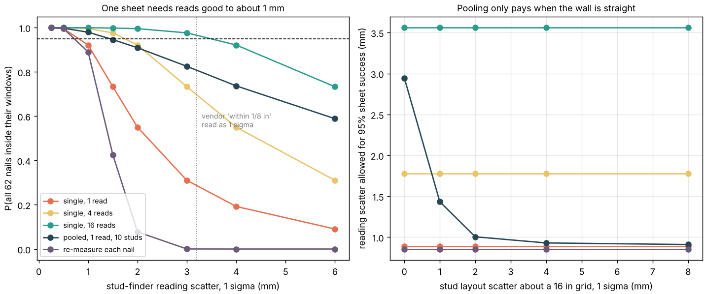

# buildbot-studfind: how well must a nailing robot find the studs, and does measuring more beat measuring better?

Fifth project of track 20, robots on the residential building site (`PROJECTS.md`, milestone 4's open "Next steps"). [`buildbot-fasten`](../buildbot-fasten) found that a robot's joints are not what limits nailing: the stud-face windows are, and "seeing the stud" was left as an unmodelled term with a budget near 1 mm. This models that term. It is a **Monte Carlo and quadrature error budget, not a perception system**: no camera, sensor or wall was simulated. Produced with AI assistance (Claude).

**Live page:** https://duncan-haywood.github.io/monorepo-projects/research/buildbot-studfind/

**Headline.** Every nail on a stud shares that stud's position error, and a sheet has four studs (two joints of 17 nails with a ±3.9 mm window, two intermediate studs of 7 nails with ±17.4 mm), plus 14 plate nails. With the robot adding 0.9 mm per nail, **a single read of each stud must be good to 0.89 mm (1 sigma) for 95% of sheets to have all 62 nails in their windows**; at 1.5 mm it is 73% of sheets, at 3 mm 31%. A consumer stud finder's "centre accuracy typically within 1/8 in (3.2 mm)" (a manufacturer's claim; I do not know what statistic it is) lands between: read as a 1 sigma, one read gives **28% clean sheets and 8 of 62 nails missed (13%)**; read as a 95% bound (1.6 mm) it gives 69% and 1.1 nails missed. Three ways to do better, all at the same sensor: **averaging n reads per stud** allows √n more scatter (4 reads: 1.78 mm, 16 reads: 3.56 mm, assuming independent reads); **pooling the studs** of a wall through a 16 in grid allows 2.95 mm if the studs are exactly on grid, but the benefit is gone (0.91 mm) once layout scatter reaches 4 to 8 mm; and **re-measuring at every nail is the worst policy** (0.86 mm allowed, 0% at 3 mm), because 62 independent errors must all be small where a shared one costs only four draws. Nothing here is a measured sensor or a measured wall: reading and layout scatter are swept.



**Not a rated accuracy.** Simulated statistics on assumed Gaussian errors. Nailing near people is a hazard needing a risk assessment (ISO 10218, ISO/TS 15066).

## Method (`src/buildbot_studfind/model.py`)
- **Windows.** The 62-nail schedule and its landing windows of `buildbot-fasten` (re-derived without MuJoCo; a test cross-checks them against it when it is installed): joint nails ±3.93 mm, field nails ±17.39 mm, plate nails on a different axis.
- **Shared stud error.** Truth is a 16 in grid, a common offset and independent layout scatter per stud. Each policy turns readings into an estimate per stud; the error (estimate minus truth) is added to every nail on that stud, then each nail adds the robot's own independent scatter. A sheet passes when all 62 nails are inside their windows.
- **Policies.** *single*: the mean of n reads of each stud. *pooled*: shrink each stud toward the grid through all k studs measured (best linear unbiased weights from layout and reading variance). *re-measure each nail*: every nail gets a fresh reading error.
- **Checks.** The quadrature over the shared error (`sheet_success_analytic`) agrees with the Monte Carlo (`simulate`) within 0.01; with no robot noise it equals the closed form product of the narrowest window per stud; with perfect studs and 1.24 mm of robot scatter it gives `buildbot-fasten`'s 95%; averaging n reads shrinks error by √n; 7 tests, 1 skipped when MuJoCo is absent.

| Input | Value | Source |
|---|---|---|
| Nail windows, schedule | 62 nails, ±3.93 / ±17.39 mm | [`buildbot-fasten`](../buildbot-fasten) (8d nail, 1.5 in face) |
| Robot scatter per nail | 0.9 mm | `buildbot-fasten` model result for the G1 with 11-bit joint sensors, no backlash or deflection |
| Stud-finder reading scatter | swept 0.25 to 6 mm | **not measured.** Vendor claim: centre accuracy "typically within 1/8 inch (3 mm)", edge accuracy 3/16 in, varying with moisture, texture and paint (a stud-finder spec sheet seen in a search result, 2026-10-22; not opened; the statistic is unstated). Another maker rates an edge-detect model "up to 1/8 in for wood" |
| Layout scatter about a 16 in grid | swept 0 to 8 mm (1 mm in tables A and C) | **not sourced**: no framing tolerance figure was found |
| Reads averaged, studs pooled | 1, 4, 16; 10 | my choices |

## Reproduce
```bash
pip install numpy matplotlib pytest      # buildbot-fasten (needs mujoco) is only for one cross-check test
cd research/buildbot-studfind
python -m pytest -q tests
python experiments/run.py > experiments/results.txt   # about 20 s, seed 1, writes results.json
python experiments/figure.py
```

## Results (`experiments/results.txt`)
- **A (layout 1 mm).** Sheet success against reading scatter (0.25, 0.5, 1, 1.5, 2, 3, 4, 6 mm): single read 1.00, 0.99, 0.92, 0.73, 0.55, 0.31, 0.19, 0.09; four reads 1.00, 1.00, 0.99, 0.98, 0.92, 0.73, 0.55, 0.31. Share of nails missed in the single-read policy: 0.2% at 1 mm, 4% at 2 mm, 11.5% at 3 mm.
- **B.** Reading scatter allowed for 95%: 0.89 mm single, 1.78 (4 reads), 3.56 (16), 0.86 re-measuring each nail; pooled 2.95, 1.43, 1.00, 0.93, 0.91 at layout scatter 0, 1, 2, 4, 8 mm.
- **C.** Vendor-claim sensor, both readings of the claim, in the headline. With 16 reads per stud even sigma 3.2 mm gives 97% clean sheets.
- **D.** With perfect robot motion the joint studs alone need an error under about 2 mm: success 1.00 at 1 mm, 0.91 at 2 mm, 0.66 at 3 mm.

## Limitations
- **Gaussian, zero-mean, independent reads.** Repeated reads from one device at one spot share a bias (wall texture, moisture, calibration) that averaging does not remove; the √n gain is a best case. A sensor that sees an edge pair rather than a centre has a different, non-Gaussian error.
- **Whole-sheet success is strict.** One nail outside its window is a fail here, but a missed nail can be pulled and re-driven, or the sheet still holds; the miss share is reported beside it. The window itself is a design choice (3/8 in edge distance, nail inside the stud half).
- **Studs are points.** Stud twist, crown, a sheet's own placement error and wall racking are not modelled; the sheet is assumed placed so that its joints lie on the studs' nominal centres.
- **Time is not priced.** More reads cost seconds a stud; no sourced figure was found, so the trade between reads and cycle time is open.
- **No hardware, no camera.** A vision system that finds fastener lines in sheathing, or a nailer that senses the stud by tip contact, would have error structures this does not describe.

## Next steps
Measure a real sensor's scatter on a mock-up wall (owner step) and replace the sweep; model a vision or tip-contact estimator with correlated error; price reads against `buildbot-custom`'s cycle; take the same stud-finding budget to drywall screws.

## Owner steps
None needed. A hardware check would need a stud finder or camera, a framed mock-up wall with a measured stud grid, and a risk assessment.

## Outside dependencies (vitamins)
NumPy, Matplotlib, pytest. Reads nothing at run time; the windows are re-derived from `buildbot-fasten`, which fetches the Unitree models from MuJoCo Menagerie (BSD-3-Clause) only for its own tests. No group in `prompt.md` covers construction, and none is claimed.
