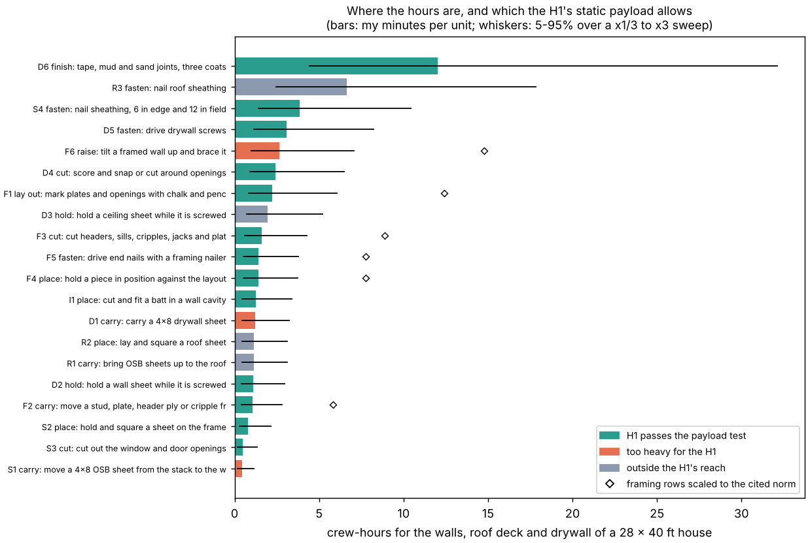

# buildbot-taskbook: which tasks of building a wood-frame house hold the crew hours, and which can a stock humanoid even hold the load for?

Second project of track 20, robots on the residential building site (`PROJECTS.md`, milestone 2). [`buildbot-payload`](../buildbot-payload) asked what a stock humanoid can hold. This writes down what a house asks of a worker: an open, scorable list of the handling tasks of one small wood-frame house, with how many times each is done, what is lifted, where, to what tolerance and for how many crew-hours. Other robot projects can score against it. Produced with AI assistance (Claude).

**Live page:** https://duncan-haywood.github.io/monorepo-projects/research/buildbot-taskbook/



**Headline.** For the 28 x 40 ft one-storey house of [`house-framing`](../house-framing) (210 framing pieces, 134 ft of wall), the walls, roof deck, insulation and drywall come to **46 crew-hours at my minutes per unit (40 to 77 over a x1/3 to x3 sweep)**. **Fastening is the largest verb, 29% of the hours** (7,980 nails and screws), and **taping and sanding drywall the largest single task** (12 h). The simulated Unitree **H1 passes the payload test for tasks holding 54 to 81% of the hours** (median 69%), the **G1 for 6 to 22%**. What is left is either too heavy (carrying a 20 to 23 kg sheet, raising a 305 kg wall: 9% of the hours) or outside both robots' reach envelope (roof sheathing, ceiling sheets: 21%). **Those minutes are my assumptions, not data**: my framing rows come out 5.5 times below the one cited norm I could find, so a second scenario scales them up to it (93 crew-hours); fastening is then 21% of the hours and the H1 share 57 to 85%. The shape (fastening and finishing hold the hours; the heavy lifts are few but need a person or a machine) holds in both. A payload pass says only that the load is not too heavy to hold: nailing force, placement accuracy and perception are not tested.

**Builds on.** [`house-framing`](../house-framing) for the takeoff (every piece counted by `takeoff`, `frame_wall`), [`buildbot-payload`](../buildbot-payload) for masses and the simulated G1 and H1 payload envelopes (read from its `results.json`; no robot is simulated here), and the track-12 cost and schedule work for the question it serves (`house-cost`, `house-schedule`; their labour inputs are placeholders, so they were not used for hours). It builds on none of the CU Boulder groups in `prompt.md` and claims no connection to them.

**Not a safety case, not a quote.** Research code. Simulated static limits at peak torque are not rated payloads. A robot handling lumber beside people is a falling-object and crush hazard; any test needs the owner's risk assessment under ISO 10218 and ISO/TS 15066 and the site's OSHA duties. The hours are for one house of one design, scope below, and nothing here was reviewed by a builder.

## What is in the book
`experiments/taskbook.csv` (and `taskbook.json`, which adds the quantities) has one row per task: id, trade, verb, description, unit, cycles, mass low and high (kg), hand height and reach (m, in the frame of `buildbot-payload`), minutes per unit, tolerance (mm) and its basis, whether the mass is shared with a person, crew-hours (mid, 5th and 95th percentile of the sweep, and the norm-scaled scenario), how often the task is among the five costliest, the H1 and G1 payload verdicts with their capacities, and the H1 load ratio.

**Scope.** Wall framing of the exterior walls (the takeoff), wall sheathing, roof sheathing on a 4:12 roof with a 1 ft overhang, wall insulation, and drywall on walls and ceiling. **Not covered:** foundation, trusses and roof framing, windows and doors, partitions, mechanical, electrical and plumbing, flooring, siding, paint and fixtures. So 48 hours is the hours of this scope, not of a house.

## Method (`src/buildbot_taskbook/model.py`)
- **Quantities from code.** `quantities()` runs `house_framing.takeoff` and `frame_wall` on the default house and reads the piece counts, member lengths and opaque wall area. Sheets are the area plus 10% waste over 32 ft<sup>2</sup>. The roof deck is (28 + 2) x (40 + 2) ft over cos(atan(4/12)); drywall is the inside wall area less openings plus the ceiling. Partition walls are not in the takeoff, so their drywall is missing.
- **Masses.** SPF lumber at 28.5 lb/ft<sup>3</sup> (the figure and sources in `buildbot-payload`): a piece runs from the mean 5.8 kg to the heaviest, a 2x12 header ply, 10.1 kg. A 4x8 OSB sheet is 20.3 to 23.2 kg and a drywall sheet 23.2 kg (`buildbot-payload`'s sources); the nailer is 3.4 kg (Metabo HPT NR90AES1). **Unsourced and flagged in the book:** the screw gun (1.5 kg), the sanding and finishing tool (2 kg), the saw and router (taken as the nailer's mass), a pencil (0.1 kg) and an insulation batt (0.5 kg). None of these decides a verdict, since all are far under the H1's capacity.
- **Tolerances.** Where a fastener or a sheet edge must land on a 2x member, the face is 1.5 in (38.1 mm) wide, and the tolerance column is half of that, so the nail stays in the member. The other tolerances (layout 3 mm, cuts 1.6 and 3 mm, wall plumb 12 mm, finish flatness 1 mm) are my assumptions and are marked so. No robot's placement accuracy is used.
- **Nails.** Four end nails a piece (two at each end), sheathing at 6 in on the edges and 12 in in the field (62 a sheet, two interior studs on a 4 ft sheet; corrected from 72 on 2026-10-21 after `buildbot-fasten` found the miscount), 32 drywall screws a sheet. These are my reading of the usual schedules; I did not check them against a code table.
- **Robot verdicts.** For each task the capacity is the **smallest** payload among the (hand height, reach) cells of the `buildbot-payload` grid around it, and none if any of them is out of reach or the point lies outside the grid. A task passes if its heaviest mass (half of it when shared with a person) is within that capacity. The roof deck (3.0 m) and a ceiling sheet (2.44 m) have no cell. This is a coarse, conservative lookup of a static envelope.
- **Minutes per unit.** The mid values are my own estimates of an experienced crew (for example 0.3 min to carry a piece, 0.1 min a nail, 0.35 min per ft<sup>2</sup> of board to tape, mud and sand). **I could not read any primary production-rate table** in this session: the hosts of the time studies I found (Home Innovation Research Labs' *Framing the American Dream*, HUD's alternative framing study, the RSMeans SIPs study, the Clemson *Professional Constructor* paper) were blocked. Instead the sweep draws every task's minutes log-uniformly between one third and three times the mid, 4,000 times with seed 1, and the README reports what survives it.
- **A cited cross-check.** Methvin's production-rate page lists wall framing at 0.12 man-hours per metre of 75 x 50 mm stud (<https://methvin.co/production-rates/building-constants/carpentry/wall-framing/>), which I saw as a search-result snippet on 2026-10-21 and could not open. It is a 2x3-class rate from a non-academic estimating site, so I use it as an order-of-magnitude check, not a calibration. Applied to the takeoff's 1,569 ft of lumber it gives 57 h. My framing rows (layout, carry, cut, place, nail, raise) total 10.4 h, 5.5 times lower. I set the minutes before looking at the norm. Scenario B multiplies the framing rows by 5.54 to meet it, and both scenarios are reported.
- **Difficulty.** The load ratio is the mass needed over the H1's conservative capacity at the task's pose. Hours per unit load ratio (with a floor of 0.25) ranks tasks; it mostly reflects hours, because the loads are small for the tool tasks, so read the two columns separately.

## Reproduce
```bash
pip install pytest matplotlib
cd research/buildbot-taskbook
python -m pytest -q tests                         # 10 tests, stdlib only (reads ../house-framing and ../buildbot-payload)
python experiments/run.py > experiments/results.txt   # a few seconds, deterministic; writes taskbook.csv and taskbook.json
python experiments/figure.py                      # experiments/figure.png
```

## Results (from `experiments/results.txt`)
| scenario | crew-hours at mid minutes | 5 to 95% over the sweep | H1 passes payload | G1 passes payload |
|---|---|---|---|---|
| A, my minutes | 46 | 40 to 77 | 54 to 81% of hours (median 69%) | 6 to 22% (median 12%) |
| B, framing scaled to the norm | 93 | 80 to 150 | 57 to 85% (median 73%) | 7 to 31% (median 16%) |

- **Biggest tasks (scenario A, hours):** taping and sanding 12.0; nailing roof sheathing 5.7; nailing wall sheathing 3.3; drywall screws 3.1; raising the four walls 2.7 (person-minutes); drywall cutting 2.4; layout 2.2. In 4,000 draws the finishing is among the five costliest every time, roof nailing in 81%, wall sheathing nailing in 53%.
- **By verb (A):** fasten 13.5 h (29%), finish 12.0 (26%), place 4.6, cut 4.5, carry 3.8, hold 3.0, raise 2.7, lay out 2.2. In B, fasten is 21% and finish 13%, because framing hours grow.
- **What the H1 cannot do by payload:** carry a sheet alone (OSB 20 to 23 kg, drywall 23 kg) and raise a wall (305 kg): 4.3 h, 9% of A. **Outside its reach envelope:** all roof work and ceiling sheets, 10.0 h, 21%. Nailing the roof deck alone is 12% of the A hours. The G1 passes almost nothing but layout, insulation and drywall cutting, because its waist limit allows 4.6 kg at the carry pose.
- **The hand-held work is the long tail.** Everything in the 68% is a task done with a light tool or a light piece, thousands of times, to a 19 mm window on a stud face. Whether a robot can do that is a placement-accuracy and perception question, the next milestones' (`buildbot-carry`, `buildbot-fasten`, `buildbot-cohold`), not a payload one.

## Limitations
- **The minutes are mine.** They are the weak input. The sweep says what is robust: the verdict columns, the cycle counts and the fastening share do not depend on them much, but the totals, the ranking among the middle tasks and the framing-to-finishing balance do. Scenario B changes the total by a factor 2 and the framing share a lot.
- **Partial house.** The scope list above is long; the largest missing trades (foundation, roof framing, mechanical, electrical, plumbing, finishes) are not half-hours.
- **One design.** One storey, one plan, conventional 2x6 at 16 in, a 4:12 roof, no partitions in the drywall. The book is a data format first; other plans and `house-plan`'s output can be fed through the same code.
- **Payload is not a skill.** A pass means the static load is below the model's peak-torque limit at a conservative grid point. Continuous torque is lower. Force during nailing, kickback, balance in motion, grasping and perception are not tested.
- **The cross-check is one snippet.** A man-hour norm for 2x3 studs from a non-academic site is a weak anchor; it says the framing minutes are probably too low, no more.
- **Raising a wall** is counted as a crew task (40 person-minutes a wall), not a handling task for a robot: no robot here lifts 305 kg.

## Next steps
Replace the minutes with a primary time study as soon as one can be read (the Home Innovation and HUD studies above), keeping the sweep as a check; add partitions, trusses and the other trades; then take the fastening tasks into `buildbot-fasten` (the tolerance column gives the target) and the sheet tasks into `buildbot-cohold` (`PROJECTS.md`, track 20).

## Owner steps
None needed. A real task book would be timed on a site against a crew, which needs a builder's permission and a risk assessment.

## Outside dependencies (vitamins)
The Python standard library; Matplotlib for the figure; pytest. Reads `research/house-framing` and the `results.json` of `research/buildbot-payload` (which fetches the Unitree models from MuJoCo Menagerie, BSD-3-Clause). The one external rate is Methvin's wall-framing norm (above, a search snippet), the masses' sources are in `buildbot-payload`, and the Metabo HPT nailer mass is the maker's listing. No group in `prompt.md` covers construction, and none is claimed.
