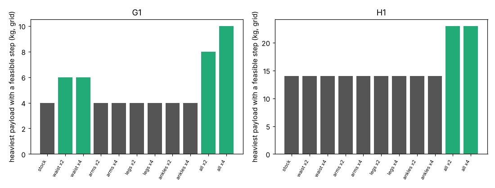

# buildbot-torquewall: which joint's torque limit sets how fast a stock humanoid can carry a load?

Track 20, robots on the residential building site (`PROJECTS.md`, milestone 3 and 7). [`buildbot-carrycop`](../buildbot-carrycop) found that joint torque, not the sole, is the wall for the Menagerie G1 and H1 carrying a load. Which joint, and how much stronger would it need to be? This re-scores the same prescribed carry step with one joint group's torque limits multiplied by 2 or 4. Produced with AI assistance (Claude). Simulated and preliminary; the factors are what-ifs, not products.

**Live page:** https://duncan-haywood.github.io/oss-monorepo/research/buildbot-torquewall/

**Headline.**
- **The G1's wall is one joint: the waist pitch (50 N·m in the model).** Doubling only the waist limits lifts the heaviest payload with a feasible step from 4 kg to 6 kg, and at 4 kg the fastest step from 0.10 to 0.20 m/s. Doubling the arms, legs or ankles alone changes nothing; at 6 kg and above, only waist-containing sets help.
- **Doubling every joint reaches 8 kg for the G1, quadrupling reaches 10 kg (0.17 m/s)**, so beyond 6 kg the waist alone is no longer enough and the next joints (left ankle pitch, then shoulder roll) bind.
- **The H1 is not a one-joint story.** No single group lifts it from 14 kg to 18 kg; only scaling every joint does (18 and 23 kg at 0.07 m/s), and nothing reaches 30 kg at 4x. Its binding joints at stock limits are the hip pitch (14 to 18 kg) and the elbow (23 kg and up).
- **No scaling raises the best speed above about 0.2 m/s**: speed is set by the prescribed single-support gait, which `buildbot-carryphase` already flagged.



**Not a safety case and not a rated payload.** Nothing here was tested on a robot, and a stronger waist is a model what-if (ISO 10218, ISO/TS 15066, OSHA apply to any real test).

## Method (`src/buildbot_torquewall/model.py`)
`buildbot_carryphase`'s scorer (IK, MuJoCo inverse dynamics, per-joint torque against limit, centre of pressure on the sole, friction) is run unchanged, with `buildbot_payload.torque_limits` patched to multiply the limits of one group (waist/torso, arms, legs = hips and knees, ankles, or all) by a factor. Flat floor, carry pose hands 0.3 m ahead and 0.6 m up, step length 0.1/0.2/0.3 m, single-support time 0.6/1.0/1.5 s, Menagerie commit `cda5236f` (BSD-3-Clause, fetched, not copied).

| Input | Value | Source |
|---|---|---|
| Joint limits | G1 waist pitch/roll 50, ankles 50, hips 88-139, knee 139, arms 25 N·m; H1 hips 200, knee 300, ankle 40, arms 18-40 N·m | Menagerie model (a community approximation, not Unitree's validated figures) |
| Scale factors | 1, 2, 4 | swept; no source for a better value |
| Payloads | G1 0-10 kg, H1 0-30 kg | swept |

## Reproduce
```bash
pip install mujoco numpy matplotlib pytest
cd research/buildbot-torquewall
python -m pytest -q tests        # 12 tests
python experiments/run.py        # 990 cases, a few minutes on 4 CPUs, deterministic; writes results.json, results.txt
python experiments/figure.py
```

## Results (`experiments/results.txt`)
Fastest feasible step by payload and scaled group for both robots, and which joint exceeds its limit first among torque-only failures at stock limits (G1: waist pitch in most cases at 4 kg and up, then left ankle pitch).

## Limitations
- Everything in `buildbot-carryphase`'s limitations holds: prescribed gait, no double support or impact, point-mass load, no falls or energy.
- Scaling a torque limit ignores that a stronger actuator is heavier (mass is not changed) and costlier; a real waist upgrade also changes the model's inertia.
- Grid is coarse (9 step cases); speed differences of one cell are not findings.
- Payload steps (4, 6, 8, 10 kg) are coarse, so "6 kg" means "between 6 and 8 kg were not tested".

## Next steps
Cost the waist upgrade (actuator torque density and price) against the labour saved in `buildbot-cost`; change the waist's mass with its limit; or hand the finding to the purpose-built loop of `buildbot-custom`.

## Owner steps
None needed.

## Outside dependencies (vitamins)
MuJoCo (Apache-2.0), NumPy, Matplotlib, pytest; `buildbot-payload` and `buildbot-carryphase` in this repository; Menagerie G1 and H1 (BSD-3-Clause, © Unitree Robotics). No group in `prompt.md` covers construction, and none is claimed.
