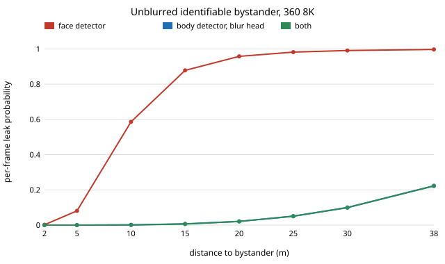

# capture-bystander: when does automatic blurring miss a bystander's face, and which platform is conspicuous?

Sixth project of track 13, autonomous multi-angle capture for travel creators (`PROJECTS.md`, milestone 6). A creator filming in public catches strangers on camera; the safe default is to blur their faces automatically. This project asks how often that blur fails, by camera, distance and detector, on an **assumed size-to-recall model** (no real footage, no real detector was run). **Headline:** a face detector that is 50% reliable at 20 px leaves an identifiable face (face-on, at least 32 px across) unblurred 5% of the time per frame for people spread evenly around a camera, and 8% of the time at 5 m on an 8K 360 camera; blurring the head region of any detected *body* instead drops that to under 0.1% because a body is 11 times taller than a face. The per-frame figure hides the worse number: with independent misses a person filmed for 5 s at the edge of the range is unblurred in at least one frame 100% of the time, and only if misses come in runs of 150 frames (the whole shot) does that fall to 25%. An offline edit that blurs a whole track after one detection is left with the share never detected at all (0 to 5%). **Not done:** no real faces, plates or detector; no measured conspicuousness. Produced with AI assistance (Claude).

**Live page:** https://duncan-haywood.github.io/oss-monorepo/research/capture-bystander/

**Guardrail.** This is a design input for filming in public with bystanders protected by default. It is not a way to hide that filming is happening, and nothing here says blurring satisfies the GDPR or any other law where you film.

**Builds on.** `capture-crop` (pixels per radian of the cameras), `capture-rig` and `capture-edit` (the offline edit that can blur a whole track). It uses the standard split between a face detector and a person detector; the minimum sizes are assumed, round numbers in the range such detectors document (Viola and Jones, CVPR 2001, use a 24 px base window), not taken from a benchmark. It builds on none of the CU Boulder groups in `prompt.md` and claims no connection to them.

## Method (`src/capture_bystander/model.py`)
- **Pixels.** Face width 0.15 m, body height 1.7 m (assumed). A target at distance d spans size/d &times; (source pixels per radian). Frames: 360 5.7K and 8K equirect, 4K ultrawide (120&deg;), 4K at 85 mm-equivalent (24&deg;), all assumed.
- **Identifiable.** Face turned to the camera (half of people, assumed) and at least R = 32 source pixels across (assumed; swept 16 to 64 in C).
- **Detectors.** Recall = 1 / (1 + (mid/px)<sup>4</sup>), 0.5 at `mid`: 20 px for a face, 40 px of body height (assumed). Policies: *face* blurs where the face detector fires; *body* blurs the head region of any detected body (head placement assumed perfect); *both* blurs if either fires, with independent errors (optimistic).
- **Crowd.** People spread uniformly over the ground from 1 m out, so the count at distance d grows as d. Leak = share of identifiable people left unblurred, by numerical integration.
- **Persistence.** One person, 150 frames, a two-state Markov chain for misses with the per-frame miss rate fixed and the mean miss-run length varied. *Per-frame* blur leaks any frame that missed. *Offline track-hold* blurs the whole track if any frame detected it.
- **Conspicuousness.** Apparent angle of each platform's largest dimension (assumed sizes) and the distance at which it subtends 1&deg; (an assumed "noticeable" angle).

## Reproduce
```bash
pip install pytest
cd research/capture-bystander
python -m pytest -q tests                        # 11 tests
PYTHONPATH=src python experiments/run.py         # under 10 s; writes experiments/results.txt
python experiments/figure.py                     # experiments/leak.svg from results.txt
```

## Results (from `experiments/results.txt`; deterministic)
**A. Leak by distance** (360 8K, one face-on person, per frame):

| distance | face px | face detector | body, blur head | both |
|---|---|---|---|---|
| 2 m | 91.7 | 0.002 | 0.000 | 0.000 |
| 5 m | 36.7 | 0.081 | 0.000 | 0.000 |
| 10 m | 18.3 | 0.586 | 0.001 | 0.001 |
| 20 m | 9.2 | 0.958 | 0.021 | 0.021 |
| 38 m | 4.8 | 0.997 | 0.223 | 0.222 |



At 10 m the face is 18 px, below what a person needs to recognise it (assumed 32 px) and below the detector's midpoint, so it is not identifiable under the assumption. The face detector's leak among *identifiable* people comes from the soft edge of its recall just above the identifiable size. Rows past 5.7 m show the detector curve only; no face-on face is identifiable there on this camera.

**B. By camera** (people per m<sup>2</sup> = 0.05; identifiable = face-on and at least 32 px):

| camera | identifiable range | leak, face | leak, body | identifiable in frame | leaked per frame (face) |
|---|---|---|---|---|---|
| 360 5.7K | 4.3 m | 0.049 | 0.000 | 1.37 | 0.067 |
| 360 8K | 5.7 m | 0.048 | 0.000 | 2.50 | 0.120 |
| 4K ultrawide 120&deg; | 8.6 m | 0.047 | 0.000 | 1.91 | 0.090 |
| 4K 85 mm-eq 24&deg; | 43.0 m | 0.047 | 0.000 | 9.66 | 0.451 |

The leak *share* barely depends on the camera, because with every size scaling by the same pixels per radian the ratio of identifiable size to detector midpoint does not change. What the camera changes is **how many people are identifiable**: a telephoto frame resolves 43 m of crowd and about 10 people at once. Wider and higher resolution reaches more strangers' faces, so a long lens does the most to the number of faces to blur.

**C. Sensitivity** (360 8K, face detector leak): identifiable size R down, detector midpoint across.

| R (px) | mid 10 | mid 20 | mid 30 |
|---|---|---|---|
| 16 | 0.047 | 0.361 | 0.636 |
| 32 | 0.003 | 0.048 | 0.184 |
| 64 | 0.000 | 0.004 | 0.018 |

If people can be recognised at 16 px while the detector needs 20, a third of identifiable faces leak. Everything turns on the gap between the size a person can be identified at and the size a detector finds.

**D. One person, 5 s at the edge of range** (per-frame miss 0.128):

| miss-run length (frames) | frames unblurred | unblurred in &ge;1 frame (per-frame blur) | never detected (offline track-hold) |
|---|---|---|---|
| 1 | 0.128 | 1.000 | 0.000 |
| 10 | 0.130 | 0.916 | 0.000 |
| 30 | 0.135 | 0.595 | 0.002 |
| 150 | 0.134 | 0.249 | 0.052 |

A per-frame blur that is "87% reliable" still lets a face show in some frame of almost every shot, and a reel is a sequence of such frames. Blurring the whole track after any detection (possible in an offline edit, as in `capture-edit`) removes nearly all of it unless misses last the whole shot. Real misses are correlated, so the truth sits somewhere between the first and last rows.

**E. Conspicuousness by size alone.** At 3 m a 1.5 m pole with a 360 camera subtends 28&deg;, a 1.6 m tripod rig 30&deg;, a wheeled robot with mast 33&deg;, a phone held up 2.9&deg; and a small drone 6.7&deg;. The 1&deg; distances are 9 m (phone), 20 m (drone), 86 to 103 m (pole, tripod, robot). Size does not separate the tall platforms from each other; it only says a phone and a drone are small. Motion, noise and behaviour decide how a bystander reacts, and none of those is modelled.

## Limitations
- **Nothing here is measured.** Detector recall curves, the identifiable size, the share of faces turned to camera, rig sizes and the noticeable angle are assumptions. Section C shows how far the answer moves when two of them change.
- **Real detectors differ.** Recall depends on pose, blur, occlusion, light and skin-tone and age bias; a face detector's failures are not a function of size alone. Only footage and a real detector settle the numbers.
- **Plates, screens and other identifying things are not modelled**, nor is a head placed from a body box (assumed exact). Detectors are assumed to err independently in the *both* policy.
- **Motion** (walking bystanders, a moving camera) is not modelled; a person is at one distance for the whole shot.
- **Blurring is not compliance.** Whether it meets a law depends on where you film and for what use; take advice.

## Next steps
- Run a real open face detector and a person detector on openly licensed street footage at known distances and fit the recall curves, replacing the assumed ones.
- Measure how large a face must be before people (or a recogniser) can name it, to set R.
- Add plates and a head-from-body placement error, and then audit a rendered reel.

## Owner steps
None for this simulation.

## Outside dependencies
None. Python standard library only; pytest for the tests.
