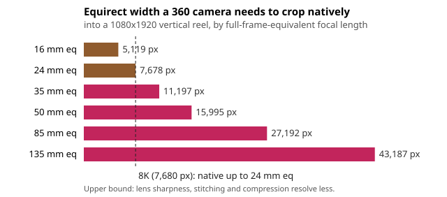

# capture-crop: how long a lens can a 360 camera fake by cropping, and what can no crop fake?

First project of track 13, autonomous multi-angle capture for travel creators (`PROJECTS.md`, milestone 1). The simplest "film me from every angle" rig is one 360-degree camera on a pole, reframed in software afterwards. Two limits decide how far that goes. **Pixels:** an 8K 360 camera reframed into a 1080x1920 Instagram reel is native only up to about a **24 mm full-frame-equivalent** view; a 50 mm crop is upscaled 2.1x and an 85 mm crop 3.5x, and cropping 85 mm natively would need a ~27,000 px wide equirect. **Perspective:** where the camera stands, not the lens, sets perspective. From a selfie stick at 0.8 m a feature 10 cm nearer the camera (a nose against the ears) images 14% larger; from the 1.4 m an 85 mm head-and-shoulders shot is taken at, 7.6%, with the background behind rendered 1.7x larger. No resolution fixes that: a portrait or "compressed" look needs a camera standing back from the creator. That is the case for the rest of the track (follow robots, rigs of several cameras, longer lenses). Produced with AI assistance (Claude).

**Live page:** https://duncan-haywood.github.io/monorepo-projects/research/capture-crop/

**Builds on.** Equirectangular projection and pinhole (rectilinear) reprojection, as used by every 360 reframing tool, and the full-frame equivalent-focal-length convention. It builds on none of the CU Boulder groups in `prompt.md` and claims no connection to them.

## Method (`src/capture_crop/model.py`)
- **Pixel pitch.** An equirectangular frame W px wide holds W/360 px per degree at the equator.
- **Native crop.** A rectilinear view with focal length f<sub>px</sub> maps one centre pixel to 1/f<sub>px</sub> rad, so the crop is native at its centre when f<sub>px</sub> = W/(2&pi;). On a w x h output that gives a full-frame-equivalent focal length f<sub>eq</sub> = 21.63 mm &times; f<sub>px</sub> / (&radic;(w&sup2;+h&sup2;)/2), using the 36 x 24 mm diagonal convention. Pixels toward a crop's edge are slightly better than native, so the centre is the binding point.
- **Perspective.** A lens f<sub>eq</sub> fills a vertical frame's 36 mm long side with a subject of height S from distance D = f<sub>eq</sub> S / 36 mm. A feature d nearer the camera images D/(D&minus;d) larger; a background object B behind the subject, with the subject framed the same, images in proportion to D/(D+B).

## Reproduce
```bash
pip install pytest
cd research/capture-crop
python -m pytest -q tests                        # 10 tests
PYTHONPATH=src python experiments/run.py         # instant; writes experiments/results.txt
python experiments/figure.py                     # experiments/crop.svg from results.txt
```

## Results (from `experiments/results.txt`; deterministic)
Longest native full-frame-equivalent focal length cropped from a 360 equirect:

| equirect class | 1080x1920 vertical | 2160x3840 vertical | 1920x1080 landscape |
|---|---|---|---|
| 5.7K (5,760 px) | 18.0 mm | 9.0 mm | 18.0 mm |
| 8K (7,680 px) | 24.0 mm | 12.0 mm | 24.0 mm |
| 11.5K (hypothetical) | 36.0 mm | 18.0 mm | 36.0 mm |
| 15K (hypothetical) | 48.0 mm | 24.0 mm | 48.0 mm |

Equirect width needed to crop each lens natively into a 1080x1920 reel, and the 8K upscale factor: 35 mm, 11,197 px (1.46x); 50 mm, 15,995 px (2.08x); 85 mm, 27,192 px (3.54x); 135 mm, 43,187 px (5.62x).



Perspective for a 0.6 m head-and-shoulders frame, a 10 cm feature depth and a landmark 20 m behind:

| setup | distance | nearer feature enlarged | background size vs stick |
|---|---|---|---|
| 360 camera on a stick, any crop | 0.80 m | 14.3% | 1.00x |
| 24 mm eq at its framing distance | 0.40 m | 33.3% | 0.51x |
| 50 mm eq | 0.83 m | 13.6% | 1.04x |
| 85 mm eq | 1.42 m | 7.6% | 1.72x |
| 135 mm eq | 2.25 m | 4.7% | 2.63x |

## What this means for a travel kit
- A pole-mounted 360 camera is a wide-angle camera. Its useful reframes are 14 to 24 mm-equivalent views; anything tighter in a 1080p reel is upscaled, and in a 4K reel even 24 mm is.
- The stick distance fixes a ~50 mm-at-0.8 m perspective whatever the crop. Flattering portraits and big backgrounds need a camera 1.5 to 3 m away, which is a second operator, a tripod, a follow robot or a drone, or a longer lens on a second camera.
- More 360 pixels help slowly: doubling the equirect width doubles the native focal length, and native 85 mm needs about 3.5x today's 8K.

## Limitations
- An upper bound from pixel geometry. Real 360 cameras resolve less than their pixel count (lens MTF, stitching, debayering, H.265 compression), so the true native limit is shorter. Measuring it from footage is a next step.
- The equirect widths are nominal 2:1 frame widths for each marketed class (5.7K = 5,760 px, 8K = 7,680 px), not measured from a camera; the 11.5K and 15K rows are hypothetical.
- The 0.6 m framing, 10 cm feature depth, 0.8 m stick and 20 m background are stated assumptions, not anthropometric data. The thin-lens distance formula ignores close-focus effects.
- Upscaling with learned super-resolution can hide some of the gap; it invents detail and is not counted as native here.

## Next steps
- Measure effective resolution (slanted-edge MTF) of real 360 footage under an open licence, to replace the pixel-count bound.
- `capture-kit` (milestone 2): which cameras, lenses and batteries to pack under the airline battery rules and a weight budget.

## Outside dependencies
None. Python standard library only; pytest for the tests.
