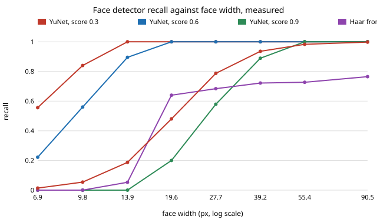

# capture-detectors: how small can a face or a person be before a real detector stops finding it?

Seventh project of track 13, autonomous multi-angle capture for travel creators (`PROJECTS.md`). It takes the first "next step" of `capture-bystander`, which modelled automatic face blurring with an *assumed* recall curve (a face detector 50% reliable at 20 px), and measures real detectors instead. **Headline:** OpenCV's YuNet face detector at its usual 0.6 score threshold found every face of 16 px or wider and half of those at 10 px (fitted 50% point 9.2 px, 95% range 8.2 to 10.4), not 20 px. On `capture-bystander`'s 8K 360 camera that cuts the per-frame leak among identifiable faces (at least 32 px) from the assumed 4.8% to 0.01%, and from 36% to 0.9% if people can be recognised at 16 px. The result hangs on the score threshold: at 0.9 the 50% point is 26.6 px and the leak is 7.2%. A YOLOX-s person detector found 52% of upright people 20 to 32 px tall and 94% at 96 to 128 px (50% point 23 px of height, not the assumed 40). **This is a pilot:** 22 faces and 254 labelled people from 128 photos, faces that are easy by construction, and shrunk photos instead of far-away footage, so every figure here is an optimistic bound for a real crowd. Produced with AI assistance (Claude).

**Live page:** https://duncan-haywood.github.io/monorepo-projects/research/capture-detectors/

**Guardrail.** Same as `capture-bystander`: a design input for protecting bystanders by default, not a way to hide filming, and nothing here says blurring satisfies the GDPR or any other law where you film.

**Builds on.** `capture-bystander` (the assumed model this replaces) and `capture-crop` (pixels per radian). Detectors: YuNet (Wu et al., 2023, in OpenCV Zoo, MIT), the Viola-Jones Haar cascade (Viola and Jones, CVPR 2001; OpenCV, Apache-2.0), YOLOX (Ge et al., 2021, arXiv:2107.08430; OpenCV Zoo export, Apache-2.0) and OpenCV's stock HOG people detector (Dalal and Triggs, CVPR 2005). It builds on none of the CU Boulder groups in `prompt.md`.

## Method (`experiments/run.py`, `src/capture_detectors/`)
- **Data.** `coco128`, 128 photos from COCO train2017 (Lin et al., 2014) with COCO's hand-drawn person boxes (254 people). The photos are Flickr images under their own Creative Commons licences; none is committed. `fetch.py` downloads them and the models at pinned URLs and checks SHA-256.
- **Faces.** COCO has no face boxes, so the reference is YuNet's own confident detections (score at least 0.9, at least 24 px wide, inside a labelled person) on the full-size photo: 22 faces, median 56 px. Each photo is then shrunk with area averaging by scales from 1 down to 0.065, and each detector is asked to find the same face again (centre inside the scaled reference box, width within 2x). Recall is "found again at this size, given findable at full size". 198 face-scale trials.
- **People.** The same shrinking applied to COCO's person boxes; a hit is IoU at least 0.5 with a YOLOX person detection (score 0.3). Upright means box height over width at least 1.8 (783 trials); all boxes (1443 trials) are shown in `results.txt`.
- **Fit.** The `capture-bystander` form, recall = 1 / (1 + (mid/px)<sup>k</sup>), by grid-search maximum likelihood; the 95% ranges resample whole faces or people (100 draws), since trials of one subject at different scales are correlated.
- **Leak.** `capture-bystander`'s integral for a crowd spread evenly over the ground, face-on faces of at least R px, recomputed with the measured curve (`stats.leak_share`; with its assumed curve it returns that project's 0.048).

## Reproduce
```bash
pip install "opencv-python-headless<5" numpy pytest   # OpenCV 5 dropped the Haar and HOG detectors
cd research/capture-detectors
python -m pytest -q tests                       # 10 tests, no network or models needed
python experiments/run.py                       # downloads ~42 MB once; ~4 min on a CPU; writes results.json
python experiments/report.py                    # results.json -> results.txt
python experiments/figure.py                    # results.txt -> recall.svg
python experiments/yaw.py                       # section F: recall against face turn -> yaw.txt, yaw.json (~1 min)
```

## Results (from `experiments/results.txt`)
**A. Face recall by width** (95% Wilson interval in `results.txt`; n = 18 to 25 trials per bin below 64 px):

| width | YuNet 0.3 | YuNet 0.6 | YuNet 0.9 | Haar | assumed |
|---|---|---|---|---|---|
| 6 to 8 px | 0.56 | 0.22 | 0.00 | 0.00 | 0.01 |
| 8 to 12 | 0.84 | 0.56 | 0.00 | 0.00 | 0.05 |
| 12 to 16 | 1.00 | 0.89 | 0.00 | 0.05 | 0.19 |
| 16 to 24 | 1.00 | 1.00 | 0.20 | 0.64 | 0.48 |
| 24 to 32 | 1.00 | 1.00 | 0.58 | 0.68 | 0.79 |
| 32 to 48 | 1.00 | 1.00 | 0.89 | 0.72 | 0.94 |
| 64+ | 1.00 | 1.00 | 1.00 | 0.76 | 1.00 |



Fitted 50% points (bootstrap 95% range): YuNet 0.3 6.7 px (5.8 to 7.6), YuNet 0.6 9.2 px (8.2 to 10.4), YuNet 0.9 26.6 px (23.7 to 29.9), against the assumed 20. Moving the threshold from 0.9 to 0.3 buys a factor of four in size; that is a bigger lever than the choice of camera. The 0.9 row is partly circular, because 0.9 is also the rule that chose the reference faces: read it as "what a conservative threshold gives up", not as a calibrated curve. The Haar cascade tops out near 0.7 even on large faces: it is frontal-only and misses faces YuNet finds, so its fit (mid 26.6, k 2) is not a size curve.

**B. People** (upright boxes, by box height after shrinking):

| height | 12 to 20 px | 20 to 32 | 32 to 48 | 48 to 64 | 64 to 96 | 96 to 128 | 128 to 192 |
|---|---|---|---|---|---|---|---|
| YOLOX-s recall | 0.34 | 0.52 | 0.75 | 0.86 | 0.93 | 0.94 | 0.99 |
| n | 164 | 148 | 123 | 66 | 97 | 48 | 68 |

Fitted 50% point 22.8 px of height (18.0 to 26.6), k = 2.0 (1.5 to 2.5): lower than the assumed 40 px but much shallower than the assumed k = 4, so the last few percent of people are found only at large sizes. OpenCV's stock HOG people detector found at most 4% of people at any size at IoU 0.5; I did not investigate why (padded boxes and COCO's poses are likely), so it is reported and not used.

**C. Leak among identifiable faces, per frame, 8K 360, evenly spread crowd** (`capture-bystander`'s section B form):

| face detector | R = 16 px | R = 24 | R = 32 |
|---|---|---|---|
| assumed (mid 20, k 4) | 0.362 | 0.128 | 0.048 |
| YuNet 0.3 (measured) | 0.003 | 0.000 | 0.000 |
| YuNet 0.6 (measured) | 0.009 | 0.001 | 0.000 |
| YuNet 0.9 (measured) | 0.591 | 0.246 | 0.072 |

With the 0.6 curve and R = 16, the ends of the fitted mid range give 0.005 and 0.018. So a modern face detector at a sensible threshold leaves almost nothing at sizes people can be recognised at, **if the real faces are as easy as these**. `capture-bystander`'s second warning (an unblurred frame in a 5 s shot) is not tested here.

**D. Head from a body box** (10 upright people with a YOLOX box and a reference face; far too few to settle anything): the face is 11% of the person-box height (median; range 8.5 to 19%, against the assumed 8.8%). The top 15% of the box fully contains the face for 2 of 10, the top 25% for 8 of 10 and the top third for all 10. Boxes of partly visible people are shorter than a full body, which inflates the ratio. A body-based blur therefore needs a band of about a quarter to a third of the box, not the assumed tight head.

**E. Independence of the face and body detectors.** In the 30 trials where a face was 8 to 24 px, YOLOX found the body every time while YuNet 0.6 missed 7% of faces: the person is about nine times taller than the face, so the body is still large when the face fails. That supports the body fallback in `capture-bystander`, and says the "both policies, independent errors" assumption never bites. The sample is 10 people.

**F. Does recall fall as the face turns away?** (`experiments/yaw.py`, added for `capture-sentinel`, whose bearing curve was assumed: miss 0.03 facing the camera, 0.40 facing away.) Reference: 54 YuNet detections (score at least 0.3, at least 24 px wide, inside a labelled person) in the full-size photos. Face turn is a landmark proxy, the nose's horizontal offset from the eye midpoint over the inter-eye distance (0 frontal, larger toward profile; not an angle). Every detector is asked about the same faces at full size, so size is not shrunk. Haar profile runs on the photo and its mirror.

| turn proxy | n | YuNet 0.6 | YuNet 0.9 | Haar frontal | Haar profile | Haar either |
|---|---|---|---|---|---|---|
| under 0.3 (near-frontal) | 35 | 0.97 | 0.54 | 0.66 | 0.43 | 0.69 |
| 0.3 or more (turned) | 19 | 0.95 | 0.16 | 0.16 | 0.26 | 0.37 |

95% Wilson intervals are in `experiments/yaw.txt`: for YuNet 0.9 they are 0.38 to 0.70 against 0.06 to 0.38, so the drop is outside the noise; YuNet 0.6 shows no drop (0.85 to 0.99 against 0.75 to 0.99). Reading for `capture-sentinel`: a conservative threshold or a frontal Haar cascade loses most faces once they turn about a third of the way to profile (miss from about 0.35 to about 0.84), so a sentinel on such a detector should be modelled with a miss that climbs well before the subject faces away; YuNet at 0.6 keeps the miss near 0.05 to profile. **Limits of this section:** the reference is a detector's own output, so faces that no detector sees (back of the head, heavy occlusion) are absent and the curve stops at near-profile, the 0.3 miss for facing away is untested; the 0.9 row is confounded with size, since the faces are 24 px and up and the 0.9 curve above is still climbing there; n is 54, in four bins of 7 to 21.

## Limitations
- **Easy faces only.** The reference faces are confident YuNet detections at full size: frontal, sharp and lit, and chosen by the detector family under test. Recall on a real crowd (profile, occluded, motion-blurred, hats, masks, children, a darker or paler skin tone than a detector's training set) will be lower; published detector benchmarks such as WIDER FACE report a steep drop on small, hard faces. These curves are upper bounds on recall and lower bounds on leak.
- **Shrunk, not far.** Area averaging gives a clean small image. A real distant face also has sensor noise, lens blur and video compression, and a 360 camera's stitching and distortion are not modelled.
- **Small sample.** 22 faces from 128 photos and 10 people for the head and independence checks. The bootstrap ranges cover resampling of these subjects only, not the population of faces in the world.
- **The identifiable size R (32 px) is still assumed**; the "can a person name this face" measurement from `capture-bystander`'s next steps is untouched. Plates are not tested.
- **One detector per class, one threshold sweep.** Others (RetinaFace, SCRFD, YOLOv8-face) may differ.
- Matching rules (centre-in-box and width within 2x for faces; IoU 0.5 for people) are choices; looser rules raise recall.

## Next steps
Feed section F's turned-face miss into `capture-sentinel` in place of its cosine model. Get labelled yaw (300W-LP or AFLW; not reachable from this environment) so the turn proxy becomes an angle and back-of-head is covered. Run the same shrink test on a face set with human labels (WIDER FACE needs a host this environment cannot reach) so the reference is not a detector's own output. Add hard-case strata (profile, occlusion). Measure the size at which people name a face, to set R. Then re-run `capture-bystander`'s persistence section with measured miss runs from real video.

## Owner steps
None for this study. A field test would film a consenting group at measured distances with the chosen camera.

## Outside dependencies
OpenCV 4 (Apache-2.0), NumPy, pytest; Matplotlib is not needed. Models from OpenCV Zoo at commit 48b10fa: YuNet `face_detection_yunet_2023mar.onnx` (MIT) and YOLOX-s `object_detection_yolox_2022nov.onnx` (Apache-2.0); `coco128` from the Ultralytics yolov5 v1.0 release (GPL-3.0 packaging of COCO; images keep their Flickr Creative Commons licences, annotations CC BY 4.0). All are fetched at run time and none is redistributed here.
