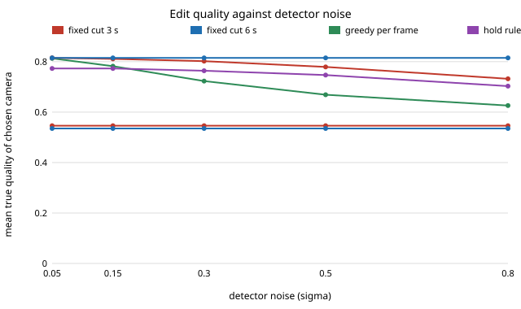

# capture-edit: how much of a multi-camera shoot can an automatic edit recover, and what stops it?

Fifth project of track 13, autonomous multi-angle capture for travel creators (`PROJECTS.md`, milestone 5). Four cameras film the same minutes; an automated edit has to line the clocks up and then pick which angle to show. This project builds that pipeline on a **synthetic quality model** (not real footage) and scores it against a fixed-cut baseline. **Headline:** with four cameras and a detector whose score is off by 0.3 (on a 0-1 scale), a fixed 3 s rotation shows an angle of mean true quality 0.546; an offline edit that maximises detected quality minus a cost per cut reaches 0.802, against 0.815 for the same search given the true scores. Picking the best-scored camera every frame is worse (0.723) and cuts 345 times a minute, with every shot under 1.5 s. Cut cost matters more than detector accuracy: at noise 0.3 the cut cost that maximises quality is near 1.0, and it needs about 14 cuts a minute. Clock sync from a shared loudness envelope is the first thing to fail: a 5 s clip at noise 0.25 is off by more than 40 ms in 25% of trials, a 15 s clip in 5%. **Not done:** no real footage, no reframing, no film-look grade (see Limitations). Produced with AI assistance (Claude).

**Live page:** https://duncan-haywood.github.io/oss-monorepo/research/capture-edit/

**Builds on.** `capture-rig` (where the cameras are) and `capture-follow` (the platform that carries them). The idea of choosing among viewpoints from a scored candidate set draws on automatic reframing of 360 video (Su and Grauman, CVPR 2017) and on virtualised-reality style multi-camera replay (Kanade, Rander and Narayanan, 1997, *IEEE MultiMedia*); the cut-cost search is an ordinary dynamic programme (Viterbi), not taken from either paper. It builds on none of the CU Boulder groups in `prompt.md` and claims no connection to them.

## Method (`src/capture_edit/model.py`)
- **Quality.** Each camera has a true quality in [0.1, 1] that changes every 2 to 8 s at random (a stand-in for framing, occlusion and subject visibility). Time step 0.1 s, 120 s clips, 20 seeds.
- **Detector.** The editor sees only quality plus Gaussian noise of standard deviation sigma, clipped to [0, 1].
- **Policies.** *Fixed*: rotate every 3 s or 6 s regardless of footage. *Greedy*: best score at every step. *Hold*: causal; a 1 s trailing mean, switch only if another camera leads by 0.15 and the shot has run 1.5 s. *Viterbi*: exact maximum of summed scores minus a cost per cut, with the whole clip in view. *Oracle*: the same search on true quality.
- **Metrics.** Mean true quality of the chosen camera; cuts per minute; share of shots under 1.5 s (assumed to read as jarring).
- **Sync.** Two recorders hear the same loud moments (Poisson, 0.5 per second, Gaussian pulses 50 ms wide). Each records a 50 Hz envelope with white noise; the offset is found by brute-force cross-correlation over &plusmn;1 s. "Bad" means an error over 40 ms (about one frame at 25 fps, assumed).

## Reproduce
```bash
pip install pytest
cd research/capture-edit
python -m pytest -q tests                        # 9 tests
PYTHONPATH=src python experiments/run.py         # about 10 s; writes experiments/results.txt
python experiments/figure.py                     # experiments/quality.svg from results.txt
```

## Results (from `experiments/results.txt`; deterministic)
Mean true quality of the chosen camera, 4 cameras, by detector noise sigma (cut cost 1.0 for viterbi and oracle):

| sigma | fixed 3 s | fixed 6 s | greedy | hold | viterbi | oracle |
|---|---|---|---|---|---|---|
| 0.05 | 0.546 | 0.535 | 0.813 | 0.773 | 0.815 | 0.815 |
| 0.15 | 0.546 | 0.535 | 0.782 | 0.773 | 0.811 | 0.815 |
| 0.30 | 0.546 | 0.535 | 0.723 | 0.764 | 0.802 | 0.815 |
| 0.50 | 0.546 | 0.535 | 0.669 | 0.747 | 0.779 | 0.815 |
| 0.80 | 0.546 | 0.535 | 0.626 | 0.703 | 0.732 | 0.815 |



- **Cuts.** Greedy cuts 102 to 416 times a minute and 90 to 100% of its shots are under 1.5 s. Hold stays near 10 to 24 cuts a minute with at most 1% jarring shots. Viterbi at a fixed cost cuts more as noise grows (10 to 39 a minute) and its jarring share rises from 7% to 64%, because noise makes cuts look worth their cost.
- **Cut cost** (4 cameras, sigma 0.3): cost 0 gives 0.726 and 325 cuts a minute; 0.3 gives 0.782; 1.0 gives 0.802 at 13.8 cuts a minute; 3.0 gives 0.796 at 7.3; 10.0 gives 0.761 at 3.5. The 1.0 used above was chosen from this table on the same seeds, so the viterbi column is in-sample.
- **More cameras** (sigma 0.3): quality rises from 0.692 (2 cameras) to 0.880 (8 cameras) for viterbi while a fixed cut stays near 0.55, so an extra camera only helps an edit that can tell which one is good.
- **Sync** (median error in ms / share over 40 ms), by envelope noise and clip length:

| noise | 5 s | 15 s | 45 s |
|---|---|---|---|
| 0.10 | 7 / 0.10 | 6 / 0.00 | 4 / 0.00 |
| 0.25 | 23 / 0.25 | 16 / 0.05 | 11 / 0.00 |
| 0.50 | 447 / 0.65 | 29 / 0.45 | 17 / 0.15 |
| 1.00 | 711 / 0.95 | 246 / 0.90 | 214 / 0.65 |

Short, quiet clips are the failure case: with a few loud moments and noise comparable to them, the correlation peak locks onto the wrong event.

## Limitations
- **No real footage.** Quality is a made-up random process that is independent across cameras, with no story, no motion and no content. "Quality" is not a measured image property. These numbers show how a cut-cost search behaves under noise, not how good a real reel is. The track asks for openly licensed footage; that run is still to do.
- **Detector noise is independent per frame and Gaussian.** Real detectors fail in runs (a face lost for two seconds), which hurts a smoothed edit more than this does.
- **Sync is a toy.** The envelope is sampled at 50 Hz with white noise; real syncing correlates audio at 48 kHz, or uses timecode or a flash, and also has to handle clock drift (ignored here) and cameras that hear different things.
- **Not built:** reframing of 360 footage, shot detection, and the film-look grade. The milestone names them; they need real pixels.
- The 1.5 s jarring threshold and the 40 ms sync tolerance are assumptions, not measured viewer thresholds. Simulated is not real.

## Next steps
- Run the same policies on openly licensed multi-camera footage with a real detector (face size and position, motion) and a human rating of the cuts.
- Add run-length (bursty) detector errors and clock drift, and see whether `hold` overtakes viterbi.
- `capture-bystander` (milestone 6): blurring bystanders in public and how conspicuous each platform is.

## Owner steps
None for this simulation.

## Outside dependencies
None. Python standard library only; pytest for the tests.
