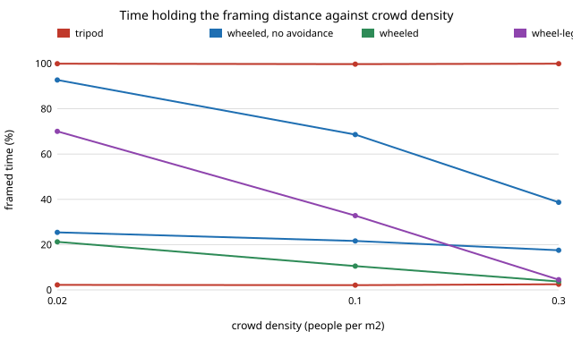

# capture-follow: which platform can follow a travel creator through a crowd and keep the shot?

Fourth project of track 13, autonomous multi-angle capture for travel creators (`PROJECTS.md`, milestone 4). A 2-D crowd simulation compares a static tripod, a wheeled follow robot, a wheel-legged robot and a drone, each trying to hold a camera 2.5 m behind a walking creator among pedestrians who do not react to it. **Headline:** a drone holds the framing distance 99.9% of the time in any crowd if it ignores pedestrians, but once it steers around them it falls to 69% at 0.1 people/m&sup2; and 39% at 0.3 people/m&sup2;; a ground robot on a plaza with curbs and one ramp is blocked 42 to 47% of the time, and wheel-legs that cross steps at 0.4&times; speed hold the frame 70% of the time in a thin crowd but only 4.5% in a dense one. Avoidance and framing pull against each other, and a flat-floor wheeled robot that ignores people holds the frame 98% of the time while passing within half a metre of a pedestrian about 500 times an hour. Every platform figure is an assumption (see Limitations). Produced with AI assistance (Claude).

**Live page:** https://duncan-haywood.github.io/monorepo-projects/research/capture-follow/

**Builds on.** `capture-crop` (a pole-mounted 360 camera cannot stand back, so something else has to) and `capture-kit` (weight and battery budget). Follow-camera control draws on the autonomous aerial cinematography of Bonatti et al. (2020, *Journal of Field Robotics*); the pedestrian repulsion term is a plain inverse-distance potential in the spirit of Helbing and Moln&aacute;r's (1995) social-force model, not a calibrated one. It builds on none of the CU Boulder groups in `prompt.md` beyond a loose link to RECUV's field-robot interests, and claims no connection to them.

## Method (`src/capture_follow/model.py`)
- **World.** A 30 m &times; 30 m periodic plaza. Pedestrians walk at 1.2 m/s, turning by a random angle every 4 to 12 s, and ignore every platform (the conservative case for the platform; real people step aside for a robot). The creator walks the same way at 1.3 m/s.
- **Steps.** Step lines (curbs or stairs) cross the plaza at x = 0, 10 and 20 m with a 4 m ramp gap. The creator crosses anywhere. A wheeled platform cannot cross outside the gap and stops; wheel-legs cross at 0.4&times; speed; a drone and a tripod ignore them.
- **Controller.** Proportional velocity toward the point 2.5 m behind the creator, plus (when avoidance is on) an inverse-distance repulsion from pedestrians within 2 m, clipped to the platform's top speed and acceleration. Time step 0.25 s, 240 s walks, 10 seeds; every platform sees the same crowd for a seed.
- **Metrics.** *Framed*: within &plusmn;25% of 2.5 m. *Clear view*: no pedestrian within 0.3 m of the camera-creator line (a drone is taken as always clear). *Blocked*: share of steps stopped by a step line. *Close seconds* and *contacts per hour*: time a pedestrian is within 1.0 m, and separate episodes within 0.5 m. *Wh/h*: assumed base and movement power.

## Reproduce
```bash
pip install pytest
cd research/capture-follow
python -m pytest -q tests                        # 10 tests
PYTHONPATH=src python experiments/run.py         # about a minute; writes experiments/results.txt
python experiments/figure.py                     # experiments/framed.svg from results.txt
```

## Results (from `experiments/results.txt`; deterministic)
Framed % / contacts per hour, by crowd density (people per m&sup2;), on the plaza with step lines:

| platform | 0.02 | 0.1 | 0.3 |
|---|---|---|---|
| tripod | 2.2 / 83 | 2.1 / 405 | 2.5 / 993 |
| wheeled, no avoidance | 25.4 / 119 | 21.6 / 492 | 17.5 / 1,149 |
| wheeled | 21.2 / 83 | 10.5 / 428 | 3.7 / 1,041 |
| wheel-legs | 70.0 / 48 | 32.8 / 302 | 4.5 / 1,050 |
| drone, no avoidance | 99.9 / 110 | 99.7 / 513 | 99.9 / 1,250 |
| drone | 92.7 / 24 | 68.6 / 149 | 38.7 / 699 |



- **Steps decide the ground robot.** Wheeled platforms are stopped by step lines for 42 to 47% of the walk. On a flat plaza (density 0.1) the wheeled robot that ignores people frames 97.9% of the time, against 21.6% with steps; wheel-legs, which pay for crossing in power (about 106 against 68 Wh/h) and in size, recover only some of it.
- **Avoidance costs framing.** At 0.1 people/m&sup2; the avoiding drone has under a third of the contacts of the one that ignores people (149 against 513 per hour) and loses 31 points of framing. Flat-plaza wheeled framing drops from 97.9% to 40.9% when it avoids. A 2-D repulsion field cannot do what a person does: go round, then catch up.
- **Nobody is safe among many people if they do not step aside.** Even the tripod has hundreds of passers-by within half a metre per hour at 0.1 people/m&sup2;; those counts are the crowd's own, and measure how much of each platform's number is the baseline.
- **Weight and battery.** A tripod is 1.2 kg; the drone 0.25 kg but about 0.34 kg of battery per filming hour; wheeled 6 kg; wheel-legs 10 kg and 0.53 kg of battery per hour (assumed figures; section C).

## Limitations
- **Everything about the platforms is assumed**: speeds, accelerations, power draw, mass and packed volume are round numbers typical of each class, not datasheets, and nothing was measured. The structure (steps block wheels, avoidance trades off against framing) is the finding, not any number.
- Pedestrians do not react to platforms, which overstates contacts for every platform. The tripod is placed once and never moves, so its framing score is not a fair estimate of a repositioned tripod.
- The drone is treated as unconstrained by altitude, wind, battery, regulation and flight over people; its clear view is assumed. Flying is an owner step (FAA Part 107 or 49 U.S.C. &sect; 44809 in the US, and local rules). A real drone would climb over a crowd rather than steer sideways, and many places ban it.
- 2-D plaza with straight step lines; no occlusion by walls, no slopes, no sensing or perception errors, no latency. The controller is deliberately simple (no planner), and wheel-legs get no better avoidance than wheels.
- Safety here means distance to a pedestrian, not injury or comfort; a real design input would be a bystander study.

## Next steps
- Add a gap-seeking planner (a local planner that goes round and rejoins) and see how much of the avoidance cost it recovers.
- Replace assumed platform figures with sourced datasheet values, and add terrain beyond step lines (slopes, grass, sand).
- `capture-edit` (milestone 5): the automated edit from multi-camera footage.

## Owner steps
None for this simulation. Building a follow robot or flying a drone, with a priced bill of materials and local permissions, is later track 13 work and an owner step.

## Outside dependencies
None. Python standard library only; pytest for the tests.
