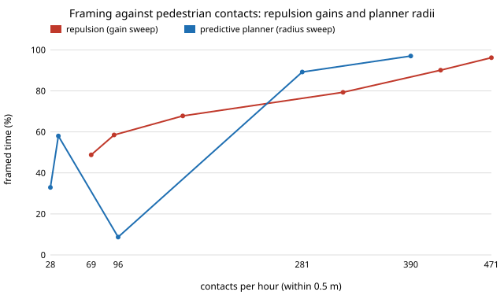

# capture-followplan: does a predictive planner recover the framing a follow camera loses by avoiding pedestrians?

Follow-up to `capture-follow` (track 13, `PROJECTS.md`), taking its first "next step": a planner that goes round a pedestrian and rejoins the shot, instead of a repulsion field. **Headline:** at equal settings it does *not* recover the framing (a drone at 0.1 people/m&sup2; frames 58.0% of the time with the planner at a 1.5 m radius, against 67.8% for `capture-follow`'s repulsion), but it makes far fewer close passes (36 contacts within 0.5 m per hour against 161), and on ground platforms it cuts contacts from 326 to 21 per hour with the same ~40% framing. The honest comparison is the framing-against-contacts curve, where the planner sits to the left of repulsion. Neither controller keeps the frame at 0.3 people/m&sup2;. Platform figures are assumed round numbers (`capture-follow`'s), pedestrians ignore the platform, and the planner is given exact pedestrian velocities. Produced with AI assistance (Claude).

**Live page:** https://duncan-haywood.github.io/monorepo-projects/research/capture-followplan/

**Builds on.** `capture-follow` (world, crowd, platforms and metrics are imported from it; with `mode="repulsion"` this project reproduces its numbers exactly, which a test checks). The sampler is a sampling-based local planner with constant-velocity prediction, in the family of velocity-obstacle and model-predictive collision avoidance (e.g. van den Berg et al., 2011, "Reciprocal n-body collision avoidance", *Robotics Research*; Bonatti et al., 2020, *Journal of Field Robotics*, for aerial cinematography). It is a plain implementation of the idea, not those papers' algorithms. It builds on none of the CU Boulder groups in `prompt.md`.

## Method (`src/capture_followplan/plan.py`)
- **Same world.** 30 m plaza, 1.2 m/s pedestrians that ignore the platform, a creator at 1.3 m/s, target 2.5 m, 0.25 s steps, 240 s walks, 8 seeds, the same crowd per seed for every controller.
- **Controllers.** `ignore`: pursue the shot point only. `repulsion`: capture-follow's inverse-distance field (gain 1.2, 2 m range). `plan`: each step, score about 80 candidate velocities (stop; 16 headings at three speeds; the pursuit velocity rotated up to &plusmn;1.2 rad at two scales) by the camera's distance at 3 s from the creator's predicted shot point, plus 6 &times; the summed squared intrusion of each pedestrian (constant velocity, 6 samples to 3 s) into a safety radius, plus a small velocity-change cost. Pedestrians within 7 m are considered.
- **Platforms.** Drone and wheel-legs on the plaza with step lines; the wheeled robot on a flat plaza (its step blocking, 42 to 47% of the time in `capture-follow`, would swamp the comparison).
- **Metrics.** capture-follow's: framed (within &plusmn;25% of 2.5 m), contacts per hour (separate episodes within 0.5 m), close seconds per hour (within 1 m), Wh/h.

## Reproduce
```bash
pip install pytest
cd research/capture-followplan
python -m pytest -q tests                        # 5 tests (needs ../capture-follow/src, already in pytest config)
PYTHONPATH=src python experiments/run.py         # several minutes; writes experiments/results.txt
python experiments/figure.py                     # experiments/front.svg from results.txt
```

## Results (from `experiments/results.txt`; deterministic)
Framed % / contacts per hour (safety radius 1.5 m, repulsion gain 1.2):

| platform, density | ignore | repulsion | planner |
|---|---|---|---|
| drone, 0.02 | 99.9 / 112 | 93.4 / 22 | 91.3 / 2 |
| drone, 0.1 | 99.8 / 523 | 67.8 / 161 | 58.0 / 36 |
| drone, 0.3 | 99.9 / 1,266 | 39.0 / 696 | 32.9 / 439 |
| wheeled (flat), 0.02 | 99.2 / 124 | 82.2 / 49 | 85.9 / 4 |
| wheeled (flat), 0.1 | 98.0 / 514 | 40.1 / 326 | 40.0 / 21 |
| wheeled (flat), 0.3 | 98.9 / 1,268 | 6.2 / 1,058 | 3.1 / 133 |
| wheel-legs, 0.02 | 86.4 / 124 | 70.0 / 47 | 85.8 / 0 |
| wheel-legs, 0.1 | 85.8 / 518 | 32.1 / 308 | 26.7 / 21 |
| wheel-legs, 0.3 | 86.5 / 1,260 | 5.0 / 1,061 | 3.6 / 111 |



- **Equal settings are not equal trade-offs.** Gain and radius are different knobs, so a single row cannot say which controller is better. Sweeping each (drone, 0.1 people/m&sup2;), repulsion runs from 96.2% framed / 471 contacts (gain 0.15) to 48.8% / 69 (gain 4.8); the planner from 97.0% / 390 (radius 0.75 m) through 89.2% / 281 (1.0 m) and 58.0% / 36 (1.5 m) to 32.9% / 28 (2.0 m). At about 58% framed the planner has 36 contacts and repulsion about 92 (gain 2.4, 58.5%); at about 80% repulsion has 322 and the planner (between 1.0 and 1.5 m) lies between 281 and 36, so is ahead there too. The planner's advantage is real but about 2 to 3 times in contacts at equal framing, not the 4 to 15 times a single row suggests.
- **The large radius backfires.** At 3.0 m the planner is framed 8.7% of the time and has more contacts (96) than at 2.0 m (28): it keeps swerving instead of holding position.
- **Wheel-legs gain most in a thin crowd.** At 0.02 people/m&sup2; the planner keeps their framing at 85.8% (repulsion 70.0%) with no contacts at all.
- **Density is the limit.** At 0.3 people/m&sup2; (a busy street) both controllers frame 3 to 39% of the time; no local planner fixes a plaza with a person every 3 m. Contacts still fall (wheeled 1,058 to 133).

## Limitations
- **Pedestrians do not react to the platform** and the planner is handed their exact velocities (finite difference of the true state). A real platform estimates them from a camera or lidar with noise and latency; contacts here are therefore a floor for the planner. Real people also step aside, which helps every controller.
- The planner's cost weights (penalty 6, horizon 3 s, safety radius) were set by hand and then swept only in radius; no weight tuning was done to flatter or hurt either controller, and the repulsion gain sweep is the comparable knob. The two sweeps are one-dimensional slices of two larger design spaces.
- All platform figures (speeds, accelerations, power) are `capture-follow`'s assumed round numbers; the structural result (the planner shifts the trade-off, density sets the limit) is the finding, not any number. 8 seeds; no confidence intervals were computed, so differences of a few points (for example 40.1 against 40.0) are ties.
- 2-D plaza, straight step lines, no occlusion by walls, no sensing. The drone's altitude is not used (a real drone could climb over a crowd); flying is an owner step (FAA 14 CFR Part 107 or 49 U.S.C. &sect; 44809 in the US, and local rules).
- Safety here means distance to a pedestrian, not injury or comfort.

## Next steps
- Estimate pedestrian velocities from noisy detections (a Kalman tracker with latency) instead of exact ones, and report how much of the contact reduction survives.
- Make pedestrians step aside for the platform with a sourced avoidance model, and recompute both controllers.
- Add a second knob to repulsion (range) so its sweep is two-dimensional, and compute confidence intervals over more seeds.

## Owner steps
None for this simulation.

## Outside dependencies
None. Python standard library only; pytest for the tests; `capture-follow` (this repository) for the world.
