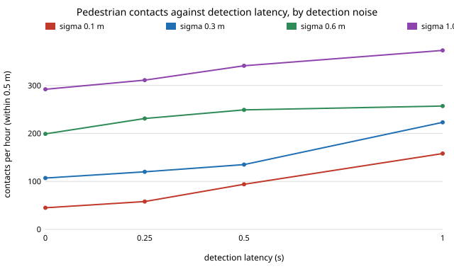

# capture-followtrack: how much of a predictive follow camera's contact reduction survives noisy, delayed pedestrian detections?

Follow-up to `capture-followplan` (track 13, `PROJECTS.md`), taking its first "next step". That project gave its planner the pedestrians' exact positions and velocities. Here the planner sees only a constant-velocity Kalman tracker's estimate from detections that carry Gaussian position noise and a latency. **Headline:** the framing is untouched (57 to 61% everywhere, against 58.0% with exact data), but the contact reduction erodes fast. For a drone at 0.1 people/m&sup2; the exact planner has 36 contacts (within 0.5 m) per hour; with 0.1 m noise and no delay 45; with 0.3 m noise and 0.25 s delay 120; with 0.6 m noise 199 to 257; with 1.0 m noise and 1 s delay 373, below the 523 of a camera that ignores pedestrians only by a third. Repulsion (161, given exact positions) is beaten only while noise is about 0.3 m or less *and* latency is under about 0.5 s. Produced with AI assistance (Claude).

**Live page:** https://duncan-haywood.github.io/monorepo-projects/research/capture-followtrack/

**Builds on.** `capture-followplan` (planner, imported; a small `estimator` hook was added so the planner can be fed estimates, and a test checks the default is unchanged) and `capture-follow` (world and metrics). The tracker is a textbook constant-velocity Kalman filter with white-acceleration process noise (Bar-Shalom, Li and Kirubarajan, 2001, *Estimation with Applications to Tracking and Navigation*, ch. 6). It builds on none of the CU Boulder groups in `prompt.md`.

## Method (`src/capture_followtrack/track.py`)
- **Detections.** Each 0.25 s step, each pedestrian's true position `latency` seconds ago plus N(0, sigma&sup2;) per axis. Swept: sigma 0.1, 0.3, 0.6, 1.0 m; latency 0, 0.25, 0.5, 1.0 s. No source gives a single figure for a drone's detector, so this is a sweep over the plausible range, not a pick: ~0.1 m is a good lidar or stereo fix on a stationary platform, 0.6 to 1 m a monocular detector with a moving camera.
- **Tracker.** One filter per pedestrian per axis, state [position, velocity], process acceleration sd 0.5 m/s&sup2; (a hand-set value, not tuned), run in the delayed time frame and extrapolated forward by the latency. The planner receives the estimated positions and velocities.
- **Everything else** is `capture-followplan`: drone, 0.1 people/m&sup2;, 1.5 m planner radius, 30 m plaza, 240 s walks, the same 8 crowds. Detection noise uses a separate random stream. Intervals are 95% (1.96 &times; standard error over 8 seeds; a normal approximation, slightly narrow for n = 8).

## Reproduce
```bash
cd research/capture-followtrack
python -m pytest -q tests                   # 4 tests
python experiments/run.py                   # about 10 minutes; writes experiments/results.txt
python experiments/figure.py                # experiments/contacts.svg
```

## Results (`experiments/results.txt`; deterministic)
Drone, 0.1 people/m&sup2;. Framed % / contacts per hour, mean over 8 seeds.

| detections | framed % | contacts/h |
|---|---|---|
| ignore pedestrians | 99.8 | 523 &plusmn; 53 |
| repulsion (exact positions) | 67.8 | 161 &plusmn; 44 |
| planner, exact | 58.0 | 36 &plusmn; 15 |
| sigma 0.1, latency 0 | 57.3 | 45 &plusmn; 15 |
| sigma 0.1, latency 0.5 | 57.8 | 94 &plusmn; 23 |
| sigma 0.1, latency 1.0 | 58.3 | 158 &plusmn; 28 |
| sigma 0.3, latency 0 | 56.9 | 107 &plusmn; 20 |
| sigma 0.3, latency 0.25 | 57.1 | 120 &plusmn; 30 |
| sigma 0.3, latency 0.5 | 57.7 | 135 &plusmn; 39 |
| sigma 0.6, latency 0.25 | 59.0 | 231 &plusmn; 31 |
| sigma 1.0, latency 1.0 | 60.6 | 373 &plusmn; 54 |



- **Noise hurts more than delay at first.** Going from exact data to 0.3 m noise with no delay triples contacts (36 to 107); going from no delay to 1 s at 0.1 m noise quadruples them (45 to 158). Both are steep; the full 4&times;4 grid is in `results.txt`.
- **The planner's edge over repulsion is conditional.** It holds at 0.1 m noise up to about 0.5 s latency (94 against 161) and at 0.3 m noise up to 0.5 s (135, within the intervals of 161); beyond that the exact-data repulsion field is as good or better. Repulsion was not rerun with noisy positions, so this comparison favours repulsion (see limitations).
- **Framing does not change.** It stays within 56.9 to 60.6% (intervals about &plusmn;3 to 5), so detection quality shows up as safety, not as shot quality. The slight rise at high noise is within the intervals and is not claimed.
- **Bad perception is nearly as bad as none.** At 1.0 m noise the planner (292 to 373) removes only 29 to 44% of the contacts of ignoring pedestrians (523) while giving up 40% of the framing.

## Limitations
- **Perfect association.** Detection i is assumed to belong to track i; real trackers swap and drop identities, missing detections and false positives are not modelled. All of these make the numbers here a floor on contacts.
- **Repulsion has exact positions** in the comparison; a fair one needs the same noisy tracker feeding it. Not run.
- **Gaussian, independent noise** at a fixed rate; real detector error is correlated in time and worse at range and in occlusion. The noise levels are a sweep, not measured from a detector.
- Process noise (0.5 m/s&sup2;) was set by hand and not tuned per noise level; a tuned filter or a smoother planner would do better. Pedestrians ignore the platform, platform figures are `capture-follow`'s assumed round numbers, 2-D plaza, 8 seeds, drone and one density only.

## Next steps
- Feed repulsion the same tracker and compare at equal perception.
- Add identity swaps and missed detections; tune the filter's process noise against each noise level.
- Make pedestrians step aside for the platform with a sourced avoidance model.

## Owner steps
None for this simulation.

## Outside dependencies
None. Python standard library only; pytest for the tests; `capture-follow` and `capture-followplan` (this repository).
