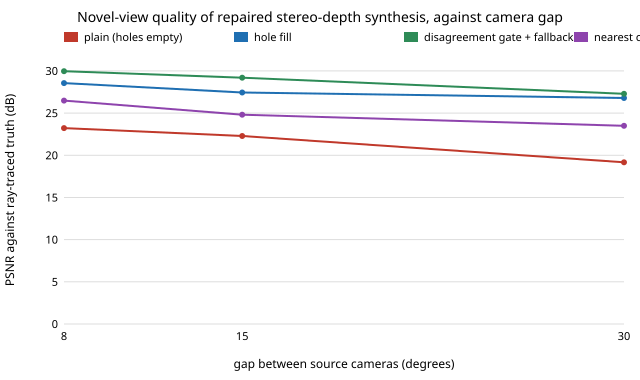

# capture-hybrid: can the holes and errors of measured stereo depth be repaired so the in-between view beats cutting to the nearest camera?

Follow-up to `capture-stereodepth` (track 13), whose "Next steps" asked for a hole filler and for the left-right mask used as a confidence map with a fall back to the nearest camera. **Headline:** with block-matching stereo depth at a 15 degree gap, plain synthesis scores 22.3 dB against 24.8 dB for cutting to the nearest camera. Filling holes from the farther row neighbour lifts it to 27.4 dB, and a gate that needs no ground truth (fall back to the raw nearest camera where the two warped sources disagree, or where no source has a pixel) reaches 29.2 dB, 4.4 dB above cutting; three fresh noise seeds with the threshold fixed beforehand give 29.2 dB again. The gate's edge is fragile: at 6% sensor noise it is level with filling, and with a bystander in the scene plain filling is better (26.3 against 26.1 dB). A per-pixel oracle reaches 32.0 dB. A toy scene: read the ordering, not the decibels. Produced with AI assistance (Claude).

**Live page:** https://duncan-haywood.github.io/monorepo-projects/research/capture-hybrid/

**Builds on.** `capture-stereodepth` (scene, stereo matcher, warp and score, copied here so the project is self-contained; the only change is that `warp` can also return the target-frame depth map). Depth-image-based rendering with hole filling is standard; the farther-neighbour rule follows the usual advice to fill disocclusions from the background. It builds on none of the CU Boulder groups in `prompt.md` and claims no connection to them.

## Method (`src/capture_hybrid/`, `hybrid.py`)
Two source cameras at azimuth 20 degrees plus or minus half the gap, each with a rectified stereo partner (baseline 0.2 m, 1% sensor noise unless stated) from which `capture-stereodepth`'s matcher measures depth. Both sources are warped to the target pose and cracks of one pixel closed; the strategies differ only in what happens next:
- **plain**: nearest-in-angle source first, holes stay sky. This reproduces `capture-stereodepth`.
- **fill**: each hole takes the colour of whichever of the nearest valid pixels to its left or right in the same row is farther away.
- **fallback**: each hole takes the pixel at the same coordinates in the raw nearest camera (no warp).
- **gate**: fallback, plus any pixel where both warps are valid but differ by more than `tau` (summed absolute RGB difference, grown by one pixel) is also taken from the raw nearest camera. Two warps of the same surface should agree; where they do not, depth is probably wrong.
- **oracle**: per pixel, whichever of plain and raw nearest is closer to the truth. It uses ground truth, so it is an upper bound and not a method.
Scored by PSNR against the ray-traced midpoint view, mean of 3 noise seeds.

## Reproduce
```bash
pip install pytest numpy
cd research/capture-hybrid
python -m pytest -q tests                        # 6 tests
PYTHONPATH=src python experiments/run.py         # writes experiments/results.txt
python experiments/figure.py                     # experiments/gap.svg from results.txt
```

## Results (from `experiments/results.txt`; deterministic)
A. By gap between the source cameras (PSNR dB):

| gap | plain | fill | fallback | gate | oracle | nearest camera |
|---|---|---|---|---|---|---|
| 8 deg | 23.2 | 28.6 | 28.5 | 30.0 | 32.7 | 26.5 |
| 15 deg | 22.3 | 27.4 | 27.5 | 29.2 | 32.0 | 24.8 |
| 30 deg | 19.2 | 26.8 | 26.5 | 27.3 | 29.8 | 23.5 |



- **The sign of `capture-stereodepth`'s verdict flips.** Every repair beats cutting to the nearest camera at every gap in this scene, with no bystander. Most of the original loss was holes left sky-coloured, not wrong depth: even naive hole filling recovers 5 dB.
- **The gate adds 1 to 2 dB over filling**, by also discarding pixels where the two warps disagree. Its threshold matters: PSNR is 26.3 dB at `tau` 0.05, 29.2 to 29.3 at 0.3 to 0.5 and 27.6 at 1.0 (E). That sweep and the headline were on the same seeds; the held-out run (F, seeds 7 to 9, `tau` fixed at 0.3 before the sweep) gives 29.2 dB, so the choice is not overfit to noise seeds, but it is one scene.
- **Baseline and noise** (B, C): the gate is best at every baseline (26.6, 29.2, 29.0 dB at 6, 20 and 50 cm). It falls with sensor noise (29.5, 29.2, 26.6, 22.5 dB at 0, 1, 3, 6%) and at 6% noise it is no better than filling (22.5 against 22.6) and level with the nearest camera (21.7).
- **A bystander reverses the ranking** (D): at gaps 8, 15, 30 degrees, filling scores 28.3, 26.3, 24.5 dB, the gate 28.3, 26.1, 23.3. The bystander's occlusions make the two warps disagree on correct pixels too, so the gate throws away good synthesis. Filling still beats the nearest camera by 4 to 5 dB.
- **Headroom** (oracle, 32.0 dB at 15 degrees): a perfect confidence signal would be worth another 2.8 dB over the gate.

## Limitations
- **Toy scene**: one analytic ground plane and cylinder, smooth textures, one target azimuth, three noise seeds; no lighting change, specularity, motion blur, calibration error or rolling shutter. Absolute decibels do not transfer.
- **PSNR rewards copying.** The nearest raw camera at 7.5 degrees offset is a good guess for most pixels in a smooth scene, which flatters fallback. Real footage with parallax-rich texture would be less forgiving, and PSNR does not capture perceived seams where the gate switches source. No human rating was done.
- **A 1990s matcher**; a learned depth model would change the numbers, and a learned inpainter would beat row filling.
- `tau` is a single global constant tuned on this scene (the threshold sweep is on the headline seeds); a different scene or camera needs its own.

## Next steps
- Soften the gate: blend with a weight that falls with disagreement instead of a hard switch, and count seam visibility.
- Use the left-right mask and cost margin from the matcher as a second confidence signal and see how much of the 2.8 dB oracle headroom it recovers, especially with a bystander.
- Run a real open depth model on openly licensed multi-view footage and have people rate the in-between frames.

## Owner steps
None for this simulation.

## Outside dependencies
numpy and pytest. Nothing else; the scene is analytic.
