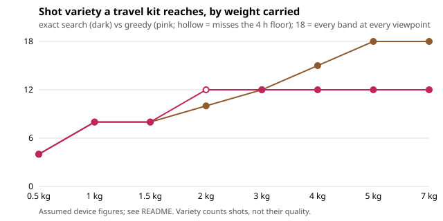

# capture-kit: what should a travel creator pack to film from many angles under a weight budget and the 100 Wh battery limit?

Second project of track 13, autonomous multi-angle capture (`PROJECTS.md`, milestone 2). It searches every kit from a small catalogue of cameras, lenses, mounts and battery packs, scoring **variety** (distinct focal-band x viewpoint shots, 18 at most) and **recording hours** against carried weight, with every battery at or under 100 Wh. **Headline:** a greedy "best gain per gram" packer stalls at 12 shots from 3 kg up, because a lens is worth nothing until its camera body is in the bag. Exact search reaches 15 shots at 4 kg and all 18 at 5 kg (with at least 4 h of recording). With no recording floor, maximising variety alone picks kits that last only about 2.2 h at 4 kg. Every device figure is assumed (see Limitations). Produced with AI assistance (Claude).

**Live page:** https://duncan-haywood.github.io/monorepo-projects/research/capture-kit/

**Builds on.** `capture-crop` (milestone 1): a 360 camera on a pole is a 14 to 24 mm-equivalent camera at one viewpoint, so longer bands and stand-back viewpoints need other devices. Battery rule: 100 Wh per battery in carry-on without airline approval (FAA PackSafe, checked 2026-10-19). It builds on none of the CU Boulder groups in `prompt.md` and claims no connection to them.

## Method (`src/capture_kit/model.py`)
- **Catalogue (assumed).** 4 cameras (360, action, phone telephoto, mirrorless body that takes lenses), 3 lenses, 4 mounts (selfie pole, mini tripod, travel tripod, telescoping mast) and 4 battery packs including one 160 Wh pack that is over the carry-on limit.
- **Variety.** Bands are 14, 24, 35, 50, 85 and 135 mm-equivalent; viewpoints are pole (held, 0.8 m), stand (1.5 to 3 m back) and high (raised). A band is covered by some camera (or the body plus a lens), a viewpoint by some mount. Variety = bands covered x viewpoints available (cameras move between mounts through the day).
- **Hours.** Carried watt-hours (camera internals plus packs) over the draw of the cameras that can run at once (one per mount, highest draw first).
- **Exact search.** All 17,280 kits (camera, lens, mount subsets; up to 2 packs); 11,520 are legal. Best = most variety, then most hours, then lightest, within the weight budget (and an hours floor where stated).
- **Greedy baseline.** Repeatedly add the item with the best (variety + 0.1 x hours) gain per gram that fits.

## Reproduce
```bash
pip install pytest
cd research/capture-kit
python -m pytest -q tests                        # 10 tests
PYTHONPATH=src python experiments/run.py         # a second or two; writes experiments/results.txt
python experiments/figure.py                     # experiments/kit.svg from results.txt
```

## Results (from `experiments/results.txt`; deterministic)
With a 4 h recording floor (variety / hours):

| budget | exact | greedy |
|---|---|---|
| 1.0 kg | 8 / 4.7 h | 8 / 4.7 h |
| 2.0 kg | 10 / 5.0 h | 12 / 2.4 h (misses the floor) |
| 3.0 kg | 12 / 16.5 h | 12 / 16.4 h |
| 4.0 kg | 15 / 11.1 h | 12 / 25.7 h |
| 5.0 kg | 18 / 16.8 h | 12 / 25.7 h |



- The 5 kg full-coverage kit is action camera, mirrorless body, 24-70 and 70-200 zooms, selfie pole, mini tripod, telescoping mast and 60 + 99 Wh packs. The 135 mm band exists only through the 70-200, so covering all 18 shots costs the 1.1 kg lens.
- Greedy never picks the mirrorless body, because on its own the body adds no band; this complementarity is what exact search sees and greedy cannot.
- Without a floor, variety-first search at 4 kg returns 18 shots but only 2.2 h; the floor is not a detail, it changes which kit wins at 2 and 4 kg.
- The 160 Wh pack is never chosen: the legality filter works (tested).

## Limitations
- **All device figures are assumed**, round numbers typical of each class from the author's general knowledge, not datasheets: weights, battery Wh, draw in watts and which bands each device covers. Nothing here was fetched or measured; the 100 Wh limit is the only sourced number. The rankings are about structure (complementary items, a floor), not about any product.
- Variety counts shots that exist, not their quality (a phone telephoto at 85 mm is not an 85 mm prime), and weights ignore cables, cases and cards. Hours ignore cold, screens and charging en route.
- Cameras are assumed to be swapped between mounts; a creator who wants shots at the same moment needs more cameras than this counts.
- Small catalogue (so exact search is trivial); a real one needs integer programming or smarter search.

## Next steps
- Replace assumed figures with sourced, dated datasheet values.
- `capture-rig` (milestone 3): how many cameras, where, with simulated coverage and stereo depth error.

## Outside dependencies
None. Python standard library only; pytest for the tests.
