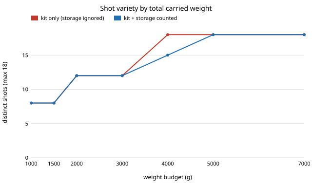

# capture-kitstore: what does it cost a travel filming kit to also carry its footage backup?

Follow-up to `capture-realkit` and `capture-storage` (track 13, autonomous multi-angle capture), taking the "couple the two" next step both name. Milestones 1 to 6 of the track are done and `capture-kit` chose cameras without counting the footage, while `capture-storage` sized the backup for a fixed camera list; nobody had chosen the two together. **Headline:** counting storage in the weight budget costs the kit 3 of 18 shots at a 4 kg budget (18 shots become 15), and the lightest kit that reaches all 18 goes from 3,900 g to 4,125 g (+225 g, the backup plan's own weight). Across bitrates from 0.25x to 1.5x the extra weight moves only from 125 g to 400 g, and card-reader speed (90, 104 or 312 MB/s) changes no variety figure at any budget tested. So the backup is a small tax, but it falls at the budget where the whole shot list was just reachable. Produced with AI assistance (Claude).

**Live page:** https://duncan-haywood.github.io/monorepo-projects/research/capture-kitstore/

**Builds on.** `capture-realkit` (the sourced catalogue and kit search; its model is copied here as `catalogue.py` so this project is self-contained) and `capture-storage` (cards reused daily, SSD copies holding the trip, parallel readers). It builds on none of the CU Boulder groups in `prompt.md`.

## Method
- **Kit search.** The 11,520 kits of `capture-realkit`; a kit must be legal (every battery at or under 100 Wh) and record at least 4 h on its batteries. Score: distinct band x viewpoint shots, then recording hours, then lightest.
- **Footage.** The cameras recording at once are one per mount (highest draw first, as `hours` assumes); each records 4 h a day at its bitrate.
- **Storage plan.** For a 7-day trip: 512 GB microSD cards (0.25 g, sourced), two SSD copies each holding the trip with 10% headroom (1, 2 or 4 TB), and 1 to 8 parallel readers (25 g each), lightest plan whose nightly copy of one day, written twice, finishes within 1 h at the reader speed.
- **Joint search.** The same exhaustive search with kit weight plus storage weight against one budget, compared with the kit-only search.

| input | value | status |
|---|---|---|
| Action-camera bitrate | 120 Mbit/s | sourced (DJI Osmo Action 5 Pro spec page, dji.com, read 2026-10-21) |
| 360 camera, phone, mirrorless bitrates | 120, 60, 200 Mbit/s | assumed (no spec reachable); swept 0.25x to 1.5x |
| microSD mass | 0.25 g | sourced (Wikipedia, SD card infobox) |
| UHS-I / UHS-II bus ceilings | 104 / 312 MB/s | sourced (SD Association table on Wikipedia); real readers are slower |
| SSD masses, reader mass | 45 to 75 g, 25 g | assumed (carried from `capture-storage`) |
| Devices, weights, energies | see `capture-realkit` | sourced there |

## Reproduce
```bash
pip install pytest
cd research/capture-kitstore
python -m pytest -q tests                       # 10 tests
PYTHONPATH=src python experiments/run.py        # a few seconds; writes experiments/results.txt
python experiments/figure.py                    # experiments/kit_vs_joint.svg
```

## Results (from `experiments/results.txt`; deterministic)
4 h floor, 7 days, two SSD copies, 1 h offload, UHS-I ceiling:

| budget (g) | kit-only shots | joint shots | storage for the joint kit (g) | readers |
|---|---|---|---|---|
| 1,000 | 8 | 8 | 115 | 1 |
| 2,000 | 12 | 12 | 115 | 1 |
| 3,000 | 12 | 12 | 115 | 1 |
| 4,000 | 18 | **15** | 226 | 3 |
| 5,000 | 18 | 18 | 226 | 3 |
| 7,000 | 18 | 18 | 400 | 4 |



- **The kit-only winner often does not fit once its backup is added.** At 3,000, 4,000 and 5,000 g the kit chosen ignoring storage plus its own backup exceeds the budget (3,056, 4,206 and 5,358 g). The joint search swaps parts to get under: at 4 kg it drops the 24-70 mm lens and the 737 power bank for a second 72 Wh bank and keeps 15 shots.
- **Cost of full coverage.** Lightest kit with all 18 shots: 3,900 g ignoring storage, 4,125 g with it at the base bitrates (25 g steps).
- **Bitrate moves it a little.** Lightest 18-shot totals are 4,025, 4,075, 4,125 and 4,300 g at bitrate scales 0.25, 0.5, 1.0 and 1.5.
- **Reader speed changes nothing here.** The joint shot count is identical at 90, 104 and 312 MB/s at all seven budgets; the speed changes how many readers the plan carries (a few tens of grams), not which kit wins.
- **The data volume is modest** because only one camera per mount records: 108 GB a day for the phone-only kits, 468 to 576 GB for kits with a mirrorless body.

## Limitations
- The 360 camera, phone and mirrorless bitrates, SSD masses and reader mass are assumed. The bitrate sweep covers the first; the second group is small next to a kit (45 to 75 g per SSD) but unswept.
- Only 4 h of recording a day and a 7-day trip were tried; longer trips raise SSD weight, and longer shooting days raise the readers needed.
- A phone has no card slot; its footage is treated as one more stream through the same readers. A laptop or hub able to take 3 to 4 readers at once, its charger and its power are not counted, though a trip with a mirrorless body probably carries a laptop anyway.
- The bus speeds are ceilings; real card and reader pairs are slower, so reader counts are lower bounds.
- The variety score counts band-by-viewpoint labels, not image quality.

## Next steps
- Count the laptop or hub the offload needs, and compare with offloading to a phone and cloud over hotel Wi-Fi.
- Weigh real mounts and SSDs with a scale (see `capture-realkit`'s next steps); the SSD and reader grams are the main unsourced inputs here.
- Vary recording hours per camera and trip length together with the kit.

## Owner steps
Time a real card-to-SSD copy with the intended readers before relying on any reader count here.

## Outside dependencies
None. Python standard library only; pytest for the tests.
