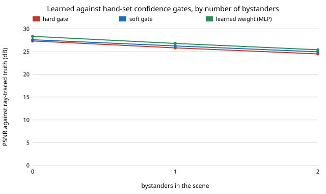

# capture-learngate: can a small model trained on many random scenes pick the per-pixel blend weight better than a hand-set ramp?

Follow-up to `capture-softgate` (track 13, autonomous multi-angle capture), whose first "Next step" asked to predict the per-pixel weight instead of hand-ramping it. **Headline:** on 40 held-out scene configurations (new ground textures, same ranges), a one-hidden-layer network predicting how much of the raw nearest camera to blend in scores 26.78 dB against 26.21 dB for the best soft gate and 25.81 dB for the hard gate, ahead of the soft gate in all 40 configs (mean +0.57 dB, standard error 0.05). That recovers 0.36 of the 2.7 dB between the hard gate and the best possible per-pixel blend, up from 0.15 for the soft gate. A linear model gets 0.29 of it. Outside the training ranges the gain over the soft gate shrinks to +0.24 dB.

**Live page:** https://duncan-haywood.github.io/oss-monorepo/research/capture-learngate/

**Why this question.** `capture-hybrid` and `capture-softgate` tuned one or two thresholds on a single scene and left most of the headroom unused. Tuning on one scene says nothing about generalisation, so this project draws many different scenes, fits on some and tests on others.

**Builds on.** `capture-softgate` (scene, matcher, warp and gates, copied here so the project is self-contained; the scene gained a ground-texture seed). Per-pixel blend weights fitted by regression are ordinary in learned image-based rendering; this is a small numpy version on a toy scene, not a reproduction of any paper. It builds on none of the CU Boulder groups in `prompt.md` and claims no connection to them.

## Method (`src/capture_learngate/learn.py`, `experiments/run.py`)
- **Target.** For each pixel the two warped sources give a synthesis `base`; the raw nearest camera gives `near`. The output is `w*near + (1-w)*base`. The least-squares weight given the truth is `w* = clip(<base-truth, base-near> / |base-near|^2, 0, 1)` (called `lstsq` below; an upper bound for any per-pixel blend, not a method, and not the same as `capture-softgate`'s binary `oracle`, which picks one source per pixel). Holes always take the raw nearest camera.
- **Features (no truth used).** Warp disagreement, its 3x3 maximum and 5x5 mean, stereo matching cost and its 3x3 maximum, local texture of the synthesis, depth edge, the two warps' depth difference, both-valid and near-source-hole flags, log depth, and the camera gap (12 in all).
- **Models.** Ridge regression, and a one-hidden-layer tanh network with sigmoid output trained with Adam on the squared image error (each pixel weighted by `|base-near|^2`, so the loss is the image loss). Size and penalty are picked on validation configs.
- **Scenes.** Each config draws its own gap between source cameras (6 to 32 degrees), base azimuth, stereo baseline (0.1, 0.2 or 0.3 m), sensor noise (0 to 0.04), 0 to 2 bystander cylinders and ground texture. Train: configs 0 to 39 (textures 1 to 4); validation: 40 to 49; **test: 100 to 139, textures 5 to 8, never seen in training**; stress: 25 configs outside the training ranges (gap 36 to 46 degrees, three bystanders, noise 0.06 to 0.09).
- **Baselines.** `capture-softgate`'s hard and soft gates, each with its thresholds swept on the same 40 training configs the regressors see, so they get the same data. Also background hole filling, the nearest camera alone and the binary oracle. Scored by PSNR against the ray-traced midpoint view.

## Reproduce
```bash
pip install pytest numpy
cd research/capture-learngate
python -m pytest -q tests                        # 7 tests
PYTHONPATH=src python experiments/run.py         # writes experiments/results.txt (about 2.5 minutes)
python experiments/figure.py                     # experiments/bystanders.svg from results.txt
```

## Results (from `experiments/results.txt`; deterministic)
Mean PSNR in dB over configs. The hand-set gates chose `tau` 0.5 and `(t0, t1)` = (0.1, 1.0) on the training configs; the validation picks were ridge with penalty 100 and a 64-unit network (validation scores differ by 0.1 dB or less across all five candidates).

| split | fill | hard | soft | ridge | MLP | lstsq (bound) | binary oracle | nearest camera |
|---|---|---|---|---|---|---|---|---|
| test, 40 configs | 25.53 | 25.81 | 26.21 | 26.59 | **26.78** | 28.52 | 27.96 | 22.46 |
| stress, 25 configs | 18.78 | 18.17 | 18.67 | 18.91 | **18.91** | 19.78 | 19.40 | 17.30 |



- **Learned beats hand-set on unseen scenes, every time.** MLP minus soft on test: +0.57 dB, standard error 0.05, ahead in 40 of 40 configs; ridge minus soft +0.38 dB, also 40 of 40. Soft over hard: +0.40 dB, 40 of 40, so the ordering `capture-softgate` found holds on random scenes.
- **It is still a minority of the headroom.** Of the 2.71 dB from the hard gate to `lstsq`, soft recovers 0.15, ridge 0.29, the MLP 0.36. The rest needs information these features lack: knowing which source is wrong, not just that the two disagree.
- **The nonlinearity buys little.** The MLP is 0.19 dB above ridge; most of the learned gain is already linear in these features.
- **By bystanders (test):** 0 bystanders: hard 27.32, soft 27.58, MLP 28.33 (11 configs); 1: 25.79, 26.22, 26.77 (17); 2: 24.47, 24.93, 25.38 (12). The learned gain over soft is 0.45 to 0.75 dB in each, so it does not cure occlusion but is not hurt by it.
- **Outside the training ranges the gain shrinks and everything is worse.** At 36 to 46 degrees gaps the hard gate (18.17) falls below plain filling (18.78); soft (18.67) is still below filling, and the learned weights (18.91 for both) are 0.13 dB above it. MLP minus soft is +0.24 dB (24 of 25 configs); the learned models recover 0.46 of a 1.61 dB headroom. A model trained on gaps up to 32 degrees did not fail badly at 40, but it was not transferring a large margin either.
- **Which features matter (ablation, test, MLP refitted):** all features 26.78; without matching cost 26.76; without texture and depth-edge features 26.65; without the spatial-context features 26.75; disagreement features and gap only 26.53. Most of the learned gain over soft (26.21) is available from disagreement alone (26.53); extra features add 0.25 dB. The matching cost adds almost nothing, consistent with `capture-softgate` finding it a weak signal.

## Limitations
- **Toy scene.** Analytic ground plane, one subject cylinder and bystander cylinders, one smooth texture family (value noise with different seeds), one pinhole camera model, a 1990s block matcher. The "new textures" are new draws of the same family, not new kinds of scenes; absolute decibels do not transfer to footage.
- **Gains are measured in PSNR only.** No seam metric or human rating this time; 0.5 dB is small and may not be visible.
- **The same-range test is not independent of the training distribution**: configs are drawn from the same ranges, so it measures generalisation across draws, not across kinds of scene. The stress split is the only out-of-range check, and it is small.
- **Hand-set gates have two parameters; the network has thousands.** Both were tuned on the same 40 configs, but the comparison is of "a simple rule" against "a fitted function", not of equal capacity. Ridge (13 coefficients) sits between them.
- **Model selection on 10 validation configs** among five candidates that differ by 0.1 dB or less; the choice of size is not meaningful.
- **Hole handling is fixed** (raw nearest camera), as in `capture-softgate`, and `lstsq` uses the truth, so it is a bound for this family of blends only.
- Training and test run on one machine; training is deterministic given the seeds, but I did not check other BLAS builds.

## Next steps
- Add features that can tell which source is wrong under occlusion (disagreement after warping each source with the other's depth; visibility from the depth order) and check whether that closes more of the remaining 64%.
- Predict a weight per source rather than one nearest-camera weight, and let it blend toward either warp.
- Run a real open depth model on openly licensed multi-view footage and have people rate the in-between frames; train on rendered scenes and test on footage.

## Owner steps
None for this simulation.

## Outside dependencies
numpy and pytest. Nothing else; the scene is analytic and the learner is written in numpy.
