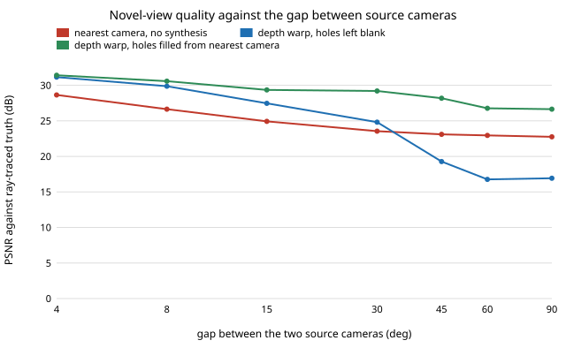

# capture-novelview: how far apart can cameras be before a reel editor can no longer synthesise the angle between them?

Fourth-in-chain follow-up to `capture-rig` (track 13, milestone 3), which counted cameras and depth error but left "the quality of novel views reconstructed between them" undone (its "Next steps"). This project does that half with a real renderer rather than a proxy: a ray-traced scene, two ring cameras, a depth-based warp to the midpoint, and a score against the ray-traced truth. **Headline:** with exact depth, synthesising the view between two neighbours and filling any pixel neither camera saw from the nearest camera beats just cutting to that camera at every gap tested, 4 to 90 degrees (28.2 against 23.1 dB at 45 degrees, 26.6 against 22.8 dB at 90), and still does with a bystander in the shot (26.5 against 21.3 dB at 15 degrees). Holes are what limit it: left blank, they make the warp lose to the cut from about 45 degrees (19.3 against 23.1 dB, with 11% of the target's surface unseen), and from 15 degrees with a bystander. Depth error on the sources costs about 0.5 dB per percent up to 1% and 0.7 dB per percent from 1 to 2% (27.5 dB exact, 22.0 dB at 10%, holes blank). An earlier version reported a crossover near 30 degrees; a [quality audit](../../portfolio/quality/audits/2026-11-17-capture-novelview.json) on 2026-11-17 found it came from leaving holes blank, which no real depth-image renderer does. A toy scene, so read the ordering, not the decibels. Produced with AI assistance (Claude).

**Live page:** https://marisstella.app/research/capture-novelview/

**Builds on.** `capture-rig` (ring layout, 3 m radius, 60 degree lens) and `capture-crop`. Prior work for the idea: Kanade, Rander and Narayanan (1997), Virtualized Reality, *IEEE MultiMedia*, which synthesises views between cameras with depth; Chai, Tong, Chan and Shum (2000), Plenoptic sampling, SIGGRAPH, which derives the camera spacing a light field needs analytically; Fehn (2004), depth-image-based rendering for 3D-TV, SPIE 5291, where filling disocclusion holes is a standard step; and Mildenhall et al. (2020), NeRF, ECCV, and Kerbl et al. (2023), 3D Gaussian splatting, *ACM TOG*, the learned successors. This project implements neither; it uses the simplest depth warp so the *limit* of two-view synthesis is visible. It builds on none of the CU Boulder groups in `prompt.md` and claims no connection to them.

## Method (`src/capture_novelview/`)
- **Scene** (`scene.py`). Analytic ray tracing in numpy: a textured ground plane, a 1.8 m subject cylinder (radius 0.25 m) at the origin and optionally a second cylinder as a bystander (0.9 m, 0.6 m from the subject). 192x128 pixels, 60 degree horizontal FOV, cameras on a 3 m ring at 1.5 m height looking at the subject. Textures are a smooth two-octave hash noise (assumed; real skin, cloth and foliage are harder).
- **Synthesis** (`synth.py`). Forward-warp each source pixel using its depth into the target camera, z-buffer (nearest wins), close one-pixel cracks, take the nearer source first and fill the rest from the other (at the midpoint both are equally near, and the tie goes to the second source). Pixels neither source reaches are **holes**. They are scored two ways: painted sky blue (the worst case), and filled from the nearest camera's own image (`fill_holes`, the simplest fallback a depth-image-based renderer uses).
- **Score.** PSNR of the full synthesised image against the ray-traced truth at the target pose (holes blank, and holes filled), and PSNR over the valid (non-hole) pixels. Hole fraction excludes sky, which has no surface.
- **Baseline.** Use the nearer source camera's image as is (a cut, no synthesis).
- Sources sit at azimuth 20 degrees plus or minus half the gap; the target is the midpoint.

## Reproduce
```bash
pip install pytest numpy
cd research/capture-novelview
python -m pytest -q tests                        # 10 tests
PYTHONPATH=src python experiments/run.py         # about 1 s; writes experiments/results.txt
python experiments/figure.py                     # experiments/baseline.svg from results.txt
```

## Results (from `experiments/results.txt`; deterministic)
A. Exact depth, no bystander (PSNR dB; hole fraction of non-sky target pixels):

| gap | nearest camera | synthesised, holes blank | synthesised, valid pixels only | synthesised, holes filled from nearest camera | holes |
|---|---|---|---|---|---|
| 4 deg | 28.65 | 31.15 | 31.42 | 31.42 | 0.0% |
| 15 deg | 24.93 | 27.46 | 29.43 | 29.35 | 0.7% |
| 30 deg | 23.55 | 24.82 | 29.54 | 29.21 | 2.3% |
| 45 deg | 23.10 | 19.27 | 29.82 | 28.18 | 11.2% |
| 90 deg | 22.75 | 16.92 | 28.33 | 26.64 | 19.1% |

Hole fractions before 2026-11-17 were computed over the whole frame although labelled as non-sky; they now are over non-sky pixels, as labelled.



- **No crossover once holes are filled.** The pixels the warp does reach stay at 28 to 31 dB at every gap; what fails is *coverage*: holes grow from under 1% of the surface at 15 degrees to 19% at 90. Left blank, each hole costs far more than a slightly wrong pixel, and the warp loses to the cut from 45 degrees. Filled from the nearest camera, a hole costs no more than the cut would there, so synthesis wins by 3.9 to 5.1 dB from 30 to 90 degrees. Better fillers (inpainting, a learned prior, a third camera) would add to that; they are not here.
- **Depth error** (gap 15 degrees, 3 seeds): 27.5 dB exact, 27.0 at 1%, 26.0 at 2%, 23.6 at 5%, 22.0 at 10%. Since `capture-rig` puts triangulation error near a millimetre at 3 m, depth quality is limited by feature matching on real footage, not geometry; compare 2 to 5% as a plausible range for monocular or stereo depth in a reel, assumed here.
- **Occlusion.** With a bystander and holes left blank, synthesis falls below the nearest camera from 15 degrees (20.5 against 21.3 dB): the bystander hides a different part of the subject from each camera. Filled from the nearest camera, it stays ahead at every gap (26.5 against 21.3 dB at 15 degrees, 22.1 against 18.6 at 90), with a smaller margin at wide gaps than without the bystander. So occlusion shrinks the gain from synthesis but does not, on this metric, set a camera count. Whether a viewer accepts the filled regions (a ghost of the wrong angle) is a perceptual question PSNR cannot answer.

## Limitations
- **Toy scene, smooth textures, one midpoint target.** PSNR in decibels from this scene does not transfer to real footage; only the ordering (small gaps good, holes growing with the gap, blank holes losing to the cut, occlusion shrinking the gain) is the finding. No lighting change, specular surface, motion, lens distortion, rolling shutter or sync error.
- **Exact depth is oracle depth** except in table B, where noise is relative and independent per pixel (real depth errors are spatially correlated and worse at edges).
- **Simple forward splatting.** NeRF or Gaussian splatting from more than two views would do better at the same gap; this is the floor for two views, not the state of the art.
- One azimuth (20 degrees), one bystander position; the crossover moves with both. Elevation is fixed.

## Next steps
- Replace the oracle depth with depth from `capture-rig`-style stereo triangulation on rendered pairs, so table B's noise is measured, not assumed.
- Compare better hole fillers (inpainting, a learned prior) against the nearest-camera fill, and try three source cameras.
- Score with a perceptual metric or a human rating: PSNR rewards the nearest-camera fill, which a viewer may see as a ghost.
- Run on openly licensed multi-view footage with a real depth model and a human rating of the in-between frames.

## Owner steps
None for this simulation.

## Outside dependencies
numpy and pytest. Nothing else; the scene is analytic.
