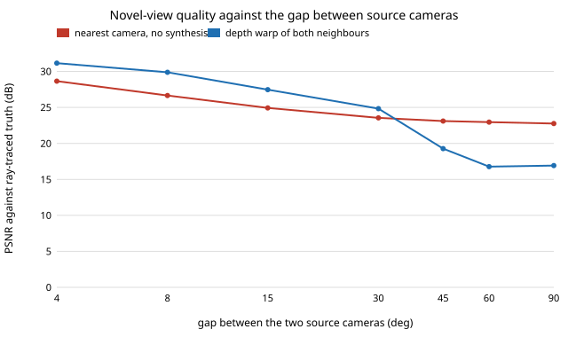

# capture-novelview: how far apart can cameras be before a reel editor can no longer synthesise the angle between them?

Fourth-in-chain follow-up to `capture-rig` (track 13, milestone 3), which counted cameras and depth error but left "the quality of novel views reconstructed between them" undone (its "Next steps"). This project does that half with a real renderer rather than a proxy: a ray-traced scene, two ring cameras, a depth-based warp to the midpoint, and a score against the ray-traced truth. **Headline:** with exact depth, synthesising the view between two neighbours beats just cutting to the nearest camera only up to a gap of about 30 degrees (24.8 dB against 23.6 dB); at 45 degrees it is worse (19.3 against 23.1 dB) because 8% of the target is a hole neither camera saw. A bystander walking into the shot makes it worse sooner: by 15 degrees synthesis is no better than the nearest camera (20.5 against 21.3 dB). Depth error on the sources costs about 1.4 dB per percent at the start (27.5 dB exact, 22.0 dB at 10%). A toy scene, so read the ordering, not the decibels. Produced with AI assistance (Claude).

**Live page:** https://duncan-haywood.github.io/monorepo-projects/research/capture-novelview/

**Builds on.** `capture-rig` (ring layout, 3 m radius, 60 degree lens) and `capture-crop`. Prior work for the idea: Kanade, Rander and Narayanan (1997), Virtualized Reality, *IEEE MultiMedia*, which synthesises views between cameras with depth, and Mildenhall et al. (2020), NeRF, ECCV, and Kerbl et al. (2023), 3D Gaussian splatting, *ACM TOG*, the learned successors. This project implements neither; it uses the simplest depth warp so the *limit* of two-view synthesis is visible. It builds on none of the CU Boulder groups in `prompt.md` and claims no connection to them.

## Method (`src/capture_novelview/`)
- **Scene** (`scene.py`). Analytic ray tracing in numpy: a textured ground plane, a 1.8 m subject cylinder (radius 0.25 m) at the origin and optionally a second cylinder as a bystander (0.9 m, 0.6 m from the subject). 192x128 pixels, 60 degree horizontal FOV, cameras on a 3 m ring at 1.5 m height looking at the subject. Textures are a smooth two-octave hash noise (assumed; real skin, cloth and foliage are harder).
- **Synthesis** (`synth.py`). Forward-warp each source pixel using its depth into the target camera, z-buffer (nearest wins), close one-pixel cracks, take the nearer source first and fill the rest from the other. Pixels neither source reaches are **holes** (painted sky blue, and counted in the score).
- **Score.** PSNR of the full synthesised image against the ray-traced truth at the target pose, and PSNR over the valid (non-hole) pixels. Hole fraction excludes sky, which has no surface.
- **Baseline.** Use the nearer source camera's image as is (a cut, no synthesis).
- Sources sit at azimuth 20 degrees plus or minus half the gap; the target is the midpoint.

## Reproduce
```bash
pip install pytest numpy
cd research/capture-novelview
python -m pytest -q tests                        # 7 tests
PYTHONPATH=src python experiments/run.py         # about 3 s; writes experiments/results.txt
python experiments/figure.py                     # experiments/baseline.svg from results.txt
```

## Results (from `experiments/results.txt`; deterministic)
A. Exact depth, no bystander (PSNR dB; hole fraction of non-sky target pixels):

| gap | nearest camera | synthesised | synthesised, valid pixels only | holes |
|---|---|---|---|---|
| 4 deg | 28.65 | 31.15 | 31.42 | 0.0% |
| 15 deg | 24.93 | 27.46 | 29.43 | 0.5% |
| 30 deg | 23.55 | 24.82 | 29.54 | 1.7% |
| 45 deg | 23.10 | 19.27 | 29.82 | 8.3% |
| 90 deg | 22.75 | 16.92 | 28.33 | 14.1% |



- **Crossover near 30 to 40 degrees.** Where the pixels it fills are good (29 to 30 dB on valid pixels at every gap), synthesis is excellent; what fails is *coverage*: holes grow from under 1% at 15 degrees to 14% at 90, and each hole costs more than a blurry pixel. A hole-filler (inpainting, a learned prior) is what a real editor needs beyond this point, and is not here.
- **Depth error** (gap 15 degrees, 3 seeds): 27.5 dB exact, 27.0 at 1%, 26.0 at 2%, 23.6 at 5%, 22.0 at 10%. Since `capture-rig` puts triangulation error near a millimetre at 3 m, depth quality is limited by feature matching on real footage, not geometry; compare 2 to 5% as a plausible range for monocular or stereo depth in a reel, assumed here.
- **Occlusion.** With a bystander, synthesis is within 0.9 dB of the nearest camera at 15 degrees and below it from there on (18.8 against 19.6 dB at 30 degrees): the bystander hides a different part of the subject from each camera, so the warp has to invent it. That moves the useful gap down to about 10 degrees, i.e. 37 cameras on a full ring, which `capture-kit` says an owner cannot carry. A crowd shrinks the number of angles you can fake.

## Limitations
- **Toy scene, smooth textures, one midpoint target.** PSNR in decibels from this scene does not transfer to real footage; only the ordering (small gaps good, holes at wide gaps, occlusion pulling the crossover in) is the finding. No lighting change, specular surface, motion, lens distortion, rolling shutter or sync error.
- **Exact depth is oracle depth** except in table B, where noise is relative and independent per pixel (real depth errors are spatially correlated and worse at edges).
- **Simple forward splatting.** NeRF or Gaussian splatting from more than two views would do better at the same gap; this is the floor for two views, not the state of the art.
- One azimuth (20 degrees), one bystander position; the crossover moves with both. Elevation is fixed.

## Next steps
- Replace the oracle depth with depth from `capture-rig`-style stereo triangulation on rendered pairs, so table B's noise is measured, not assumed.
- Add a hole filler and see how far it pushes the crossover; try three source cameras.
- Run on openly licensed multi-view footage with a real depth model and a human rating of the in-between frames.

## Owner steps
None for this simulation.

## Outside dependencies
numpy and pytest. Nothing else; the scene is analytic.
