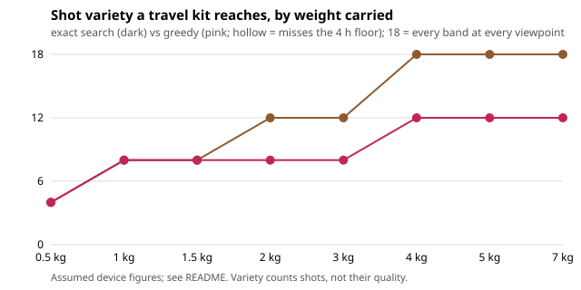

# capture-realkit: does the capture-kit packing result survive real, sourced device weights, energies and runtimes?

Follow-up to `capture-kit` (track 13, autonomous multi-angle capture, `PROJECTS.md` milestone 2), taking its first "Next step" (replace assumed figures with sourced ones) and the owner's 2026-10-21 direction to run and source numbers instead of stylising them. **Headline:** on a catalogue of real devices, exact search with a 4 h recording floor reaches all 18 focal-band x viewpoint shots at 4 kg (the assumed catalogue needed 5 kg), and a greedy best-gain-per-gram packer stalls at 12, so the lens-needs-a-body result survives. The exact figure does not survive the inputs no source gave: sweeping them by +-30% moves the 4 kg result anywhere from 8 to 18 shots.

**Live page:** https://duncan-haywood.github.io/monorepo-projects/research/capture-realkit/

**Builds on.** `capture-kit` (model copied so the project is self-contained) and `capture-crop` (a 360 camera covers 14 to 24 mm-equivalent). Battery rule: 100 Wh per battery in carry-on (FAA PackSafe, checked 2026-10-19). It builds on none of the CU Boulder groups in `prompt.md` and claims no connection to them. Produced with AI assistance (Claude).

## Method (`src/capture_realkit/model.py`, `experiments/run.py`)
Same search as `capture-kit`: variety = bands covered x viewpoints, hours = carried Wh over the draw of the cameras running at once, exact search over all 11,520 kits (6,912 legal) against greedy. Only the catalogue changed: Insta360 X4, DJI Osmo Action 4, iPhone 15 Pro Max, Sony a7C II body, three Sony lenses, Peak Design carbon travel tripod and two Anker banks, plus three generic mounts and an illustrative 160 Wh pack that the legality filter must reject. `SOURCES` in the model gives each figure's source, read 2026-10-21 by web fetch and search; `results.txt` section E repeats them.

| Figure | Value | Source | Status |
|---|---|---|---|
| X4 weight, battery, runtime | 203 g, 2290 mAh, 135 min (5.7K30 lab) | Insta360 listings via retailers | sourced; Wh and draw derived (3.85 V assumed) |
| Osmo Action 4 | 145 g, 6.8 Wh, 160 min (1080p24) | DJI spec page | sourced; draw derived |
| iPhone 15 Pro Max | 221 g, 4441 mAh | Apple, Smartprix (Swappa says 4422) | sourced; **recording draw 4 W assumed** (Apple gives playback only) |
| Sony a7C II | 514 g with battery, 16.4 Wh, ~100 min video | retailer listings, NP-FZ100 rating | weight sourced; runtime unverified (not Sony's page) |
| 24-70 GM II, 70-200 f/4 G II, 85 f/1.8 | 695, 794, 371 g | Wikipedia, The Digital Picture, Camera Decision (one source) | sourced |
| Peak Design carbon tripod | 1270 g | Leica Store Miami, Robert's Camera | sourced |
| Anker Prime 20K, 737 | 72 Wh/540 g, 88.8 Wh/630 g | Galaxus, Currys, Digitec | sourced |
| selfie pole, mini tripod, mast | 200, 150, 1200 g | none | **assumed** |

## Reproduce
```bash
pip install pytest
cd research/capture-realkit
python -m pytest -q tests                        # 8 tests
PYTHONPATH=src python experiments/run.py         # about a minute; writes experiments/results.txt
python experiments/figure.py                     # experiments/kit.svg from results.txt
```

## Results (from `experiments/results.txt`; deterministic)
Variety with a 4 h floor, sourced catalogue against the assumed one:

| budget | exact (real) | greedy (real) | exact (capture-kit, assumed) |
|---|---|---|---|
| 1.0 kg | 8 | 8 | 8 |
| 2.0 kg | 12 | 8 | 10 |
| 3.0 kg | 12 | 8 | 12 |
| 4.0 kg | 18 | 12 | 15 |
| 5.0 kg | 18 | 12 | 18 |



- The 4 kg kit is iPhone, a7C II, 24-70 and 85 prime, pole, mini tripod, mast and one 88.8 Wh bank. The phone's 120 mm-equivalent lens (snapped to the 135 band) covers the long end that cost the assumed catalogue a 1.1 kg zoom.
- Greedy picks the phone, two mounts and banks and never the body, so it stops at 12; it also never fails the 4 h floor here (the real banks are large), unlike the assumed run at 2 kg.
- No pack over 100 Wh is chosen (tested).
- **Sweep of the unsourced figures** (100 draws within +-30% of the phone draw and the three generic mount masses and the 160 Wh pack mass): greedy is below exact in 77 to 99% of draws from 1.5 kg up, so the structural result holds. The exact variety equals the base value in only 0 to 53% of draws from 1 kg up (4 kg: 3%; range 8 to 18), because a 30% change in a 150 to 1200 g mount decides whether a lens still fits. The budget at which all 18 shots become reachable is therefore not a finding of this project.

## Limitations
- Unsourced, listed above: the three generic mount masses, the iPhone recording draw, cell voltages used to turn mAh into Wh, which bands each device covers, and the viewpoint each mount gives. Several sources are retailer pages, not manufacturers; the Sony and Insta360 manufacturer pages blocked this environment.
- Runtimes are lab figures in one mode; real draw depends on resolution, temperature and use. Cameras still move between mounts, so simultaneous shots need more cameras than counted.
- The sweep is uniform on +-30%, a choice, not a measured spread.

## Next steps
- Weigh actual mounts (a person with a scale, minutes) and replace the three assumed masses; that removes the sweep's main driver.
- Bench-measure the phone's recording draw and the a7C II's real runtime.
- Couple with `capture-storage`: choose cameras and storage under one weight and offload budget.
