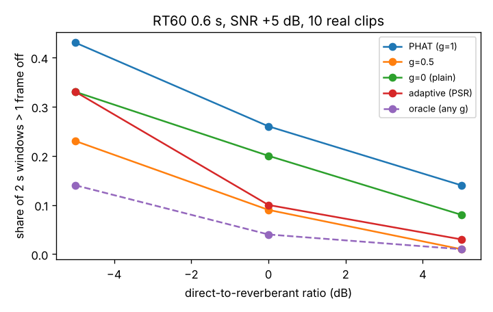

# capture-reverbsync: in a reverberant room, does PHAT win after all, and can the whitening exponent be chosen per window?

Track 13 (autonomous multi-angle capture), the first two "Next steps" of `capture-realaudio`. That project found that partial whitening (GCC weight 1/|C|^gamma, gamma 0.25) beat PHAT on real clips, but it had no reverb, the one case where PHAT is expected to win. **Headline:** it does not win here either. Over 10 real clips in 10 simulated rooms (RT60 0 to 1.0 s, direct-to-reverberant ratio +5 to -5 dB) and two SNRs (-5, +5 dB), PHAT (gamma 1) is the worst fixed weighting in 19 of 20 cells. Example, RT60 0.6 s, DRR 0 dB, SNR +5 dB: PHAT fails 0.26 of 2 s windows (more than one 30 fps frame off), gamma 0.5 fails 0.09, plain correlation 0.20. Picking gamma per window by peak-to-sidelobe ratio (PSR, no ground truth) beats PHAT in all 20 cells but is never better than the best fixed gamma (0.25 to 0.5), and an oracle that picks the best gamma per window would roughly halve the failures again. Produced with AI assistance (Claude).

**Live page:** https://duncan-haywood.github.io/oss-monorepo/research/capture-reverbsync/



**Builds on.** `capture-realaudio` (clips, noise, `gcc_gamma` weighting; imported) and `capture-audiosync`. PHAT's reverberation robustness is from Knapp and Carter (1976), *IEEE Trans. ASSP* 24(4), and the statistical late-reverb model (exponentially decaying Gaussian tail) from Schroeder (1962/1965) and Polack (1993). No CU Boulder group in `prompt.md` covers this and none is claimed.

## What is and is not real
Real: the 10 source clips (LibreOffice gallery sounds, read from the system at run time, not copied; the same ones as `capture-realaudio`). Simulated: the delay (FFT phase ramp), the noise (white), and the rooms. Each camera gets its own impulse response, a unit direct path plus an exponentially decaying Gaussian tail starting at 5 ms (60 dB decay in RT60), scaled to the stated DRR. No measured room impulse response is used, so this is a model of reverberation, not a room measurement.

| input | value | source |
|---|---|---|
| RT60 | 0 (dry), 0.3, 0.6, 1.0 s | sweep covering a small furnished room to a hall; not tied to one site |
| DRR | +5, 0, -5 dB | sweep; these span positions near to beyond the critical distance |
| SNR | -5, +5 dB (reverberant signal over noise) | sweep |
| Window / delay / "bad" | 2 s / U[0.2, 0.8] s / more than 33 ms | as `capture-realaudio` |
| Trials | 20 per clip per cell (200 per cell), windows from a clip overlap | |
| Gammas | 1, 0.75, 0.5, 0.25, 0 | as `capture-realaudio` |

## Method (`src/capture_reverbsync/reverb.py`)
`reverb_pair` builds the two noisy reverberant windows; every method sees the same pair (paired comparison). `adaptive_estimate` computes the correlation curve for each gamma, scores each by PSR (peak over the largest value more than 2 ms from the peak) and returns the delay of the highest-scoring curve. The `oracle` column counts a window as failed only if every gamma failed, an upper bound on any selector, not an achievable method.

## Reproduce
```bash
pip install pytest numpy matplotlib
cd research/capture-reverbsync
python -m pytest -q tests                                              # 7 tests
PYTHONPATH=src:../capture-realaudio/src:../capture-audiosync/src python experiments/run.py   # about 3 min; writes results.txt
python experiments/figure.py
```

## Results (from `experiments/results.txt`)
Share of windows more than one frame off (rows are a selection; the file has all 20):

| RT60 (s) | DRR (dB) | SNR (dB) | PHAT | 0.5 | 0.25 | plain | PSR-adaptive | oracle |
|---|---|---|---|---|---|---|---|---|
| 0 | - | -5 | 0.41 | 0.17 | 0.10 | 0.07 | 0.14 | 0.05 |
| 0.3 | 0 | 5 | 0.28 | 0.08 | 0.10 | 0.18 | 0.14 | 0.04 |
| 0.6 | 0 | 5 | 0.26 | 0.09 | 0.10 | 0.20 | 0.10 | 0.04 |
| 0.6 | -5 | -5 | 0.74 | 0.49 | 0.43 | 0.47 | 0.53 | 0.35 |
| 1.0 | -5 | 5 | 0.45 | 0.31 | 0.37 | 0.46 | 0.33 | 0.18 |

- **PHAT almost never wins.** Reverberation raises every method's failure share, but the ranking from the dry case holds. The expected PHAT advantage appears only in one way: **plain correlation degrades faster with reverb than gamma 0.25 to 0.5**. At SNR +5 dB and DRR 0 dB it goes from 0.03 (dry) to 0.18 to 0.22, while gamma 0.5 goes from 0.01 to 0.08 to 0.09. The best fixed gamma shifts from 0.25 (dry, low SNR) to 0.5 (reverberant, high SNR), so about 0.5 is a defensible default.
- **PSR selection is a partial win.** It beats PHAT in every cell but is never better than the best fixed gamma (by 0.01 to 0.12) (for example 0.39 vs 0.30 at RT60 0.6, DRR 0, SNR -5). It does best at the high SNR, high DRR end and at RT60 1.0 / DRR -5 / SNR +5 (0.33, level with the best fixed 0.31). Its sidelobe score likely favours curves with sharp but wrong peaks; I did not test why.
- **A large gap to the oracle remains** (0.09 for the best fixed weight vs 0.04 for the oracle at RT60 0.6, DRR 0, SNR +5), so a better selector (for example a consistency check across neighbouring windows) has room to help.

## Limitations
Statistical rooms, not measured impulse responses; one tail model for both cameras with independent draws (real cameras in one room share much of the reverberant field); white noise only; 10 sound-effect clips; overlapping windows within a clip; 200 trials per cell so shares carry about +/-0.03 sampling noise; the PSR exclusion width (2 ms) was not tuned. Only the per-window estimate is tested.

## Next steps
- Measured impulse responses (an open IR set) instead of the statistical tail.
- A selector that uses agreement across consecutive windows, not PSR of one window.
- Real two-camera recordings from the owner (clap test; see `capture-audiosync`).

## Owner steps
Share a short two-camera clip pair from one real room, with a clap at the start.

## Outside dependencies
Python, NumPy, matplotlib (figure only), pytest, `capture-realaudio` and `capture-audiosync` (imported), and the LibreOffice gallery sounds on the machine that runs it.
