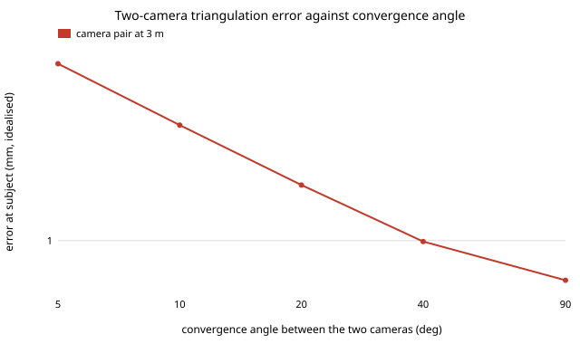

# capture-rig: how many cameras, and where, to film a person from every angle?

Third project of track 13, autonomous multi-angle capture (`PROJECTS.md`, milestone 3). In a 2-D geometric model it places N cameras on a full ring or a 90 degree front arc around a subject 3 m away and scores angle coverage and triangulation (stereo depth) error. **Headline:** the number of cameras buys *angle coverage*, the angle between them buys *depth accuracy*. Coverage costs a lot: a gap of 30 degrees between neighbours needs 13 cameras, 15 degrees needs 25. Depth error barely moves with N (a full ring of 3 gives 0.52 mm, 16 gives 0.23 mm) but falls 11x as a pair's convergence angle goes from 5 to 90 degrees (7.3 mm to 0.64 mm). A tripod bar of cameras a hand apart is a poor stereo rig for a subject 3 m away. Idealised lower bounds, not image quality. Produced with AI assistance (Claude).

**Live page:** https://duncan-haywood.github.io/monorepo-projects/research/capture-rig/

**Builds on.** `capture-crop` (milestone 1: pixel and perspective limits) and `capture-kit` (milestone 2: weight and battery budget). Prior work for the idea: Kanade, Rander and Narayanan (1997), Virtualized Reality, *IEEE MultiMedia*, and Joo et al. (2015), the Panoptic Studio, ICCV, which surround a subject with many cameras. This project does not reproduce either. It builds on none of the CU Boulder groups in `prompt.md` and claims no connection to them.

## Method (`src/capture_rig/model.py`)
- **Layout.** Cameras sit on a circle of radius R = 3 m (assumed) and look at the subject at the origin; a full ring or an arc.
- **Depth error.** Each camera gives a bearing with angular noise `sigma_px / f_px` (0.5 px, 60 degree vertical FOV, 3,840 px long side, all assumed), i.e. a lateral error `sigma_a z` across its ray. Information from all rays adds (weighted least squares) and the covariance of the triangulated point is the inverse; the reported number is `sqrt(trace)`. Two opposite cameras are degenerate (collinear rays) and print `n/a`.
- **Angle coverage.** Largest azimuth gap between neighbours, and the mean angle from a random wanted viewing direction to the nearest camera (a quarter of the gap for an even ring).
- **Pixels.** Pixels covering the 1.8 m subject at distance R, and whether the subject fits the frame.

## Reproduce
```bash
pip install pytest
cd research/capture-rig
python -m pytest -q tests                        # 8 tests
PYTHONPATH=src python experiments/run.py         # instant; writes experiments/results.txt
python experiments/figure.py                     # experiments/baseline.svg from results.txt
```

## Results (from `experiments/results.txt`; deterministic)
Centre error in mm, 3 m, 60 degree FOV:

| N | full ring: gap | full ring: mean miss | full ring: error | 90 degree arc: error |
|---|---|---|---|---|
| 3 | 120 deg | 30 deg | 0.52 | 0.55 |
| 4 | 90 deg | 22.5 deg | 0.45 | 0.50 |
| 8 | 45 deg | 11.25 deg | 0.32 | 0.38 |
| 16 | 22.5 deg | 5.6 deg | 0.23 | (n/a) |



- **Coverage is expensive.** Gaps of 30, 20, 15 and 10 degrees need 13, 19, 25 and 37 cameras on a ring. At the action-camera class in `capture-kit` that is a rig an owner cannot carry, so a reel editor has to synthesise between views or accept a coarse choice of angle.
- **Depth accuracy comes from baseline, not count.** A pair converging 5 degrees (0.26 m apart at 3 m) has 7.3 mm error; 40 degrees 0.99 mm; 90 degrees 0.64 mm. Four cameras on a 90 degree front arc are within 11% of four on a full ring.
- **Lens trade.** A tighter lens lowers error and raises pixels on the subject but stops fitting it: at 3 m a 30 degree vertical FOV gives 0.21 mm and 4,299 px but cuts the subject off; 120 degrees gives 1.35 mm and 665 px.
- Error is linear in distance at a fixed convergence angle (tested), so a follow robot that holds 3 m instead of 6 m halves it.

## Limitations
- **2-D geometry only.** No occlusion (the subject hides the far side from a front arc's cameras and from each other), no height, no moving subject, no lens distortion or rolling shutter, no synchronisation error.
- **Matching noise is assumed** (0.5 px). Real feature matching on skin, clothes and moving backgrounds is worse, so the millimetre figures are lower bounds and only the *ratios* between layouts carry information.
- **Novel-view quality is not modelled.** The milestone also asks for the quality of views reconstructed between cameras; that needs a renderer (NeRF or Gaussian splatting on real or synthetic images) and is not done here. Mean angular miss to the nearest camera is only a geometric proxy.
- Radius, FOV, sensor size and subject height are assumptions, not measurements.

## Next steps
- Add a renderer and score reconstructed novel views between adjacent cameras against their gap (the missing half of milestone 3).
- Add occlusion by the subject and by bystanders, and a mast stack (vertical baseline) layout.
- `capture-follow` (milestone 4): the platform that holds the distance and the rig.

## Outside dependencies
None. Python standard library only; pytest for the tests.
