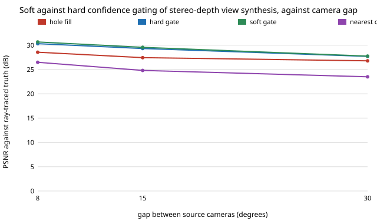

# capture-softgate: does a soft confidence weight beat a hard switch, and does stereo matching cost help?

Follow-up to `capture-hybrid` (track 13), whose "Next steps" asked to soften the gate and to try the matcher's cost as a second confidence signal. **Headline:** replacing the hard "use the nearest camera where the two warps disagree" switch with a weight that ramps from 0 to 1 gains 0.1 to 0.5 dB in every one of the 11 conditions tried (29.3 to 29.5 dB at a 15 degree gap on held-out seeds, 26.5 to 26.7 with a bystander) and cuts false edges (seams) by about a quarter, 0.0087 to 0.0067 grey levels per pixel. It closes about 0.25 dB of the 2.6 dB gap to a per-pixel oracle, so most of the headroom stays. The stereo matching cost is a worse confidence signal than the disagreement of the two warps: gating on it scores 27.6 dB, no better than hole filling (27.3), and it hurts under a bystander (24.5 dB against 26.2 for filling). A toy scene: read the ordering, not the decibels. Produced with AI assistance (Claude).

**Live page:** https://duncan-haywood.github.io/monorepo-projects/research/capture-softgate/

**Builds on.** `capture-hybrid` (scene, matcher, warp, hole fill and hard gate, copied here so the project is self-contained). The matcher now also returns its window cost. Soft blending of view-synthesis sources by a confidence weight is standard in image-based rendering; this tests it on one toy scene. It builds on none of the CU Boulder groups in `prompt.md` and claims no connection to them.

## Method (`src/capture_softgate/hybrid.py`)
Two sources at azimuth 20 degrees plus or minus half the gap, each with a rectified stereo partner (baseline 0.2 m, 1% sensor noise unless stated). Both are warped to the target pose; holes always take the raw nearest camera. Strategies differ in how much of the raw nearest camera `w` enters each pixel (output = `w`·nearest + (1−`w`)·synthesis):
- **hard**: `w` = 1 where the summed absolute RGB difference of the two warps exceeds `tau`, grown one pixel (`capture-hybrid`'s gate).
- **soft**: `w` = ramp from 0 at difference `t0` to 1 at `t1`, grown one pixel by a max filter, then smoothed by a 3×3 mean.
- **cost**: hard gate where the worse of the two warped pixels' stereo matching cost (window-mean colour difference at the chosen disparity) exceeds `ct`.
- **softcost**: the larger of the soft weight and the cost gate.
- **fill** (background row fill) and **oracle** (per pixel the better of synthesis and raw nearest, using ground truth) for reference.
Scored by PSNR against the ray-traced midpoint view, mean of 3 noise seeds, and by a seam score: mean gradient magnitude of the output minus that of the truth (false edges raise it).

**Parameter selection.** `tau`, `(t0, t1)` and `ct` are each picked as the best of a short sweep on development seeds 0 to 2 at a 15 degree gap with no bystander (section A of `results.txt`), then frozen for every other section, including held-out seeds 7 to 9. The soft gate got a larger sweep (5 settings, two parameters) than the hard gate (4 settings, one), which favours it slightly.

## Reproduce
```bash
pip install pytest numpy
cd research/capture-softgate
python -m pytest -q tests                        # 7 tests
PYTHONPATH=src python experiments/run.py         # writes experiments/results.txt (about 2 minutes)
python experiments/figure.py                     # experiments/gap.svg from results.txt
```

## Results (from `experiments/results.txt`; deterministic)
Chosen: `tau` 0.5, `(t0, t1)` = (0.15, 0.5), `ct` 0.1. PSNR dB:

| condition | fill | hard | soft | cost | softcost | oracle | nearest camera |
|---|---|---|---|---|---|---|---|
| gap 8 deg | 28.6 | 30.3 | 30.7 | 28.4 | 30.4 | 32.6 | 26.5 |
| gap 15 deg | 27.4 | 29.3 | 29.6 | 27.6 | 29.3 | 31.9 | 24.8 |
| gap 30 deg | 26.8 | 27.7 | 27.8 | 26.6 | 27.4 | 29.8 | 23.5 |
| held out (7 to 9) | 27.3 | 29.3 | 29.5 | 27.6 | 29.3 | 31.9 | 24.8 |
| held out, bystander | 26.2 | 26.5 | 26.7 | 24.5 | 24.9 | 28.2 | 21.6 |



- **Soft beats hard everywhere, by a small margin.** Soft is ahead of hard in all 11 rows of sections B to E (gap, held-out, bystander, noise), by 0.1 to 0.5 dB; the held-out gain at 15 degrees is 0.25 dB without and 0.20 dB with a bystander. Small, but it never reversed.
- **It also removes seams.** Seam score on held-out seeds: hard 0.0087 (0.0095 with a bystander), soft 0.0067 (0.0072), the truth being 0 by construction and the raw nearest camera 0.0070 (0.0066). A soft weight leaves about as many false edges as the nearest camera alone (a little fewer without a bystander, a little more with one); the hard switch leaves about a quarter more than soft.
- **The bystander still erases most of the gate's advantage.** With a bystander the gate family is only 0.3 to 0.5 dB above plain filling (26.7 against 26.2 held out), and at a 30 degree gap hard (23.9) and soft (24.0) are both below filling (24.5), so softening does not cure the failure `capture-hybrid` found: occlusions make correct pixels disagree.
- **Matching cost is a poor second signal here.** Gating on cost scores 27.6 dB at 15 degrees, about level with filling (27.4), and about 2 dB below filling under a bystander or 3% sensor noise (24.5 against 26.2; 24.1 against 25.8). Combining it with the soft weight is no better than soft alone without noise (29.3 against 29.6) and much worse with noise. A low cost does not mean a correct depth in this scene's smooth textures (a wrong disparity in a flat patch matches well), and noise raises cost everywhere so a global threshold cuts good pixels.
- **Headroom** (oracle 31.9 dB): the soft gate closes 0.25 of the 2.6 dB between the hard gate and the oracle, about a tenth. A better signal than colour agreement or window cost is needed for the rest.

## Limitations
- **Toy scene**: one analytic ground plane and cylinder, one target azimuth, three noise seeds per cell; no lighting change, specularity, motion blur or calibration error. Absolute decibels do not transfer, and the 0.1 to 0.5 dB gain is small enough that a different scene could remove it.
- **Parameters are tuned on this scene's development seeds**, with a modest sweep; the held-out seeds share the scene, so they test noise, not generalisation. The soft gate had more settings tried than the hard one.
- **PSNR and the seam score are proxies.** No human rated the frames; the seam score is a global gradient statistic, not a seam detector, and the differences (0.002 grey levels) are small in absolute terms.
- **A 1990s matcher** and a global cost threshold; a learned confidence or a per-region threshold could use cost better.
- The oracle here sends holes to the raw nearest camera; `capture-hybrid`'s left them empty, so oracle numbers differ from that project's by about 0.1 dB.

## Next steps
- Predict the per-pixel weight rather than hand-ramping it: fit a small regressor on disagreement, cost, local texture and depth discontinuity features over many generated scenes, and test it on unseen scenes to see how much of the 2.6 dB it recovers.
- Treat bystander occlusion explicitly, for example by checking disagreement after warping each source with the other's depth, so a correct pixel hidden from one source is not discarded.
- Run a real open depth model on openly licensed multi-view footage and have people rate the in-between frames.

## Owner steps
None for this simulation.

## Outside dependencies
numpy and pytest. Nothing else; the scene is analytic.
