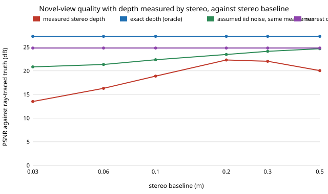

# capture-stereodepth: is the depth a camera rig can actually measure good enough to synthesise the angle between two cameras?

Follow-up to `capture-novelview` (track 13), whose first "Next step" was to replace its oracle and assumed depth noise with depth that is measured. It matters because `capture-novelview` found synthesis helps only if depth is within a few percent, and guessed 2 to 5% was plausible for stereo. **Headline:** with classic block-matching stereo on a rendered rectified pair, mean depth error falls from 14.9% at a 3 cm baseline to 2.7% at 50 cm, but coverage (the share of surface pixels that get a depth) peaks at 91% near 20 cm, and the synthesised in-between view at a 15 degree gap never beats cutting to the nearest camera: best 22.3 dB (20 cm baseline) against 24.8 dB, with exact depth at 27.3 dB. The assumed model (independent noise with the same mean error) is optimistic by 1 to 7 dB, because stereo errors are correlated and missing depth leaves holes. A toy scene: read the ordering, not the decibels. Produced with AI assistance (Claude).

**Live page:** https://duncan-haywood.github.io/oss-monorepo/research/capture-stereodepth/

**Builds on.** `capture-novelview` (scene, warp and score, copied here so the project is self-contained; the only changes are a rectified `stereo_pair`, sensor noise and a pose-based `render_pose`) and `capture-rig` (triangulation geometry). Stereo matching after Scharstein and Szeliski (2002), "A taxonomy and evaluation of dense two-frame stereo correspondence algorithms", *International Journal of Computer Vision*; the left-right consistency check is the standard occlusion test from the same literature. It builds on none of the CU Boulder groups in `prompt.md` and claims no connection to them.

## Method (`src/capture_stereodepth/`)
- **Scene** (`scene.py`). As `capture-novelview`: analytic ray-traced textured ground, a 1.8 m subject cylinder, optional bystander, 192x128 px, 60 degree FOV, ring at 3 m. New: `stereo_pair` renders the ring camera and a copy shifted by the baseline along its right axis (parallel axes, so disparity = F x baseline / z), with optional per-channel Gaussian sensor noise (assumed).
- **Stereo** (`stereo.py`). Window (7x7) sum of absolute colour differences over disparities 0 to 48, winner-take-all, parabola sub-pixel refinement, then a left-right check (the right image's best match must point back within 1 px). Pixels failing the check, or with disparity under 1 px (too far to measure, treated as background), get no depth and become holes in the warp.
- **Synthesis and score.** `capture-novelview`'s depth warp and PSNR against the ray-traced midpoint view; sources at azimuth 20 degrees plus or minus half the gap. Three depths are compared at the same gap: measured, exact, and independent relative noise with the same mean absolute error (the assumed model of `capture-novelview` table B).
- Averaged over 3 sensor-noise seeds.

## Reproduce
```bash
pip install pytest numpy
cd research/capture-stereodepth
python -m pytest -q tests                        # 7 tests
PYTHONPATH=src python experiments/run.py         # about 10 s; writes experiments/results.txt
python experiments/figure.py                     # experiments/baseline.svg from results.txt
```

## Results (from `experiments/results.txt`; deterministic)
A. Stereo baseline, gap 15 degrees, sensor noise 1%, no bystander (PSNR dB):

| baseline | coverage | mean depth error | measured | exact | iid, same error | nearest camera |
|---|---|---|---|---|---|---|
| 3 cm | 55% | 14.9% | 13.5 | 27.3 | 20.8 | 24.8 |
| 6 cm | 79% | 10.7% | 16.3 | 27.3 | 21.3 | 24.8 |
| 10 cm | 87% | 6.9% | 18.9 | 27.3 | 22.3 | 24.8 |
| 20 cm | 91% | 4.3% | 22.3 | 27.3 | 23.5 | 24.8 |
| 30 cm | 88% | 3.3% | 22.0 | 27.3 | 24.1 | 24.8 |
| 50 cm | 82% | 2.7% | 20.0 | 27.3 | 24.7 | 24.8 |



- **Error falls with baseline, coverage does not.** A longer baseline lowers depth error (the median goes from 9.8% to 1.5%) but widens the occluded strip and the search range, so more pixels fail the check. The best synthesis sits at 20 to 30 cm, where the two curves cross, and the estimate is still 2.5 dB below cutting to the nearest camera. The 2 to 5% that `capture-novelview` called plausible is reached, but only on the pixels that survive.
- **The assumed noise model is optimistic.** Independent noise with the same mean error scores 1.2 to 7.3 dB better than measured depth at every baseline. Measured errors cluster at depth edges and in low-texture ground, and a pixel with no depth is a hole, which costs more than a blurry pixel (`capture-novelview`).
- **Sensor noise** (B, baseline 20 cm): mean depth error 2.9% with a clean image, 4.3% at 1% noise, 7.8% at 3%, 18.5% at 6%; coverage falls from 93% to 65%; the synthesised view drops from 23.7 to 15.4 dB. Low-light footage is where this breaks first.
- **Bystander** (C, 20 cm, 1% noise): at 8 degrees the measured result is 19.7 dB against 22.8 dB for the nearest camera and 27.5 exact; at 15 and 30 degrees it is 3 to 4 dB below the nearest camera.

## Limitations
- **Toy scene.** Smooth two-octave textures (a fair case for matching, not the worst), no lighting change, specular surfaces, motion blur, lens distortion, sync error or rolling shutter. Absolute decibels do not transfer; the ordering (error vs coverage, iid optimism) is the finding.
- **A 1990s matcher.** Window SAD with a left-right check. Semi-global matching, a learned depth model or a hole filler would raise every number; this is the floor for "measure depth from a rectified pair", not the state of the art.
- **Rectified, ideal pairs.** A real rig needs calibration and rectification; error there is not modelled. Each ring camera is given its own stereo partner 3 to 50 cm beside it, which on the owner's rig means either a second lens per camera or a pair at each position (compare `capture-kit` weight).
- One azimuth, one bystander position, 3 noise seeds, image noise independent per channel and pixel.

## Next steps
- Add a hole filler and semi-global matching and see how much of the 2.5 dB gap closes; try three source cameras.
- Run a real open depth model on openly licensed multi-view footage and have people rate the in-between frames.
- Use the left-right mask as a confidence map: fall back to the nearest camera in low-confidence regions.

## Owner steps
None for this simulation.

## Outside dependencies
numpy and pytest. Nothing else; the scene is analytic.
