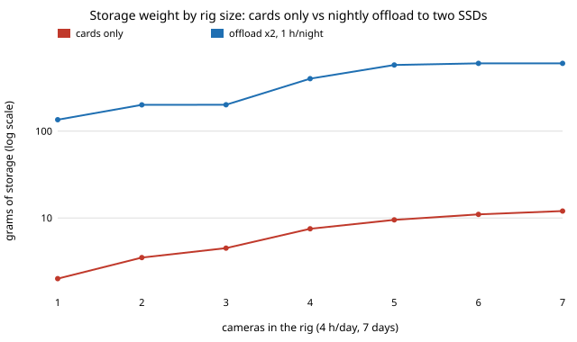

# capture-storage: how much footage does a multi-camera travel kit produce, and what limits carrying and backing it up?

Follow-up to `capture-kit` (track 13, autonomous multi-angle capture), which budgeted weight and battery but not the footage. **Headline:** a four-camera rig recording 4 h a day each makes about 860 GB a day (6 TB over a week). The cards for that, as one copy, weigh about 8 g; per recording hour a camera's battery is 440 to 980 times heavier than its card. So storage *weight* is not the constraint. The evening is: copying one day to a single SSD from one card reader takes 2.7 h, so a safe plan (two SSD copies, offload done in 1 h, each card read once by one reader and written to both SSDs as it passes) needs 4 readers, 5 cards and 4 SSDs, about 400 g, and half an hour is infeasible (one 216 GB card alone takes 0.67 h). Reading the cards once per copy instead makes no rig of 1 to 8 cameras fit the hour. Halving the bitrate shrinks the plan from 402 g to 202 g. Carrying only cards instead leaves all 6 TB in one copy on tiny cards that can be lost. Every device figure is assumed (see Limitations). Produced with AI assistance (Claude).

**Fixed 2026-11-18 (quality audit 2026-11-17, high; [audit file](../../portfolio/quality/audits/2026-11-17-capture-storage.json)).** The first version's `offload()` split a day's footage evenly over any number of readers, but a card can be read by only one reader at a time, so every plan it reported used more readers than cards (one 360 camera: 1 card, 2 readers) and the old headline, 6 readers and 452 g, was not a kit anyone could pack. The model now schedules whole cards onto readers (largest first, never more readers than cards), floors the evening by one SSD taking the whole day at an assumed 400 MB/s, and reads each card once while writing both copies, as multi-destination offload tools do (`reads="per-copy"` keeps the old two-pass model for comparison: under it nothing fits 1 h). Every table below was regenerated. The structural finding (copy time binds, card weight does not) is unchanged.

**Live page:** https://marisstella.app/research/capture-storage/

**Builds on.** `capture-kit` (the cameras, their draw in watts and the 99 Wh pack it carries). Data rates are simple arithmetic from assumed bitrates. It builds on none of the CU Boulder groups in `prompt.md` and claims no connection to them. Why a new question rather than another variant: milestones 1 to 6 of the track are done, and none of the projects counts the footage itself.

## Method (`src/capture_storage/model.py`)
- **Data.** Rate in GB per hour = Mbit/s x 3600 / 8 / 1000, at four assumed bitrates (60 to 200 Mbit/s); a day's data = sum over cameras of rate x hours x a codec scale.
- **Cards only.** Enough 512 GB cards for the whole trip, one copy (10% headroom).
- **Nightly offload.** One day of cards per camera (as few as hold its day with 10% headroom, the day split evenly over them), copied each evening onto `copies` SSDs that hold the whole trip. A card is read by one reader at a time: cards go largest first onto the least-busy reader (LPT, a schedule a person can follow, within 4/3 of the best one), so readers never outnumber cards. Each card is read once and written to every copy as it passes; the evening is the card schedule or, if longer, one SSD absorbing the day at 400 MB/s (assumed). `reads="per-copy"` models a full pass of the cards per copy, `spare=k` gives each camera k extra cards swapped at even intervals. Exact search over card size (3), SSD size (3) and 1 to 8 readers (90 MB/s each, assumed), lightest plan whose evening copy fits the time limit. Exposure = footage held in one copy at the worst moment (one day, before tonight's copy).
- **Battery comparison.** Grams of the 99 Wh pack (700 g) a camera uses per recording hour, against grams of 512 GB card per hour.

## Reproduce
```bash
pip install pytest
cd research/capture-storage
python -m pytest -q tests                        # 21 tests
PYTHONPATH=src python experiments/run.py         # under a second; writes experiments/results.txt
PYTHONPATH=src python experiments/sourced.py     # about 10 s; writes experiments/sourced_results.txt
python experiments/figure.py                     # experiments/offload_vs_cards.svg from results.txt
```

## Results (from `experiments/results.txt`; deterministic)
4 h a day, 7 days, two SSD copies (each card read once), offload within 1 h:

| cameras | day (GB) | cards only (g) | offload plan (g) | readers | SSDs | evening copy (h) |
|---|---|---|---|---|---|---|
| 1 | 216 | 2.0 | 135 | 1 | 2 | 0.67 |
| 2 | 396 | 3.5 | 201 | 2 | 2 | 0.67 |
| 4 | 864 | 7.5 | 402 | 4 | 4 | 0.89 |
| 6 | 1,260 | 11.0 | 603 | 6 | 6 | 0.89 |
| 7 | 1,368 | 12.0 | 603 | 6 | 6 | 0.95 |
| 8 | 1,728 | 15.0 | infeasible within 8 readers | | | |



- **Card weight is negligible.** Cards cost 0.03 to 0.10 g per recording hour; the 99 Wh pack costs 28 to 42 g per hour of the same camera (ratio 439 to 975).
- **Offload time binds.** For the 4-camera rig, one reader and one copy takes 0.67 h per hour filmed per day: 2.7 h at 4 h/day and 5.3 h at 8 h/day.
- **The time limit sets the weight.** Allowing 2 h instead of 1 h drops the plan from 402 g to 352 g (2 readers), 3 h to 327 g (1 reader); 0.5 h is infeasible, because the 360 camera's single 216 GB card takes 0.67 h on its own and one SSD takes 0.6 h to absorb 864 GB.
- **How the copy is done matters more than the gear.** Reading every card once per SSD copy (`results.txt` F) fits no rig of 1 to 8 cameras in 1 h. Reading once and writing both copies fits up to 7 cameras. Carrying one spare card per camera and swapping at mid-day splits the biggest loads and saves a reader: 379 g and 3 readers for the 4-camera rig, 556 g and 4 readers for 6 cameras.
- **Bitrate is the lever.** Scaling bitrates by 0.5 cuts the 1-hour plan to 202 g (2 readers) and 0.25 to 137 g (1 reader); 1.5 needs 5 readers and 578 g.
- **What the weight buys.** Cards only holds 6 TB in one copy (864 GB exposed is the offload plan's worst case); two SSD copies cost about 54 times the grams (402 g against 7.5 g) in return.

## Sourced figures and a measured checksum rate (added 2026-10-21)
The first version used round numbers chosen by the author. `src/capture_storage/sourced.py` now holds a `PARAMS` table (value, unit, source, sourced or assumed) and `experiments/sourced.py` re-runs the model on it (`experiments/sourced_results.txt`; the hash timings vary a few percent per run).

- **Sourced:** action-camera bitrate 120 Mbit/s (GoPro HERO13 Black, Wikipedia's GoPro table; DJI Osmo Action 5 Pro, dji.com spec page "Max Video Bitrate 120 Mbps"); card mass 0.25 g microSD and 2 g full SD (Wikipedia "SD card" infobox; mass does not depend on capacity, so the old 0.4 to 0.6 g was wrong for microSD); card bus ceilings, UHS-I 104 MB/s and UHS-II 312 MB/s (SD Association table as shown on Wikipedia, all fetched 2026-10-21).
- **Still assumed (no spec text reachable from this environment):** the 360 camera (Insta360 returned 403), phone and mirrorless bitrates, SSD grams, reader grams, and an SSD read rate of 400 MB/s.
- **Measured:** hash throughput with Python's OpenSSL `hashlib` on this container's 2.3 GHz Xeon (SHA-NI): SHA-256 about 1,420 to 1,460 MB/s, MD5 and BLAKE2b about 630 to 660, CRC-32 about 4,300 to 4,500 (two runs, 2026-10-21 and 2026-11-18, on different container CPUs; `sourced_results.txt` holds the latest).

| 4 cameras, 4 h/day, 7 days, 2 SSD copies, 1 h limit | day (GB) | plan (g) | readers | evening copy (h) |
|---|---|---|---|---|
| assumed figures (above) | 864 | 402 | 4 | 0.89 |
| sourced, reader 90 MB/s | 900 | 401 | 4 | 0.89 |
| sourced, UHS-I ceiling 104 MB/s | 900 | 376 | 3 | 0.96 |
| sourced, UHS-II ceiling 312 MB/s | 900 | 326 | 1 | 0.80 |

- **The headline survives.** With sourced bitrates and card masses a day is 900 GB, cards alone weigh 4 g and a card is still orders of magnitude lighter than its battery per recording hour (0.029 g of card against 31.8 g of pack per hour for an action camera). Evening copy time still decides the kit: one UHS-I reader needs 2.4 h to copy a day once, and a plan with two copies in 1 h needs 3 readers (4 at 90 MB/s; none within 8 at 45 MB/s, where the largest card alone takes over an hour).
- **A faster card bus is the cheapest lever.** UHS-II readers (312 MB/s ceiling) cut the plan from 376 g to 326 g and from 3 readers to 1. These are ceilings: a real card and reader pair reads below the bus speed, so treat 104 and 312 MB/s as best cases, which makes the reader count a lower bound.
- **Checksums are not the bottleneck.** One core hashes SHA-256 at about 1,420 to 1,460 MB/s, enough to feed 14 UHS-I readers at once (4.6 to 4.7 UHS-II readers). A rig that hashes while it copies adds no time; a separate re-read of the SSD copy adds about 0.6 h (at an assumed 400 MB/s SSD), and re-reading the cards as well adds another 2.4 h, 5.4 h in all. Verify while copying.
- **Not shown:** that any plan here works with real readers, hubs or a laptop's USB bus; the hash timings are for this container, not a travel laptop.

## Limitations
- **The first sections' figures are assumed** (round numbers, not datasheets). The section above replaces those it could source and says which it could not. Read the structure (time, not grams, binds), not the grams.
- The 400 MB/s SSD write rate is assumed, and the LPT card schedule can be up to a third longer than the best possible one, so a cleverer order could save a reader in a few cases. Many readers need a powered hub and a laptop able to carry their combined rate; their weight, the laptop and the power for the offload are not counted. Cards are assumed reused daily after a verified copy, and a real workflow verifies checksums, which costs time.
- Recording hours are assumed per camera; `capture-kit`'s battery hours for a given kit are not enforced here. Variable bitrate, proxies and cloud upload are not modelled.

## Next steps
- Bench a real multi-destination copy (one card to two SSDs through one hub) to replace the assumed 90 MB/s reader and 400 MB/s SSD write rates.
- Source the remaining assumed figures: 360-camera, phone and mirrorless bitrates, SSD masses and read rates (their manufacturer pages are scripted or blocked from this environment; a person with a browser can fill `PARAMS` in minutes), then bench-measure a real card-to-SSD copy.
- Couple with `capture-kit`: choose cameras and storage together under one weight and offload-time budget.
- Model checksum verification and a cloud or phone-hotspot backup path.

## Owner steps
Time a real card-to-SSD copy with the intended readers and hub before relying on any figure here.

## Outside dependencies
None. Python standard library only; pytest for the tests.
