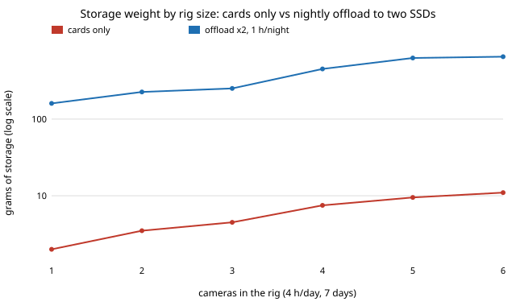

# capture-storage: how much footage does a multi-camera travel kit produce, and what limits carrying and backing it up?

Follow-up to `capture-kit` (track 13, autonomous multi-angle capture), which budgeted weight and battery but not the footage. **Headline:** a four-camera rig recording 4 h a day each makes about 860 GB a day (6 TB over a week). The cards for that, as one copy, weigh about 8 g; per recording hour a camera's battery is 440 to 980 times heavier than its card. So storage *weight* is not the constraint. The evening is: copying one day to a single SSD from one card reader takes 2.7 h, so a safe plan (two SSD copies, offload done in 1 h) needs 6 parallel readers and 4 SSDs, about 450 g, and half an hour is infeasible. Halving the bitrate shrinks that plan from 452 g to 227 g. Carrying only cards instead leaves all 6 TB in one copy on tiny cards that can be lost. Every device figure is assumed (see Limitations). Produced with AI assistance (Claude).

**Live page:** https://duncan-haywood.github.io/monorepo-projects/research/capture-storage/

**Builds on.** `capture-kit` (the cameras, their draw in watts and the 99 Wh pack it carries). Data rates are simple arithmetic from assumed bitrates. It builds on none of the CU Boulder groups in `prompt.md` and claims no connection to them. Why a new question rather than another variant: milestones 1 to 6 of the track are done, and none of the projects counts the footage itself.

## Method (`src/capture_storage/model.py`)
- **Data.** Rate in GB per hour = Mbit/s x 3600 / 8 / 1000, at four assumed bitrates (60 to 200 Mbit/s); a day's data = sum over cameras of rate x hours x a codec scale.
- **Cards only.** Enough 512 GB cards for the whole trip, one copy (10% headroom).
- **Nightly offload.** One day of cards per camera, copied each evening onto `copies` SSDs that hold the whole trip. Exact search over card size (3), SSD size (3) and 1 to 8 parallel readers (90 MB/s each, assumed), lightest plan whose evening copy fits the time limit. Exposure = footage held in one copy at the worst moment (one day, before tonight's copy).
- **Battery comparison.** Grams of the 99 Wh pack (700 g) a camera uses per recording hour, against grams of 512 GB card per hour.

## Reproduce
```bash
pip install pytest
cd research/capture-storage
python -m pytest -q tests                        # 15 tests
PYTHONPATH=src python experiments/run.py         # under a second; writes experiments/results.txt
PYTHONPATH=src python experiments/sourced.py     # about 10 s; writes experiments/sourced_results.txt
python experiments/figure.py                     # experiments/offload_vs_cards.svg from results.txt
```

## Results (from `experiments/results.txt`; deterministic)
4 h a day, 7 days, two SSD copies, offload within 1 h:

| cameras | day (GB) | cards only (g) | offload plan (g) | readers | SSDs | evening copy (h) |
|---|---|---|---|---|---|---|
| 1 | 216 | 2.0 | 160 | 2 | 2 | 0.67 |
| 2 | 396 | 3.5 | 226 | 3 | 2 | 0.81 |
| 4 | 864 | 7.5 | 452 | 6 | 4 | 0.89 |
| 6 | 1,260 | 11.0 | 653 | 8 | 6 | 0.97 |
| 7 and 8 | 1,368 / 1,728 | 12 / 15 | infeasible with 8 readers | | | |



- **Card weight is negligible.** Cards cost 0.03 to 0.10 g per recording hour; the 99 Wh pack costs 28 to 42 g per hour of the same camera (ratio 439 to 975).
- **Offload time binds.** For the 4-camera rig, one reader and one copy takes 0.67 h per hour filmed per day: 2.7 h at 4 h/day and 5.3 h at 8 h/day.
- **The time limit sets the weight.** Allowing 3 h instead of 1 h drops the plan from 452 g to 352 g (2 readers); 0.5 h is infeasible within 8 readers.
- **Bitrate is the lever.** Scaling bitrates by 0.5 cuts the 1-hour plan to 227 g and 0.25 to 162 g; 1.5 needs all 8 readers and 652 g.
- **What the weight buys.** Cards only holds 6 TB in one copy (864 GB exposed is the offload plan's worst case); two SSD copies cost 60 times the grams in return.

## Sourced figures and a measured checksum rate (added 2026-10-21)
The first version used round numbers chosen by the author. `src/capture_storage/sourced.py` now holds a `PARAMS` table (value, unit, source, sourced or assumed) and `experiments/sourced.py` re-runs the model on it (`experiments/sourced_results.txt`; the hash timings vary a few percent per run).

- **Sourced:** action-camera bitrate 120 Mbit/s (GoPro HERO13 Black, Wikipedia's GoPro table; DJI Osmo Action 5 Pro, dji.com spec page "Max Video Bitrate 120 Mbps"); card mass 0.25 g microSD and 2 g full SD (Wikipedia "SD card" infobox; mass does not depend on capacity, so the old 0.4 to 0.6 g was wrong for microSD); card bus ceilings, UHS-I 104 MB/s and UHS-II 312 MB/s (SD Association table as shown on Wikipedia, all fetched 2026-10-21).
- **Still assumed (no spec text reachable from this environment):** the 360 camera (Insta360 returned 403), phone and mirrorless bitrates, SSD grams, reader grams, and an SSD read rate of 400 MB/s.
- **Measured:** hash throughput with Python's OpenSSL `hashlib` on this container's 2.3 GHz Xeon (SHA-NI): SHA-256 about 1,460 MB/s, MD5 about 630, BLAKE2b about 630, CRC-32 about 4,500.

| 4 cameras, 4 h/day, 7 days, 2 SSD copies, 1 h limit | day (GB) | plan (g) | readers | evening copy (h) |
|---|---|---|---|---|
| assumed figures (above) | 864 | 452 | 6 | 0.89 |
| sourced, reader 90 MB/s | 900 | 451 | 6 | 0.93 |
| sourced, UHS-I ceiling 104 MB/s | 900 | 426 | 5 | 0.96 |
| sourced, UHS-II ceiling 312 MB/s | 900 | 351 | 2 | 0.80 |

- **The headline survives.** With sourced bitrates and card masses a day is 900 GB, cards alone weigh 4 g and a card is still orders of magnitude lighter than its battery per recording hour (0.029 g of card against 31.8 g of pack per hour for an action camera). Evening copy time still decides the kit: one UHS-I reader needs 2.4 h to copy a day once, and a plan with two copies in 1 h needs 5 readers (6 at 90 MB/s; none within 8 at 45 MB/s).
- **A faster card bus is the cheapest lever.** UHS-II readers (312 MB/s ceiling) cut the plan from 426 g to 351 g and from 5 readers to 2. These are ceilings: a real card and reader pair reads below the bus speed, so treat 104 and 312 MB/s as best cases, which makes the reader count a lower bound.
- **Checksums are not the bottleneck.** One core hashes SHA-256 at about 1,460 MB/s, enough to feed 14 UHS-I readers at once (4.7 UHS-II readers). A rig that hashes while it copies adds no time; a separate re-read of the SSD copy adds about 0.6 h (at an assumed 400 MB/s SSD), and re-reading the cards too doubles the evening to 4.8 h. Verify while copying.
- **Not shown:** that any plan here works with real readers, hubs or a laptop's USB bus; the hash timings are for this container, not a travel laptop.

## Limitations
- **The first sections' figures are assumed** (round numbers, not datasheets). The section above replaces those it could source and says which it could not. Read the structure (time, not grams, binds), not the grams.
- Many readers need a powered hub and a laptop or fast SSDs able to absorb 8 x 90 MB/s; their weight, the laptop and the power for the offload are not counted. Cards are assumed reused daily after a verified copy, and a real workflow verifies checksums, which costs time.
- Recording hours are assumed per camera; `capture-kit`'s battery hours for a given kit are not enforced here. Variable bitrate, proxies and cloud upload are not modelled.

## Next steps
- Source the remaining assumed figures: 360-camera, phone and mirrorless bitrates, SSD masses and read rates (their manufacturer pages are scripted or blocked from this environment; a person with a browser can fill `PARAMS` in minutes), then bench-measure a real card-to-SSD copy.
- Couple with `capture-kit`: choose cameras and storage together under one weight and offload-time budget.
- Model checksum verification and a cloud or phone-hotspot backup path.

## Owner steps
Time a real card-to-SSD copy with the intended readers and hub before relying on any figure here.

## Outside dependencies
None. Python standard library only; pytest for the tests.
