# capture-sync: how often does a short window of sound sync real phones and cameras to within a video frame?

A research programme ([`PROPOSAL.md`](PROPOSAL.md), [`LOG.md`](LOG.md)) on **audio sync of free-running cameras and phones**: how often a short window of shared sound fixes the offset between two recorders to within one 30 fps frame (33.3 ms) on real devices, rooms and clocks, and whether a confidence calibrated in one room or rig keeps its failure rate in another. Track 13 (`capture`, multi-angle capture for travel creators). It takes over the question the 18 earlier `capture-*sync*` and `capture-*audio*` projects asked with simulated delays and gallery clips. Produced with AI assistance (Claude); no affiliation with the LibriWASN authors or any device maker is implied.

**Live page:** https://marisstella.app/research/capture-sync/

**Headline (step 1, 2026-11-13, five real phones in two real rooms).** On LibriWASN, five smartphones recording the same speech on their own clocks (20 ten-minute sessions, a 200 ms and an 800 ms reverberation room):

- **Real phone clocks differ by up to 19 ppm** (median 13.7 ppm over the 200 pairs), and each pair's rate is the same within about 1 ppm from session to session and room to room. Our earlier sync projects assumed &plusmn;40 ppm.
- **GCC-PHAT is the worst weighting in real rooms once there is noise.** With white noise added at -10 dB, a 2 s window misses by more than a frame **17% of the time in the 200 ms room and 34% in the 800 ms room with PHAT, against 5% and 7% with partial whitening (gamma 0.25)**. That reverses [`capture-reverbsync`](../capture-reverbsync)'s result in simulated rooms and agrees with [`capture-realaudio`](../capture-realaudio)'s on dry clips.
- **The peak-to-sidelobe ratio is a good confidence** (AUROC 0.91 to 0.998 for 2 s windows). **A threshold calibrated in one room does not quite carry to the other.** Set in the drier room so that at most 1% of accepted windows are wrong, at -10 dB it lets 3.7% through wrong in the wetter room (gamma 0.25; PHAT 5.5%).

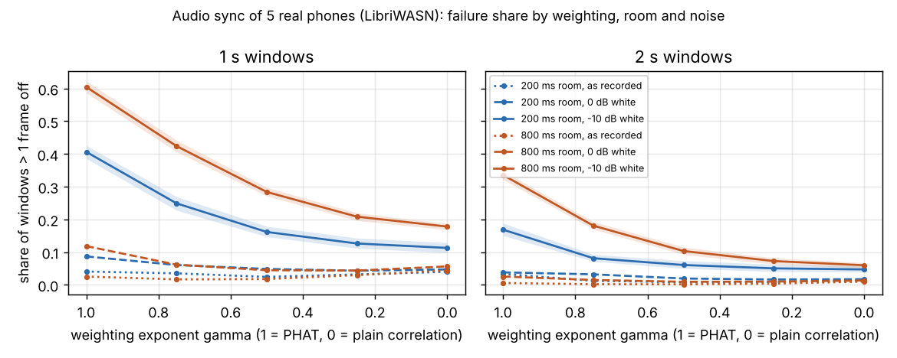

**Step 2a (2026-11-13): can theory say in advance how often a window will miss?** Ianniello's (1982) threshold model of the gross error in time-delay estimation, extended here to weighted GCC and fed with each window's own measured spectra, was checked against 84,000 simulated windows (Gaussian signals, and real read speech from MS-SNSD with real recorded babble in statistical rooms; LibriWASN was out of reach from this session):

- **On real speech the model predicts the miss rate within a factor of two in 137 of 171 scored cells (80%)**, met the pre-registered 75% bar, and errs on the low side (median predicted/observed 0.6 to 0.74). It fails worst on 0.5 s windows at 0 dB, where it underpredicts in all 22 cells, and does better in the 0.8 s room (85%) than dry (67%), the opposite of what we expected.
- **Raw-bin PHAT, the textbook estimator, misses more than its own smoothed-weight version**: over the speech cells 39.7% against 32.6%, and at -10 dB with white noise in the 0.8 s room 25% against 6% for 2 s windows. That rough per-bin normalisation is part of why PHAT came last in step 1. For plain correlation, raw and smoothed are the same estimator, and they match exactly.
- **With real babble the ranking flips.** When the noise is itself speech (babble, independent per device), PHAT is the best weighting and plain correlation the worst: 2 s windows at -10 dB in the 0.8 s room miss 50% with raw PHAT against 70% with gamma 0.25 and 79% with plain correlation (smoothed PHAT 31%). So step 1's "partial whitening, not PHAT" holds for white noise only. This was not a pre-registered prediction.
- **The model's probability works as a blind confidence for PHAT**: computed from spectra aligned at the window's own estimate, it flags PHAT failures better than the peak-to-sidelobe ratio in all 12 scored 2 s speech cells (median AUROC 0.85 against 0.74), but not for gamma 0.25 or less.

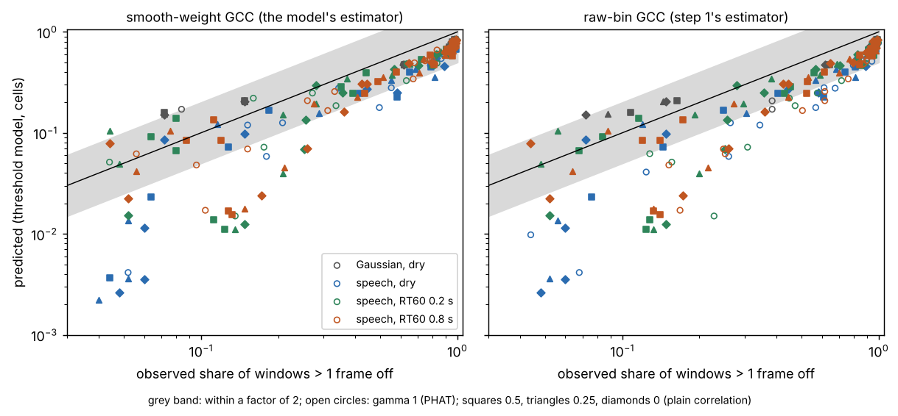

**Step 2b (2026-11-14): does that theory hold on the real phones? No.** The same model, run window for window on the five LibriWASN phones of step 1 (96,000 windows replayed exactly; every one of step 1's 96 miss rates reproduced to the digit):

- **H4 is refuted on real devices.** The model predicts the miss rate within a factor of two in **41 of 94 scored cells (44%)**, against the pre-registered 75%. Rice's variant does no better (39/94).
- **It now errs high, not low**: median predicted/observed 2.2, and no scored cell is underpredicted by more than x2. On the simulated rooms of step 2a it ran low.
- **The error grows with window length**: 0.5 s windows agree in 24 of 24 cells (median ratio 0.98), 1 s in 14 of 24, 2 s in 1 of 24 and 4 s in 2 of 22 (median ratio 5). Real recordings get better with a longer window much faster than the theory says. For an engineer this means the model is a usable miss-rate estimate for sub-second windows and a pessimistic bound beyond that.
- **Raw-bin PHAT again misses more than its smoothed form**, in all 8 window-room cells at -10 dB (e.g. 800 ms room, 2 s: 34% against 17%).

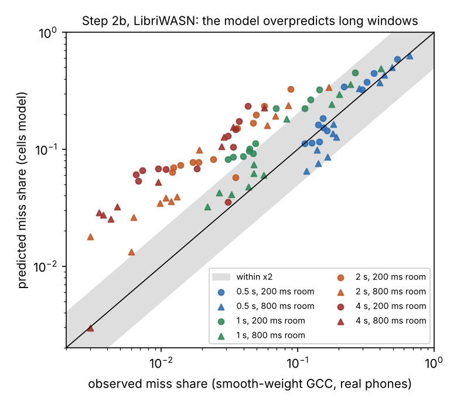

**Step 4c (2026-11-21): does the literature's multi-recording consistency step rescue the baselines when four devices record the same scene? No, and it barely helps GCC.** Kammerl et al. (2014) make many recordings' pairwise offsets agree before placing them. With four devices, all six pairs estimated by each of seven methods and the offsets placed by a confidence spanning tree or by closure-trimmed least squares (75,600 pair windows), envelope-normalised GCC's summed -10 dB failure falls only from 0.88 to 0.70-0.80 (1.08 to 0.87-1.02 in the wetter room), plain GCC's rises, and no baseline improves (Haitsma-Kalker 4.3, the rest 6.9-9.2). Pair failures come together: all four devices hear the same speech, so when one pair fails another of the anchor's fails 2.3-2.4x as often as chance for normalised GCC, and the baselines fail 68-91% of pairs, leaving no correct majority. The ground-truth-free closure flag keeps 90% of devices but lets 1.9-3.2% wrong through ([details](#step-4c-four-devices-and-kammerl-et-als-consistency-step-experimentsbaselinesconsistencypy)).

**Step 4b (2026-11-20): do the baselines catch up with more audio? No: longer windows help GCC more.** Rerun at 2, 4 and 8 s windows (74,400 windows), every method fails less, but envelope-normalised GCC's summed -10 dB failure falls from 1.0 to 0.01 while the best baseline's (Haitsma-Kalker) falls from 4.5 to 0.9, so the ratio grows from 4.5x to 70-200x. Haitsma-Kalker needs about four times the audio for GCC's failure share; Kammerl-style feature correlation and landmarks at 8 s are still worse than plain GCC at 2 s ([details](#step-4b-the-same-baselines-at-4-and-8-s-windows-experimentsbaselineswinlengthpy)).

**Step 4a (2026-11-20): do the multi-camera sync literature's own methods do better than GCC on short windows? No, not one of five.** On the same 62,000 2 s windows (step 3h's simulated rooms and ten real noise types, replayed bit for bit), envelope-normalised GCC was put against reimplementations of three lineages: frame-feature cross-correlation in the style of Kammerl et al. (2014) (spectral flatness, energy, zero-crossing rate), Wang (2003) landmark hashing (the Shazam method behind most open alignment tools) and Haitsma-Kalker (2002) binary fingerprints. At -10 dB the failure shares summed over ten noise types are **1.1-1.3 for envelope-normalised GCC against 4.3-4.9 for the best baseline (Haitsma-Kalker) and 6.6-8.9 for the rest**. With no noise all but landmarks are perfect, but GCC's median error is 0.01 ms against 0.4-2.6 ms. GCC's confidence is the only one that supports a useful 1% gate: it keeps 74% of -10 dB windows at 1.9% wrong, against at most 27% kept at 3-6% wrong for any baseline. Two literature claims did not reproduce here: spectral flatness did not beat energy, and landmarks did not shrug off one-sided bursts. Haitsma-Kalker bits did beat plain GCC on impulsive noise ([details](#step-4a-fingerprint-and-feature-baselines-on-equal-windows-experimentsbaselinesfingerprintpy)).

**Step 3l (2026-11-19): what if the noise is partly heard by both devices, as in a real room?** Independent noise per microphone, which every earlier step used, turns out to be the worst case. With devices 3 m apart and noise at -10 dB, making a quarter of the noise power shared cuts failures summed over ten noise types from 3.3 to 0.7 (plain partial-whitening GCC) and from 1.1 to 0.14 (the envelope-normalised default, `fn`); shared steady and speech-like noise acts as signal, as a one-line coherent-SNR rule predicts for 7 of 10 types at rho 0.5. A confidence gate calibrated on fully independent noise keeps wrong-among-accepted at 0.1-1.0% at every mix while coverage rises from 64-70% to 98-99%. Shared repeating sounds still break it (looped door recordings 4.6-8.2% wrong). The first run said the opposite about the gate (4-6% wrong); that was the simulation handing both devices the same recording, found and corrected in the same step ([details](#step-3l-noise-partly-shared-partly-independent-experimentsgatenoisemixpy)).

**Step 3k (2026-11-19): can the simulated room be calibrated to the real phones, and can a sync confidence gate be set in simulation and used on real phones?** Calibration: no. A gate set in simulation: yes, about as well as one set on real recordings. The simulated room (the programme's digital twin) was fitted to five real LibriWASN phones on two knobs it had never been checked on, the direct-to-reverberant ratio and a recorded noise floor, using white noise only, then tested on nine real noise types it never saw (124,000 simulated and 168,000 real 2 s windows; step 3h's simulated windows replayed bit for bit, 62 of 62 cells):

- **No setting of the two knobs reproduces the phones.** In the twin, reverberation is either harmless or breaks noise-free windows too (8-9% a frame off at DRR -6 dB in the 800 ms room, against 0.1-0.4% on the phones), while the real phones are near perfect as recorded and lose 5-10% of windows to white noise. The fit cannot match both.
- **So the fitted twin predicts the other noise types no better, and in the drier room worse:** mean gap 5.0 to 20.4 points (200 ms room), 7.4 to 7.4 (800 ms room). It still ranks the noise types right (Spearman 0.94-1.00).
- **But a 1% gate set wholly on twin windows holds on the real phones as well as one set on them:** 2% wrong among accepted for 7 and 6 of 10 noise types at -10 dB, keeping 77% and 68% of windows, against 7 and 6, keeping 78% and 65%, for the gate set on real recordings. The twin is optimistic about how often sync fails, not about what the peak-to-sidelobe ratio means.
- **A pessimistic twin buys margin.** The fitted, too-reverberant twin's gate holds 2% for **all 10 types** in the 200 ms room (0.20% wrong overall, keeping 67%); in the 800 ms room no twin fixes speech-like noise (neighbours 11%, babble 9% wrong among accepted).
- **Post hoc, a lead:** the median window has 97-99% of its power in the 100-4000 Hz band GCC uses on phones and twin alike, but one real window in twenty has only 52-59% there (Nexus above 4 kHz, Pixel6a below 100 Hz), against 89-90% in the twin: a per-phone microphone model is the next knob to test.

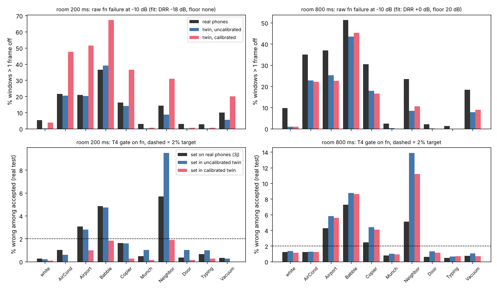

**Step 3j (2026-11-18): does the simulated room predict the real phones? Yes for which noise breaks sync and what fixes it; no for how often.** Steps 3c-3i were all run on speech through statistical rooms. This step put the same nine kinds of real recorded noise (plus white) on step 1's five real LibriWASN phones, independently per phone, and ran plain partial-whitening GCC (gamma 0.25) against the envelope-normalised estimator `fn` on 168,000 2 s windows (step 1's windows replayed bit for bit: 6 of 6 of its cells reproduce to the digit). Each real cell sits beside its simulated twin at -10 dB:

- **The twin gets the ranking right.** Across the ten noise types the real failure shares rank like the simulated ones (Spearman 0.98 and 1.00 for plain GCC, 0.89 and 1.00 for `fn`, in the 200 ms and 800 ms rooms), and the sign of `fn`'s effect agrees for 9 and 8 of 10 types.
- **The fix carries to real phones.** `fn` takes typing from **66% to 2.8%** and **79% to 1.3%** of windows a frame off, munching 28-39% to 2-3%, door 22-32% to 2-3%, neighbours 52-69% to 14-24%. Summed over the ten types it halves the failure (2.78 to 1.33 and 4.01 to 2.11).
- **So does its cost.** On steady noise `fn` is worse on the real phones too, by more than in simulation: air conditioner +7.4 and +10.5 points (simulated +8.6 and +7.0), vacuum cleaner +3.2 and +7.6.
- **The twin is optimistic about the absolute level.** `fn` fails 13% and 21% of real -10 dB windows on average against 11% and 13% simulated; on white noise the real phones fail 5-10% where the simulated room fails under 1%, and `fn`'s impulsive residual is 1.3-2.9% real against 0.0-0.3% simulated. A gate must be calibrated on real recordings, not on the twin.
- **A single 1% gate on the real phones:** on `fn`'s PSR it keeps 78% and 65% of -10 dB windows and holds 2% wrong among accepted for 7 and 6 of 10 types (misses: speech-like noise, 3-7%); on plain GCC it refuses 98% and 100% of them on average.

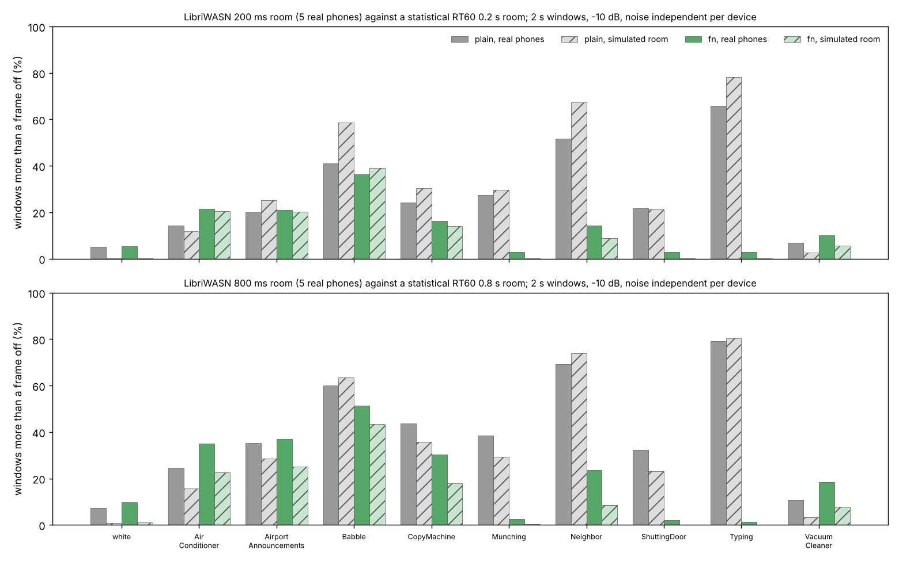

**Step 3i (2026-11-18): should a rig switch between plain and envelope-normalised GCC per window? Not by kurtosis: always normalising does as well.** Step 3h's normalised correlation fixed keyboard, bite and door noise but cost a few points on steady noise, so this step fitted a per-window switch on the window's own frame-energy kurtosis (threshold chosen on calibration sessions, tested on held-out ones; 62,000 windows replayed bit for bit). Results at -10 dB, 2 s windows, noise independent at each device:

- **The fitted switch sends almost everything to the normalised estimator** (94-100% of windows for every noise type except air conditioner, 62-75%, and vacuum, 82-84%), because read speech is itself bursty: clean speech's kurtosis sits above the threshold.
- **So it inherits the normalised estimator's results.** Impulsive noise falls from 21-81% of windows a frame off to 0.0-0.2% (neighbours 10-11%), and the 1% gate meets 2% for 9 of 10 types in each room, keeping 60-62% of -10 dB windows; it recovers only about a quarter of the steady-noise cost (air conditioner 18% and 22% against plain's 11% and 15%).
- **Choosing by the higher PSR is worse** (mean failure 17.5-18.9% against 11.5-12.5%): plain GCC's wrong peak on a click train is sharp, so it wins the PSR vote on a third of typing windows.
- **Room left: a per-window oracle would reach 7.8-8.9%,** and most of that gap is babble and copy-machine noise, not steady noise. The practical default is to always normalise.

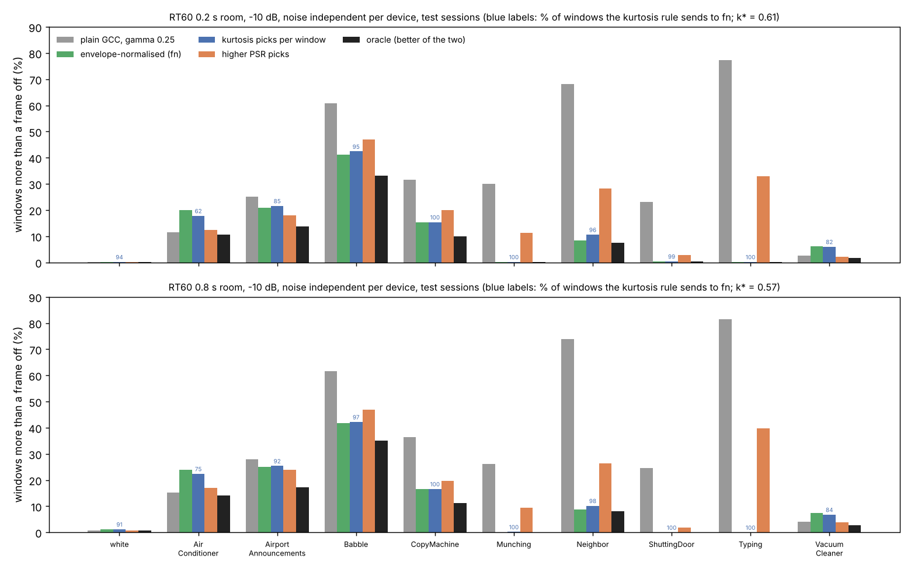

**Step 3h (2026-11-18): can audio sync survive a keyboard, a bite or a door heard by one device only? Yes, if each device's audio is divided by its own 32 ms loudness envelope before the correlation.** Step 3c's 62,000 windows replayed bit for bit (62 of 62 failure cells), with two new things recorded per window: the same GCC (gamma 0.25) on envelope-normalised audio, and whether 1 s sub-windows find the full window's lag. Results at -10 dB, 2 s windows, noise independent at each device:

- **Impulsive noise stops breaking the sync.** Windows more than a 30 fps frame off fall from **78% to 0.1% (typing), 30% to 0.1% (munching), 21% to 0.2% (door) and 67% to 9% (neighbour)** in the 0.2 s room, and the same in the 0.8 s room (80% to 0.0% for typing). No other noise kind and no level gets worse by more than half a point at +10 or 0 dB.
- **The 1% gate now keeps those windows instead of refusing them.** Calibrated on the same noise type, the gate on the normalised estimator's own PSR keeps 84% and 91% of impulsive-noise windows (PSR on plain GCC kept 4-5%) and meets 2% wrong among accepted for 9 of 10 noise types in each room (plain PSR 4 of 10).
- **It costs something on steady noise.** Air conditioner rises from 12% to 21% and 16% to 23% raw failure, vacuum cleaner from 2.5% to 5.5% and 3.4% to 7.8%: envelope normalisation lifts the quiet gaps between words, where steady noise is all there is. Running both estimators and choosing per window is the next step.
- **Checking sub-windows does not work.** Requiring the two 1 s halves to find the full window's lag met 2% for 7 and 5 of 10 types, keeping 15%; a failed typing window looks like a successful one by this test (AUROC 0.50 and 0.53).

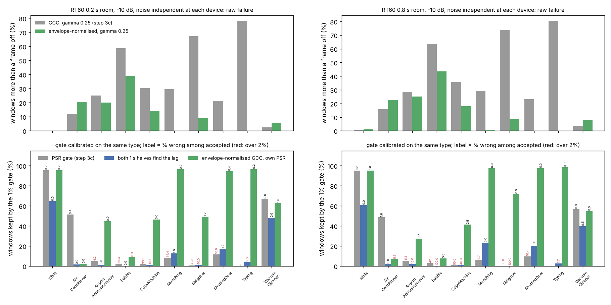

**Step 3g (2026-11-17): can the gate tell a repeating sound from the right answer? A second-peak ratio can; PSR could not.** Step 3f's 242,000 windows replayed bit for bit (720 of 720 failure cells, 240 of 240 gate cells), now with the second-peak ratio of each correlation (the highest value more than a frame from the peak, over the peak) as the confidence instead of, or multiplied into, the peak-to-sidelobe ratio (PSR). Results at -10 dB, 2 s windows, gamma 0.25, devices 3 m apart, gate calibrated on independent noise and tested on one shared source:

- **The looped door recordings stop getting through.** PSR passed 19% and 20% wrong among accepted windows (keeping 79% and 72%). The margin (1 minus the second-peak ratio) passes 1.1% and 0.0% (keeping 56% and 51%); PSR times margin 2.1% and 0.4%. Calibrated on the rig's own shared noise, the margin keeps 57-60% of door windows (4.2% and 1.7% wrong) where PSR kept 7-9% (12.8% and 3.0% wrong).
- **It costs nothing elsewhere.** The margin gate keeps more of all shared windows than PSR (69% and 68% against 63% and 60%), and wrong-and-accepted windows fall from 1.4-1.5% of all -10 dB windows to 0.0-0.1%.
- **It does not fix impulsive noise heard by one device only.** With independent typing, neighbours or munching at each device, the 2% bound still holds for only 4-5 of 10 noise types whichever score is used. There the wrong peak has no close rival: PSR ranks typing failures *above* successes (AUROC 0.25), and the margin is near chance (0.55).

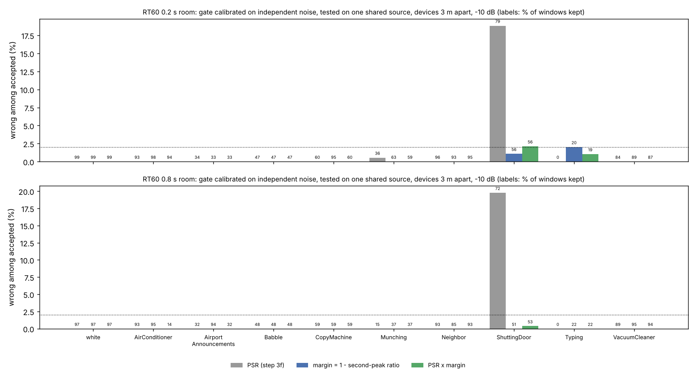

**Step 3f (2026-11-17): what if both devices hear the same noise, as in a real room? Then it is signal, until the devices are more than a frame of sound travel apart.** Step 3c's windows replayed exactly, plus 180,000 windows where one noise source is heard by both devices through its own impulse responses, at a path difference set by geometry (devices 3, 10 or 30 m apart, talker and noise source placed at random around them). Errors are scored against the clock, which is what a camera rig needs:

- **Every common sound lands within D / c of the clock offset** (triangle inequality), so at 30 fps a lock on shared noise cannot cost a frame while the devices are under 11.4 m apart (5.7 m at 60 fps).
- **Inside that, shared noise helps.** At -10 dB with partial whitening, independent babble at each device makes 2 s windows miss a frame 59-64% of the time; one babble source heard by both, 0%. Shared noise beats independent noise for 9 of 10 noise types in each room at 3 and 10 m, and the confidence gate keeps 60-63% of -10 dB windows instead of 23-24%.
- **The exception is sound that repeats.** Door-slam recordings that loop every 0.5 to 1.5 s give several equal correlation peaks: 24-27% of windows miss, and a gate calibrated without shared noise passes 19-20% wrong. Calibrating on the rig's own shared noise brings that to 3-13% at 3 m and under 2% at 10 m, mostly by refusing.
- **Beyond the bound, geometry, not noise, sets the floor.** At 30 m the talker's own path difference exceeds a frame in 69% of layouts, so about 70% of windows miss at every noise level, even +10 dB, and the gate rightly refuses everything. For spread-out rigs, sync on a clap made equidistant from the cameras, or correct for known positions.

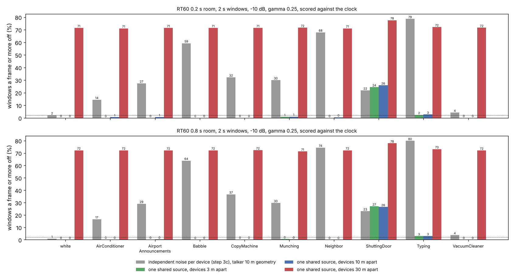

## What is and is not real

| input | value | source |
|---|---|---|
| Recordings | 5 smartphones (Nexus, Pixel 6a, Pixel 6 &times;2, Pixel 7, Xiaomi), 16 kHz mono | LibriWASN, subsets `200_0S` and `800_0S` (Schmalenstroeer, Gburrek and Haeb-Umbach 2023; Zenodo [doi:10.5281/zenodo.10952434](https://doi.org/10.5281/zenodo.10952434), CC BY 4.0), fetched at run time, **not copied into this repository** |
| Content | loudspeaker playback of LibriSpeech read speech, single talker at a time with 0.1 to 0.5 s pauses | LibriCSS design (Chen et al. 2020, [arXiv:2001.11482](https://arxiv.org/abs/2001.11482)) |
| Rooms | about 200 ms and about 800 ms reverberation time | dataset description |
| Clock drift, reverberation, device responses | real | the recordings |
| Start offset between recorders | **simulated**: the published files start within 4 ms of each other, so the search is centred on the reference plus an error uniform in &plusmn;1 s and searches &plusmn;1.5 s | design choice, as `capture-realaudio` (0.2 to 0.8 s) |
| Noise | as recorded, or **synthetic** white noise added independently per phone at 0 and -10 dB window SNR | design choice |
| Failure | more than 33.3 ms (one 30 fps frame) from the reference line | as the earlier `capture-*sync*` projects |

## Method (`src/capture_sync/sync.py`, `experiments/real-devices/run.py`)

1. **Coarse offset** per pair from a PHAT correlation of the whole decimated files.
2. **Reference line** per pair: GCC-PHAT on 20 s windows every 10 s, searched &plusmn;0.25 s around the coarse offset, and a Theil-Sen line through them (offset and clock-rate difference). It is checked three ways without ground truth: the share of windows within 5 ms of the line, the largest gap between the PHAT line and a gamma 0.25 line, and **triple closure**: for every three phones, the a-b and b-c lines must add up to the a-c line.
3. **Short windows** of 0.5, 1, 2 and 4 s at 40 seeded random times per pair and session. The other phone's stretch is cut around the reference delay plus the simulated prior error, and the delay is estimated by GCC with weighting 1/|C|^gamma (gamma = 1 is PHAT, 0 plain correlation; band 100 to 4000 Hz; parabolic peak interpolation) for five gammas on the same windows and noise draws. The peak-to-sidelobe ratio (PSR) is kept as a confidence.
4. **Statistics.** Failure shares with 95% intervals from 2,000 bootstrap resamples of the 10 sessions per room (sessions are the independent unit). AUROC of PSR for failure. Gate transfer: the lowest PSR threshold whose accepted windows fail at most 1% in one room (noise levels pooled) is applied in the other.

## Reproduce

```bash
pip install numpy scipy pytest matplotlib
cd research/capture-sync
python -m pytest -q tests                                     # 36 tests (34 synthetic; 2 check committed step 2b outputs)
python experiments/real-devices/fetch.py ~/libriwasn 200_0S 800_0S   # ~1 GB, phone channels only
python experiments/real-devices/run.py ~/libriwasn --trials 40 --procs 4   # ~25 min on 4 cores
python experiments/real-devices/figure.py
python experiments/real-devices/bypair.py ~/libriwasn 200       # per-pair breakdown, ~15 min
# step 2a: real speech and babble from MS-SNSD (MIT), sparse clone of only the files read (~100 MB)
git clone --depth 1 --filter=blob:none --no-checkout https://github.com/microsoft/MS-SNSD ~/ms-snsd
cd ~/ms-snsd && git sparse-checkout init --no-cone && printf '/clean_test/clnsp1[0-9].wav\n/clean_test/clnsp[2-9][0-9].wav\n/clean_test/clnsp1[0-9][0-9].wav\n/noise_test/*\n' > .git/info/sparse-checkout && git checkout HEAD && cd -
OMP_NUM_THREADS=1 python experiments/threshold/run.py ~/ms-snsd --trials 250 --procs 4   # ~15 min on 4 cores
python experiments/threshold/figure.py
OMP_NUM_THREADS=1 python experiments/threshold/libriwasn.py ~/libriwasn --procs 4   # step 2b, ~38 min on 4 cores
python experiments/threshold/libriwasn_score.py               # scores the step 2b predictions
python experiments/threshold/libriwasn_figure.py
OMP_NUM_THREADS=1 python experiments/gate/run.py collect ~/libriwasn /tmp/windows.npz --procs 4   # step 3, ~33 min
python experiments/gate/run.py score /tmp/windows.npz          # ~5 s; results.txt, summary.json
python experiments/gate/figure.py
OMP_NUM_THREADS=1 python experiments/gate/noise.py collect ~/libriwasn /tmp/windows_b.npz --procs 4   # step 3b, ~17 min
python experiments/gate/noise.py score /tmp/windows_b.npz    # ~10 s; noise_results.txt, noise_summary.json
python experiments/gate/noise_figure.py
# steps 3c/3d: MS-SNSD speech (clnsp10-199, as step 2a's checkout) and every noise_test type
OMP_NUM_THREADS=1 python experiments/gate/noiseclass.py collect ~/ms-snsd /tmp/windows_d.npz --procs 4   # step 3d, ~4 min
python experiments/gate/noiseclass.py score /tmp/windows_d.npz   # noiseclass_results.txt, noiseclass_summary.json
python experiments/gate/noiseclass_figure.py
OMP_NUM_THREADS=1 python experiments/gate/noiselevel.py collect ~/ms-snsd /tmp/windows_e.npz --procs 4   # step 3e, ~8 min
python experiments/gate/noiselevel.py score /tmp/windows_e.npz   # noiselevel_results.txt, noiselevel_summary.json
python experiments/gate/noiselevel_figure.py
OMP_NUM_THREADS=1 python experiments/gate/noiseshared.py collect ~/ms-snsd /tmp/windows_f.npz --procs 4   # step 3f, ~25 min
OMP_NUM_THREADS=1 python experiments/gate/noiseimpulse.py collect ~/ms-snsd /tmp/windows_h.npz --procs 4   # step 3h, ~11 min
OMP_NUM_THREADS=1 python experiments/gate/noiseselect.py collect ~/ms-snsd /tmp/windows_i.npz --procs 4   # step 3i, ~9 min
OMP_NUM_THREADS=1 python experiments/real-devices/noisereal.py collect ~/libriwasn ~/ms-snsd /tmp/windows_j.npz --procs 4   # step 3j, ~18 min
python experiments/real-devices/noisereal.py score /tmp/windows_j.npz   # noisereal_results.txt, noisereal_summary.json
python experiments/real-devices/noisereal_figure.py
# step 3k: MS-SNSD as above (clnsp10-199 only; the repository's clean_test now holds 1,100 files) and step 3j's windows
OMP_NUM_THREADS=1 python experiments/real-devices/twincal.py fit ~/ms-snsd /tmp/windows_j.npz /tmp/fit_k.npz --procs 4   # ~8 min; twincal_fit.json
OMP_NUM_THREADS=1 python experiments/real-devices/twincal.py predict ~/ms-snsd /tmp/fit_k.npz /tmp/windows_j.npz /tmp/pred_k.npz --procs 4   # ~9 min
python experiments/real-devices/twincal.py score /tmp/windows_j.npz /tmp/fit_k.npz /tmp/pred_k.npz && python experiments/real-devices/twincal_figure.py
python experiments/real-devices/twinband.py ~/libriwasn ~/ms-snsd   # post hoc band shares, ~8 min on one core
# step 3l: MS-SNSD as above; the first run, then the screened run (3l-b) the results are read from
OMP_NUM_THREADS=1 python experiments/gate/noisemix.py collect ~/ms-snsd /tmp/windows_l.npz --procs 4   # ~15 min
python experiments/gate/noisemix.py score /tmp/windows_l.npz   # noisemix_results.txt (reused recordings, kept for the record)
python experiments/gate/noisemix_crossdraw.py ~/ms-snsd /tmp/windows_l.npz --chunks 4   # post hoc diagnosis, ~1.5 min
OMP_NUM_THREADS=1 python experiments/gate/noisemix.py collect ~/ms-snsd /tmp/windows_lb.npz --procs 4 --screen   # ~20 min
python experiments/gate/noisemix.py score /tmp/windows_lb.npz --screened && python experiments/gate/noisemix_figure.py
# step 4a: MS-SNSD as above; step 3h's windows with five fingerprint/feature baselines, then the post hoc landmark sweep
OMP_NUM_THREADS=1 python experiments/baselines/fingerprint.py collect ~/ms-snsd /tmp/windows_4a.npz --procs 4   # ~25 min
python experiments/baselines/fingerprint.py score /tmp/windows_4a.npz && python experiments/baselines/fingerprint_figure.py
# step 4c: four devices, all six pairs, and the multi-recording consistency step (check the noise split first)
python experiments/baselines/consistency.py check ~/ms-snsd   # ~10 min
OMP_NUM_THREADS=1 python experiments/baselines/consistency.py collect ~/ms-snsd /tmp/windows_4c.npz --procs 4   # ~31 min
python experiments/baselines/consistency.py score /tmp/windows_4c.npz && python experiments/baselines/consistency_figure.py
python experiments/baselines/consistency_why.py /tmp/windows_4c.npz   # post hoc diagnostics, ~15 min
# step 4b: the same baselines at 2, 4 and 8 s windows
OMP_NUM_THREADS=1 python experiments/baselines/winlength.py collect ~/ms-snsd /tmp/windows_4b.npz --procs 4   # ~70 min
python experiments/baselines/winlength.py score /tmp/windows_4b.npz && python experiments/baselines/winlength_figure.py
OMP_NUM_THREADS=1 python experiments/baselines/wang_sweep.py ~/ms-snsd --procs 4   # ~6 min
python experiments/gate/noiseselect.py score /tmp/windows_i.npz && python experiments/gate/noiseselect_figure.py
python experiments/gate/noiseimpulse.py score /tmp/windows_h.npz && python experiments/gate/noiseimpulse_figure.py
python experiments/gate/noiseshared.py score /tmp/windows_f.npz   # noiseshared_results.txt, noiseshared_summary.json
python experiments/gate/noiseshared_figure.py
OMP_NUM_THREADS=1 python experiments/gate/noiseperiod.py collect ~/ms-snsd /tmp/windows_g.npz --procs 4   # step 3g, ~25 min (step 3f's windows plus the second-peak ratio)
python experiments/gate/noiseperiod.py score /tmp/windows_g.npz   # noiseperiod_results.txt, noiseperiod_summary.json
python experiments/gate/noiseperiod_figure.py
```

## Results (from [`experiments/real-devices/results.txt`](experiments/real-devices/results.txt))

**The reference is good to about 2 ms.** All 200 pair references kept at least 97% of their 20 s windows within 5 ms of the line (median residual 0.6 to 0.8 ms). Triple closure was median 0.5 ms (200 ms room) and 0.3 ms (800 ms room), at most 1.8 ms. PHAT and gamma 0.25 reference lines differ by at most 3.2 ms. Some of that is real: the loudspeaker that is playing changes the path lengths to the phones by up to a few ms. So errors below a couple of ms are not resolved here, and the frame criterion (33 ms) is 10 times the reference's error.

**Clock-rate differences (ppm, mean &plusmn; sd over 10 sessions).** The Nexus and the Xiaomi run about 14 to 18 ppm slow of the three Pixels (Nexus-Pixel 6a 16.8 &plusmn; 1.3 in the 200 ms room, 16.9 &plusmn; 0.7 in the 800 ms room); the two Pixel 6 phones and the Pixel 7 agree within 3 ppm, and Pixel 6b-Pixel 7 within 0.4. Over all pairs and sessions |SRO| has a median of 13.7 ppm and a maximum of 19.1. At 19 ppm a sync made once drifts one frame in 29 minutes.

**Share of windows more than a frame off** (95% session-bootstrap interval), selected cells; the full grid is in `results.txt`:

| room, noise | window | PHAT (gamma 1) | gamma 0.5 | gamma 0.25 | plain correlation (0) |
|---|---|---|---|---|---|
| 200 ms, as recorded | 2 s | 0.033 [0.029, 0.038] | 0.008 [0.004, 0.011] | 0.009 [0.005, 0.013] | 0.014 [0.010, 0.018] |
| 800 ms, as recorded | 2 s | 0.005 [0.004, 0.007] | 0.002 [0.001, 0.003] | 0.004 [0.002, 0.005] | 0.010 [0.007, 0.013] |
| 200 ms, 0 dB | 2 s | 0.038 [0.034, 0.042] | 0.019 [0.015, 0.024] | 0.016 [0.013, 0.020] | 0.017 [0.013, 0.022] |
| 800 ms, 0 dB | 2 s | 0.025 [0.022, 0.029] | 0.009 [0.007, 0.011] | 0.010 [0.007, 0.012] | 0.013 [0.010, 0.016] |
| 200 ms, -10 dB | 2 s | 0.169 [0.150, 0.188] | 0.060 [0.050, 0.073] | 0.050 [0.041, 0.063] | 0.047 [0.039, 0.058] |
| 800 ms, -10 dB | 2 s | 0.336 [0.322, 0.348] | 0.103 [0.092, 0.115] | 0.072 [0.063, 0.082] | 0.060 [0.051, 0.068] |
| 200 ms, -10 dB | 1 s | 0.406 [0.386, 0.426] | 0.162 [0.147, 0.179] | 0.126 [0.112, 0.143] | 0.113 [0.098, 0.129] |
| 800 ms, -10 dB | 1 s | 0.605 [0.586, 0.623] | 0.284 [0.271, 0.298] | 0.208 [0.196, 0.220] | 0.178 [0.168, 0.187] |
| either, as recorded | 0.5 s | 0.14 | 0.11 | 0.12 to 0.14 | 0.14 to 0.17 |

- **Weighting.** With added noise, failures fall steadily from PHAT towards plain correlation in both rooms, and at -10 dB the 1 s and 2 s intervals of PHAT and gamma 0.25 are far apart. Without added noise, the middle weightings (0.5 to 0.75) are best and plain correlation is a little worse.
- **Room.** At -10 dB the 800 ms room fails more than the 200 ms room at every weighting for windows up to 2 s; at 4 s the two are level (within 0.5 points). At 0 dB and as recorded, the 200 ms room is the worse one with PHAT (see the next point).
- **PHAT's floor as recorded.** In the 200 ms room PHAT fails 3.3% of 2 s windows and 2.6% of 4 s windows; longer windows barely help, which points at a fixed cause rather than noise. A per-pair rerun (`bypair.py`, 4 s windows, 200 per pair; [`bypair_200.txt`](experiments/real-devices/bypair_200.txt), [`bypair_800.txt`](experiments/real-devices/bypair_800.txt)) finds it **spread over all ten pairs** (PHAT 1.5% to 5.5% each in the 200 ms room, 0 to 1% in the 800 ms room), with the wrong peaks at scattered lags (no lag repeats more than twice). So it is neither one bad phone nor a fixed echo; gamma 0.25 removes nearly all of it (0 to 1% per pair). The cause is open (a candidate is a narrowband background sound in that room, which PHAT weights as much as speech); step 2 looks at the spectra.
- **Where a window is found, the error is small**: median 0.8 to 1.2 ms, 95th percentile 2 to 10 ms (2 s windows), about the reference's own error.

**PSR as a confidence (AUROC, good windows score higher).** At 2 s, 0.91 to 0.998 over rooms, noise levels and weightings; at 0.5 s, 0.80 to 0.98. It is weakest exactly where failures are commonest (PHAT at -10 dB in the 800 ms room).

**Gate transfer (2 s windows; threshold set in one room for at most 1% failure among accepted windows, noise levels pooled, applied in the other).**

| gamma | direction | kept | failure among kept, pooled | at -10 dB: kept, failure among kept (ungated) |
|---|---|---|---|---|
| 0.25 | 200 &rarr; 800 | 0.98 | 1.6% | 0.95, 3.7% (7.2%) |
| 0.25 | 800 &rarr; 200 | 0.97 | 0.6% | 0.95, 1.1% (5.0%) |
| 1 (PHAT) | 200 &rarr; 800 | 0.83 | 1.4% | 0.53, 5.5% (33.6%) |
| 1 (PHAT) | 800 &rarr; 200 | 0.88 | 0.8% | 0.72, 1.7% (16.9%) |

Averaged over noise levels the transferred gate lands within 2% of failures. In the hardest cell it does not: at -10 dB a threshold learned in the drier room is too lenient in the wetter one, because the same PSR means less there.

## Step 2a: threshold theory (`src/capture_sync/threshold.py`, `experiments/threshold/`)

**Question.** Does Ianniello's (1982) gross-error model predict how often a short window lands on a wrong lag (H4)? The pre-registered plan and predictions are in `LOG.md`, written before the full run.

**Why not LibriWASN.** This session's egress proxy refused zenodo.org (403), so the real-device check of H4 is step 2b. `experiments/threshold/libriwasn.py` is ready for it: it replays step 1's windows and noise draws exactly and adds the predictions. It was run on the real data in step 2b (below).

**Model.** The correlator weight is W = (G<sub>xx</sub>G<sub>yy</sub>)<sup>-gamma/2</sup>, taken from smoothed spectra (gamma 1 is the SCOT weighting of Knapp and Carter 1976). The mean output at the true lag is mu = max over &plusmn;1 ms of &int;W Re(G<sub>xy</sub>e<sup>j2&pi;f&tau;</sup>)df. The spreads are sigma<sub>1</sub><sup>2</sup> = (1/2L)&int;W<sup>2</sup>G<sub>xx</sub>G<sub>yy</sub>df at wrong lags and sigma<sub>0</sub><sup>2</sup> = (1/2L)&int;W<sup>2</sup>(G<sub>xx</sub>G<sub>yy</sub> + Re G<sub>xy</sub><sup>2</sup>)df at the true lag. The largest of the wrong-lag outputs over 2.93 s of lag comes from M = 2B<sub>eff</sub>T independent cells (Ianniello's model, scored for H4) or from Rice's (1944) upcrossing rate. The spectra are Welch estimates (512-sample Hann segments, no overlap) of the two windows aligned at the true lag. Tests check the model against the textbook output SNR &radic;(2LB)/(1+N/S) and a Gaussian Monte Carlo.

**Grid.** Each cell is a combination of the following, with 250 trials per cell and gamma 1, 0.5, 0.25 and 0 scored on the same windows (84,000 windows):

- **source:** white Gaussian (dry, white noise at -10, -15 and -20 dB), or real read speech (MS-SNSD `clean_test`, 37 min, Reddy et al. 2019, MIT);
- **room:** dry, or a fresh statistical impulse response per device and trial (direct path plus a decaying Gaussian tail from 5 ms, RT60 0.2 or 0.8 s, DRR 0 dB, Polack 1993);
- **noise:** white, or real babble (MS-SNSD `noise_test/Babble_*`, a different stretch per device), at 0, -10 and -15 dB;
- **window:** 0.5, 1, 2 and 4 s.

Prior, search and failure rule are as in step 1. A cell is scored if it has at least 10 observed failures. It agrees if predicted/observed falls in [0.5, 2].

**Results** (from [`experiments/threshold/results.txt`](experiments/threshold/results.txt)):

| estimator, model | Gaussian (36 scored) | speech dry | speech RT60 0.2 s | speech RT60 0.8 s | all speech |
|---|---|---|---|---|---|
| smooth-weight GCC, cells (H4) | 32 (89%) | 29/43 | 53/63 | 55/65 | **137/171 (80%)** |
| smooth-weight GCC, Rice | 32 | 33/43 | 53/63 | 57/65 | 143/171 (84%) |
| raw-bin GCC (step 1), cells | 34 | 25/43 | 49/64 | 48/65 | 122/172 (71%) |

- The model **underpredicts on speech** (median predicted/observed 0.58 to 0.74 by room and gamma, against 0.84 on Gaussian signals). The misses cluster where few windows fail for noise reasons: all 22 scored cells at 0 dB with 0.5 s windows underpredict by more than a factor of two, while at -15 dB 82 of 83 scored cells agree.
- **The Gaussian misses are all one cell** (-10 dB, 0.5 s, every gamma), where the model predicts 0.15 to 0.17 against 0.07 to 0.08 observed.
- **Raw-bin against smooth weighting** (mean miss rate over the speech cells): PHAT 0.397 against 0.326, gamma 0.5 0.337 against 0.322, gamma 0.25 0.344 against 0.341, plain correlation 0.352 for both (the same estimator; their failure counts are identical in every cell).
- **2 s windows at -10 dB** (raw-bin, then smoothed, miss rate):

| room, noise | PHAT | gamma 0.5 | gamma 0.25 | plain |
|---|---|---|---|---|
| dry, white | 0.008 / 0.000 | 0 / 0 | 0 / 0 | 0 / 0 |
| dry, babble | 0.020 / 0.020 | 0.008 / 0.008 | 0.020 / 0.020 | 0.148 / 0.148 |
| RT60 0.2 s, white | 0.128 / 0.024 | 0 / 0 | 0 / 0 | 0 / 0 |
| RT60 0.2 s, babble | 0.472 / 0.336 | 0.428 / 0.392 | 0.588 / 0.556 | 0.704 / 0.704 |
| RT60 0.8 s, white | 0.252 / 0.056 | 0.008 / 0.004 | 0.004 / 0.008 | 0.008 / 0.008 |
| RT60 0.8 s, babble | 0.504 / 0.312 | 0.524 / 0.436 | 0.700 / 0.708 | 0.792 / 0.792 |

**Predictions** (`LOG.md`):

- (a) Gaussian, at least 90% of scored cells agree for every gamma: **failed narrowly** (8 of 9 per gamma, 89%; the one miss is the cell above).
- (b) H4 on speech, at least 75% agree: **held** (80%). The expected pattern, dry agreeing more than the 0.8 s room, **failed** (67% against 85%).
- (c) Raw PHAT misses more than twice the prediction in most scored cells at -10 dB or below: **failed** (20 of 41 speech cells, 1 of 9 Gaussian). At gamma 0, raw and smooth agree, as expected.
- (d) Exploratory: the blind theory probability beats PSR as a confidence for PHAT (12/12 cells), not for gamma 0.25 (6/9 cells, median AUROC 0.567 against 0.578).

**Limits of step 2a.** The rooms are statistical, not measured, and each device gets an independent tail. The delays and starts are simulated. The babble is independent per device, while in a real room both devices hear the same crowd. Each source stretch is a random cut from 37 minutes, so windows overlap. The spectra are oracle-aligned for the H4 score, which an estimator in the field cannot do (hence the blind variant in (d)). No intervals are reported on the agreement counts.

**Step 3 (2026-11-14): can a sync confidence carry a guaranteed failure rate to another room, phone or noise level?** A Learn-then-Test gate (Angelopoulos et al. 2021) on the peak-to-sidelobe ratio, set for at most 1% wrong among accepted windows, calibrated in one condition and tested in another on the same 96,000 phone windows (step 1 replayed exactly):

- **Room and phone shifts mostly hold.** For 2 s windows with gamma 0.25, calibrating in one room and testing in the other gives **1.45% and 0.57%** wrong among accepted (keeping 97 to 98% of windows); holding out each phone in turn gives 0.49% to 1.30%.
- **A noise shift breaks it.** Calibrated on the recordings as published and at 0 dB, then tested at -10 dB, the gate lets through **4.7% (200 ms room) and 7.3% (800 ms room)** wrong windows. On cleaner audio almost every window is right, so the threshold falls to the floor and the gate accepts everything. A gate calibrated on a mix of conditions controls the mix, not each condition, and the deployed gate cannot see the noise level.
- **Requiring PHAT and gamma 0.25 to agree is the more robust gate** (post hoc): under the same noise shift it lets through 1.4% and 2.6%, keeping 84% and 68% of 2 s windows. At 1 s it is worse than the PSR gate (4.7% and 11.3%).
- **Session clustering costs part of the guarantee.** Within one room, 13% of random session splits ended above 1% (the i.i.d. bound is 10%), against 33% for step 1's plug-in threshold; none went above 2%.

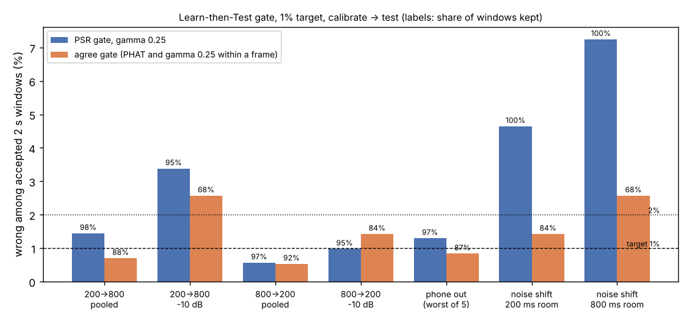

**Step 3b (2026-11-14): can the gate keep its bound when the noise level shifts? Only by noticing and refusing.** The same 96,000 phone windows (replayed exactly, 48/48 cells identical), with two noise-aware Learn-then-Test gates beside step 3's:

- **A blind SNR estimate tells noise levels apart almost perfectly.** The spread of a window's 32 ms frame energies (90th over 10th percentile) is 21 dB for 2 s windows as recorded, 5.2 dB at 0 dB added noise and 1.2 dB at -10 dB, with the 5-95% ranges not overlapping between 0 and -10 dB.
- **Gating per blind-SNR bin, and refusing windows below the calibration's range, keeps the bound under every shift.** Calibrated without -10 dB audio and tested on it, it lets **0.00%** wrong windows through in both rooms (pooled gate 4.65% and 7.25%), but only by refusing 93% and 99% of them, most of which were right. When the calibration does include noisy audio, room to room at -10 dB it gives **0.27%** wrong while keeping 74% (pooled 3.38% at 95%). Within a room, 4% of session splits exceed 1% (pooled 15%): the bound step 3 missed is met.
- **Using the threshold theory as the score does not transfer.** It is a slightly better failure flag for PHAT (AUROC 0.987 against 0.977 at 2 s), but under the noise shift it lets 2.25% and 5.37% through, like PSR.
- **For an engineer:** calibrate the gate on recordings with noise added down to the lowest SNR you expect, gate per blind-SNR bin, and treat a window below the floor as unknown, not as good.

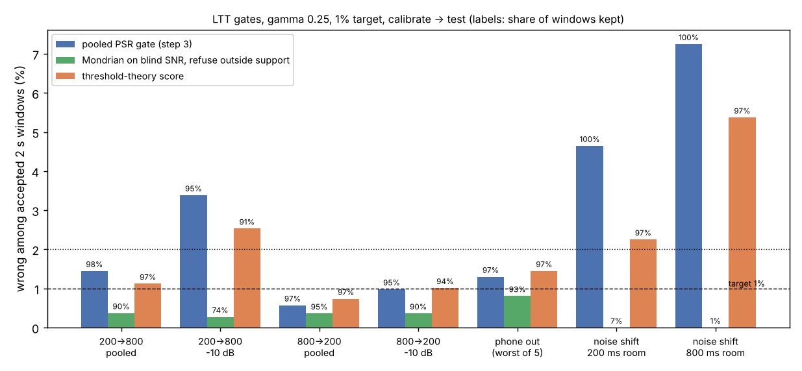

**Step 3c (2026-11-15): does that recipe survive real noise? No.** Real read speech in statistical rooms (MS-SNSD, MIT; LibriWASN was out of reach from this session), 186,000 windows, each clean pair scored under white noise and nine kinds of real recorded noise (air conditioner, airport announcements, babble, copy machine, munching, neighbour, door, typing, vacuum cleaner) at +10, 0 and -10 dB:

- **The blind SNR estimate cannot place real noise.** At -10 dB it reads 1.1 dB under white noise but 3.3 to 16.6 dB under the real types (medians, 2 s), so every real -10 dB window looks like audio the white-noise calibration has seen. Frame-energy spread measures how steady the noise is, not how loud it is.
- **Step 3b's gate, calibrated on white noise, fails on all nine real types in both rooms.** 2 s windows, gamma 0.25, -10 dB: **2.6% to 77% wrong among accepted** (0.2 s room) and 3.8% to 81% (0.8 s room), against a 1% target, while accepting 99-100% of windows.
- **Calibrating on a library of the other nine types mostly refuses, and still fails on impulsive noise.** The pooled gate refuses every window, because even the most confident windows are more than 1% wrong. The per-bin gate keeps 10-18% of windows, and when the held-out type is typing it lets **80% and 93% wrong** through.
- **Requiring PHAT and gamma 0.25 to agree works for steady noise, not for impulses**: 0.0% to 0.3% wrong for air conditioner, airport and vacuum cleaner (keeping 70% to 91%), but 87% to 90% for typing, where both weightings land on the same wrong lag.
- **No fixed weighting wins.** At -10 dB, 2 s, PHAT misses 2% under air-conditioner noise against 12% for gamma 0.25, and 40% against 59% under babble. Under copy-machine noise it misses 84% against 30%. Step 1's "partial whitening, not PHAT" holds for white and impulsive noise, not for steady coloured or speech-like noise.
- **For an engineer:** an SNR-only confidence does not carry a failure bound across kinds of noise. Calibrate on the site's own noise, or add a feature that names the noise (impulsiveness, spectral flatness) and refuse what it has not seen.

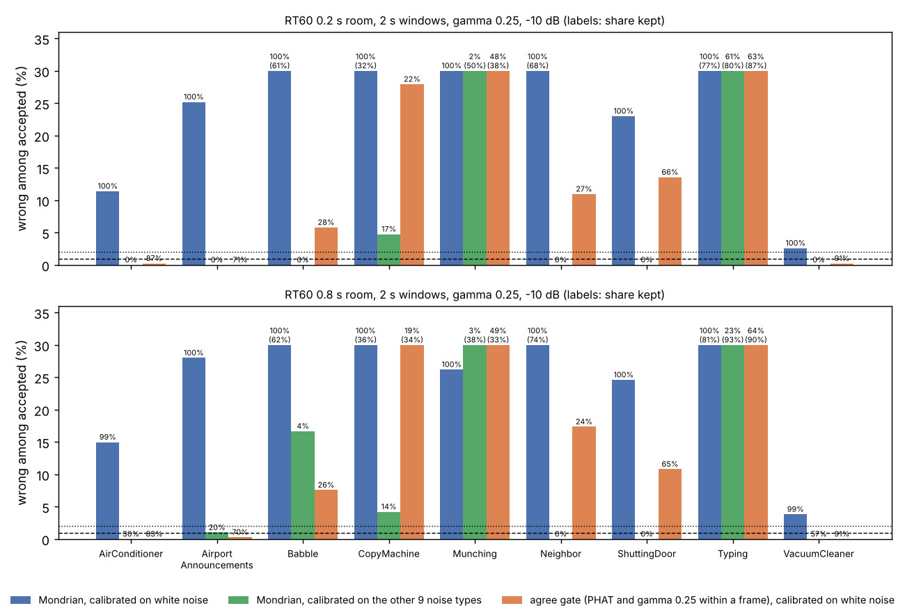

**Step 3d (2026-11-15): can a gate that sees what kind of noise a window holds carry its bound to a new kind? No, but it keeps far more.** Step 3c's 2 s windows replayed exactly (62,000; 62 of 62 failure cells identical), with two blind features per window: impulsiveness (kurtosis of the 32 ms frame energies) and spectral flatness. The new gate bins on blind SNR x impulsiveness and refuses windows whose features lie outside the calibration's (conformal novelty refusal, Bates et al. 2023):

- **It keeps four times as much and breaks the bound more often.** Calibrated on nine noise types and tested on the tenth, it keeps 43% and 48% of held-out windows (step 3b's gate: 10% and 18%), but at -10 dB it stays at or under 2% wrong for only 5 and 3 of 10 types. Neighbor noise goes through at 66% and 75% wrong, typing at 86% and 97%.
- **"Refuse what you have not seen" cannot see a new kind of real noise.** 92% to 100% of a held-out type's -10 dB windows sit inside the other nine types' features. Only white noise stands out (flatness -0.2 dB against -2.6 to -9.5 dB for every real type).
- **Calibrating on the site's own noise holds the bound pooled over noise levels, not at the worst level.** Same type, other speech: at or under 2% for 9 to 10 of 10 types over all levels together, for every gate; at -10 dB alone, 4 to 8 of 10. The guarantee is for the calibration's mix of conditions, and the blind SNR estimate cannot pick out the hard ones under real noise.
- **For an engineer:** state a sync confidence's failure rate as a rate over the site's own noise mix, measured there, and expect it to be exceeded in the loudest stretches. A per-level guarantee needs a better blind noise-level estimate than one window can give.

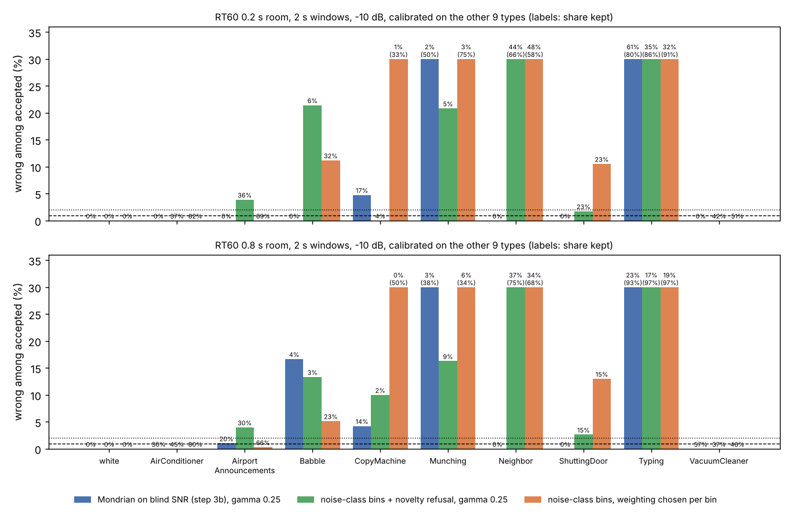

**Step 3e (2026-11-16): can a noise level estimated from the seconds before a window make the bound hold at the worst level? No, and the true level mostly says refuse.** Step 3c's 2 s windows replayed exactly (62,000; every failure cell identical), each now preceded by 4 s of the same speech and the same noise recording. The gate's bins come from a minimum-statistics noise floor (a simplified form of Martin 2001) tracked over those 4 s, instead of from the window alone; an oracle that knows the true level is the ceiling:

- **Hearing the context does not fix it.** Calibrated on the site's own kind of noise, the context-binned gate stays at or under 2% wrong at -10 dB for 4 of 10 noise types in each room, the same as the window-only gate (4 and 4).
- **Louder intermittent noise reads as cleaner audio.** For neighbour noise, door slams and typing, the window's own estimate rates -10 dB windows as *less* noisy than 0 dB ones (AUROC 0.36 to 0.47); the context estimate brings that only to 0.48 to 0.66. Only steady noise (white, air conditioner, vacuum) is ranked well (0.99 or more).
- **Knowing the level, the right answer is to refuse.** With the true level as the bin, no confidence threshold certifies 1% at -10 dB for 7 of 10 noise types, so the oracle gate accepts nothing there.
- **For an engineer:** quote a sync confidence's failure rate over the site's own mix of noise, and the absolute share of wrong windows it lets through in the worst stretch (at most 2.4% of -10 dB windows here), not a per-level rate that a single microphone cannot measure.

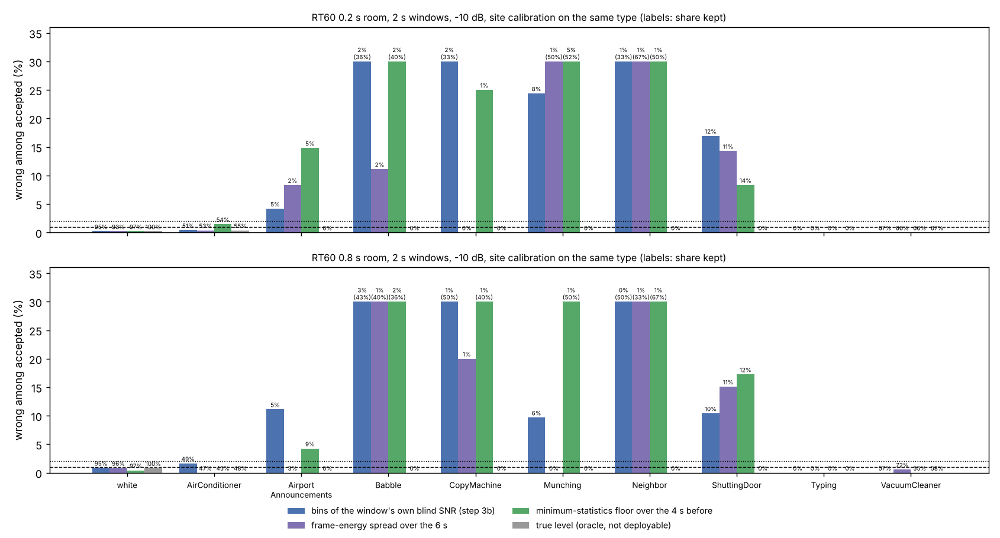

## Step 3: a Learn-then-Test gate across rooms, phones and noise (`src/capture_sync/gate.py`, `experiments/gate/`)

**Question.** Milestone 3: step 1's peak-to-sidelobe (PSR) gate used a plug-in threshold with no guarantee and broke at -10 dB from room to room. With a distribution-free threshold, which shifts keep the failure rate and which break it? Plan and six predictions in `LOG.md`, written before the run.

**Method.** Accept a window when its score is at least lam. Learn then Test (Angelopoulos, Bates, Cand&egrave;s, Jordan and Lei 2021) picks lam on calibration windows: for each threshold on a fixed grid (241 values, PSR 2 to 400, geometric) it tests H0 "more than 1% of accepted windows are wrong" with an exact binomial p-value and walks from the strictest threshold to the loosest, stopping at the first that fails at delta 0.1. Under i.i.d. windows, P(failure among accepted > 1%) &le; 0.1. Thresholds accepting fewer than 230 windows are skipped, because there even zero failures cannot reject H0 (a fix made after the first scoring pass abstained everywhere; see `LOG.md`). Scores: the PSR of PHAT, the PSR of gamma 0.25, and *agree*: gamma 0.25's PSR when the PHAT and gamma 0.25 estimates land within a frame of each other, otherwise refused. Shifts: S1 random 5/5 session splits within a room (50 per room), S2 room to room, S3 leave one phone out (both rooms), S4 as recorded and 0 dB to -10 dB. Calibration pools the noise levels except in S4. Step 1's plug-in rule on the same grid is reported beside it.

**Results** (2 s windows; [`experiments/gate/results.txt`](experiments/gate/results.txt) has every window length and gate):

| calibrate &rarr; test | PSR gate, gamma 0.25: kept, wrong among kept | agree gate: kept, wrong among kept | no gate: wrong |
|---|---|---|---|
| 200 ms &rarr; 800 ms room, pooled noise | 97.9%, **1.45%** | 88.2%, 0.70% | 2.9% |
| 200 ms &rarr; 800 ms room, -10 dB | 94.6%, **3.38%** | 68.0%, 2.57% | 7.2% |
| 800 ms &rarr; 200 ms room, pooled noise | 97.0%, 0.57% | 92.4%, 0.53% | 2.5% |
| 800 ms &rarr; 200 ms room, -10 dB | 94.6%, 0.98% | 84.2%, 1.43% | 5.0% |
| leave one phone out (worst: Xiaomi) | 97.1%, 1.30% | 87.2%, 0.84% | 3.2% |
| no -10 dB &rarr; -10 dB, 200 ms room | 99.5%, **4.65%** | 84.2%, 1.43% | 5.0% |
| no -10 dB &rarr; -10 dB, 800 ms room | 100%, **7.25%** | 68.0%, 2.57% | 7.2% |

Within a room (S1), averaged over window lengths and gates, 13.2% of splits ended above 1% wrong among accepted (gamma 0.25 alone 19.8%, agree 9.0%), against 33.1% for the plug-in rule; no split went above 2%.

**Predictions** (`LOG.md`, 2026-11-14):

- (a) Replay, raw failure shares equal step 1's: **held** (120/120 identical).
- (b) S1, at most 15% of splits above 1% for LTT and more for the plug-in rule: **held** (13.2% against 33.1%), though above the i.i.d. bound of 10%.
- (c) S2, 2 s, gamma 0.25: at or under 2% pooled in both directions and over 2% at -10 dB in at least one: **held** (1.45% and 0.57%; 3.38% from 200 to 800 ms).
- (d) S4, 2 s, gamma 0.25: over 2% in both rooms: **held** (4.65% and 7.25%).
- (e) S3, 2 s, gamma 0.25: at or under 2% for at least 4 of 5 phones: **held** (5/5).
- (f) Agree keeps more windows than PSR alone under S2 at 2 s: **failed**; it keeps fewer and is wrong less often.

**What it means, and what it does not.** The guarantee is marginal: calibrate on a mix of noise levels and it holds for the mix, while the noisiest part of a deployment gets 3 to 7 times the target. Rooms and phones are not where it breaks; the noise level is, and a deployed gate does not observe it. The fix this points to is calibration conditional on something the window can measure (an estimated SNR, Mondrian-style), and the agree check is a cheap extra guard at 2 s and above. Two rooms, five phones and white added noise; the session clustering means the i.i.d. bound itself is not met (S1), so a session-level calibration is the honest next version. No intervals on the S2 to S4 shares: each is one calibration and one test set.

## Step 3b: noise-aware gates (`experiments/gate/noise.py`)

**Question.** Step 3's gate, calibrated on a mix of noise levels, let 4.7% and 7.3% wrong windows through at -10 dB. A deployed gate never sees the added-noise label. Does conditioning on something the window can measure, or a score that models noise, keep the bound? Plan and seven predictions in `LOG.md`, written before the run.

**Method.** Step 1's windows replayed exactly for gamma 1 and 0.25, keeping per window the error, PSR, the threshold theory's blind failure probability `p_blind` (step 2a's cells model, spectra aligned at the window's own estimate) and `snr_hat`, 10 log10 of the 90th over the 10th percentile of 32 ms frame energies, the smaller of the two phones' windows (`gate.blind_snr_db`). Three LTT gates at alpha 1%, delta 0.1: *pooled* (step 3), *mondrian* (a separate PSR threshold for each calibration quartile of `snr_hat`, and refusal below the calibration's 1st percentile; `gate.mondrian_ltt`), *theory* (accept when `p_blind` is at most t). Shifts S1 to S4 as step 3.

**Results** (2 s, gamma 0.25; kept, wrong among kept; [`experiments/gate/noise_results.txt`](experiments/gate/noise_results.txt) has every cell):

| calibrate &rarr; test | pooled (step 3) | mondrian | theory | no gate: wrong |
|---|---|---|---|---|
| 200 ms &rarr; 800 ms room, pooled noise | 98%, 1.45% | 90%, **0.37%** | 97%, 1.12% | 2.9% |
| 200 ms &rarr; 800 ms room, -10 dB | 95%, 3.38% | 74%, **0.27%** | 91%, 2.53% | 7.2% |
| 800 ms &rarr; 200 ms room, -10 dB | 95%, 0.98% | 90%, 0.36% | 94%, 1.01% | 5.0% |
| leave one phone out (worst) | 97%, 1.30% | 93%, 0.81% | 97%, 1.45% | 3.2% |
| no -10 dB &rarr; -10 dB, 200 ms room | 100%, 4.65% | 7%, 0.00% | 97%, 2.25% | 5.0% |
| no -10 dB &rarr; -10 dB, 800 ms room | 100%, 7.25% | 1%, 0.00% | 97%, 5.37% | 7.2% |

Within a room (S1, 16 cells of room, window and gamma), the share of session splits above 1% wrong among accepted is 15.3% pooled, **4.0% mondrian** and 21.5% theory, keeping 72%, 66% and 77% of windows on average.

**Predictions** (`LOG.md`): (a) replay identical: **held** (48/48). (b) S4 mondrian at or under 2% in both rooms: **held** (0.00%). (c) by refusing, keeping under half: **held** (7% and 1%). (d) theory at or under 2% under S4 while keeping half: **failed** (2.25% and 5.37%). (e) S2 at -10 dB, both noise-aware gates at or under 2%: **failed** for theory (2.53%; mondrian 0.27%). (f) mondrian keeps at least 90% of pooled's windows in S1: **held** (ratio 0.95 in both rooms). (g) theory a better flag than PSR for PHAT at 2 s: **held** (AUROC 0.987 against 0.977); for gamma 0.25 at 2 to 4 s PSR is better.

**What it means, and what it does not.** No score carries a failure bound to a noise level the calibration never saw. What a window can do is tell that it is outside the calibration, and the frame-energy spread does that cleanly for white noise. The guarantee then holds bin by bin, so the practical recipe is to cover the noise range in calibration (adding noise to clean recordings is cheap) and refuse below it. Limits: added white noise only (real babble is speech-like, and its frame-energy spread may not separate levels so well); the per-bin LTT bound assumes exchangeability within a bin, which session clustering still bends; no intervals on S2 to S4, each one calibration and one test set.

## Step 3c: gates under unseen kinds of real noise (`experiments/gate/noisetype.py`)

**Question.** Step 3b's rule was found with white noise. Does it hold when the *kind* of noise changes, and does calibrating on a library of real noise types carry to a type it has not seen? Plan and six predictions in `LOG.md`, written before the run.

**Data and design.** MS-SNSD (Reddy et al. 2019, MIT): `clean_test` read speech (190 files, 37 min), split into 10 contiguous blocks that serve as sessions, and the nine `noise_test` types (35 s to 7 min each). Statistical rooms as step 2a (RT60 0.2 and 0.8 s, a fresh impulse response per device, DRR 0 dB). Prior, search and failure rule as step 1. 1000 trials per room and window length (1, 2, 4 s); each clean pair is scored under 31 conditions: none, plus white and the nine real types at +10, 0 and -10 dB, with noise scaled to each device's own speech power. The two devices never hear the same noise recording: each type's files are split between them, with files that duplicate each other kept on one side (`split_files`; checked by `noise_overlap_check.py`). Gates (LTT, 1% target, delta 0.1): pooled PSR, step 3b's mondrian, and step 3's agree. Calibrate on sessions 0-4 and test on 5-9. **T0** white to white; **T1** white (all levels) to each real type; **T2** leave one noise type out.

**Two reruns before the result** (`LOG.md`). v1 drew both devices' noise from one pool, so a pair could share noise samples and lock onto them: 41% of the 230 most confident calibration windows were wrong. v2 split each type's audio into halves, but two Neighbor files are the same recording and four Munching files overlap. v3, reported here, splits by file. All predictions scored the same in the three runs, except that v1 met (d) only vacuously. The earlier outputs are kept as [`noisetype_v1_results.txt`](experiments/gate/noisetype_v1_results.txt) and [`noisetype_v2_results.txt`](experiments/gate/noisetype_v2_results.txt). Step 2a's babble drew both devices from one pool too, so some of its babble windows may share noise samples; how much that moved its babble miss rates is not measured here (this run's differ from step 2a's by up to 11 points, with different seeds, trials and speech blocks).

**Results** ([`experiments/gate/noisetype_results.txt`](experiments/gate/noisetype_results.txt); 2 s windows, -10 dB, 0.2 s room; the 0.8 s room is alike):

| noise | blind SNR, median dB | miss: PHAT / gamma 0.25 | T1 mondrian (white cal.): kept, wrong | T1 agree: kept, wrong | T2 mondrian (other 9 types): kept, wrong |
|---|---|---|---|---|---|
| white | 1.1 | 18.4% / 0.2% | (T0: 99%, 0.10%) | | 0% |
| AirConditioner | 3.3 | 2.0% / 11.9% | 100%, 11.4% | 87%, 0.23% | 0% |
| AirportAnnouncements | 5.2 | 5.9% / 25.2% | 100%, 25.2% | 71%, 0.00% | 0% |
| Babble | 5.5 | 39.6% / 58.7% | 100%, 60.8% | 28%, 5.8% | 0% |
| CopyMachine | 5.1 | 83.6% / 30.4% | 100%, 31.6% | 22%, 27.9% | 17%, 4.8% |
| Munching | 11.5 | 68.0% / 29.6% | 100%, 30.0% | 48%, 38.3% | 2%, 50% |
| Neighbor | 12.9 | 27.6% / 67.2% | 100%, 68.2% | 27%, 11.0% | 0% |
| ShuttingDoor | 16.6 | 34.2% / 21.3% | 100%, 23.0% | 66%, 13.6% | 0% |
| Typing | 12.7 | 91.2% / 78.1% | 100%, 77.2% | 63%, 87.3% | 61%, 80.2% |
| VacuumCleaner | 3.3 | 5.6% / 2.5% | 100%, 2.6% | 91%, 0.22% | 0% |

**Predictions** (`LOG.md`): (a) real noise reads cleaner than white at -10 dB, for at least 5 of 9 types: **held** (9/9). (b) T1 mondrian over 2% for at least 3 types per room: **held** (9 and 9). (c) pooled at least as bad: **held**. (d) T2 mondrian at or under 2% for at least 7 of 10 held-out types per room: **failed** (7 and 6, mostly by accepting nothing). (e) T0 at or under 1%: **held** (0.00% to 0.20%). (f) exploratory, agree beats mondrian under T1: **held** (7 of 9 per room).

**Limits of step 3c.** Simulated rooms and delays, one speech corpus. Noise is independent per device, while in a real room both devices hear the same air conditioner or crowd, from a direction close to the speech's (a coherent noise peak near the true lag, which could help rather than hurt). The noise types are MS-SNSD's test clips, several of them loops of a few seconds. The -10 dB windows are harsh; at 0 dB the white-calibrated gate stays at or under 0.4% wrong for every type at gamma 0.25 (2 s), so the failure is one of very noisy audio.

## Step 3d: a noise-class gate (`experiments/gate/noiseclass.py`)

**Question.** Step 3c said a gate needs a feature that names the kind of noise. Do blind features of impulsiveness and spectral colour, used as Mondrian bins with a refusal of unfamiliar windows, keep the 1% bound on an unseen kind of real noise, and does calibrating on the site's own noise keep it? Plan and eight predictions in `LOG.md`, written before the run.

**Method.** Step 3c's 2 s windows replayed exactly (same speech blocks, rooms, seeds and noise draws; the collection code is step 3c's with feature columns appended, checked bit for bit). Features per window, blind: `snr_hat` (step 3b), `kurt` (log10 kurtosis of 32 ms frame energies, the larger of the two devices') and `flat` (spectral flatness of the 100 Hz to 4 kHz band, dB, the mean of the two). Gates, LTT at alpha 1%, delta 0.1: *mondrian* (step 3b); *class* (8 bins, `snr_hat` quartile x `kurt` above or below its calibration median, plus conformal novelty refusal: a window is refused when its 5th-nearest-neighbour distance to half the calibration windows, in median/IQR-scaled features, exceeds the 99th percentile of the other half's); *select* (class, with the weighting chosen per bin on calibration between PHAT and gamma 0.25, each tested at delta/2). Shifts: T0 white to white; T1 white to each real type; T2 leave one type out; T3 site calibration (none plus the same type, other sessions).

**Results** ([`experiments/gate/noiseclass_results.txt`](experiments/gate/noiseclass_results.txt); 2 s windows, gamma 0.25 unless named):

| | 0.2 s room | 0.8 s room |
|---|---|---|
| T2, kept, all held-out windows: mondrian / class / select | 10% / 43% / 48% | 18% / 48% / 51% |
| T2, -10 dB, types at or under 2%: mondrian / class / select | 7 / 5 / 4 of 10 | 6 / 3 / 4 of 10 |
| T2, -10 dB, worst: class | Typing 86%, Neighbor 66% | Typing 97%, Neighbor 75% |
| T3, all levels, types at or under 2%: mondrian / class / select | 9 / 9 / 10 of 10 | 10 / 10 / 10 of 10 |
| T3, -10 dB, types at or under 2%: mondrian / class / select | 4 / 8 / 10 of 10 | 4 / 5 / 8 of 10 |
| T0 white, class: wrong among accepted (kept) | 0.06% (87%) | 0.15% (68%) |

Predictions: (a) replay held; (b) kurtosis flags all three impulsive types failed (Typing 1.55 and Munching 1.42 against white's 95th percentile of 1.32; ShuttingDoor 1.30); (c) class at or under 2% for 8 of 10 under T2 failed; (d) class keeps more than mondrian under T2 held; (e) select failed; (f) site calibration at -10 dB for 9 of 10 types, 25% kept, failed; (g) T0 held; (h) novelty refusal rejects most impulsive windows under T1 failed. Select was close to vacuous outside T2: at delta/2 a bin needs 299 accepted calibration windows, and T0, T1 and T3 calibrate on about 2,000 windows over 8 bins (a design slip found in the results, in `LOG.md`).

**Limits of step 3d.** Everything in step 3c's limits (simulated rooms, one speech corpus, noise independent per device). The features are three numbers from one 2 s window; a rig can watch the seconds before the window, which these gates do not use. The novelty threshold (1%) and the bin layout were fixed in advance and not tuned.

## Step 3e: a level estimate from the seconds before the window (`experiments/gate/noiselevel.py`)

**Question.** Step 3d found site calibration holds pooled over noise levels but not at -10 dB, because the window's own blind SNR estimate mixes levels in each bin. A rig has heard the seconds before the window. Does a noise floor tracked over them give bins that make the bound hold level by level? Plan and nine predictions in `LOG.md`, written before the run.

**Method.** Step 3c's 2 s windows replayed exactly (the collection code is step 3c's, every draw unchanged and checked bit for bit, with four columns appended). Each window gets 4 s of context: the same session's preceding speech through the same impulse responses, and the 4 s of the same noise recording that precede the window's noise draw, at the window's own gain (white context from a separate generator). Level features, the smaller of the two devices': `ms` (`gate.min_stats_snr_db`: each band bin's periodogram smoothed recursively, alpha 0.7, its minimum over 1.5 s as the noise floor, summed over 100 Hz to 4 kHz; the window's SNR against it; Martin's (2001) optimal smoothing and bias compensation left out), `ctx` (step 3b's frame-energy spread over the 6 s) and `snr_hat` (the window alone). Gates, LTT at alpha 1%, delta 0.1: step 3b's Mondrian gate (4 quartile bins, refuse below the 1st percentile) on each feature, and an oracle with one threshold per true level. Shifts T0 to T3 as in step 3d.

**Results** ([`experiments/gate/noiselevel_results.txt`](experiments/gate/noiselevel_results.txt); 2 s windows, gamma 0.25):

| | 0.2 s room | 0.8 s room |
|---|---|---|
| T3 site calibration, -10 dB, types at or under 2%: `snr_hat` / `ctx` / `ms` / oracle | 4 / 5 / 4 / 10 of 10 | 4 / 6 / 4 / 10 of 10 |
| ... of which the oracle accepts nothing | 7 | 7 |
| T3, -10 dB, mean kept: `snr_hat` / `ms` / oracle | 24% / 25% / 22% | 23% / 22% / 21% |
| T3, -10 dB, worst wrong-and-accepted share of all windows: `snr_hat` / `ms` / oracle | 2.0% / 2.4% / 0.2% | 1.2% / 2.0% / 0.8% |
| T2 leave one type out, -10 dB, at or under 2%: `snr_hat` / `ms` | 7 / 3 of 10 | 6 / 7 of 10 |
| T1 white to real, -10 dB, at or under 2%: `ms` / oracle | 1 / 0 of 9 | 1 / 1 of 9 |
| T0 white: `ms` wrong among accepted (kept) | 0.10% (99%) | 0.10% (99%) |

AUROC of -10 against 0 dB windows (`snr_hat` / `ms`): white 1.00 / 1.00, AirConditioner 0.99 / 1.00, VacuumCleaner 0.99 / 0.99, AirportAnnouncements 0.85 / 0.78, Babble 0.85 / 0.79, CopyMachine 0.82 / 0.82, Munching 0.55 / 0.65, Neighbor 0.36 / 0.48, ShuttingDoor 0.36 / 0.59, Typing 0.47 / 0.66.

Predictions: (a) replay held; (b) `ms` orders levels at AUROC 0.90 for 7 of 9 types failed (2 of 9; above `snr_hat` for 7 of 9); (c) site calibration at -10 dB for 9 of 10 types failed (4 and 4); (d) the oracle ceiling held, mostly by accepting nothing; (e) `ms` beats `snr_hat` under T3 failed (a tie); (f) the level does not fix a change of kind held; (g) leave-one-out under 8 of 10 held; (h) T0 held; (i) `ctx` between the two held for 5 of 9.

**Limits of step 3e.** Everything in step 3c's limits (simulated rooms, one speech corpus, noise independent per device). The tracker is a simplified minimum-statistics estimator with fixed smoothing and no bias compensation; Martin's full tracker, or a speech-presence-based one, might rank steady-but-coloured noise better, but cannot change the impulsive case, where the noise's bursts look like speech to any single-channel level estimate (an interpretation, not tested here). Context is 4 s; noise that changes kind within it is not modelled.

## Step 4c: four devices and Kammerl et al.'s consistency step (`experiments/baselines/consistency.py`)

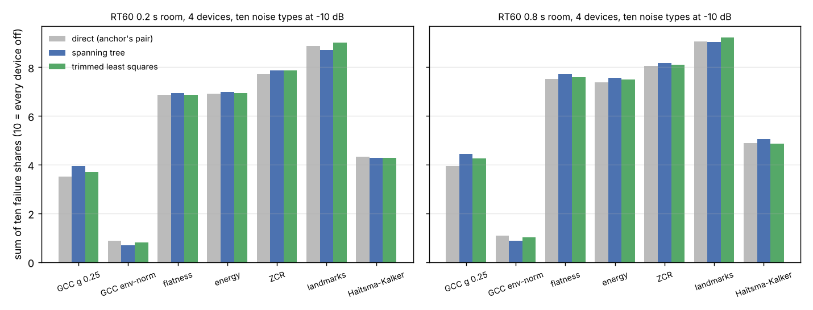

**Question.** Steps 4a and 4b scored each method on one pair. Kammerl et al. (2014) synchronise many recordings at once and make the pairwise offsets agree first, which can repair a pair that jumped to a wrong peak. Do the literature's methods, or GCC, gain from that when a rig has four devices?

**Method** (plan and predictions in `LOG.md` before the run). Four devices per trial hear one stretch of MS-SNSD speech through their own statistical impulse responses (RT60 0.2 or 0.8 s); each device's whole recording gets its own noise once per condition, so one noisy device spoils all three of its pairs. Noise files are split four ways with no file feeding two devices, checked by cross-correlating 1 s chunks across devices before any window was collected (Typing then drew from Typing_2 alone, since Typing_1's quarters recur in each other). All six pairs (2 s window, prior error +-1 s, search +-1.5 s) are estimated by step 4a's seven methods unchanged. Devices 1-3 are placed against device 0 by `direct` (the anchor's own pair), `mst` (maximum-confidence spanning tree) or `trim` (least squares over all pairs, dropping the worst-residual pair while it exceeds a frame and the rest stay connected; a device is *flagged consistent* when every kept residual is within a frame and it and the anchor keep two pairs each) (`src/capture_sync/consistency.py`). Kammerl et al.'s own global step could not be read here, so these are the two textbook versions. 21 conditions (none, ten types at 0 and -10 dB), 300 trials per room: 75,600 pair windows.

**Results** ([`experiments/baselines/consistency_results.txt`](experiments/baselines/consistency_results.txt), post hoc [`consistency_why.txt`](experiments/baselines/consistency_why.txt)). Failure shares summed over the ten noise types at -10 dB, direct / mst / trim:

| | `fn` | plain | `hk` | `kenergy` | `kflat` | `kzcr` | `wang` |
|---|---|---|---|---|---|---|---|
| 200 ms room | **0.88 / 0.70 / 0.80** | 3.51 / 3.96 / 3.69 | 4.33 / 4.28 / 4.29 | 6.91 / 6.99 / 6.94 | 6.86 / 6.93 / 6.87 | 7.73 / 7.87 / 7.87 | 8.87 / 8.71 / 9.02 |
| 800 ms room | **1.08 / 0.87 / 1.02** | 3.97 / 4.44 / 4.25 | 4.90 / 5.05 / 4.86 | 7.39 / 7.58 / 7.49 | 7.53 / 7.73 / 7.58 | 8.06 / 8.17 / 8.11 | 9.07 / 9.03 / 9.23 |
| closure flag at -10 dB: flagged / wrong among flagged | 91% / 1.9%, 90% / 3.2% | 69% / 19%, 66% / 23% | 65% / 21%, 63% / 27% | 56% / 55%, 55% / 61% | 55% / 51%, 52% / 61% | 50% / 64%, 51% / 68% | 16% / 77%, 18% / 81% |

- **Four of seven predictions held.** No noise: 0% failures (a). `trim` lowers `fn`'s failures, barely: by 0.077 (95% session bootstrap 0.033-0.129) and 0.056 (0.001-0.108) (b). The weakest four baselines gain nothing (d). `fn` beats every baseline after consistency, and even placed directly (e, 20 of 20; gap 3.5 and 3.8). Failed: plain GCC gets *worse* with `trim` (c); the closure flag lets 1.9-3.2% wrong through, not 1% (f); the spanning tree beats trimming for `fn` (g; 0.70 against 0.80, 0.87 against 1.02).
- **Why so little (post hoc).** Pair failures come together. At -10 dB, when one of the anchor's pairs fails, another fails 28% of the time for `fn` against a 12% marginal, and 61% against 39% for plain. All six pairs fail together in 7-10% of plain's trials, against 0.3-0.7% if failures were independent. All four devices hear the same speech, so a window short on usable speech fails every pair. The baselines fail 68-91% of pairs, so no correct majority is left for the graph to find.
- **What the closure flag misses.** Shifts of a whole device (all three of its pairs off by the same lag), which no loop check can see, explain at most 2% of flagged failures, and anchor-wide shifts 1-13%. An untested guess: once trimming leaves a single loop, a wrong pair spreads its error around it and cannot be told from a right one.

**For a rig builder.** Recording with more devices does not make up for a weak pairwise method, and the graph step adds only 5-20% to a good one. Choose pairs by the estimator's own confidence (the spanning tree) rather than by residual trimming. The closure flag is a calibration-free check that keeps 90% of devices at -10 dB, but at 2-3% wrong it is not a 1% gate.

**Limitations.** Simulated rooms with real speech and noise; four devices at equal SNR (a rig with one quiet device would gain more from the graph); 2 s windows only; Kammerl et al.'s exact global step unread, so `mst` and `trim` stand in for it; the failure mechanisms are post hoc.

## Step 4b: the same baselines at 4 and 8 s windows (`experiments/baselines/winlength.py`)

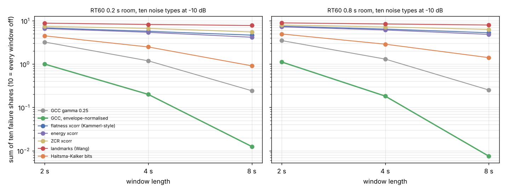

**Question.** Step 4a's baselines were designed for minutes of overlap, so 2 s may simply be too little audio for them. Do they catch up with GCC when they get 4 or 8 s?

**Method** (plan and predictions in `LOG.md` before the run). Step 4a's harness and methods unchanged, at L = 2, 4 and 8 s; both rooms; 31 noise conditions; 400 trials per room and length with fresh seeds (74,400 windows). 16 s does not fit: VacuumCleaner's per-device noise is 17.3 s. Intervals are 95% session bootstraps over the ten speech sessions.

**Results** ([`experiments/baselines/winlength_results.txt`](experiments/baselines/winlength_results.txt)). Failure shares summed over the ten noise types at -10 dB, 2 / 4 / 8 s:

| | `fn` | plain | `hk` | `kenergy` | `kflat` | `kzcr` | `wang` |
|---|---|---|---|---|---|---|---|
| 200 ms room | **1.00 / 0.20 / 0.013** | 3.23 / 1.19 / 0.24 | 4.49 / 2.49 / 0.91 | 6.60 / 5.41 / 4.17 | 6.86 / 5.72 / 4.66 | 7.43 / 6.68 / 5.52 | 8.82 / 8.22 / 7.79 |
| 800 ms room | **1.12 / 0.18 / 0.007** | 3.49 / 1.31 / 0.25 | 4.96 / 2.88 / 1.41 | 7.23 / 6.12 / 4.85 | 7.48 / 6.43 / 5.29 | 7.96 / 7.19 / 6.33 | 8.94 / 8.44 / 7.98 |
| T4 gate at 8 s, kept / pooled wrong | 97% / 0.1% (both) | 72% / 1.2%, 64% / 1.7% | 79% / 1.6%, 62% / 3.7% | 41% / 5.0%, 20% / 4.2% | 32% / 5.0%, 16% / 3.5% | 22% / 4.1%, 10% / 3.4% | 4% / 5.6%, 2% / 2.2% |

- **All seven predictions held.** Every method fails less with more audio, and `fn` still fails less than every baseline at 8 s (10 of 10). The best baseline's lead over `fn` shrinks in absolute terms (3.49, 95% interval 3.19-3.79, to 0.90, 0.76-1.10, in the drier room) but grows as a ratio, from 4.5x to 70x (200x in the wetter room).
- **Per doubling of the window,** `fn`'s failures fall 5-25x, plain GCC's 3-5x, Haitsma-Kalker's about 2x, the frame-feature methods' 1.2-1.3x and landmarks' 1.07x. So Haitsma-Kalker needs about four times the audio for `fn`'s failure share (8 s for `fn`'s 2 s in the drier room, not quite in the wetter), and the feature methods at 8 s are still worse than plain GCC at 2 s.
- **Landmarks recover with no noise** (0% at 8 s against 12-16% at 2 s) but not under noise (7.8-8.0 of 10 at 8 s).
- `fn`'s confidence stays the best ranked (AUROC 0.999-1.000 at 8 s, `hk` 0.979-0.985), and its gate keeps 97% of -10 dB windows at 0.1% wrong.

**Limitations.** As step 4a: simulated rooms with real speech and noise, pairwise windows, parameters mine except Haitsma-Kalker's. Lengths stop at 8 s because the shortest noise corpus stops there; past 8 s the baselines' trends are extrapolation.

## Step 4a: fingerprint and feature baselines on equal windows (`experiments/baselines/fingerprint.py`)

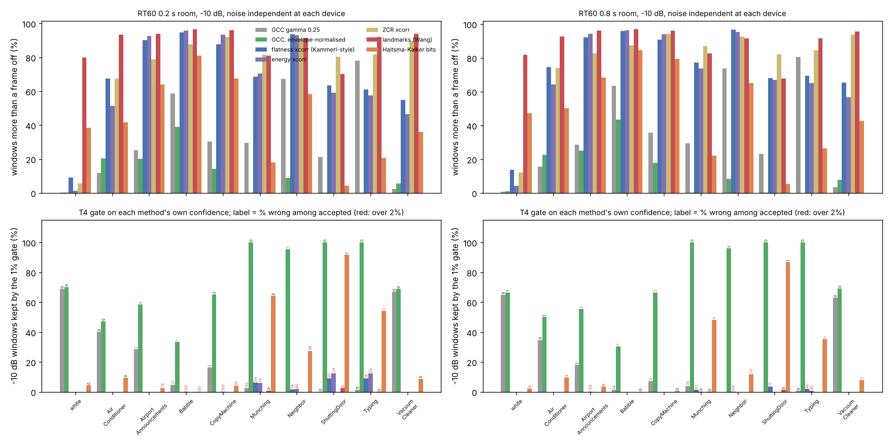

**Question.** Milestone 4: before claiming GCC with a confidence gate is the right tool for re-syncing cameras from a short window, compare it on equal windows with the methods the multi-camera sync literature uses. Those mostly do not correlate waveforms. Kammerl et al. (2014) cross-correlate frame-level audio features (their abstract reports spectral flatness beating zero-crossing rate and energy), Shrestha et al. (2007) match audio fingerprints, and most open alignment tools vote over Wang (2003) landmark hashes.

**Method** (`src/capture_sync/fingerprint.py`, plan and predictions in `LOG.md` before the run). Step 3h's 62,000 2 s windows replayed bit for bit (62 of 62 cells of plain GCC and `fn` equal), each scored by seven estimators on the same (a, b) pair and the same +-1.5 s search:

| method | what it correlates | confidence |
|---|---|---|
| plain | GCC, partial whitening gamma 0.25 | PSR |
| `fn` | the same on audio divided by its 32 ms RMS envelope (step 3h, the default) | PSR |
| `kflat`, `kenergy`, `kzcr` | normalised cross-correlation of spectral flatness, log energy or zero-crossing rate per 32 ms frame, 4 ms hop, 100-4000 Hz (Kammerl-style; frame settings mine) | PSR of that curve |
| `wang` | landmark pairs of spectrogram peaks hashed as (f1, f2, dt), lag with most matching hashes (32 ms frames, 8 ms hop, 30 peaks/s, fan-out 5) | vote margin |
| `hk` | Haitsma-Kalker 32-bit sub-fingerprints (0.37 s frames, 11.6 ms hop, 33 bands 300-2000 Hz, their parameters), lag of least bit-error rate | 0.5 minus the bit-error rate |

Failure is more than a 30 fps frame from the speech truth. The gate is step 3h's T4 for every method on its own confidence. Kammerl et al.'s graph step over many recordings needs three or more devices and is not tested; their frame settings, and which fingerprint Shrestha et al. used, could not be read from this session.

**Results** ([`experiments/baselines/fingerprint_results.txt`](experiments/baselines/fingerprint_results.txt)). Failure shares summed over the ten noise types (200 ms room / 800 ms room):

| | `fn` | plain | `hk` | `kenergy` | `kflat` | `kzcr` | `wang` |
|---|---|---|---|---|---|---|---|
| no noise (share) | 0.000 / 0.000 | 0.000 / 0.000 | 0.000 / 0.000 | 0.000 / 0.000 | 0.000 / 0.000 | 0.000 / 0.004 | 0.144 / 0.173 |
| +10 dB | 0.00 / 0.00 | 0.00 / 0.00 | 0.00 / 0.01 | 0.02 / 0.08 | 0.20 / 0.49 | 0.49 / 0.87 | 3.56 / 3.78 |
| 0 dB | 0.01 / 0.01 | 0.01 / 0.01 | 0.35 / 0.49 | 1.22 / 1.80 | 2.29 / 3.08 | 2.78 / 3.70 | 6.40 / 6.56 |
| -10 dB | **1.09 / 1.27** | 3.25 / 3.54 | 4.30 / 4.92 | 6.62 / 7.11 | 6.91 / 7.44 | 7.56 / 7.91 | 8.88 / 8.93 |
| AUROC of own confidence, pooled | 0.981 / 0.984 | 0.856 / 0.865 | 0.963 / 0.959 | 0.917 / 0.855 | 0.909 / 0.862 | 0.892 / 0.847 | 0.839 / 0.823 |
| T4 gate: -10 dB test windows kept, pooled wrong | 74% at 1.9% / 74% at 1.9% | 23% at 1.7% / 19% at 1.0% | 27% at 5.7% / 21% at 3.4% | 3% at 27% / 0.2% at 56% | 3% at 26% / 0.7% at 33% | 0% / 0% | 0.4% at 5% / 0.2% at 0% |
| median error of successes, no noise | 0.00 ms | 0.01 ms | 1.6 / 2.4 ms | 0.4 / 0.6 ms | 0.6 / 0.8 ms | 1.0 / 1.7 ms | 2.6 / 2.0 ms |

- **Primary prediction held, 10 of 10:** `fn` fails less than every baseline at -10 dB in both rooms, by a factor of about four against the best of them.
- **Haitsma-Kalker is the strongest baseline and beats plain GCC on all four impulsive types in both rooms** (ShuttingDoor 4.4% against 21%, Typing 21% against 78%, 200 ms room), and loses on every steady and speech-like type (white noise 39% against 0.2%). Its binary sign-of-difference bits ignore a burst's size, as envelope normalisation does.
- **Not reproduced:** spectral flatness did not beat energy (6.91 against 6.62 and 7.44 against 7.11; it did beat zero-crossing rate), and landmarks did not ignore one-sided bursts (0 of 4 impulsive types better than plain).
- **Was the landmark baseline mistuned?** A post hoc sweep ([`wang_sweep_results.txt`](experiments/baselines/wang_sweep_results.txt), a quarter of the windows, written after the score) with denser peaks brings its no-noise failure from 11% to 1-2% in the drier room, but its -10 dB sum only from 8.8 to 8.1. Landmark voting is built for minutes of overlap; 2 s is too little.

**Limitations.** Simulated rooms with real speech and noise, not the real phones (zenodo.org was refused this session). Parameters other than Haitsma-Kalker's are mine. Pairwise windows only: Kammerl et al.'s consistency step over many recordings, which is where their method is strongest, is untested. The baselines' thresholds use calibration quantiles as the gate grid, which suits any confidence scale.

## Step 3l: noise partly shared, partly independent (`experiments/gate/noisemix.py`)

**Question.** Steps 3c-3k gave each device its own noise, and step 3f one source heard by both. A rig hears a mix: a room's air conditioner reaches every microphone, a keyboard mostly one. How much of the noise must be shared before it stops hurting, does the default estimator `fn` keep its lead, and does a gate calibrated on independent noise still hold? Plan and predictions in [`LOG.md`](LOG.md), written before the run.

**Method.** Each device's noise is sqrt(rho) &times; shared + sqrt(1 &minus; rho) &times; independent, each scaled to that device's speech power at &minus;10 dB, rho = 0, 0.25, 0.5, 0.75, 0.9, 1; devices 3 m apart (inside step 3f's 11.4 m bound, so the shared part alone is never a frame wrong). Independent draws are step 3c's, shared draws step 3f's, so rho 0 replays steps 3c and 3h and rho 1 replays step 3f (20 of 20 cells each). Plain gamma 0.25 GCC and `fn` on 120,000 2 s windows; errors against the clock truth at 30 fps. Gate: Mondrian-`snr_hat` LTT on `fn`'s PSR (alpha 1%, delta 0.1) calibrated on rho 0, sessions 0-4, tested at each rho on sessions 5-9. A model to test: shared noise inside the bound is signal, so the coherent SNR is 10 log10((1 + 10 rho) / (10 (1 &minus; rho))), &minus;10, &minus;3.3, +0.8, +5.3 and +10 dB for rho 0 to 0.9.

**A correction, found after the first score.** The first run's mid-rho cells were wrong: the shared stretch came from all of a type's files while each device's independent stretch came from its own half, so 7-30% of windows gave one device's shared component and the other device's independent one the *same recording* at an arbitrary lag ([`noisemix_crossdraw.py`](experiments/gate/noisemix_crossdraw.py)); those windows failed 48-88%. It made VacuumCleaner fail 19% at rho 0.25 against 2.5% and 0% at the two ends, and the gate look broken (4.2-5.7% wrong among accepted). Step 3l-b redraws a shared stretch whose recording matches either independent one (peak normalised cross-correlation above 0.3, a threshold set after seeing the diagnostic); both runs' results are kept ([`noisemix_results.txt`](experiments/gate/noisemix_results.txt), [`noisemix_screened_results.txt`](experiments/gate/noisemix_screened_results.txt)). The numbers below are 3l-b.

| -10 dB total, 2 s, 30 fps | 0.2 s room | 0.8 s room |
|---|---|---|
| plain, failure summed over ten types: rho 0 / 0.25 / 0.5 / 1 | 3.26 / 0.70 / 0.30 / 0.28 | 3.54 / 0.88 / 0.34 / 0.30 |
| `fn`, the same | 1.09 / 0.14 / 0.06 / 0.05 | 1.26 / 0.21 / 0.09 / 0.07 |
| coherent-SNR model right at rho 0.5 / 0.9 (types within 2 points) | 7 / 8 of 10 | 7 / 8 of 10 |
| Typing, plain / `fn`: rho 0 / 0.5 / 1 | 78 / 6.0 / 2.4% ; 0.1 / 0.0 / 0.0% | 80 / 7.5 / 3.0% ; 0.0 / 0.4 / 0.1% |
| ShuttingDoor (looped files), plain / `fn` at rho 1 | 25% / 4.7% | 27% / 7.0% |
| AirConditioner, `fn` minus plain: rho 0 / 0.5 | +8.6 / +0.2 points | +7.0 / +0.3 points |
| gate set on rho 0: pooled wrong among accepted, any rho | 0.41-0.69% | 0.09-0.98% |
| ... kept: rho 0 / 0.25 / 1 | 70 / 92 / 99% | 64 / 89 / 98% |
| ... types at 2%, rho above 0 (ShuttingDoor the miss) | 9 of 10 | 9 of 10 |

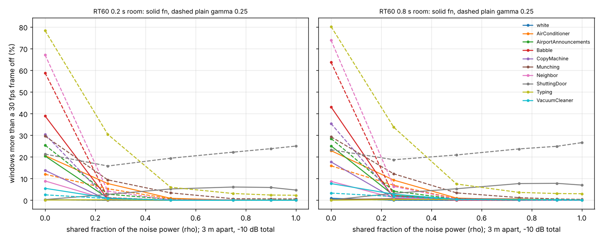

Predictions (3l-b): (a) replay held (rho 0 40 of 40; rho 1 11 of 20 equal step 3f, the rest changed by redraws); (b) plain falls with rho for 8 of 10 types held (9, the door the exception); (c) primary, the coherent-SNR model, **failed** at rho 0.5 (7 of 10; impulsive shared noise under plain GCC) and held at rho 0.9; (d) a quarter shared halves the failure for 5 of 10 held (9 and 8); (e) `fn` within 2 points of plain on fully shared noise held (10 of 10); (f) `fn` summed no worse than plain at every rho held; (g) the independent-noise gate at or under 2% pooled at every rho with rising coverage **held in 3l-b, failed in the first run** because of the reused recordings; (h) exploratory, the door passes the gate at 4.6-8.2% wrong at rho 0.75 or more.

**Reading.** Inside the bound, independent noise per device is the worst case. Shared steady and speech-like noise acts as signal, at the rate the coherent-SNR rule gives, so a quarter shared already removes three quarters of the failures, and a gate calibrated with a noise source beside each microphone is conservative in a real room. `fn`'s one cost, on steady noise, is a cost of *independent* steady noise; it disappears once half the noise is shared. Plain GCC still fails on shared repeating sounds (typing 2-8%, looped doors 19-27%); `fn` fixes typing, not the door.

**Limits of step 3l.** Simulated rooms and MS-SNSD recordings; one separation (3 m); the shared and independent parts are the same noise type; the screen's threshold was chosen after the diagnostic; the looped door files are a corpus artefact as much as a property of doors (step 3f). Real phones were out of reach this session (zenodo.org refused).

## Step 3k: calibrating the twin to the real phones (`experiments/real-devices/twincal.py`)

**Question.** Step 3j found the statistical-room twin ranks noise types like the real phones but is optimistic about level (white noise at -10 dB: 5-10% of real windows a frame off against under 1% simulated). Can the twin be fitted to the phones on one cheap condition (white noise) and then predict the rest, and can a confidence gate be set in it and used on real phones? Plan and predictions were committed before the run ([`LOG.md`](LOG.md), 2026-11-19).

**Method.** The twin is step 3c's simulator at 2 s with two knobs: the impulse response's direct-to-reverberant ratio (DRR; step 2a fixed 0 dB) and independent white noise at `floor` dB below each device's reverberant speech, added before the window's power is taken (so test noise is scaled to speech plus floor, as on a phone). Both knobs leave the main random stream untouched, so DRR 0 dB with no floor replays step 3h's windows exactly. Fit per room on real sessions 0-4 only: for each DRR on {+6, 0, -6, -12, -18} dB, the floor on {none, 40, 30, 25, 20, 15, 10} dB whose noise-free median blind SNR matches the phones' (no labels); then the DRR whose six white-noise failure shares (plain and `fn`, as recorded, 0 and -10 dB) are closest. The nine MS-SNSD types are not used. The fitted and uncalibrated twins then run all 31 conditions, 1000 trials per room; each is compared with step 3j's real windows (re-collected, results reproduced byte for byte), and a T4 gate (Mondrian blind-SNR LTT, alpha 1%, delta 0.1) is calibrated wholly on twin windows and tested on real sessions 5-9.

**Results** ([`experiments/real-devices/twincal_results.txt`](experiments/real-devices/twincal_results.txt), [`twincal_fit.json`](experiments/real-devices/twincal_fit.json)):

| | 200 ms room | 800 ms room |
|---|---|---|
| fitted DRR, floor | -18 dB (grid edge), none | 0 dB, 20 dB |
| white -10 dB, real / uncalibrated / fitted, plain | 5.0 / 0.2 / 1.9% | 7.2 / 0.7 / 0.6% |
| white -10 dB, `fn` | 5.2 / 0.1 / 3.9% | 9.7 / 1.0 / 1.0% |
| nine types, mean \|sim - real\|, uncalibrated / fitted | 5.0 / 20.4 points | 7.4 / 7.4 points |
| Spearman over ten types, `fn`, uncalibrated / fitted | 0.89 / 0.95 | 1.00 / 0.96 |
| T4 `fn` gate set on real phones (3j): types at 2%, kept | 7 of 10, 78% | 6 of 10, 65% |
| set in uncalibrated twin: types at 2%, kept, pooled wrong | 7 of 10, 77%, 0.98% | 6 of 10, 68%, 1.58% |
| set in fitted twin | **10 of 10**, 67%, 0.20% | 6 of 10, 67%, 1.38% |

Predictions: (a) replay 62 of 62, **held**; (b) the fit picks DRR below 0 dB and a finite floor in each room, **failed** (-18 dB with no floor; 0 dB with 20 dB); (c) fitted white-noise failure within 2 points, **failed** (gaps 1.3-8.7 points); (d) primary, the fitted twin's nine-type gap a third smaller, **failed** (worse in the drier room, unchanged in the wetter); (e) ranking kept, **held**; (f) the uncalibrated twin's gate meets 2% for at most 5 types, **failed** (7 and 6, as good as the real-set gate); (g) the fitted twin's gate at least as good as the real-set one with pooled wrong at most 2%, **held**; (h) exploratory: neither twin has the phones' low tail of blind SNR (5th percentile 6.4 dB real against 10.1-10.4 simulated in the wetter room).

**Reading.** The two knobs act on the wrong thing. Lowering the DRR makes the twin fail more under noise, but in the wetter room it breaks noise-free windows first, which the phones never do; a white floor only lowers the blind SNR. The phones' extra sensitivity to added noise is something else. A post-hoc band analysis ([`twinband.py`](experiments/real-devices/twinband.py), [`twinband_results.txt`](experiments/real-devices/twinband_results.txt); no failure label read) points at the microphones: the 5th-percentile window has only 52-59% of its power in GCC's 100-4000 Hz band on the phones against 89-90% in the twin, so white noise scaled to total power is several dB stronger in-band there. For a practitioner the gate result matters more than the level miss: PSR thresholds learned in simulation carry to real phones, and erring towards a harsher twin trades about 10 points of coverage for margin.

**Limits of step 3k.** One fit per room on a coarse grid (the 200 ms room's choice sits on its edge), 240 twin trials per grid point; a white floor rather than a recorded one; the same dataset, loudspeaker playback and added (not recorded) noise as step 3j. The band analysis is post hoc and descriptive.

## Step 3j: the simulated room against the real phones (`experiments/real-devices/noisereal.py`)

**Question.** Steps 3c-3i measured every noise result on MS-SNSD speech through statistical rooms with a simulated delay, and step 3i made the envelope-normalised estimator `fn` the default on that evidence. Does the simulation (the programme's digital twin of a recording room) predict what happens on real phones, with real clocks, reverberation, microphones and their own recorded noise? Plan and eight predictions in `LOG.md`, written before the run.

**Method.** LibriWASN 200_0S and 800_0S (10 sessions each, 5 phones, 10 pairs), step 1's reference lines and its 40 seeded 2 s window times per pair, prior error uniform in &plusmn;1 s, search &plusmn;1.5 s. The loop consumes step 1's random stream exactly, so its windows and white noise are reproduced bit for bit. On each as-recorded pair, the nine MS-SNSD noise types at 0 and -10 dB window SNR, independent per phone (each phone from its own half of the type's files), from a second seeded generator. Per window: plain gamma 0.25 GCC and `fn` (gamma 0.25 on each phone's audio divided by its own 32 ms RMS envelope), error and PSR; failure = more than a 30 fps frame from step 1's reference. Gate T4: Mondrian-`snr_hat` Learn-then-Test, alpha 1%, delta 0.1, calibrated on sessions 0-4 of a room (all 21 conditions), tested per type at -10 dB on sessions 5-9. Twin: step 3h's simulated cell (RT60 0.2 s for the 200 ms room, 0.8 s for the 800 ms room). 168,000 windows, 18 min on 4 cores.

**Results** ([`experiments/real-devices/noisereal_results.txt`](experiments/real-devices/noisereal_results.txt); -10 dB, raw failure share, plain / `fn`):

| | 200 ms room, real | RT60 0.2 s, simulated | 800 ms room, real | RT60 0.8 s, simulated |
|---|---|---|---|---|
| white | 5.0 / 5.2% | 0.2 / 0.1% | 7.2 / 9.7% | 0.7 / 1.0% |
| AirConditioner | 14.2 / 21.6% | 11.9 / 20.5% | 24.5 / 35.0% | 15.7 / 22.7% |
| VacuumCleaner | 6.8 / 10.0% | 2.5 / 5.5% | 10.8 / 18.3% | 3.4 / 7.8% |
| Babble | 41.1 / 36.4% | 58.7 / 39.0% | 59.9 / 51.2% | 63.5 / 43.5% |
| CopyMachine | 24.1 / 16.2% | 30.4 / 14.1% | 43.7 / 30.4% | 35.7 / 17.9% |
| AirportAnnouncements | 19.9 / 20.8% | 25.2 / 20.2% | 35.2 / 37.0% | 28.6 / 25.2% |
| Munching | 27.5 / 2.9% | 29.6 / 0.1% | 38.5 / 2.4% | 29.3 / 0.3% |
| Neighbor | 51.8 / 14.4% | 67.2 / 8.8% | 69.3 / 23.5% | 73.8 / 8.4% |
| ShuttingDoor | 21.6 / 2.9% | 21.3 / 0.2% | 32.3 / 2.1% | 23.1 / 0.1% |
| Typing | 65.7 / 2.8% | 78.1 / 0.1% | 79.1 / 1.3% | 80.4 / 0.0% |
| mean of the ten | 27.8 / 13.3% | 32.5 / 10.9% | 40.1 / 21.1% | 35.4 / 12.7% |
| Spearman real vs simulated over types | plain 0.98, `fn` 0.89 | | plain 1.00, `fn` 1.00 | |
| T4 gate: types at or under 2%, mean kept, plain | 8 of 10, 2% | | 10 of 10, 0% | |
| T4 gate, `fn` | 7 of 10, 78% | | 6 of 10, 65% | |

Predictions: (a) replay, 6 of 6 step 1 cells equal, **held**; (b) `fn` halves plain for at least 3 of 4 impulsive types, **held** (4 of 4 in each room); (c) the air-conditioner cost transfers (more than 2 points), **held** (+7.4 and +10.5); (d) `fn` fails less summed over the ten types, **held**; (e) as recorded and at 0 dB, `fn` within 0.5 points of plain for every condition, **failed**: `fn` is *better* by up to 2.3 and 3.5 points (typing at 0 dB 3.7% to 1.4% and 0.3%; as recorded 0.9% to 0.8% and 0.4% to 0.1%); (f) T4, `fn` meets 2% for at least as many types as plain and keeps more, **failed on the first part** (7 against 8, 6 against 10), held on the second (78% and 65% kept against 2% and 0%); (g) exploratory, Spearman at least 0.8 and the effect's sign for 8 of 10, **held** in both rooms; (h) exploratory, the gap: `fn`'s mean failure is 2.4 and 8.4 points higher on the real phones than in the simulated room; plain's is 4.7 points lower in the drier room and 4.7 higher in the wetter.

**Reading.** Plain GCC's 8 and 10 "types at 2%" under T4 are a gate that refuses: a calibration pool that contains typing at -10 dB, where plain GCC is confidently wrong, pushes every threshold up until almost nothing is accepted (and the few typing and munching windows it does accept are 78% and 29% wrong in the drier room). `fn`'s misses are the speech-like types (AirportAnnouncements 3.1-4.3%, Babble 4.9-7.3%, Neighbor 5.1-5.7%, CopyMachine 2.5% in the wetter room), as in simulation. What the twin gets wrong is level, not order: real white noise costs 5-10% where the simulated room costs under 1%, plausibly because the real phones' windows also carry the loudspeaker's colouring, the phones' own noise and a real late reverberant tail (not separated here).

**Limits of step 3j.** One dataset, one loudspeaker playing read speech, phones not cameras; noise is added, not recorded in the room, and independent per phone; the start offset is simulated as in step 1. The twin comparison is per type and room over one simulated configuration (statistical rooms, DRR 0 dB), not a fitted twin. Step 1's reference line (closure up to 1.8 ms) is the truth.

## Step 3i: a per-window switch between plain and normalised GCC (`experiments/gate/noiseselect.py`)

**Question.** Step 3h's envelope-normalised estimator (`fn`) wins on impulsive and speech-like noise and loses 3-9 points on steady noise. Can the window's own impulsiveness, the frame-energy kurtosis of step 3d, say which estimator to trust? Plan and nine predictions in `LOG.md`, written before the run.

**Method.** Step 3c's 62,000 2 s windows replayed bit for bit (`noisetype.run_chunk` unchanged, `gcc` wrapped). At gamma 0.25 the wrapper records `fn`'s delay and PSR and `gate.frame_kurtosis` (log10 kurtosis of 32 ms frame energies) at each device; `kurt` is the larger. Switches: **`kurt`** uses `fn` above a threshold k\* fitted per room on sessions 0-4 (all 31 conditions pooled; the calibration kurtosis percentile that minimises the switched estimator's failures, `fit_kstar`); **`psrmax`** uses whichever estimator has the higher PSR; **`oracle`** takes the better per window (a ceiling, not deployable). Raw failure on test sessions 5-9; gates as step 3h (Mondrian-`snr_hat` LTT, alpha 1%, delta 0.1), each switch gated on its chosen estimator's PSR.

**Results** ([`experiments/gate/noiseselect_results.txt`](experiments/gate/noiseselect_results.txt); gamma 0.25, -10 dB, test sessions):

| | 0.2 s room | 0.8 s room |
|---|---|---|
| replay: step 3c raw cells / step 3h `fn` cells | 62 of 62 / 62 of 62 (both rooms) | |
| fitted k\* (log10 kurtosis); clean speech's median | 0.61; 1.02 | 0.57; 0.93 |
| share of windows `kurt` sends to `fn`: none / AirConditioner / Vacuum / Typing | 96% / 62% / 82% / 100% | 98% / 75% / 84% / 100% |
| raw failure plain / `fn` / `kurt` / `psrmax` / oracle: Typing | 77.2 / 0.2 / 0.2 / 33.0 / 0.2% | 81.4 / 0.0 / 0.0 / 39.8 / 0.0% |
| Neighbor | 68.2 / 8.4 / 10.6 / 28.2 / 7.4% | 73.8 / 8.8 / 10.2 / 26.4 / 8.2% |
| Babble | 60.8 / 41.2 / 42.4 / 47.0 / 33.2% | 61.6 / 41.8 / 42.2 / 46.8 / 35.0% |
| AirConditioner | 11.4 / 20.0 / 17.8 / 12.4 / 10.6% | 15.2 / 24.0 / 22.4 / 17.0 / 14.2% |
| VacuumCleaner | 2.6 / 6.2 / 6.0 / 2.2 / 1.8% | 4.0 / 7.4 / 6.8 / 3.8 / 2.8% |
| mean over the ten types | 33.0 / 11.3 / 11.5 / 17.5 / 7.8% | 35.2 / 12.5 / 12.5 / 18.9 / 8.9% |
| T3, types at or under 2%: plain / `fn` / `kurt` / `psrmax` | 4 / 9 / 9 / 6 of 10 | 4 / 9 / 9 / 5 of 10 |
| T3, mean kept | 24 / 60 / 62 / 35% | 23 / 60 / 60 / 33% |
| T4 (one calibration), types at or under 2% | 6 / 7 / 7 / 7 of 10 | 7 / 6 / 6 / 8 of 10 |

Predictions: (a) replay held; (b) `kurt` within 2 points of the better estimator for 8 of 10 types, failed in the drier room (7), held in the wetter (8); (c) halves plain for 4 of 4 impulsive types, held; (d) steady noise within 2 points of plain, **failed** (+3 to +7 points); (e) no cost at none, +10 and 0 dB, held (within 0.2 points); (f) T4 at 8 of 10, failed (7 and 6), kept held; (g) T3 at `fn`'s count, held; (h) exploratory, `psrmax` worse than `kurt`, held; (i) exploratory, `kurt` within 3 points of the oracle, failed (3.6-3.7 points).

**Why kurtosis cannot switch, a reading.** The rule had to choose between noise kinds by a feature of the whole window, and read speech has pauses: clean windows score 0.93-1.02, above most noisy ones, so any threshold low enough to keep steady noise on plain GCC also sends clean speech there, and the fit preferred `fn` everywhere it costs nothing. The feature needed is one of the noise alone (a band where speech is weak, or the residual after the estimated alignment); not tested here.

**Post hoc.** The two estimators fail on different windows mostly under speech-like noise (Babble, 0.2 s room: 268 windows only plain fails, 71 only `fn` fails, 319 both, of 1000), which is where the oracle's 3-4 point lead comes from. Higher PSR is the better switch on steady noise alone (air conditioner within 1-2 points of plain), and the worse one overall.

**Limits of step 3i.** Everything in step 3h's limits. One feature and one threshold rule; a learned switch on several features might close part of the oracle gap. Calibration pools all 31 conditions with equal weight, which is not a real site's mix: a site whose noise is mostly an air conditioner would fit a higher k\*.

## Step 3h: impulsive noise at one device (`experiments/gate/noiseimpulse.py`)

**Question.** A key click, a bite or a door heard by one device only gives plain GCC a sharp, unrivalled wrong peak: PSR ranks typing failures above successes (AUROC 0.25), the second-peak margin is near chance (step 3g), and PHAT and gamma 0.25 land on the same wrong lag (step 3c). Can an estimator stop the bursts from dominating the correlation, and can a gate catch a peak that one stretch of the window makes? Plan and eight predictions in `LOG.md`, written before the run.

**Method.** Step 3c's 2 s windows replayed bit for bit: `noisetype.run_chunk` runs unchanged with its `gcc` wrapped, so every failure label and PSR equals step 3c's. At gamma 0.25 the wrapper also records:

- **`fn`, envelope-normalised GCC** (`sync.envelope_normalise`): each device's window is divided by its own centred 32 ms moving RMS (floor 10<sup>-3</sup> of the window's RMS), then correlated as before. A burst 20-40 dB above the speech becomes a stretch of unit power like every other, so it can no longer outvote the rest of the window; the fine structure that carries the delay is kept. This is a cousin of the robust correlators built for impulsive noise, such as the fractional lower-order covariance of Ma and Nikias (1996), and of the per-frame gain control a recorder applies; the narrow claim here is the measurement on real recorded noise and a frame-accuracy target, not the idea of taming bursts.
- **sub-window delays** (`sync.subwindow_delays`): three 1 s sub-windows starting at 0, 0.5 and 1 s, on the full window's lag axis. `sub2` accepts a window only when both halves land within a frame of the full estimate, `sub3` when 2 of 3 sub-windows do.

Gates as step 3g (Mondrian on `snr_hat`, LTT at alpha 1%, delta 0.1, step 3's PSR grid, calibrate sessions 0-4, test 5-9). **T3** calibrates on no noise plus the same type at every level and tests that type at -10 dB; **T4** is one generic calibration on no noise plus all ten types. `fn` is gated on its own PSR and scored on its own error.

**Results** ([`experiments/gate/noiseimpulse_results.txt`](experiments/gate/noiseimpulse_results.txt); gamma 0.25, -10 dB, 2 s windows):

| | 0.2 s room | 0.8 s room |
|---|---|---|
| replay of step 3c: raw failure cells | 62 of 62 (both rooms) | |
| raw failure, plain / normalised: Typing | 78.1% / 0.1% | 80.4% / 0.0% |
| Munching | 29.6% / 0.1% | 29.3% / 0.3% |
| ShuttingDoor | 21.3% / 0.2% | 23.1% / 0.1% |
| Neighbor | 67.2% / 8.8% | 73.8% / 8.4% |
| Babble / CopyMachine / AirportAnnouncements | 58.7 / 30.4 / 25.2% to 39.0 / 14.1 / 20.2% | 63.5 / 35.7 / 28.6% to 43.5 / 17.9 / 25.2% |
| AirConditioner / VacuumCleaner (worse) | 11.9 / 2.5% to 20.5 / 5.5% | 15.7 / 3.4% to 22.7 / 7.8% |
| no noise / white | 0.0 / 0.2% to 0.0 / 0.1% | 0.0 / 0.7% to 0.0 / 1.0% |
| T3, types at or under 2%: psr / agree / sub2 / sub3 / fn | 4 / 5 / 7 / 4 / 9 of 10 | 4 / 5 / 5 / 5 / 9 of 10 |
| T3, mean kept: psr / sub2 / fn | 24% / 15% / 60% | 23% / 15% / 60% |
| T3, impulsive types kept: psr / sub2 / fn | 5% / 9% / 84% | 4% / 12% / 91% |
| T3, wrong and accepted, share of all windows: psr / sub2 / fn | 0.62% / 0.12% / 0.34% | 0.56% / 0.16% / 0.14% |
| T4 (one calibration for all types), types at or under 2%: psr / sub2 / fn | 6 / 5 / 7 of 10 | 7 / 5 / 6 of 10 |
| AUROC for failure, Typing: psr / sub-windows agreeing | 0.25 / 0.50 | 0.25 / 0.53 |

`fn`'s miss under T3 is Babble in the drier room (8.9% wrong among 9% kept) and AirConditioner in the wetter one (5.9% among 7%). Under T4 its misses are Neighbor (6.7% and 7.5% wrong while keeping 95-96%) and the speech-like types: one calibration for all noise lets the normalised estimator's confident errors on babble and neighbours through, so with `fn` the per-site calibration of step 3d still matters.

Predictions: (a) replay held; (b) `fn` halves raw failure for at least 3 of 4 impulsive types, held (4 of 4 in each room, by 7 to over 100 times); (c) `fn` costs little elsewhere, **failed**: no noise and white held, but AirConditioner rose by 7-9 points and VacuumCleaner by 3-4; (d) `sub2` at or under 2% for 8 of 10 types, failed (7 and 5); (e) `sub2` keeps at least 10% of impulsive windows, failed in the drier room (9%), held in the wetter one (12%); (f) `fn` beats `psr` on types met and windows kept, held (9 against 4; 60% against 23-24%); (g) exploratory, sub-window agreement ranks Typing failures with AUROC 0.8, failed (0.50, 0.53); (h) exploratory, `sub2` under T4 at 8 of 10, failed (5 and 5).

**Why sub-windows fail, a reading not tested here.** A typing failure is not one chance alignment in one stretch: 96% of failed typing windows have at least one sub-window that finds the same wrong lag, and 41-45% have two of the three. The click trains at the two devices line up at the wrong lag throughout the window, because a typist's keystrokes come at a steady rate; consistency in time is exactly what a periodic burst train has.

**Post hoc, not pre-registered.** Requiring plain and normalised GCC to agree within a frame, gated on `fn`'s PSR, did worse than `fn` alone (8 and 7 of 10 types at 2%, 43-44% kept): where they disagree on steady noise, plain GCC is usually the right one, so the agreement refuses the windows `fn` loses and also the windows only `fn` gets right. Choosing per window needs a rule that says which one to trust.

**Limits of step 3h.** Everything in step 3c's limits (statistical rooms, one speech corpus, noise independent per device). One envelope window (32 ms) and one floor, fixed in advance and not tuned; a shorter window would flatten more of the speech's own envelope, a longer one would let short clicks through. Not yet tested on shared noise (step 3f's case), on the real phones of LibriWASN, or on mixed shared and independent noise.

## Step 3g: a second-peak ratio as the confidence (`experiments/gate/noiseperiod.py`)

**Question.** PSR compares the peak with the *average* sidelobe, so a single rival peak of nearly the same height, which a sound repeating inside the search range produces, barely moves it. Does the ratio of the runner-up to the winner (the second-peak ratio, `spr`) catch what PSR passes? Plan and seven predictions in `LOG.md`, written before the run.

**Method.** Step 3f's windows replayed bit for bit: `noiseshared.run_chunk` runs unchanged with its `gcc` swapped for `sync.gcc_peaks`, which returns the same delay and PSR plus `spr`, the highest correlation value more than one 30 fps frame (533 samples) from the peak divided by the peak. A content-only flag, `per` (`gate.self_periodicity`: the most a window's own band-limited autocorrelation repeats at lags of a frame to 1.5 s), is recorded beside it. Three confidences go through step 3f's gates (Mondrian on `snr_hat`, LTT at alpha 1%, delta 0.1, calibrate sessions 0-4, test 5-9, labels against the clock): `psr`, `margin` = 1 - spr, and `prod` = psr &times; margin. T3 calibrates on independent noise of the type, T3s on shared noise at the tested separation, and T3i is T3 tested on independent -10 dB windows.

**Results** ([`experiments/gate/noiseperiod_results.txt`](experiments/gate/noiseperiod_results.txt); gamma 0.25, -10 dB, 2 s windows):

| | 0.2 s room | 0.8 s room |
|---|---|---|
| replay of step 3f: raw failure cells / PSR gate cells | 720 of 720 / 240 of 240 (both rooms) | |
| AUROC for failure, ShuttingDoor shared at 3 m: psr / margin / prod | 0.73 / 0.91 / 0.91 | 0.71 / 0.91 / 0.91 |
| T3 shared 3 m, ShuttingDoor, wrong among accepted (kept): psr / margin / prod | 18.8% (79%) / 1.1% (56%) / 2.1% (56%) | 19.8% (72%) / 0.0% (51%) / 0.4% (53%) |
| T3 shared 3 m, types at or under 2%: psr / margin / prod | 9 / 9 / 9 of 10 | 9 / 10 / 10 of 10 |
| T3 shared 3 m, mean kept: psr / margin / prod | 63% / 69% / 65% | 60% / 68% / 55% |
| T3 shared 3 m, wrong and accepted, share of all windows: psr / margin / prod | 1.50% / 0.10% / 0.14% | 1.42% / 0.00% / 0.02% |
| T3s shared 3 m, ShuttingDoor: psr / margin / prod | 12.8% (9%) / 4.2% (57%) / 2.3% (52%) | 3.0% (7%) / 1.7% (60%) / 1.7% (58%) |
| T3s shared 3 m, types at or under 2%: psr / margin / prod | 9 / 9 / 9 of 10 | 9 / 10 / 10 of 10 |
| T3i independent, types at or under 2%: psr / margin / prod | 4 / 3 / 5 of 10 | 4 / 4 / 5 of 10 |
| AUROC, Typing independent: psr / margin | 0.25 / 0.56 | 0.25 / 0.55 |
| windows with `per` above 0.8: ShuttingDoor shared / no noise | 4% / 0% | 3% / 0% |

The miss in the drier room is Typing for the margin (2.02% among 20% kept) and ShuttingDoor for the product (2.13%); both are on the line rather than through it. Under independent noise the margin's AUROC beats PSR's for every impulsive type (Munching 0.76 against 0.54, Typing 0.56 against 0.25), but from a low base: a keystroke on each device gives a sharp wrong peak with no close rival, so neither score sees it.

Predictions: (a) replay held; (b) margin AUROC at least 0.90 for the door and above PSR's held (0.91 against 0.71-0.73); (c) T3s at 3 m, product at or under 2% for 10 of 10 failed in the drier room (9, door at 2.3%) and held in the wetter one, and it kept far more door windows (52-58% against 7-9%), held; (d) T3 at 3 m, product 10 of 10 failed in the drier room (9, door at 2.1%) and held in the wetter one, kept within 5 points held (65% against 63%, 55% against 60%); (e) two more types under T3i failed (one more); (f) exploratory, `per` above 0.8 for 30% of door windows failed (3-4%; a guess, not tested: a 2 s window holds one or two slams, so a loop with a 0.5-1.5 s period rarely repeats inside it, while the correlation searches a 5 s stretch of the other device); (g) exploratory, margin above PSR in AUROC for the three impulsive types held (6 of 6 cells).

**Post hoc.** The product used step 3's PSR grid (2 to 400) unchanged; since margin is below 1, products under 2 are refused outright, which is why it keeps only 14% of AirConditioner windows in the wetter room where the margin alone keeps 95%. The margin on its own grid is the better gate here, but it was not the pre-registered primary score.

**Limits of step 3g.** The repeating sound is the corpus's own looped files, not a measured machine or a steady door; the exclusion zone is fixed at one frame; the impulsive independent case remains open, and needs a score that sees the wrong peak itself (agreement of two weightings, or a peak's consistency across sub-windows) rather than its rival.

## Step 3f: noise heard by both devices (`experiments/gate/noiseshared.py`)

**Question.** Steps 3c-3e gave each device its own noise recording. In a room both hear one air conditioner, one crowd, one door, and the correlation can lock onto that sound at its own lag. When is that lag wrong, and does the gate notice? Plan and eight predictions in `LOG.md`, written before the run.

**Method.** Step 3c's 2 s windows replayed exactly (every independent-noise draw unchanged, checked bit for bit). New draws come from a separate generator per trial: devices at (&plusmn;D/2, 0), the talker and the noise source uniform in [-D, D]&sup2; (one layout per trial, scaled to D = 3, 10 and 30 m), speed of sound 343 m/s. One stretch of each noise type (white, or a random stretch of all its MS-SNSD test files) passes through a fresh statistical impulse response per device and reaches device b later than device a by the noise's path difference relative to the talker's (whole samples), scaled to each device's speech power at +10, 0 and -10 dB. Errors are scored against the clock truth (the speech-truth error plus the talker's path difference; sign checked by `tests/test_noiseshared.py`) at a 30 fps frame (60 fps secondary); independent-noise windows are scored against the same clock truth with the same trial's talker. Gates: step 3b's Mondrian-`snr_hat` LTT gate (alpha 1%, delta 0.1), calibrated on sessions 0-4 and tested on 5-9, with labels against the clock at the D tested: **T3** calibrated on independent noise of the same type, **T3s** on shared noise of that type at the same D.

**Results** ([`experiments/gate/noiseshared_results.txt`](experiments/gate/noiseshared_results.txt); 2 s windows, gamma 0.25, -10 dB):

| | 0.2 s room | 0.8 s room |
|---|---|---|
| share of layouts with the talker's path difference over a 30 fps frame: 3 / 10 / 30 m | 0 / 0 / 69% (both rooms pooled) | |
| types where shared noise fails less than independent: 3 / 10 / 30 m | 9 / 9 / 7 of 10 | 9 / 9 / 7 of 10 |
| types with shared-noise failure at or under 2%: 3 / 10 / 30 m | 8 / 8 / 0 of 10 | 8 / 8 / 0 of 10 |
| raw failure, independent / shared, 3 m: Babble | 59% / 0.0% | 64% / 0.0% |
| ... Typing | 78% / 2.4% | 80% / 3.0% |
| ... ShuttingDoor | 21% / 24% | 23% / 27% |
| raw failure at 30 m, any type and level, +10 dB included | 68-92% | 70-92% |
| T3 at or under 2%: 3 / 10 m (ShuttingDoor the exception) | 9 / 9 of 10 | 9 / 9 of 10 |
| T3 mean kept at 3 m, shared / independent | 63% / 24% | 60% / 23% |
| T3, ShuttingDoor, 3 m: wrong among accepted (kept) | 19% (79%) | 20% (72%) |
| T3s, ShuttingDoor, 3 m / 10 m: wrong among accepted (kept) | 13% (9%) / under 2% | 3.0% (7%) / under 2% |
| T3 and T3s at 30 m | refuse every window | refuse every window |

In 94-100% of shared -10 dB windows of 8 of 10 types the estimate sits within 2 ms of the noise source's own lag (Munching 83-87%, ShuttingDoor 58-62%): the correlation follows the louder shared sound, and inside the bound that is still the right answer. The door failures cluster at the periods of three looped ShuttingDoor test files (autocorrelation 0.94 to 0.98 at 0.53, 1.37 and 1.52 s): aliasing on repeated content, as in [`capture-aliaswin`](../capture-aliaswin).

Predictions: (a) replay held; (b) shared below independent for 9 of 10 types inside the bound held; (c) at or under 2% for 9 of 10 failed (8, door and typing); (d) shared worse than independent at 30 m for 5 of 10 failed (3: both are about 70%, set by the talker's geometry); (e) the gate passing wrong windows at 30 m failed, vacuously, because it refuses everything; (f) T3 at 3 m for 10 of 10 failed (9, door) while keeping more held; (g) exploratory 60 fps at 10 m held in one room; (h) exploratory T3s beating T3 at 30 m failed.

**Limits of step 3f.** Free-field path differences on a plane with statistical impulse responses: no geometric reflections, no near-field level differences (each device's noise is scaled to its own speech power), point sources. The noise is either fully shared or fully independent; a real rig hears a mix (a room's air conditioner plus the wind on one microphone). The periodic-door result rests on MS-SNSD files that are loops; that real repeating sounds do the same is a prediction, not a result. The 30 m case uses room impulse responses of 0.2 and 0.8 s, not an outdoor field.

## Step 2b: threshold theory on the real phones (`experiments/threshold/libriwasn.py`)

**Question.** H4 proper: does the gross-error model of step 2a predict how often a window misses on real devices, rooms and clocks? The harness was written in step 2a and not changed; the plan and five predictions were written to `LOG.md` before the run.

**Design.** Step 1 replayed exactly: LibriWASN 200_0S and 800_0S, 10 sessions each, 10 phone pairs, 40 seeded window times, a prior error uniform in &plusmn;1 s, noise as recorded or independent white at 0 and -10 dB, windows of 0.5, 1, 2 and 4 s. For gamma 1, 0.5, 0.25 and 0 each window gets step 1's raw-bin GCC, the smooth-weight GCC the model describes, and the cells and Rice predictions from Welch spectra of the two windows aligned at step 1's reference line. 96 cells of 4,000 windows each; 94 have at least 10 failures and are scored. Run time 38 min on 4 cores.

**Results** (from [`experiments/threshold/libriwasn_score.txt`](experiments/threshold/libriwasn_score.txt)):

| smooth-weight GCC vs cells model | agree within x2 | over x2 | under x0.5 | median predicted/observed |
|---|---|---|---|---|
| all scored cells | **41/94 (44%)** | 53 | 0 | 2.23 |
| 200 ms room | 17/48 | 31 | 0 | 2.61 |
| 800 ms room | 24/46 | 22 | 0 | 1.57 |
| 0.5 s windows | 24/24 | 0 | 0 | 0.98 |
| 1 s windows | 14/24 | 10 | 0 | 1.84 |
| 2 s windows | 1/24 | 23 | 0 | 3.63 |
| 4 s windows | 2/22 | 20 | 0 | 5.04 |

The pattern holds for every weighting: at 2 and 4 s, PHAT agrees in 3 of 12 cells and gamma 0.5, 0.25 and 0 in none (median ratios 3.4 to 4.6). Example: as recorded, 200 ms room, 4 s, gamma 0.25, the model predicts 6.1% and 0.6% of windows miss.

**Predictions** (`LOG.md`, 2026-11-14):

- (a) Replay check, raw-bin failure rates equal step 1's: **held** (96/96 cells, identical).
- (b) H4, at least 75% of scored cells agree: **failed** (44%). H4 is refuted on these devices by the proposal's own criterion.
- (c) The prediction runs low (median below 1): **failed**; it runs high (2.23).
- (d) The 800 ms room agrees at least as often as the 200 ms room: **held** (52% against 35%).
- (e) Raw-bin PHAT misses more than smooth-weight PHAT in at least 3 of 4 window lengths at -10 dB in each room: **held** (4/4 in both).

**What it means, and what it does not.** The model's error is not a constant factor: it is right for half-second windows and increasingly pessimistic as the window grows, on both rooms and all weightings. Step 2a's statistical rooms and simulated delays did not show this, so the simulated benchmark was the wrong place to calibrate it. Why the real recordings improve faster with window length than the theory says is open. The model treats a window as stationary Gaussian with averaged spectra; speech is bursty, and the cell count M of the wrong-lag maximum does not depend on L, so a mis-modelled scaling of the true-lag peak with L is the first suspect. Testing that needs per-window outputs, which this harness pools; that is the next step. No intervals are reported on the agreement counts.

## Pre-registered predictions, step 1 (`LOG.md`)

- (a) H1, -10 dB, 2 s, the 800 ms room fails more than the 200 ms room: **held** for PHAT (0.336 vs 0.169) and for gamma 0.25 (0.072 vs 0.050; the intervals touch at 0.063).
- (b) H2, gamma 0.25 fails less than PHAT at 0 and -10 dB with 2 s windows in both rooms: **held** in all four cells.
- (c) H3, a gate set in one room keeps accepted failures at most 2% in the other (2 s, gamma 0.25): **held pooled** over noise levels (1.6% and 0.6%), **failed at -10 dB** from the 200 ms to the 800 ms room (3.7%).
- (d) As recorded, 2 s windows fail under 1% for every gamma in both rooms: **failed** (PHAT 3.3%, plain correlation 1.4%, gamma 0.75 1.2% in the 200 ms room).

## Limitations

- **One dataset, one kind of sound.** Read speech from a loudspeaker in a lab: no wind, crowds, music or traffic; the added noise is white and independent per phone, which real ambient noise is not (a crowd is heard by both cameras).
- **Phones, not cameras**, and the start offsets are simulated (the published files are pre-aligned). Camera audio adds codecs, AGC and frame-locked clocks.
- **Reference, not ground truth.** Errors below about 2 ms are not resolved. The reference uses PHAT on 20 s windows; the PHAT and gamma 0.25 references differ by at most 3.2 ms, which cannot move a 33 ms verdict except at the margin.
- **Windows within a session overlap in time and share the talker sequence**; the intervals resample whole sessions, so they are wider than per-window counts would suggest, as they should be.
- Two rooms are not a population of rooms: the transfer result is one pair of rooms in each direction.

## Next steps (milestones in `PROPOSAL.md`)

- Why the threshold model overpredicts long windows on real phones (step 2b): keep per-window outputs, regress predicted against observed failure on window SNR, speech activity and L, and try a nonstationary (segment-wise) version of the true-lag peak variance.
- Babble shared between devices (one crowd heard by both), and why PHAT wins in babble: a whitening that adapts to the noise spectrum, not a fixed gamma.
- Real repeating sounds (step 3l: a mix of shared and independent noise is benign except for them), where step 3f's looped door recordings gave several equal peaks; envelope-normalised GCC (step 3h, the default since step 3i found a kurtosis switch adds nothing) checked on step 3f's shared noise (the real-phone check is step 3j); a switch on a noise-only feature, for the babble windows where the two estimators fail apart; then the overlap subsets (two talkers at once) and the Paderborn time-varying-SRO set.
- After step 3k (DRR and a white floor cannot make the twin a level predictor; a gate set in the twin holds on the phones about as well as one set on them): give the twin each phone's measured microphone response (out-of-band share and tilt, `twinband.py`) and test it the same way; set a gate in the twin on speech-like noise, the class every gate still misses; and check a twin-set gate on a second real dataset.
- Baselines on equal windows, after step 4a (five feature, fingerprint and landmark baselines all lose to envelope-normalised GCC on 2 s windows): the same baselines on the real phones (4 and 8 s windows done in step 4b, the multi-recording consistency step in step 4c), `paderwasn`'s online tracker, and a consistency step for rigs whose devices differ in SNR, where one quiet device could carry the others.
- Real ambient noise (licensed recordings) shared between devices, then owner camera clips with a clapper reference.

## Owner steps

Record two or more of your own cameras with a clap at the start and end and a timecode or clapper reference, indoors and outdoors with wind; that is the camera-side ground truth this programme needs (milestone 7). Submitting the paper is an owner step.

## References

Bates et al. (2023), arXiv:2104.08279 (*Annals of Statistics* 51(1), 149-178), and Martin (2001), doi:10.1109/89.928915, were checked by web search on 2026-11-15, because the proxy refused arxiv.org and doi.org. The Rice (1944) DOI and the MS-SNSD arXiv id were checked by web search on 2026-11-13, because `cite_check.py` could not reach doi.org or arxiv.org from that session.

The full related-work list, each entry checked, is in [`PROPOSAL.md`](PROPOSAL.md). Cited here: Knapp and Carter (1976), [doi:10.1109/TASSP.1976.1162830](https://doi.org/10.1109/TASSP.1976.1162830); Schmalenstroeer, Gburrek and Haeb-Umbach (2023), LibriWASN, [arXiv:2308.10682](https://arxiv.org/abs/2308.10682); Chen et al. (2020), LibriCSS, [arXiv:2001.11482](https://arxiv.org/abs/2001.11482); Kammerl et al. (2014), [doi:10.1109/ICASSP.2014.6854474](https://doi.org/10.1109/ICASSP.2014.6854474); Ianniello (1982), [doi:10.1109/TASSP.1982.1163992](https://doi.org/10.1109/TASSP.1982.1163992); Rice (1944), "Mathematical analysis of random noise", *Bell System Technical Journal* 23(3), [doi:10.1002/j.1538-7305.1944.tb00874.x](https://doi.org/10.1002/j.1538-7305.1944.tb00874.x); Polack (1993), "Playing billiard in the concert hall: the mathematical foundations of geometrical room acoustics", *Applied Acoustics* 38, 235-244 (DOI not checked: doi.org was unreachable from this session; details from the author's publication list); Angelopoulos, Bates, Cand&egrave;s, Jordan and Lei (2021), "Learn then Test: calibrating predictive algorithms to achieve risk control", [arXiv:2110.01052](https://arxiv.org/abs/2110.01052); Reddy et al. (2019), "A scalable noisy speech dataset and online subjective test framework" (MS-SNSD), Interspeech, 1816-1820, [arXiv:1909.08050](https://arxiv.org/abs/1909.08050). Ma and Nikias (1996), "Joint estimation of time delay and frequency delay in impulsive noise using fractional lower order statistics", *IEEE Transactions on Signal Processing* 44(11), 2669-2687, [doi:10.1109/78.542175](https://doi.org/10.1109/78.542175) (checked by web search on 2026-11-18). Bates, Cand&egrave;s, Lei, Romano and Sesia (2023), "Testing for outliers with conformal p-values", *Annals of Statistics* 51(1), [arXiv:2104.08279](https://arxiv.org/abs/2104.08279); Wang (2003), "An industrial-strength audio search algorithm", ISMIR 2003 (no DOI); Haitsma and Kalker (2002), "A highly robust audio fingerprinting system", ISMIR 2002 (no DOI); Shrestha, Barbieri and Weda (2007), "Synchronization of multi-camera video recordings based on audio", ACM Multimedia 2007, 545-548, [doi:10.1145/1291233.1291367](https://doi.org/10.1145/1291233.1291367) (checked by web search on 2026-11-20). Martin (2001), "Noise power spectral density estimation based on optimal smoothing and minimum statistics", *IEEE Transactions on Speech and Audio Processing* 9(5), [doi:10.1109/89.928915](https://doi.org/10.1109/89.928915).

## Outside dependencies

Python, NumPy, SciPy (decimation in the coarse offset), Matplotlib (figure), pytest; the LibriWASN recordings from Zenodo (CC BY 4.0); for steps 2a and 3c, MS-SNSD speech and noise from GitHub (MIT), read at run time and not copied.
