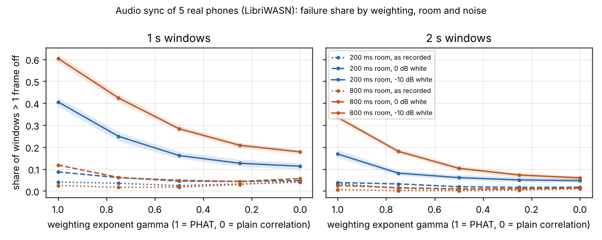
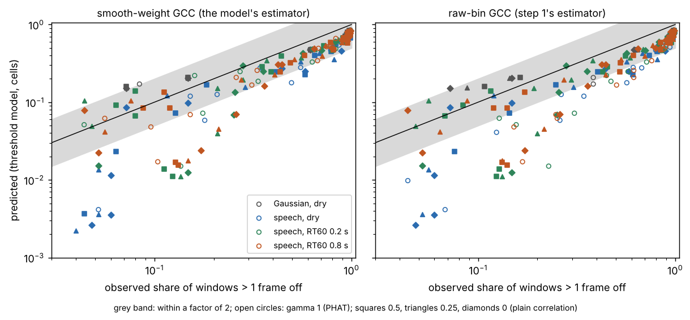

# capture-sync: how often does a short window of sound sync real phones and cameras to within a video frame?

A research programme ([`PROPOSAL.md`](PROPOSAL.md), [`LOG.md`](LOG.md)) on **audio sync of free-running cameras and phones**: how often a short window of shared sound fixes the offset between two recorders to within one 30 fps frame (33.3 ms) on real devices, rooms and clocks, and whether a confidence calibrated in one room or rig keeps its failure rate in another. Track 13 (`capture`, multi-angle capture for travel creators). It takes over the question the 18 earlier `capture-*sync*` and `capture-*audio*` projects asked with simulated delays and gallery clips. Produced with AI assistance (Claude); no affiliation with the LibriWASN authors or any device maker is implied.

**Live page:** https://marisstella.app/research/capture-sync/

**Headline (step 1, 2026-11-13, five real phones in two real rooms).** On LibriWASN, five smartphones recording the same speech on their own clocks (20 ten-minute sessions, a 200 ms and an 800 ms reverberation room):

- **Real phone clocks differ by up to 19 ppm** (median 13.7 ppm over the 200 pairs), and each pair's rate is the same within about 1 ppm from session to session and room to room. Our earlier sync projects assumed &plusmn;40 ppm.
- **GCC-PHAT is the worst weighting in real rooms once there is noise.** With white noise added at -10 dB, a 2 s window misses by more than a frame **17% of the time in the 200 ms room and 34% in the 800 ms room with PHAT, against 5% and 7% with partial whitening (gamma 0.25)**. That reverses [`capture-reverbsync`](../capture-reverbsync)'s result in simulated rooms and agrees with [`capture-realaudio`](../capture-realaudio)'s on dry clips.
- **The peak-to-sidelobe ratio is a good confidence** (AUROC 0.91 to 0.998 for 2 s windows). **A threshold calibrated in one room does not quite carry to the other.** Set in the drier room so that at most 1% of accepted windows are wrong, at -10 dB it lets 3.7% through wrong in the wetter room (gamma 0.25; PHAT 5.5%).



**Step 2a (2026-11-13): can theory say in advance how often a window will miss?** Ianniello's (1982) threshold model of the gross error in time-delay estimation, extended here to weighted GCC and fed with each window's own measured spectra, was checked against 84,000 simulated windows (Gaussian signals, and real read speech from MS-SNSD with real recorded babble in statistical rooms; LibriWASN was out of reach from this session):

- **On real speech the model predicts the miss rate within a factor of two in 137 of 171 scored cells (80%)**, met the pre-registered 75% bar, and errs on the low side (median predicted/observed 0.6 to 0.74). It fails worst on 0.5 s windows at 0 dB, where it underpredicts in all 22 cells, and does better in the 0.8 s room (85%) than dry (67%), the opposite of what we expected.
- **Raw-bin PHAT, the textbook estimator, misses more than its own smoothed-weight version**: over the speech cells 39.7% against 32.6%, and at -10 dB with white noise in the 0.8 s room 25% against 6% for 2 s windows. That rough per-bin normalisation is part of why PHAT came last in step 1. For plain correlation, raw and smoothed are the same estimator, and they match exactly.
- **With real babble the ranking flips.** When the noise is itself speech (babble, independent per device), PHAT is the best weighting and plain correlation the worst: 2 s windows at -10 dB in the 0.8 s room miss 50% with raw PHAT against 70% with gamma 0.25 and 79% with plain correlation (smoothed PHAT 31%). So step 1's "partial whitening, not PHAT" holds for white noise only. This was not a pre-registered prediction.
- **The model's probability works as a blind confidence for PHAT**: computed from spectra aligned at the window's own estimate, it flags PHAT failures better than the peak-to-sidelobe ratio in all 12 scored 2 s speech cells (median AUROC 0.85 against 0.74), but not for gamma 0.25 or less.



## What is and is not real

| input | value | source |
|---|---|---|
| Recordings | 5 smartphones (Nexus, Pixel 6a, Pixel 6 &times;2, Pixel 7, Xiaomi), 16 kHz mono | LibriWASN, subsets `200_0S` and `800_0S` (Schmalenstroeer, Gburrek and Haeb-Umbach 2023; Zenodo [doi:10.5281/zenodo.10952434](https://doi.org/10.5281/zenodo.10952434), CC BY 4.0), fetched at run time, **not copied into this repository** |
| Content | loudspeaker playback of LibriSpeech read speech, single talker at a time with 0.1 to 0.5 s pauses | LibriCSS design (Chen et al. 2020, [arXiv:2001.11482](https://arxiv.org/abs/2001.11482)) |
| Rooms | about 200 ms and about 800 ms reverberation time | dataset description |
| Clock drift, reverberation, device responses | real | the recordings |
| Start offset between recorders | **simulated**: the published files start within 4 ms of each other, so the search is centred on the reference plus an error uniform in &plusmn;1 s and searches &plusmn;1.5 s | design choice, as `capture-realaudio` (0.2 to 0.8 s) |
| Noise | as recorded, or **synthetic** white noise added independently per phone at 0 and -10 dB window SNR | design choice |
| Failure | more than 33.3 ms (one 30 fps frame) from the reference line | as the earlier `capture-*sync*` projects |

## Method (`src/capture_sync/sync.py`, `experiments/real-devices/run.py`)

1. **Coarse offset** per pair from a PHAT correlation of the whole decimated files.
2. **Reference line** per pair: GCC-PHAT on 20 s windows every 10 s, searched &plusmn;0.25 s around the coarse offset, and a Theil-Sen line through them (offset and clock-rate difference). It is checked three ways without ground truth: the share of windows within 5 ms of the line, the largest gap between the PHAT line and a gamma 0.25 line, and **triple closure**: for every three phones, the a-b and b-c lines must add up to the a-c line.
3. **Short windows** of 0.5, 1, 2 and 4 s at 40 seeded random times per pair and session. The other phone's stretch is cut around the reference delay plus the simulated prior error, and the delay is estimated by GCC with weighting 1/|C|^gamma (gamma = 1 is PHAT, 0 plain correlation; band 100 to 4000 Hz; parabolic peak interpolation) for five gammas on the same windows and noise draws. The peak-to-sidelobe ratio (PSR) is kept as a confidence.
4. **Statistics.** Failure shares with 95% intervals from 2,000 bootstrap resamples of the 10 sessions per room (sessions are the independent unit). AUROC of PSR for failure. Gate transfer: the lowest PSR threshold whose accepted windows fail at most 1% in one room (noise levels pooled) is applied in the other.

## Reproduce

```bash
pip install numpy scipy pytest matplotlib
cd research/capture-sync
python -m pytest -q tests                                     # 13 tests, synthetic, no data needed
python experiments/real-devices/fetch.py ~/libriwasn 200_0S 800_0S   # ~1 GB, phone channels only
python experiments/real-devices/run.py ~/libriwasn --trials 40 --procs 4   # ~25 min on 4 cores
python experiments/real-devices/figure.py
python experiments/real-devices/bypair.py ~/libriwasn 200       # per-pair breakdown, ~15 min
# step 2a: real speech and babble from MS-SNSD (MIT), sparse clone of only the files read (~100 MB)
git clone --depth 1 --filter=blob:none --no-checkout https://github.com/microsoft/MS-SNSD ~/ms-snsd
cd ~/ms-snsd && git sparse-checkout init --no-cone && printf '/clean_test/clnsp1[0-9].wav\n/clean_test/clnsp[2-9][0-9].wav\n/clean_test/clnsp1[0-9][0-9].wav\n/noise_test/Babble_*\n' > .git/info/sparse-checkout && git checkout HEAD && cd -
OMP_NUM_THREADS=1 python experiments/threshold/run.py ~/ms-snsd --trials 250 --procs 4   # ~15 min on 4 cores
python experiments/threshold/figure.py
python experiments/threshold/libriwasn.py ~/libriwasn            # step 2b, not yet run
```

## Results (from [`experiments/real-devices/results.txt`](experiments/real-devices/results.txt))

**The reference is good to about 2 ms.** All 200 pair references kept at least 97% of their 20 s windows within 5 ms of the line (median residual 0.6 to 0.8 ms). Triple closure was median 0.5 ms (200 ms room) and 0.3 ms (800 ms room), at most 1.8 ms. PHAT and gamma 0.25 reference lines differ by at most 3.2 ms. Some of that is real: the loudspeaker that is playing changes the path lengths to the phones by up to a few ms. So errors below a couple of ms are not resolved here, and the frame criterion (33 ms) is 10 times the reference's error.

**Clock-rate differences (ppm, mean &plusmn; sd over 10 sessions).** The Nexus and the Xiaomi run about 14 to 18 ppm slow of the three Pixels (Nexus-Pixel 6a 16.8 &plusmn; 1.3 in the 200 ms room, 16.9 &plusmn; 0.7 in the 800 ms room); the two Pixel 6 phones and the Pixel 7 agree within 3 ppm, and Pixel 6b-Pixel 7 within 0.4. Over all pairs and sessions |SRO| has a median of 13.7 ppm and a maximum of 19.1. At 19 ppm a sync made once drifts one frame in 29 minutes.

**Share of windows more than a frame off** (95% session-bootstrap interval), selected cells; the full grid is in `results.txt`:

| room, noise | window | PHAT (gamma 1) | gamma 0.5 | gamma 0.25 | plain correlation (0) |
|---|---|---|---|---|---|
| 200 ms, as recorded | 2 s | 0.033 [0.029, 0.038] | 0.008 [0.004, 0.011] | 0.009 [0.005, 0.013] | 0.014 [0.010, 0.018] |
| 800 ms, as recorded | 2 s | 0.005 [0.004, 0.007] | 0.002 [0.001, 0.003] | 0.004 [0.002, 0.005] | 0.010 [0.007, 0.013] |
| 200 ms, 0 dB | 2 s | 0.038 [0.034, 0.042] | 0.019 [0.015, 0.024] | 0.016 [0.013, 0.020] | 0.017 [0.013, 0.022] |
| 800 ms, 0 dB | 2 s | 0.025 [0.022, 0.029] | 0.009 [0.007, 0.011] | 0.010 [0.007, 0.012] | 0.013 [0.010, 0.016] |
| 200 ms, -10 dB | 2 s | 0.169 [0.150, 0.188] | 0.060 [0.050, 0.073] | 0.050 [0.041, 0.063] | 0.047 [0.039, 0.058] |
| 800 ms, -10 dB | 2 s | 0.336 [0.322, 0.348] | 0.103 [0.092, 0.115] | 0.072 [0.063, 0.082] | 0.060 [0.051, 0.068] |
| 200 ms, -10 dB | 1 s | 0.406 [0.386, 0.426] | 0.162 [0.147, 0.179] | 0.126 [0.112, 0.143] | 0.113 [0.098, 0.129] |
| 800 ms, -10 dB | 1 s | 0.605 [0.586, 0.623] | 0.284 [0.271, 0.298] | 0.208 [0.196, 0.220] | 0.178 [0.168, 0.187] |
| either, as recorded | 0.5 s | 0.14 | 0.11 | 0.12 to 0.14 | 0.14 to 0.17 |

- **Weighting.** With added noise, failures fall steadily from PHAT towards plain correlation in both rooms, and at -10 dB the 1 s and 2 s intervals of PHAT and gamma 0.25 are far apart. Without added noise, the middle weightings (0.5 to 0.75) are best and plain correlation is a little worse.
- **Room.** At -10 dB the 800 ms room fails more than the 200 ms room at every weighting for windows up to 2 s; at 4 s the two are level (within 0.5 points). At 0 dB and as recorded, the 200 ms room is the worse one with PHAT (see the next point).
- **PHAT's floor as recorded.** In the 200 ms room PHAT fails 3.3% of 2 s windows and 2.6% of 4 s windows; longer windows barely help, which points at a fixed cause rather than noise. A per-pair rerun (`bypair.py`, 4 s windows, 200 per pair; [`bypair_200.txt`](experiments/real-devices/bypair_200.txt), [`bypair_800.txt`](experiments/real-devices/bypair_800.txt)) finds it **spread over all ten pairs** (PHAT 1.5% to 5.5% each in the 200 ms room, 0 to 1% in the 800 ms room), with the wrong peaks at scattered lags (no lag repeats more than twice). So it is neither one bad phone nor a fixed echo; gamma 0.25 removes nearly all of it (0 to 1% per pair). The cause is open (a candidate is a narrowband background sound in that room, which PHAT weights as much as speech); step 2 looks at the spectra.
- **Where a window is found, the error is small**: median 0.8 to 1.2 ms, 95th percentile 2 to 10 ms (2 s windows), about the reference's own error.

**PSR as a confidence (AUROC, good windows score higher).** At 2 s, 0.91 to 0.998 over rooms, noise levels and weightings; at 0.5 s, 0.80 to 0.98. It is weakest exactly where failures are commonest (PHAT at -10 dB in the 800 ms room).

**Gate transfer (2 s windows; threshold set in one room for at most 1% failure among accepted windows, noise levels pooled, applied in the other).**

| gamma | direction | kept | failure among kept, pooled | at -10 dB: kept, failure among kept (ungated) |
|---|---|---|---|---|
| 0.25 | 200 &rarr; 800 | 0.98 | 1.6% | 0.95, 3.7% (7.2%) |
| 0.25 | 800 &rarr; 200 | 0.97 | 0.6% | 0.95, 1.1% (5.0%) |
| 1 (PHAT) | 200 &rarr; 800 | 0.83 | 1.4% | 0.53, 5.5% (33.6%) |
| 1 (PHAT) | 800 &rarr; 200 | 0.88 | 0.8% | 0.72, 1.7% (16.9%) |

Averaged over noise levels the transferred gate lands within 2% of failures. In the hardest cell it does not: at -10 dB a threshold learned in the drier room is too lenient in the wetter one, because the same PSR means less there.

## Step 2a: threshold theory (`src/capture_sync/threshold.py`, `experiments/threshold/`)

**Question.** Does Ianniello's (1982) gross-error model predict how often a short window lands on a wrong lag (H4)? The pre-registered plan and predictions are in `LOG.md`, written before the full run.

**Why not LibriWASN.** This session's egress proxy refused zenodo.org (403), so the real-device check of H4 is step 2b. `experiments/threshold/libriwasn.py` is ready for it: it replays step 1's windows and noise draws exactly and adds the predictions. It ran end to end on a fake LibriWASN-shaped tree, but it has not been run on the real data.

**Model.** The correlator weight is W = (G<sub>xx</sub>G<sub>yy</sub>)<sup>-gamma/2</sup>, taken from smoothed spectra (gamma 1 is the SCOT weighting of Knapp and Carter 1976). The mean output at the true lag is mu = max over &plusmn;1 ms of &int;W Re(G<sub>xy</sub>e<sup>j2&pi;f&tau;</sup>)df. The spreads are sigma<sub>1</sub><sup>2</sup> = (1/2L)&int;W<sup>2</sup>G<sub>xx</sub>G<sub>yy</sub>df at wrong lags and sigma<sub>0</sub><sup>2</sup> = (1/2L)&int;W<sup>2</sup>(G<sub>xx</sub>G<sub>yy</sub> + Re G<sub>xy</sub><sup>2</sup>)df at the true lag. The largest of the wrong-lag outputs over 2.93 s of lag comes from M = 2B<sub>eff</sub>T independent cells (Ianniello's model, scored for H4) or from Rice's (1944) upcrossing rate. The spectra are Welch estimates (512-sample Hann segments, no overlap) of the two windows aligned at the true lag. Tests check the model against the textbook output SNR &radic;(2LB)/(1+N/S) and a Gaussian Monte Carlo.

**Grid.** Each cell is a combination of the following, with 250 trials per cell and gamma 1, 0.5, 0.25 and 0 scored on the same windows (84,000 windows):

- **source:** white Gaussian (dry, white noise at -10, -15 and -20 dB), or real read speech (MS-SNSD `clean_test`, 37 min, Reddy et al. 2019, MIT);
- **room:** dry, or a fresh statistical impulse response per device and trial (direct path plus a decaying Gaussian tail from 5 ms, RT60 0.2 or 0.8 s, DRR 0 dB, Polack 1993);
- **noise:** white, or real babble (MS-SNSD `noise_test/Babble_*`, a different stretch per device), at 0, -10 and -15 dB;
- **window:** 0.5, 1, 2 and 4 s.

Prior, search and failure rule are as in step 1. A cell is scored if it has at least 10 observed failures. It agrees if predicted/observed falls in [0.5, 2].

**Results** (from [`experiments/threshold/results.txt`](experiments/threshold/results.txt)):

| estimator, model | Gaussian (36 scored) | speech dry | speech RT60 0.2 s | speech RT60 0.8 s | all speech |
|---|---|---|---|---|---|
| smooth-weight GCC, cells (H4) | 32 (89%) | 29/43 | 53/63 | 55/65 | **137/171 (80%)** |
| smooth-weight GCC, Rice | 32 | 33/43 | 53/63 | 57/65 | 143/171 (84%) |
| raw-bin GCC (step 1), cells | 34 | 25/43 | 49/64 | 48/65 | 122/172 (71%) |

- The model **underpredicts on speech** (median predicted/observed 0.58 to 0.74 by room and gamma, against 0.84 on Gaussian signals). The misses cluster where few windows fail for noise reasons: all 22 scored cells at 0 dB with 0.5 s windows underpredict by more than a factor of two, while at -15 dB 82 of 83 scored cells agree.
- **The Gaussian misses are all one cell** (-10 dB, 0.5 s, every gamma), where the model predicts 0.15 to 0.17 against 0.07 to 0.08 observed.
- **Raw-bin against smooth weighting** (mean miss rate over the speech cells): PHAT 0.397 against 0.326, gamma 0.5 0.337 against 0.322, gamma 0.25 0.344 against 0.341, plain correlation 0.352 for both (the same estimator; their failure counts are identical in every cell).
- **2 s windows at -10 dB** (raw-bin, then smoothed, miss rate):

| room, noise | PHAT | gamma 0.5 | gamma 0.25 | plain |
|---|---|---|---|---|
| dry, white | 0.008 / 0.000 | 0 / 0 | 0 / 0 | 0 / 0 |
| dry, babble | 0.020 / 0.020 | 0.008 / 0.008 | 0.020 / 0.020 | 0.148 / 0.148 |
| RT60 0.2 s, white | 0.128 / 0.024 | 0 / 0 | 0 / 0 | 0 / 0 |
| RT60 0.2 s, babble | 0.472 / 0.336 | 0.428 / 0.392 | 0.588 / 0.556 | 0.704 / 0.704 |
| RT60 0.8 s, white | 0.252 / 0.056 | 0.008 / 0.004 | 0.004 / 0.008 | 0.008 / 0.008 |
| RT60 0.8 s, babble | 0.504 / 0.312 | 0.524 / 0.436 | 0.700 / 0.708 | 0.792 / 0.792 |

**Predictions** (`LOG.md`):

- (a) Gaussian, at least 90% of scored cells agree for every gamma: **failed narrowly** (8 of 9 per gamma, 89%; the one miss is the cell above).
- (b) H4 on speech, at least 75% agree: **held** (80%). The expected pattern, dry agreeing more than the 0.8 s room, **failed** (67% against 85%).
- (c) Raw PHAT misses more than twice the prediction in most scored cells at -10 dB or below: **failed** (20 of 41 speech cells, 1 of 9 Gaussian). At gamma 0, raw and smooth agree, as expected.
- (d) Exploratory: the blind theory probability beats PSR as a confidence for PHAT (12/12 cells), not for gamma 0.25 (6/9 cells, median AUROC 0.567 against 0.578).

**Limits of step 2a.** The rooms are statistical, not measured, and each device gets an independent tail. The delays and starts are simulated. The babble is independent per device, while in a real room both devices hear the same crowd. Each source stretch is a random cut from 37 minutes, so windows overlap. The spectra are oracle-aligned for the H4 score, which an estimator in the field cannot do (hence the blind variant in (d)). No intervals are reported on the agreement counts.

## Pre-registered predictions, step 1 (`LOG.md`)

- (a) H1, -10 dB, 2 s, the 800 ms room fails more than the 200 ms room: **held** for PHAT (0.336 vs 0.169) and for gamma 0.25 (0.072 vs 0.050; the intervals touch at 0.063).
- (b) H2, gamma 0.25 fails less than PHAT at 0 and -10 dB with 2 s windows in both rooms: **held** in all four cells.
- (c) H3, a gate set in one room keeps accepted failures at most 2% in the other (2 s, gamma 0.25): **held pooled** over noise levels (1.6% and 0.6%), **failed at -10 dB** from the 200 ms to the 800 ms room (3.7%).
- (d) As recorded, 2 s windows fail under 1% for every gamma in both rooms: **failed** (PHAT 3.3%, plain correlation 1.4%, gamma 0.75 1.2% in the 200 ms room).

## Limitations

- **One dataset, one kind of sound.** Read speech from a loudspeaker in a lab: no wind, crowds, music or traffic; the added noise is white and independent per phone, which real ambient noise is not (a crowd is heard by both cameras).
- **Phones, not cameras**, and the start offsets are simulated (the published files are pre-aligned). Camera audio adds codecs, AGC and frame-locked clocks.
- **Reference, not ground truth.** Errors below about 2 ms are not resolved. The reference uses PHAT on 20 s windows; the PHAT and gamma 0.25 references differ by at most 3.2 ms, which cannot move a 33 ms verdict except at the margin.
- **Windows within a session overlap in time and share the talker sequence**; the intervals resample whole sessions, so they are wider than per-window counts would suggest, as they should be.
- Two rooms are not a population of rooms: the transfer result is one pair of rooms in each direction.

## Next steps (milestones in `PROPOSAL.md`)

- Step 2b: run `experiments/threshold/libriwasn.py` on the LibriWASN phones (H4 on real devices) from a session that can reach zenodo.org.
- Babble shared between devices (one crowd heard by both), and why PHAT wins in babble: a whitening that adapts to the noise spectrum, not a fixed gamma.
- A conformal gate across the overlap subsets (two talkers at once) and the Paderborn time-varying-SRO set, and where exchangeability breaks.
- Baselines on equal windows: a Kammerl et al. (2014) style fingerprint sync and `paderwasn`'s online tracker.
- Real ambient noise (licensed recordings) shared between devices, then owner camera clips with a clapper reference.

## Owner steps

Record two or more of your own cameras with a clap at the start and end and a timecode or clapper reference, indoors and outdoors with wind; that is the camera-side ground truth this programme needs (milestone 7). Submitting the paper is an owner step.

## References

The Rice (1944) DOI and the MS-SNSD arXiv id were checked by web search on 2026-11-13, because `cite_check.py` could not reach doi.org or arxiv.org from that session.

The full related-work list, each entry checked, is in [`PROPOSAL.md`](PROPOSAL.md). Cited here: Knapp and Carter (1976), [doi:10.1109/TASSP.1976.1162830](https://doi.org/10.1109/TASSP.1976.1162830); Schmalenstroeer, Gburrek and Haeb-Umbach (2023), LibriWASN, [arXiv:2308.10682](https://arxiv.org/abs/2308.10682); Chen et al. (2020), LibriCSS, [arXiv:2001.11482](https://arxiv.org/abs/2001.11482); Kammerl et al. (2014), [doi:10.1109/ICASSP.2014.6854474](https://doi.org/10.1109/ICASSP.2014.6854474); Ianniello (1982), [doi:10.1109/TASSP.1982.1163992](https://doi.org/10.1109/TASSP.1982.1163992); Rice (1944), "Mathematical analysis of random noise", *Bell System Technical Journal* 23(3), [doi:10.1002/j.1538-7305.1944.tb00874.x](https://doi.org/10.1002/j.1538-7305.1944.tb00874.x); Polack (1993), "Playing billiard in the concert hall: the mathematical foundations of geometrical room acoustics", *Applied Acoustics* 38, 235-244 (DOI not checked: doi.org was unreachable from this session; details from the author's publication list); Reddy et al. (2019), "A scalable noisy speech dataset and online subjective test framework" (MS-SNSD), Interspeech, 1816-1820, [arXiv:1909.08050](https://arxiv.org/abs/1909.08050).

## Outside dependencies

Python, NumPy, SciPy (decimation in the coarse offset), Matplotlib (figure), pytest; the LibriWASN recordings from Zenodo (CC BY 4.0); for step 2a, MS-SNSD speech and babble from GitHub (MIT), read at run time and not copied.
