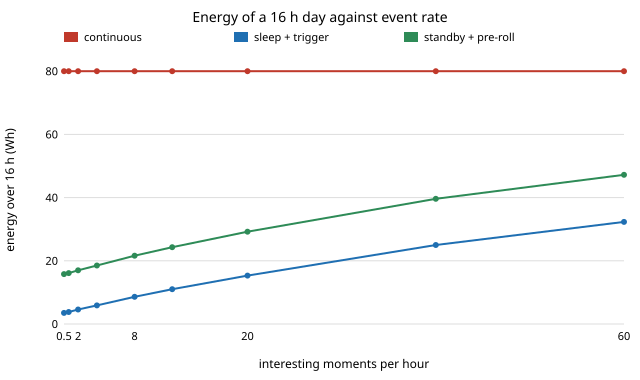

# capture-trigger: does recording only when something happens save a travel creator's battery, and what does it cost in missed moments?

Sixth project of track 13, autonomous multi-angle capture for travel creators (`PROJECTS.md`; a new question beyond milestones 1 to 6, on the energy side of `capture-kit` and `capture-rig`). Several cameras filming all day need several 100 Wh batteries; a camera that records only around interesting moments needs far fewer. This project simulates that trade on a **synthetic day with assumed device figures** (not measured). **Headline:** with 6 interesting 30 s moments an hour, a trigger that misses 10% and raises 2 false alarms an hour, a camera on a standby-with-10 s-pre-roll mode uses 19.4 Wh over a 16 h day against 80 Wh recording continuously (76% less) and captures 90% of the interesting seconds; a deep-sleep camera uses 7.7 Wh but captures 69%, because it wakes too slowly to catch the start. The share captured is set by the trigger's miss rate and the wake latency, not by the battery. Energy only becomes the deciding limit with a rig: four cameras need 320 Wh continuous (four 99 Wh packs) but 78 Wh triggered (one pack). Produced with AI assistance (Claude).

**Live page:** https://duncan-haywood.github.io/monorepo-projects/research/capture-trigger/

**Builds on.** `capture-kit` (the 100 Wh carry-on battery rule and recording hours against carried weight), `capture-rig` (several cameras at once) and `capture-edit` (what the edit does with the footage). Pre-roll buffering is the ordinary "pre-record" feature of action cameras and security cameras; no paper is reproduced. No lab in `prompt.md` covers this, and none is claimed.

## Method (`src/capture_trigger/model.py`)
- **Day.** 16 waking hours at 1 s steps. Interesting moments are a Poisson process; duration is Gaussian around 30 s (floor 3 s).
- **Modes (all figures assumed).** *Continuous*: 5 W throughout. *Sleep + trigger*: 0.15 W idle, 5 W recording, 6 s from trigger to recording, no buffer. *Standby + pre-roll*: 0.9 W idle, 5 W recording, 2 s latency, a 10 s buffer that back-fills the start.
- **Trigger (assumed).** Fires 1 s after an event starts, misses 10% of events outright, 2 false alarms an hour, and keeps recording 15 s after the last trigger.
- **Metrics.** Watt-hours over the day; share of interesting seconds that are on tape; 99 Wh packs needed (every pack under the 100 Wh carry-on limit). A closed form and a simulation of 20 days agree (tests check both).

## Reproduce
```
cd research/capture-trigger
PYTHONPATH=src python3 -m pytest -q tests
python3 experiments/run.py && python3 experiments/figure.py
```

## Results (from `experiments/results.txt`; deterministic)


- **Energy (A).** Continuous is 80.0 Wh. At 1 moment an hour, sleep + trigger uses 3.8 Wh and standby + pre-roll 16.1 Wh; at 12 an hour, 11.0 and 24.3; at 60 an hour (an event half the time), 32.3 and 47.2. Standby never reaches the continuous figure within the feasible rates.
- **Coverage (B).** Roughly flat in event rate: standby + pre-roll captures 0.89 to 0.91 of event seconds, sleep + trigger 0.68 to 0.74. Both lose the 10% the trigger misses; sleep also loses the first 7 s of each caught event.
- **Miss rate (C).** Coverage falls one-for-one with misses: standby captures 1.000, 0.900, 0.700 and 0.500 at miss 0, 0.1, 0.3 and 0.5.
- **Break-even (D).** The event rate at which triggering costs as much as continuous is 88 an hour for standby with 30 s events, which is above what 30 s events can fill (up to 120 an hour back to back). With 120 s events, sleep + trigger never saves energy. In practice triggering saves energy at any realistic rate.
- **Standby draw (E).** The idle draw is what you pay for pre-roll: at 0.9 W the saving is 76%, at 2.5 W 46%, at 4 W 19%.
- **Packs (F).** One camera fits one 99 Wh pack in every mode. Four cameras: continuous 4 &times; 80 = 320 Wh (four packs), standby + pre-roll 4 &times; 19.4 = 78 Wh (one pack). This multiplication is arithmetic on (F), not a separate simulation.

## Limitations
- **Every device figure is assumed**, not taken from a datasheet. Real action cameras idle at several watts and need seconds to boot; a 0.9 W camera with a pre-roll buffer is a design target, not a product claim.
- **The trigger is a probability, not a detector.** Misses are independent per event and do not depend on distance, light or sound. Real triggers (audio, motion, a person detector) miss in runs and differ with the scene.
- **Events do not overlap and "interesting" is a label.** A creator's best moments are not known in advance; the model assumes they are what the trigger is aimed at. The closed-form break-even ignores overlap, so rates near 120 an hour are not reachable.
- **Heating, storage and the edit are left out:** triggered footage also cuts storage, which this does not count, and short clips give the edit (`capture-edit`) less to choose between. Simulated is not real.

## Next steps
- Measure idle and wake figures from datasheets or a bench log of an open camera board, and replace the assumed ones.
- Drive the trigger from the `capture-edit` quality score or the `capture-bystander` detector and fit real miss rates.
- Share one trigger across a rig, so one standby camera wakes the others (rig energy against latency).

## Owner steps
Bench-measure a real camera's idle, wake and recording power before relying on any figure here.

## Outside dependencies
None. Python standard library only; pytest for the tests.
