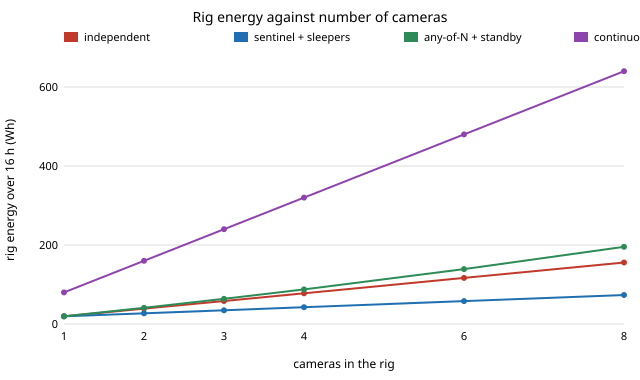

# capture-wake: when a camera rig records only on a trigger, should every camera have its own, or should one wake the rest?

Seventh project of track 13, autonomous multi-angle capture for travel creators (`PROJECTS.md`; the first "Next step" of `capture-trigger`, shared across a rig). A rig of four cameras filming the same moments can give each camera its own trigger, or let one sentinel camera (or any camera) wake the others by radio. This project simulates that on a **synthetic day with assumed device figures** (not measured). **Headline:** with 6 thirty-second moments an hour, a 10% per-detector miss rate and 2 false alarms an hour per detector, four standby cameras with their own triggers use 80 Wh of the 320 Wh a continuous rig needs, but all four angles are on tape for only 68% of the interesting seconds (about 0.9<sup>4</sup>): the misses are independent, so the angles you get differ from moment to moment. One sentinel waking the other three costs the same energy (80 Wh) and puts all four angles on 90.5% of the seconds, because a miss is now a miss for everyone. Letting any camera wake the rest lifts that to 100% (when misses are independent) for 92 Wh, but its energy rises with the number of detectors times the false-alarm rate (281 Wh at 40 false alarms an hour per detector, against 126 Wh for one sentinel). Sleeping the non-sentinel cameras halves the rig to 41.5 Wh but they miss the start of each moment (75% mean share). Produced with AI assistance (Claude).

**Live page:** https://duncan-haywood.github.io/oss-monorepo/research/capture-wake/

**Builds on.** `capture-trigger` (one camera, one trigger; same event process, hold time, and assumed device figures), `capture-rig` (several cameras at once) and `capture-kit` (the 100 Wh carry-on battery rule). Pre-roll buffering and wake-on-radio are ordinary features of action cameras and low-power radios; no paper is reproduced. No lab in `prompt.md` covers this, and none is claimed.

## Method (`src/capture_wake/model.py`)
- **Day and events.** As in `capture-trigger`: 16 waking hours at 1 s steps, Poisson moments, Gaussian duration around 30 s (floor 3 s). Every camera sees every moment.
- **Cameras (all figures assumed).** *Standby + pre-roll*: 0.9 W idle, 5 W recording, 2 s to record, 10 s buffer. *Sleep*: 0.15 W idle (including a wake-on-radio receiver), 5 W recording, 6 s to record, no buffer.
- **Detector.** Fires 1 s after a moment starts, holds 15 s, raises false alarms at a fixed rate. It misses a moment with probability 0.1; a `common` part of that miss is shared by every detector (a subject nothing hears) and the rest is independent per detector.
- **Strategies.** *independent*: every camera has a detector and records on its own only. *sentinel + sleepers*: camera 0 has the detector, the other three sleep and are woken over a 0.5 s radio hop. *sentinel + standby*: same, but all four are in standby. *any-of-N + standby*: every camera has a detector and any fire wakes all.
- **Metrics.** Rig Wh; mean per-camera share of interesting seconds captured; share on **every** camera and on **at least one**; packs of 99 Wh needed. A closed form (events non-overlapping) and a 20-day simulation are both reported and tests check they agree within 6% on energy and 0.04 on share.

## Reproduce
```
cd research/capture-wake
PYTHONPATH=src python3 -m pytest -q tests
python3 experiments/run.py && python3 experiments/figure.py
```

## Results (from `experiments/results.txt`; deterministic)


- **Strategies (A, 4 cameras, simulated).** Continuous 320 Wh (4 packs). Independent 80.2 Wh: mean per-camera share 0.904, every camera 0.676, at least one 1.000. Sentinel + sleepers 41.5 Wh: 0.751, 0.700, 0.906. Sentinel + standby 80.0 Wh: 0.905 on every camera. Any-of-N + standby 92.0 Wh: 1.000 on every camera. All the triggered rigs fit one 99 Wh pack; the continuous rig needs four.
- **Rig size (B, closed form).** Independent and sentinel + standby both cost about 19.4 Wh per camera. Sleepers cost 19.4 Wh for the sentinel plus 7.7 Wh per sleeper, so at eight cameras 73 Wh against 156 Wh. Any-of-N costs 195 Wh at eight cameras because false alarms multiply with detector count.
- **Shared misses (C).** If the whole 10% miss is shared (`common` = 0.1) every strategy gets the same 0.90 on every camera, and any-of-N's extra detectors buy nothing. At `common` = 0.05 it is 0.77 independent, 0.90 sentinel, 0.95 any-of-N. Any-of-N's advantage rests on detectors whose misses are independent, which is the thing to measure first.
- **False alarms (D, closed form).** One sentinel adds 1.3 Wh per extra false alarm an hour per detector, any-of-N 5.1 Wh. At 5 false alarms an hour any-of-N costs 103 Wh against the sentinel's 82 Wh; at 40 an hour, 281 against 126 Wh.
- **Radio hop (E).** With a 10 s pre-roll, a standby camera hides a radio hop up to 7 s with no loss (0.900). Beyond that coverage falls (0.833 at 10 s). A sleeper loses 0.742 even with an instant hop, because it needs 6 s to boot, and 0.585 at 7 s.

## Limitations
- **Every device figure is assumed**, not taken from a datasheet: the 0.9 W standby draw, the 0.15 W sleep draw with a radio receiver, the 6 s boot and the 0.5 s hop are design targets, not product claims. Standby draw dominates the verdict, as in `capture-trigger`.
- **Detectors are probabilities, not detectors.** Misses are independent per moment apart from the `common` part; real misses come in runs and depend on where each camera points and what it hears. The `common` split is one way to show the dependence, not a fit.
- **Every camera sees every moment.** In a real rig a camera behind the subject misses what a sentinel in front sees, and the sentinel's field of view limits what wakes the rest.
- **The closed form is about 3% under the simulation on energy** (77.8 against 80.2 Wh for independent) because it counts non-overlapping events; the tests allow 6%.
- **The radio hop for any-of-N is applied to every camera**, including the one that fired, which is a slightly pessimistic head loss. Storage, heating and the edit (`capture-edit`) are left out. Simulated is not real.

## Next steps
- Bench-measure standby and wake-on-radio draw on an open camera board and replace the assumed figures.
- Replace the independent-miss split with misses measured from footage (`capture-edit` quality score, `capture-bystander` detector) on cameras at different angles.
- Pick the sentinel's position: the camera whose view of the subject gives the lowest miss rate, using `capture-rig` geometry.

## Owner steps
Bench-measure a real camera's idle, wake and recording power, and a real wake-on-radio link's latency, before relying on any figure here.

## Outside dependencies
None. Python standard library only; pytest for the tests.
